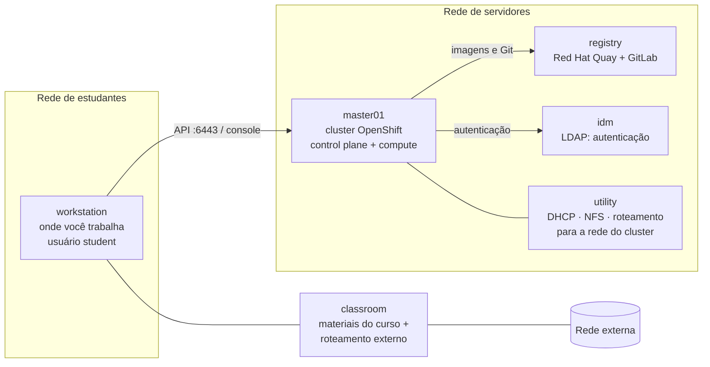

# Ambiente oficial de laboratório da Red Hat

| Campo | Valor |
|-------|-------|
| Referência | Capítulo 0 — *Orientation to the Classroom Environment*, PDF p. 8–12 |

Os exercícios do DO180 rodam em um ambiente fornecido pela Red Hat. Este
repositório **não** reproduz esse ambiente, **não** cria infraestrutura própria e
**não** registra suas senhas (elas estão na própria apostila e nos enunciados).

## Arquitetura do ambiente

- Cluster **Red Hat OpenShift Container Platform 4.22** em **nó único**, instalado em
  **bare metal** no modo **UPI** (*User Provisioned Infrastructure*).
- Todas as máquinas ficam no domínio DNS `lab.example.com`.
- O aluno tem **privilégios de administrador** do seu cluster dedicado.
- O registry é **privado e interno**: o ambiente não depende de acesso à internet.

## Papel de cada máquina

| Máquina | Papel | Se estiver indisponível... |
|---------|-------|----------------------------|
| `workstation` | Estação gráfica do aluno; onde se executam `lab`, `oc`, navegador | Não há como trabalhar |
| `master01` | O cluster OpenShift inteiro: control plane **e** compute | Não há cluster |
| `registry` | Registry privado **Red Hat Quay** com as imagens das atividades e servidor **GitLab** | Pods não baixam imagens; builds não acham código |
| `idm` | Serviço de identidade (LDAP) para autenticação e autorização no cluster | Login no cluster falha |
| `utility` | DHCP, NFS e roteamento para a rede do cluster | O cluster pode não funcionar ou travar no boot |
| `classroom` | Materiais do curso e roteamento para a rede externa | As demais máquinas podem não funcionar ou travar no boot |

⚠️ Um cluster de nó único é uma simplificação de treinamento. Em produção há
vários nós de control plane e de compute para alta disponibilidade.

## Pontos de acesso ao cluster

| Acesso | Endereço |
|--------|----------|
| Web console | `https://console-openshift-console.apps.lab.example.com` |
| API | `https://api.lab.example.com:6443` |
| Registry de imagens | `https://registry.lab.example.com:8443/` |
| GitLab | `https://git.lab.example.com` |

## Contas

| Conta | Onde | Perfil |
|-------|------|--------|
| `student` | Máquinas do aluno | Usuário de trabalho; também existe `root` |
| `developer` | Cluster OpenShift e registry | Usuário comum (desenvolvedor) |
| `admin` | Cluster OpenShift | Administrador do cluster |

> As senhas estão na seção de orientação da apostila (PDF p. 9–10) e são repetidas
> nos enunciados. Não as copie para este repositório.

## Registry da sala de aula

As imagens usadas nas atividades são **espelhos** de repositórios públicos
(`registry.redhat.io`, `registry.access.redhat.com`, `quay.io/redhattraining`,
`docker.io`), hospedados no registry interno com caminhos equivalentes. Ao ler um
enunciado, lembre-se de que a imagem vem do registry interno, não da internet. A
lista completa de correspondências está no PDF (p. 11–12).

Isso reforça o conceito de **referência completa de imagem** (registry +
repositório + tag), visto em [F1](../01-fundamentos-essenciais/01-containers-e-imagens.md).

## Ambientes próprios para praticar fora do curso

Para revisar conceitos, nunca para reproduzir os exercícios oficiais:

- **Red Hat OpenShift Local**: cluster local para testes.
- **Developer Sandbox**: acesso gratuito e temporário a um cluster compartilhado.

Ambos são citados no curso (seção 1.3) como opções de exploração, não de produção.

---
[← Roteiro de estudos](roteiro-de-estudos.md) | [Índice](README.md) | [Próximo: Preparação para os laboratórios →](preparacao-para-os-laboratorios.md)
