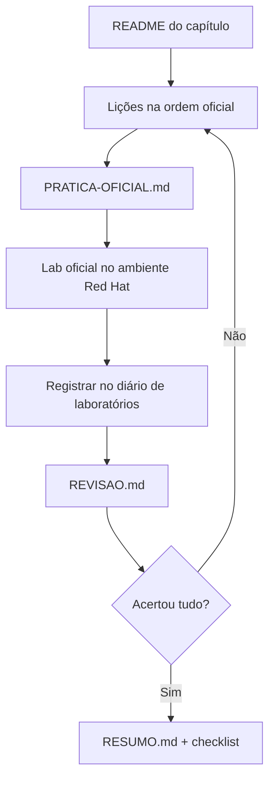

# Como usar este repositório

## A ideia central

A apostila oficial é longa e em inglês. Este repositório reorganiza o mesmo
currículo em lições curtas, em português, que respondem sempre às mesmas
perguntas: **o que é, que problema resolve, como se relaciona com o resto, como
o administrador usa, como verificar e o que pode dar errado.**

O laboratório continua sendo feito no ambiente da Red Hat. Aqui você chega ao
laboratório já sabendo **por que** cada passo existe.

## Como uma lição está organizada

| Parte | Conteúdo | Use para |
|-------|----------|----------|
| Identificação | Seção oficial, objetivo, pré-requisitos, páginas do PDF | Localizar-se no curso |
| A — Conceito | O problema e a solução, em linguagem própria | Primeira leitura |
| B — Modelo mental | Diagrama ou analogia técnica | Fixar a ideia |
| C — Na prática | Comandos e manifestos explicados | Consulta durante o lab |
| D — Relações | Comparações entre recursos que se confundem | Evitar erros conceituais |
| E — Preparação para o lab | Competências que a atividade exige | Antes do lab oficial |
| F — Fixação | 3 a 5 perguntas com respostas recolhíveis | Autoavaliação |
| G — Essencial | Lista curta para memorizar | Revisão rápida |

## O ciclo de estudo de um capítulo

## Convenções

- `comando` em bloco de código: algo que você digita.
- `<VALOR>` em maiúsculas: substitua pelo seu valor.
- **PDF p. NN**: página da apostila oficial para consulta excepcional.
- 📘 **Fonte externa**: informação vinda da documentação pública, não da apostila.
- ⚠️ **Alerta operacional**: erro comum ou ação que exige cuidado.

## Onde está cada coisa

- `01-fundamentos-essenciais/`: base conceitual, independente da numeração oficial.
- `capitulos/`: segue exatamente a numeração do DO180 4.22.
- `consulta-rapida/`: tabelas para consulta diária.
- `exemplos-originais/`: manifestos autorais para leitura e testes em clusters próprios.
- `progresso/`: checklists, diário de laboratórios e mapa de objetivos.
- `modelos/`: modelos usados para escrever novas lições.

---
[← Sobre o curso](sobre-o-curso.md) | [Índice](README.md) | [Próximo: Roteiro de estudos →](roteiro-de-estudos.md)
