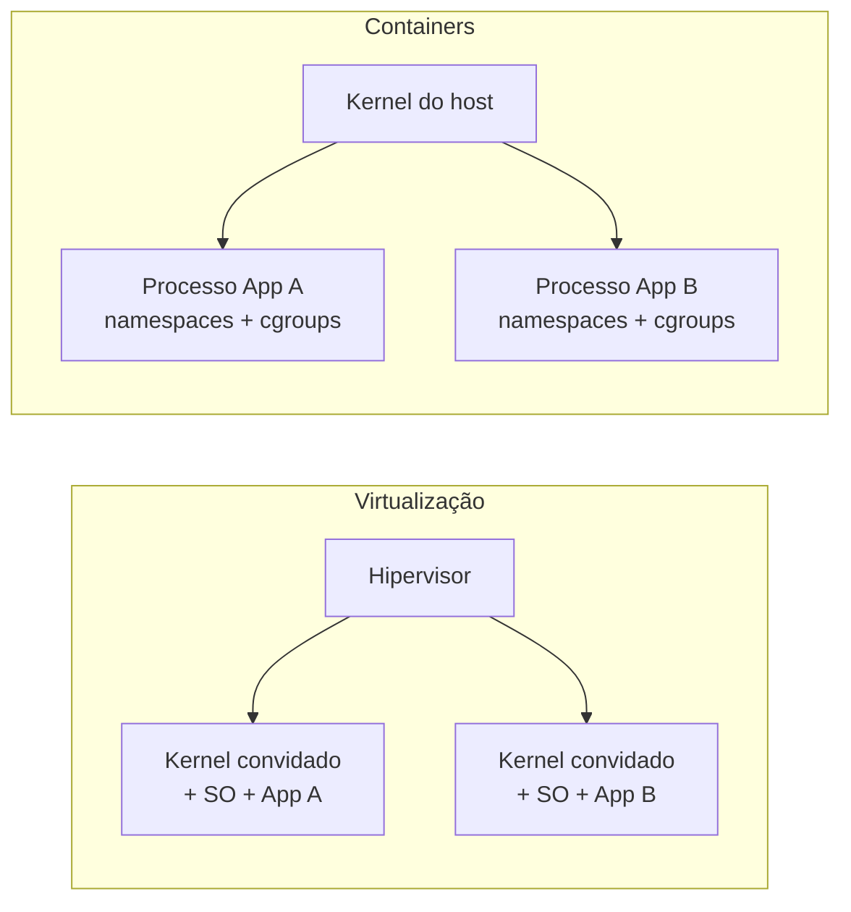
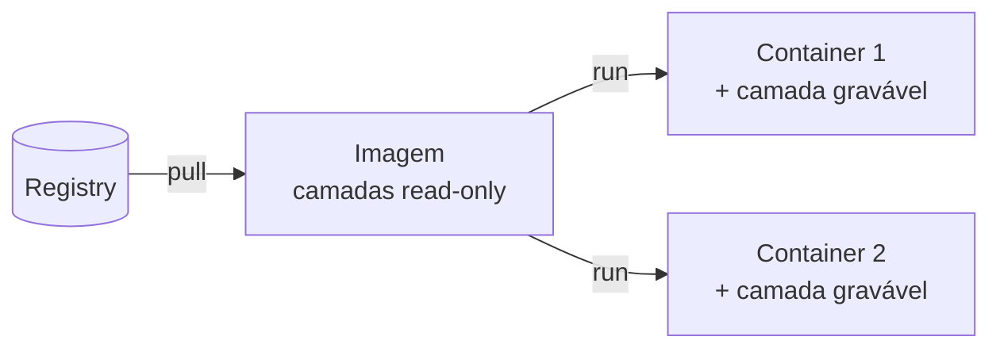

# F1 — Containers e imagens

| Campo | Valor |
|-------|-------|
| Curso | DO180 — OpenShift 4.22 |
| Módulo | Fundamentos essenciais (autoral, sem seção oficial correspondente) |
| Objetivo | Entender o que é um container no Linux, o que é uma imagem OCI e como as duas coisas se relacionam |
| Pré-requisitos | Processos Linux, sistema de arquivos, noções de virtualização |
| Prepara para | Seção 1.1 e Capítulo 3 |

## Parte A — Entendendo o conceito

### O problema

Uma aplicação depende de bibliotecas, runtime (Java, Python, Node.js), arquivos de
configuração e versões específicas de pacotes. Instalar tudo isso direto no
sistema operacional do servidor gera três problemas clássicos:

1. **Conflito de dependências**: a aplicação A precisa de OpenSSL 1.1; a B, de 3.0.
2. **"Na minha máquina funciona"**: o ambiente de desenvolvimento difere do de produção.
3. **Densidade baixa**: para isolar, cria-se uma VM por aplicação, cada uma com seu kernel.

### A solução: container

Um **container é um processo Linux** (ou grupo de processos) que roda isolado dos
demais, enxergando apenas o próprio sistema de arquivos, a própria rede e os
próprios processos. Ele **não é uma máquina virtual**: não há kernel próprio.
Todos os containers de um host compartilham o kernel do host.

O isolamento vem de dois recursos do kernel:

| Recurso do kernel | O que faz | Exemplo |
|-------------------|-----------|---------|
| **Namespaces** | Limitam o que o processo **enxerga** | PID (vê só os próprios processos), NET (interfaces próprias), MNT (sistema de arquivos próprio), UTS (hostname), IPC, USER |
| **cgroups** (control groups) | Limitam o que o processo **consome** | Máximo de memória, cota de CPU |

Somam-se a isso camadas de segurança como **SELinux** e **seccomp**, que o
OpenShift usa intensamente.

### Imagem

A **imagem** é o pacote imutável a partir do qual o container nasce. Ela contém o
sistema de arquivos da aplicação (binários, bibliotecas, configurações padrão) e
metadados (comando inicial, variáveis de ambiente, porta exposta, usuário).

- A imagem é formada por **camadas** (*layers*) somente leitura, empilhadas.
- Ao iniciar o container, o runtime adiciona uma **camada gravável** por cima.
- Quando o container é removido, essa camada gravável **é descartada**.
  Por isso dados persistentes precisam de volumes (lição F7).

O padrão **OCI** (*Open Container Initiative*) define o formato da imagem, a forma
de distribuí-la e o comportamento do runtime. Imagens OCI rodam em qualquer
ferramenta compatível: Podman, CRI-O, containerd.

### Registry

Um **registry** é o servidor que armazena e distribui imagens, como
`registry.redhat.io`, `quay.io` ou o registry interno do OpenShift. A referência
completa de uma imagem tem este formato:

```text
registry.access.redhat.com/ubi9/ubi-minimal:9.4
└──────── registry ───────┘└ repositório ┘└tag┘
```

A tag é um **rótulo móvel**: `latest` hoje pode apontar para outro conteúdo amanhã.
A identificação imutável é o **digest** (`@sha256:...`). Isso será central no
Capítulo 7.

### Runtime e ferramentas

| Ferramenta | Papel | Onde aparece |
|------------|-------|--------------|
| **Podman** | Ferramenta de linha de comando para criar, rodar e inspecionar containers sem daemon | Sua estação de trabalho |
| **Skopeo** | Inspeciona e copia imagens entre registries sem baixá-las para rodar | Estação de trabalho |
| **CRI-O** | Runtime de containers usado pelo kubelet nos nós do OpenShift | Cada nó do cluster |
| **runc / crun** | Runtime de baixo nível que de fato cria os namespaces e cgroups | Chamado pelo Podman/CRI-O |

## Parte B — Modelo mental



Analogia técnica: a **imagem está para o container assim como um executável está
para um processo**. Um executável em disco pode originar vários processos; uma
imagem pode originar vários containers. Apagar o processo não apaga o executável.



## Parte C — Funcionamento na prática

Os comandos abaixo usam **Podman** em uma máquina Linux própria, apenas para
consolidar os conceitos. No cluster, quem roda containers é o CRI-O.

### `podman pull`

- **Finalidade:** baixar uma imagem do registry para o armazenamento local.
- **Contexto:** usuário comum (Podman *rootless*); registries como `registry.redhat.io` exigem `podman login`.
- **Sintaxe:** `podman pull registry.access.redhat.com/ubi9/ubi-minimal:latest`
- **Resultado esperado:** download das camadas e o ID da imagem no final.
- **Verificar:** `podman images` lista a imagem.
- **Erros comuns:** `unauthorized` (falta login), `manifest unknown` (tag inexistente), erro de nome curto ambíguo (use o nome completo com registry).

### `podman run`

- **Finalidade:** criar e iniciar um container a partir de uma imagem.
- **Sintaxe:** `podman run --rm -it registry.access.redhat.com/ubi9/ubi-minimal:latest cat /etc/os-release`
- **Parâmetros importantes:** `--rm` remove o container ao final; `-it` terminal interativo; `-d` em segundo plano; `-p 8080:8080` publica porta; `--name` nomeia; `-e VAR=valor` define variável.
- **Resultado esperado:** o conteúdo de `/etc/os-release` **da imagem**, não do host.
- **Verificar:** `podman ps -a` mostra containers, inclusive os parados.

### `podman inspect` e `skopeo inspect`

- **Finalidade:** ler os metadados (comando padrão, variáveis, usuário, portas, digest).
- **Sintaxe:** `podman inspect <imagem-ou-container>`; `skopeo inspect docker://<registry>/<repo>:<tag>` consulta sem baixar.
- **Como interpretar:** procure `Cmd`/`Entrypoint` (o que roda), `User`, `ExposedPorts`, `Env` e `Digest`.

### Observando o isolamento

```bash
# No host: centenas de PIDs em /proc
ls /proc | grep -cE '^[0-9]+$'
# Dentro do container: só os processos do próprio container (namespace PID)
podman run --rm registry.access.redhat.com/ubi9/ubi-minimal:latest \
  sh -c "ls /proc | grep -E '^[0-9]+$'"
```

O container lista apenas um ou dois PIDs, começando pelo `1`. Usamos `/proc`
porque a imagem *minimal* nem traz o comando `ps`: uma imagem contém só o que
a aplicação precisa.

## Parte D — Relações importantes

| Conceito | Versus | Diferença essencial |
|----------|--------|---------------------|
| Container | Máquina virtual | Container compartilha o kernel do host; VM tem kernel próprio sobre hipervisor |
| Imagem | Container | Imagem é estática e imutável; container é a instância em execução com camada gravável |
| Tag | Digest | Tag é um rótulo que pode mudar; digest é o hash imutável do conteúdo |
| Podman | CRI-O | Podman é ferramenta de uso humano; CRI-O é runtime chamado pelo kubelet |
| Namespaces | cgroups | Namespaces isolam a **visão**; cgroups limitam o **consumo** |

## Parte E — Preparação para o laboratório

Antes da seção 1.1 e do Capítulo 3, você deve conseguir:

- Explicar por que um container é "apenas um processo".
- Dizer o que se perde quando um container é removido.
- Ler uma referência completa de imagem e separar registry, repositório, tag e digest.

## Parte F — Fixação

1. Um colega diz: "vou rodar uma imagem de Ubuntu em um host RHEL, então o container usa o kernel do Ubuntu". Está correto?
2. Dois containers foram criados da mesma imagem. Um deles grava um arquivo em `/tmp`. O outro enxerga o arquivo?
3. Qual recurso do kernel impede um container de consumir toda a memória do nó?
4. Por que usar `@sha256:...` em vez de `:latest` torna uma implantação reproduzível?

<details>
<summary>Respostas comentadas</summary>

1. **Não.** Containers compartilham o kernel do host. A imagem traz apenas o *userspace* (bibliotecas e utilitários) do Ubuntu; o kernel é o do RHEL. Por isso o kernel do host precisa ser compatível com o que a aplicação exige.
2. **Não.** Cada container tem sua própria camada gravável. As camadas da imagem são compartilhadas e somente leitura.
3. **cgroups.** Namespaces só isolam a visão; o limite de consumo vem dos cgroups. No Kubernetes, isso aparece como `resources.limits` (Capítulo 6).
4. O digest identifica um conteúdo exato e imutável. A tag `latest` pode passar a apontar para outra imagem, e duas implantações "iguais" rodariam códigos diferentes.

</details>

## Parte G — Essencial para memorizar

- Container = processo isolado por **namespaces** e limitado por **cgroups**; compartilha o kernel.
- Imagem = camadas **read-only** + metadados; container = imagem + camada **gravável descartável**.
- OCI padroniza imagem e runtime; Podman (estação) e CRI-O (nós do cluster) seguem o padrão.
- Referência: `registry/repositório:tag` ou `registry/repositório@sha256:digest`.
- ⚠️ Dado gravado dentro do container some quando ele é removido.

---
[← Fundamentos](README.md) | [Índice do módulo](README.md) | [Próximo: Arquitetura Kubernetes →](02-arquitetura-kubernetes.md)
