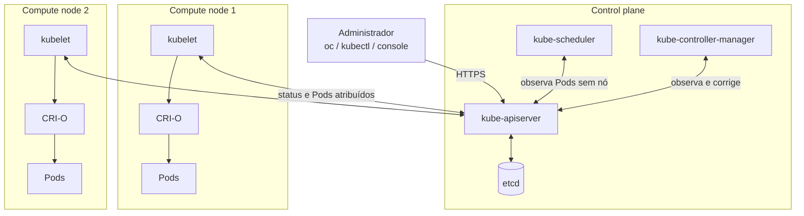
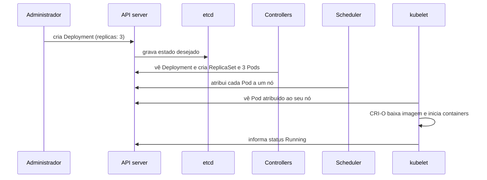

# F2 — Arquitetura Kubernetes

| Campo | Valor |
|-------|-------|
| Curso | DO180 — OpenShift 4.22 |
| Módulo | Fundamentos essenciais (autoral) |
| Objetivo | Identificar os componentes de um cluster Kubernetes, o papel de cada um e o ciclo de reconciliação |
| Pré-requisitos | [F1 — Containers e imagens](01-containers-e-imagens.md) |
| Prepara para | Seções 1.1, 1.7 e Capítulo 2 |

## Parte A — Entendendo o conceito

### O problema

Com Podman você roda containers **em um host**. Mas em produção é preciso:
distribuir containers por vários servidores, reiniciá-los se falharem, movê-los se
um servidor cair, balancear tráfego entre réplicas e atualizar versões sem
indisponibilidade. Fazer isso com scripts não escala.

### A solução: um cluster com estado desejado

O Kubernetes transforma vários servidores em um **cluster** e muda o modo de
trabalhar: em vez de dar ordens ("inicie 3 containers no servidor X"), você
**declara o estado desejado** ("quero 3 réplicas desta aplicação"). O cluster
trabalha continuamente para que o **estado observado** coincida com o desejado.

### Os dois papéis de nó

| Papel | Função | Componentes principais |
|-------|--------|------------------------|
| **Control plane** | Decide e coordena: guarda o estado, agenda Pods, reage a eventos | `kube-apiserver`, `etcd`, `kube-scheduler`, `kube-controller-manager` |
| **Compute (worker)** | Executa as cargas de trabalho | `kubelet`, runtime de containers (CRI-O no OpenShift), componente de rede/proxy |

No OpenShift os nós de control plane também são chamados de *master*, como o
`master01` do ambiente de laboratório.

### Componentes do control plane

| Componente | O que faz | Analogia operacional |
|------------|-----------|----------------------|
| **kube-apiserver** | Porta de entrada única. Toda leitura e escrita passa por ele, com autenticação, autorização e validação | Recepção de um datacenter: ninguém entra sem passar por ela |
| **etcd** | Banco chave-valor distribuído que guarda **todo** o estado do cluster | Fonte da verdade; só o API server fala com ele |
| **kube-scheduler** | Escolhe **em qual nó** cada Pod novo vai rodar, considerando recursos, regras e restrições | Ele decide, mas não inicia o Pod |
| **kube-controller-manager** | Executa os **controllers**, laços que comparam desejado × observado e agem | Ex.: controller de ReplicaSet cria Pods faltantes |

### Componentes de cada nó

| Componente | O que faz |
|------------|-----------|
| **kubelet** | Agente do nó: recebe do API server os Pods atribuídos ao nó, pede ao runtime que crie os containers, reporta status e executa health checks |
| **CRI-O** | Runtime que baixa imagens e cria containers via interface CRI |
| **Rede do cluster** | Plugin de rede (no OpenShift 4.22, OVN-Kubernetes) que dá IP aos Pods e implementa os Services |

### O ciclo de reconciliação

Este é o conceito mais importante do curso. **Controllers** observam objetos via
API server, comparam com a realidade e agem para eliminar a diferença. Isso se
repete o tempo todo, e não só no momento da criação. Por isso mudanças levam alguns
segundos para ter efeito e por isso o cluster "se conserta sozinho".

## Parte B — Modelo mental

Sequência ao pedir 3 réplicas:

## Parte C — Funcionamento na prática

Comandos de **leitura** que mostram a arquitetura em um cluster OpenShift. O
Capítulo 2 aprofunda a CLI.

| Comando | O que mostra | Permissão |
|---------|--------------|-----------|
| `oc get nodes` | Nós, status (`Ready`), papéis (`control-plane,master`, `worker`) e versão do kubelet | Leitura em nível de cluster (administrador) |
| `oc get nodes -o wide` | Também IPs, sistema operacional e versão do runtime | Idem |
| `oc describe node <nome>` | Capacidade, recursos alocados, condições (`MemoryPressure`, `DiskPressure`, `Ready`) e eventos | Idem |
| `oc get pods -n openshift-etcd` | Pods do etcd | Administrador |
| `oc get pods -n openshift-kube-apiserver` | Pods do API server | Administrador |

**Como interpretar `oc get nodes`:** `STATUS Ready` indica que o kubelet está
saudável e reportando. `NotReady` costuma indicar kubelet parado, falha de rede ou
pressão de recursos; o primeiro passo é `oc describe node`.

**Erros comuns:**
- `Forbidden`: usuário sem permissão de cluster (normal para desenvolvedor).
- `Unable to connect to the server`: endpoint errado ou API inacessível.

## Parte D — Relações importantes

| A | B | Diferença essencial |
|---|---|--------------------|
| Scheduler | kubelet | Scheduler **escolhe** o nó; kubelet **executa** o Pod no nó |
| API server | etcd | API server é a interface com validação; etcd é o armazenamento. Ninguém acessa o etcd diretamente |
| Estado desejado | Estado observado | `spec` = o que você pediu; `status` = o que o cluster relata |
| Controller | Operator | Controller é um laço de reconciliação; Operator é um controller especializado que gerencia uma aplicação complexa (F3) |
| Control plane | Hosted control plane | No modelo tradicional roda em nós dedicados; no hosted control plane roda como Pods em outro cluster |

## Parte E — Preparação para o laboratório

- Saber nomear os componentes do control plane e do nó.
- Explicar por que o `kubelet` e o `crio` são serviços **do sistema operacional do nó** (systemd), e não Pods. O Guided Exercise 1.8 verifica exatamente esses dois serviços.

## Parte F — Fixação

1. Você apaga manualmente um Pod que pertence a um Deployment de 3 réplicas. O que acontece e qual componente é responsável?
2. Se o scheduler parar, Pods que **já estão rodando** param?
3. Por que um nó com `STATUS NotReady` é investigado primeiro pelo kubelet?
4. Qual componente guarda a informação de que existem 3 réplicas desejadas?

Respostas comentadas

1. Um Pod substituto é criado. O controller de ReplicaSet (no kube-controller-manager) percebe 2 observados contra 3 desejados e cria um novo Pod; o scheduler o atribui a um nó e o kubelet o inicia.
2. **Não.** Pods existentes continuam sob responsabilidade dos kubelets. Novos Pods ficam `Pending` sem nó atribuído.
3. A condição `Ready` é reportada pelo kubelet. Se ele parou ou não alcança o API server, o nó vira `NotReady`.
4. O **etcd**, gravado pelo API server a partir do objeto Deployment.

## Parte G — Essencial para memorizar

- Control plane: **API server** (porta única), **etcd** (estado), **scheduler** (onde), **controllers** (reconciliação).
- Nó: **kubelet** (agente) + **CRI-O** (runtime) + rede.
- `spec` = desejado; `status` = observado; controllers fecham a diferença continuamente.
- ⚠️ Mudanças não são instantâneas: verifique o resultado depois de aplicar.

---
[← Containers e imagens](01-containers-e-imagens.md) | [Índice do módulo](README.md) | [Próximo: Arquitetura OpenShift →](03-arquitetura-openshift.md)
