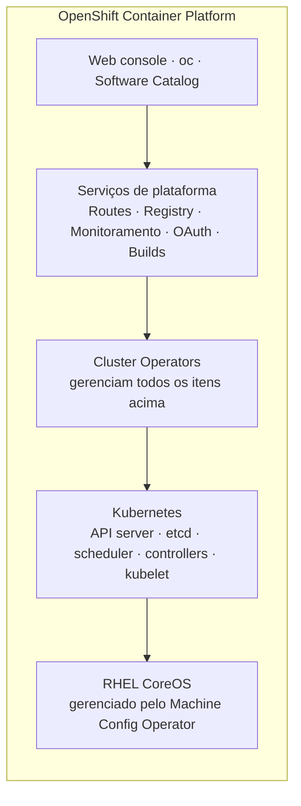

# F3 — Arquitetura OpenShift

| Campo | Valor |
|-------|-------|
| Curso | DO180 — OpenShift 4.22 |
| Módulo | Fundamentos essenciais (autoral) |
| Objetivo | Entender o que o OpenShift acrescenta ao Kubernetes e como a plataforma se gerencia por meio de Operators |
| Pré-requisitos | [F2 — Arquitetura Kubernetes](02-arquitetura-kubernetes.md) |
| Prepara para | Seções 1.3, 1.5, 1.7 e 2.5 |

## Parte A — Entendendo o conceito

### O problema

O Kubernetes, por projeto, **não é uma plataforma completa**. Ele oferece pontos
de extensão e deixa decisões em aberto: qual registry usar, como construir imagens,
como expor aplicações para fora, como monitorar, como instalar e atualizar o sistema
operacional dos nós. Cada empresa que usa Kubernetes "puro" precisa montar e manter
esse quebra-cabeça.

### A solução: OpenShift

O **Red Hat OpenShift Container Platform (RHOCP)** é uma distribuição de Kubernetes
que entrega essas peças integradas, testadas e suportadas. Tudo o que você sabe de
Kubernetes continua valendo; o OpenShift **adiciona**, não substitui.

| Área | O que o OpenShift adiciona |
|------|---------------------------|
| Sistema operacional | **RHEL CoreOS**: imutável, gerenciado pelo próprio cluster |
| Ciclo de vida da plataforma | Instalação e atualização automatizadas por Operators |
| Exposição de aplicações | **Route** e o Ingress Controller (HAProxy) |
| Imagens | Registry interno, **ImageStream**, builds (S2I) |
| Observabilidade | Monitoramento (Prometheus, Alertmanager, Thanos) pré-configurado; logging opcional |
| Segurança | Políticas restritivas por padrão (SCC), OAuth integrado |
| Experiência | **Web console** completa e a CLI **`oc`** |
| Multitenancy | **Project** (namespace com metadados e controle de criação) |

### Operators: como o OpenShift se gerencia

Um **Operator** é um controller que conhece uma aplicação específica e a gerencia
de forma declarativa: instala, configura, atualiza, corrige. No OpenShift 4 a
**própria plataforma** é composta por Operators.

- **Cluster Operators**: gerenciam componentes da plataforma (API server, DNS,
  ingress, console, monitoramento, rede, registry, Machine Config etc.). São
  listados por `oc get clusteroperators`.
- **Operators adicionais**: instalados pelo administrador a partir do
  **Software Catalog** do console (ex.: MetalLB, LVM Storage) e gerenciados pelo
  OLM (*Operator Lifecycle Manager*).

Cada Cluster Operator reporta três condições que você vai ler muito:

| Condição | Significado quando `True` |
|----------|---------------------------|
| `Available` | O componente está funcionando |
| `Progressing` | O componente está mudando de estado (atualização, rollout) |
| `Degraded` | O componente não atinge o estado desejado; investigar |

### Projeto versus namespace

Um **Project** é um namespace Kubernetes com anotações extras (nome de exibição,
descrição) e um fluxo de criação controlado pela plataforma. Na prática, para o
DO180: **todo projeto é um namespace**, e o `oc` permite alternar entre eles com
`oc project`. Namespaces que começam com `openshift-` e `kube-` pertencem à
plataforma.

## Parte B — Modelo mental

Pense no OpenShift como **Kubernetes + Operators que mantêm tudo o mais**. Quando
algo da plataforma falha, a primeira pergunta é: **qual Cluster Operator cuida
disso e o que ele reporta?**

## Parte C — Funcionamento na prática

| Comando | Finalidade | Permissão | Como interpretar |
|---------|-----------|-----------|------------------|
| `oc get clusterversion` | Versão do cluster e se há atualização em andamento | Leitura de cluster | `AVAILABLE True`, `PROGRESSING False` = estável |
| `oc get clusteroperators` (ou `oc get co`) | Saúde de cada componente da plataforma | Leitura de cluster | Procure qualquer linha com `DEGRADED True` ou `AVAILABLE False` |
| `oc get projects` | Projetos visíveis para o usuário | Qualquer usuário autenticado | Usuário comum vê apenas os seus |
| `oc new-project <nome>` | Cria projeto e já muda para ele | Usuário com permissão de self-provisioning | Aparece `Now using project "<nome>"` |
| `oc project` | Mostra o projeto atual | Qualquer usuário | Evita trabalhar no projeto errado |

⚠️ Em clusters de laboratório, o administrador **observa** os Cluster Operators.
Não altere componentes da plataforma sem um motivo e um procedimento.

## Parte D — Relações importantes

| A | B | Diferença essencial |
|---|---|--------------------|
| Kubernetes | OpenShift | OpenShift é uma distribuição de Kubernetes com plataforma completa em volta |
| Project | Namespace | Project = namespace + metadados + criação controlada; o escopo dos recursos é o mesmo |
| Cluster Operator | Operator do Software Catalog | O primeiro faz parte da plataforma; o segundo é opcional e adicionado pelo administrador |
| RHEL | RHEL CoreOS | RHEL CoreOS usa o mesmo kernel e pacotes do RHEL, mas é imutável e configurado pelo cluster (MachineConfig) |
| Route | Ingress | Ambos expõem HTTP(S) externamente; Route é o recurso nativo do OpenShift (Capítulo 4) |

## Parte E — Preparação para o laboratório

- Reconhecer, no console, onde ficam Operators instalados, nós, projetos e alertas.
- Distinguir namespaces da plataforma (`openshift-*`) dos projetos de aplicação.

## Parte F — Fixação

1. Por que se diz que, no OpenShift 4, "a plataforma é gerenciada por Operators"?
2. Um Cluster Operator mostra `AVAILABLE True` e `DEGRADED True`. Como interpretar?
3. Um desenvolvedor cria um projeto. Que objeto Kubernetes existe por baixo?
4. Por que não se recomenda instalar pacotes com `dnf` direto em um nó RHEL CoreOS?

Respostas comentadas

1. Componentes como API server, DNS, ingress, console e monitoramento são instalados e mantidos por Cluster Operators, que reconciliam o estado desejado como qualquer controller.
2. O componente funciona, mas não está plenamente no estado desejado (ex.: uma réplica falhando). Funciona, porém exige investigação.
3. Um **Namespace**. O Project é a visão OpenShift desse namespace.
4. O RHEL CoreOS é imutável e sua configuração é declarada via MachineConfig. Mudanças manuais divergem do estado desejado e podem ser revertidas ou causar inconsistência.

## Parte G — Essencial para memorizar

- OpenShift = Kubernetes + RHEL CoreOS + Operators + serviços de plataforma + console/`oc`.
- `oc get clusterversion` e `oc get co` são o "painel" da plataforma pela CLI.
- Condições: `Available`, `Progressing`, `Degraded`.
- Project = namespace com metadados; namespaces `openshift-*` são da plataforma.

---
[← Arquitetura Kubernetes](02-arquitetura-kubernetes.md) | [Índice do módulo](README.md) | [Próximo: Pods e workloads →](04-pods-e-workloads.md)
