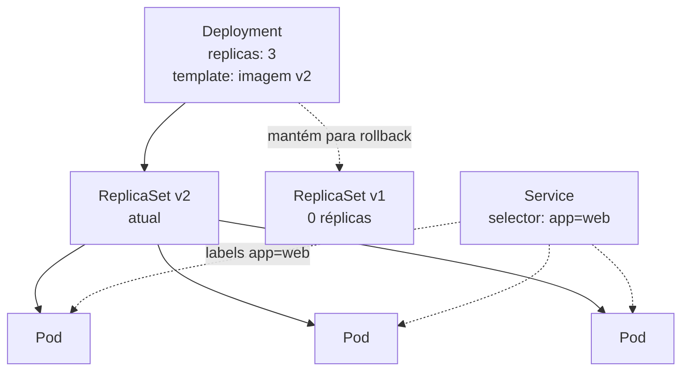

# F4 — Pods e workloads

| Campo | Valor |
|-------|-------|
| Curso | DO180 — OpenShift 4.22 |
| Módulo | Fundamentos essenciais (autoral) |
| Objetivo | Entender o Pod como unidade de execução e os controllers que gerenciam Pods (ReplicaSet, Deployment, StatefulSet, DaemonSet, Job, CronJob) |
| Pré-requisitos | [F2 — Arquitetura Kubernetes](02-arquitetura-kubernetes.md) |
| Prepara para | Capítulos 3, 4, 5 e 6 |

## Parte A — Entendendo o conceito

### Pod

O Kubernetes não agenda containers isolados: agenda **Pods**. Um Pod é um grupo de
**um ou mais containers** que:

- rodam sempre **no mesmo nó**;
- compartilham **o mesmo IP** e as mesmas portas (namespace de rede);
- podem compartilhar **volumes**.

O caso mais comum é um container por Pod. Vários containers no mesmo Pod só fazem
sentido quando são fortemente acoplados (ex.: um *sidecar* que coleta logs do
container principal).

### Por que não criar Pods "soltos"

Um Pod é **efêmero e descartável**. Se o nó cai, o Pod não é recriado sozinho. Se
você apagá-lo, ele some. Pods não se atualizam: para mudar a imagem, cria-se um Pod
novo. Por isso, em produção, quem cria Pods são **controllers de workload**: você
declara um modelo (*template*) e o controller mantém os Pods.

### Os controllers de workload

| Recurso | Para que serve | Comportamento chave |
|---------|----------------|---------------------|
| **Deployment** | Aplicações *stateless* de longa duração (web, APIs) | Mantém N réplicas idênticas e faz rollout/rollback de versões criando ReplicaSets |
| **ReplicaSet** | Garante N Pods idênticos | Normalmente **não** é criado à mão: o Deployment o gerencia |
| **StatefulSet** | Aplicações com identidade e dados próprios (bancos, filas) | Pods com nomes estáveis (`app-0`, `app-1`) e um volume por Pod |
| **DaemonSet** | Um Pod por nó (agentes de log, monitoramento, rede) | Novo nó → novo Pod automaticamente |
| **Job** | Tarefa que roda até terminar (migração, backup) | Sucesso = Pod termina com código 0 |
| **CronJob** | Job agendado (sintaxe cron) | Cria Jobs nos horários definidos |

### Labels e selectors: a cola entre objetos

Objetos Kubernetes **não se ligam por nome**, e sim por **labels** (pares
chave=valor em `metadata.labels`) e **selectors** (filtros sobre labels).

- O Deployment encontra seus Pods pelo `selector`.
- O Service encontra os Pods para os quais envia tráfego pelo `selector`.
- Você filtra a saída da CLI com `-l chave=valor`.

Um label errado é uma das causas mais comuns de "o Service não tem endpoints".

### Ciclo de vida do Pod

| Fase (`status.phase`) | Significado |
|-----------------------|-------------|
| `Pending` | Aceito, mas ainda não rodando (aguardando nó, baixando imagem) |
| `Running` | Ao menos um container rodando |
| `Succeeded` | Todos os containers terminaram com sucesso (típico de Job) |
| `Failed` | Ao menos um container terminou com erro e não será reiniciado |
| `Unknown` | O nó não reporta |

A coluna `STATUS` do `oc get pods` mostra mais detalhes que a fase, como
`ContainerCreating`, `CrashLoopBackOff`, `ImagePullBackOff` e `Completed`. O
diagnóstico desses estados é o tema da seção 3.5.

## Parte B — Modelo mental



Hierarquia: **Deployment → ReplicaSet → Pods → containers**. Você trabalha no topo;
os níveis de baixo são consequência.

## Parte C — Funcionamento na prática

Manifesto mínimo de Deployment (original, para leitura):

```yaml
apiVersion: apps/v1
kind: Deployment
metadata:
  name: web
  labels:
    app: web
spec:
  replicas: 3
  selector:
    matchLabels:
      app: web            # o Deployment gerencia Pods com este label
  template:               # modelo de cada Pod
    metadata:
      labels:
        app: web          # precisa casar com o selector acima
    spec:
      containers:
        - name: web
          image: registry.access.redhat.com/ubi9/httpd-24:latest
          ports:
            - containerPort: 8080
```

| Comando | Finalidade | Como verificar / interpretar |
|---------|-----------|------------------------------|
| `oc get pods` | Lista Pods do projeto atual | Colunas `READY` (containers prontos/total), `STATUS`, `RESTARTS` |
| `oc get pods -l app=web` | Filtra por label | Deve listar só os Pods do selector |
| `oc get deployment,replicaset,pod` | Mostra a hierarquia | Nome do Pod = `<deployment>-<hash RS>-<sufixo>` |
| `oc delete pod <nome>` | Remove um Pod | Se pertencer a um Deployment, outro Pod surge em segundos |
| `oc scale deployment/web --replicas=5` | Altera o estado desejado | `oc get deployment web` mostra `5/5` quando concluído |

**Erros comuns:**
- `selector` não casa com os labels do `template` → o API server rejeita o Deployment.
- Editar o ReplicaSet à mão → o Deployment sobrescreve na próxima reconciliação.

## Parte D — Relações importantes

| A | B | Diferença essencial |
|---|---|--------------------|
| Pod | Container | Pod é a unidade agendável; pode conter vários containers que compartilham rede |
| Pod | Deployment | Pod é descartável; Deployment garante réplicas e versões |
| Deployment | ReplicaSet | Deployment gerencia versões; ReplicaSet só mantém a contagem de uma versão |
| Deployment | StatefulSet | Deployment: réplicas intercambiáveis; StatefulSet: identidade e armazenamento por Pod |
| Job | Deployment | Job deve terminar; Deployment deve continuar rodando |
| Label | Annotation | Label é usado por selectors; annotation guarda metadados sem filtragem |

## Parte E — Preparação para o laboratório

- Explicar por que um Pod apagado "volta" e outro não volta.
- Ler o nome de um Pod e deduzir o Deployment ao qual pertence.
- Saber que `CrashLoopBackOff` e `ImagePullBackOff` são sintomas a investigar com `oc describe` e `oc logs` (Capítulos 2 e 3).

## Parte F — Fixação

1. Dois containers no mesmo Pod podem escutar ambos na porta 8080?
2. Você precisa rodar um script de migração de banco uma única vez. Qual workload usar?
3. Por que mudar a imagem de um Deployment cria um novo ReplicaSet?
4. Um Service tem `selector: app=api`, mas os Pods têm o label `app: API`. O que acontece?

<details>
<summary>Respostas comentadas</summary>

1. **Não.** Containers de um Pod compartilham o namespace de rede; duas escutas na mesma porta conflitam.
2. Um **Job**. Ele roda até a conclusão e registra sucesso ou falha. Um Deployment reiniciaria o script para sempre.
3. Cada ReplicaSet representa uma versão do template. O Deployment cria o novo, escala-o e reduz o antigo (rollout), mantendo o antigo para rollback.
4. Labels diferenciam maiúsculas de minúsculas. O selector não encontra nenhum Pod e o Service fica sem endpoints.

</details>

## Parte G — Essencial para memorizar

- Pod = 1+ containers, mesmo nó, mesmo IP; é **efêmero**.
- Deployment → ReplicaSet → Pod. Trabalhe no Deployment.
- StatefulSet = identidade + volume por Pod; DaemonSet = 1 Pod por nó; Job = até terminar; CronJob = Job agendado.
- Labels + selectors ligam os objetos; são *case-sensitive*.

---
[← Arquitetura OpenShift](03-arquitetura-openshift.md) | [Índice do módulo](README.md) | [Próximo: Kubernetes API e YAML →](05-kubernetes-api-e-yaml.md)
