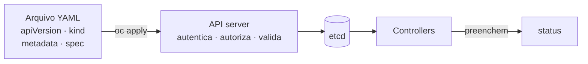

# F5 — Kubernetes API e YAML

| Campo | Valor |
|-------|-------|
| Curso | DO180 — OpenShift 4.22 |
| Módulo | Fundamentos essenciais (autoral) |
| Objetivo | Ler e compreender manifestos, entender a estrutura de um recurso e saber pesquisar campos e tipos de recurso |
| Pré-requisitos | [F4 — Pods e workloads](04-pods-e-workloads.md); sintaxe YAML básica |
| Prepara para | Capítulo 2 (seção 2.3) e todos os seguintes |

## Parte A — Entendendo o conceito

### Tudo é recurso na API

O Kubernetes expõe uma **API REST uniforme**. Pods, Deployments, Services, nós,
projetos, Routes: todos são **recursos** com o mesmo formato e as mesmas operações
(criar, ler, atualizar, apagar, observar). Por isso uma única ferramenta (`oc` ou
`kubectl`) gerencia qualquer tipo, inclusive tipos novos adicionados por Operators
via **CustomResourceDefinition (CRD)**.

### A anatomia de um objeto

| Campo | Pergunta que responde | Exemplo |
|-------|-----------------------|---------|
| `apiVersion` | Em qual grupo e versão da API este tipo está? | `v1` (grupo *core*), `apps/v1`, `route.openshift.io/v1` |
| `kind` | Que tipo de objeto é este? | `Pod`, `Deployment`, `Route` |
| `metadata` | Como o objeto é identificado? | `name`, `namespace`, `labels`, `annotations` |
| `spec` | Qual é o **estado desejado**? | Réplicas, imagem, portas |
| `status` | Qual é o **estado observado**? | Preenchido pelo cluster; você não escreve |

Nem todo tipo tem `spec`: ConfigMap e Secret usam `data`, por exemplo.

### Declarativo versus imperativo

| Estilo | Exemplo | Característica |
|--------|---------|----------------|
| Imperativo | `oc create deployment web --image=...` | Rápido, bom para testes; difícil de reproduzir |
| Declarativo | `oc apply -f web.yaml` | O arquivo é a fonte da verdade; versionável no Git; repetível |

`oc apply` cria o objeto se não existir e, se existir, **atualiza** para casar com o
arquivo. Rodar duas vezes produz o mesmo resultado (idempotência).

### Escopo dos recursos

- **Namespaced**: existem dentro de um namespace (Pod, Deployment, Service, Route, PVC, ConfigMap).
- **Cluster-scoped**: existem uma vez para o cluster todo (Node, PersistentVolume, StorageClass, Namespace, ClusterOperator).

## Parte B — Modelo mental



Leia um manifesto de cima para baixo como uma frase: "na API **apps/v1**, quero um
**Deployment** chamado **web**, no namespace X, cujo **spec** é...".

## Parte C — Funcionamento na prática

### Pesquisando tipos: `oc api-resources`

- **Finalidade:** listar todos os tipos de recurso disponíveis no cluster.
- **Saída:** `NAME`, `SHORTNAMES` (ex.: `po`, `deploy`, `svc`), `APIVERSION`, `NAMESPACED`, `KIND`.
- **Uso típico:** `oc api-resources --namespaced=false` lista os tipos de escopo de cluster.

### Pesquisando campos: `oc explain`

- **Finalidade:** documentação de cada campo direto do cluster.
- **Sintaxe:** `oc explain deployment.spec.template.spec.containers`
- **Parâmetros:** `--recursive` mostra a árvore inteira de campos.
- **Interpretação:** cada campo vem com tipo (`<string>`, `<[]Object>`, `<map[string]string>`) e descrição; `-required-` indica obrigatório.

### Exportando um objeto existente

```bash
oc get deployment web -o yaml      # objeto completo, incluindo status
oc get deployment web -o json | jq '.spec.replicas'
```

Use o YAML de um objeto existente para **aprender**, não para recriar às cegas: ele
contém campos gerados pelo cluster (`uid`, `resourceVersion`, `status`).

### Validando antes de aplicar

```bash
oc apply -f web.yaml --dry-run=server   # validação completa pelo API server, sem gravar
oc diff -f web.yaml                     # mostra o que mudaria
```

### Regras de YAML que mais causam erro

- Indentação com **espaços**, nunca tabulação.
- Listas começam com `- `; o nível de indentação define a quem pertencem.
- `"8080"` (string) é diferente de `8080` (número); `containerPort` exige número.
- Vários documentos no mesmo arquivo são separados por `---`.

## Parte D — Relações importantes

| A | B | Diferença essencial |
|---|---|--------------------|
| `spec` | `status` | Você escreve o `spec`; o cluster escreve o `status` |
| `oc create -f` | `oc apply -f` | `create` falha se já existe; `apply` cria ou atualiza |
| `apiVersion: v1` | `apiVersion: apps/v1` | Grupo *core* versus grupo `apps`; o `kind` precisa estar no grupo certo |
| Label | Annotation | Labels servem a selectors; annotations guardam informação livre |
| Namespaced | Cluster-scoped | Depende de `-n`/projeto ou não |

## Parte E — Preparação para o laboratório

- Saber usar `oc explain` para descobrir um campo sem sair do terminal; isso vale também no EX280.
- Identificar a que tipo e grupo pertence qualquer manifesto apresentado.

## Parte F — Fixação

1. Um manifesto com `apiVersion: v1` e `kind: Deployment` é aceito?
2. Você aplicou o mesmo arquivo com `oc apply` três vezes sem alterá-lo. Quantos objetos existem?
3. Como descobrir se `PersistentVolume` é namespaced, sem consultar documentação externa?
4. Por que não copiar o campo `status` para um manifesto novo?

<details>
<summary>Respostas comentadas</summary>

1. **Não.** `Deployment` pertence ao grupo `apps`; a combinação correta é `apps/v1`. O API server responde que não existe o tipo naquela versão.
2. **Um.** `apply` é idempotente: cria na primeira vez e depois apenas reconcilia (sem mudança).
3. `oc api-resources | grep -i persistentvolume` e observar a coluna `NAMESPACED` (`false`).
4. `status` é escrito pelo cluster e reflete a realidade observada; enviá-lo não muda o estado e só polui o manifesto.

</details>

## Parte G — Essencial para memorizar

- Todo objeto: `apiVersion`, `kind`, `metadata`, `spec` (desejado) e `status` (observado).
- `oc api-resources` → quais tipos existem; `oc explain` → quais campos existem.
- `oc apply -f` é declarativo e idempotente; `--dry-run=server` valida sem gravar.
- ⚠️ YAML: espaços, nunca tabs; atenção aos tipos (string × número).

---
[← Pods e workloads](04-pods-e-workloads.md) | [Índice do módulo](README.md) | [Próximo: Redes e serviços →](06-redes-e-servicos.md)
