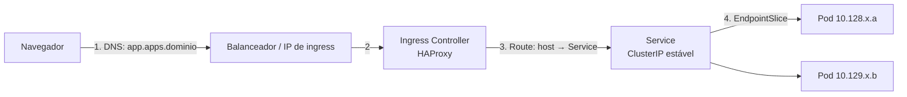

# F6 — Redes e serviços

| Campo | Valor |
|-------|-------|
| Curso | DO180 — OpenShift 4.22 |
| Módulo | Fundamentos essenciais (autoral) |
| Objetivo | Entender como Pods se comunicam, por que Services existem, como o DNS interno funciona e como o tráfego externo chega por uma Route |
| Pré-requisitos | [F4 — Pods e workloads](04-pods-e-workloads.md); redes TCP/IP, DNS, balanceamento de carga |
| Prepara para | Capítulo 4 (seções 4.5 e 4.7) |

## Parte A — Entendendo o conceito

### Comunicação Pod-to-Pod

O modelo de rede do Kubernetes estabelece que **todo Pod recebe um IP próprio** e
pode falar com qualquer outro Pod **sem NAT**, mesmo em nós diferentes. No
OpenShift 4.22 essa rede é implementada pelo plugin **OVN-Kubernetes**, que cria
uma rede *overlay* entre os nós.

| Rede | Exemplo de faixa padrão* | Quem usa |
|------|--------------------------|----------|
| Rede de Pods (*cluster network*) | `10.128.0.0/14` | IPs dos Pods |
| Rede de Services (*service network*) | `172.30.0.0/16` | IPs virtuais dos Services |
| Rede das máquinas | definida na instalação | IPs dos nós |

\* 📘 Fonte externa: valores padrão da documentação de instalação do OpenShift. Cada cluster pode usar outros.

### O problema dos IPs de Pod

O IP de um Pod **muda** sempre que ele é recriado (rollout, falha, escala). Uma
aplicação cliente não pode depender dele. E, com várias réplicas, alguém precisa
distribuir as requisições.

### Service: endereço estável + balanceamento

Um **Service** cria um **IP virtual estável** (*ClusterIP*) e um **nome DNS**, e
encaminha o tráfego para os Pods que casam com seu **selector**. A lista atual de
IPs de Pods prontos fica em objetos **EndpointSlice**, atualizados automaticamente.

| Tipo de Service | Uso |
|-----------------|-----|
| `ClusterIP` (padrão) | Acesso interno ao cluster |
| `NodePort` | Abre a mesma porta em todos os nós |
| `LoadBalancer` | Pede um balanceador externo (nuvem ou MetalLB em bare metal) |

### DNS interno

Cada Service recebe um nome resolvível de dentro do cluster:

```text
<service>.<namespace>.svc.cluster.local
```

Pods do **mesmo** namespace podem usar apenas `<service>`. O DNS do cluster é
mantido por um Cluster Operator (`dns`).

### Acesso externo: Route

Services `ClusterIP` não são acessíveis de fora. Para HTTP/HTTPS, o OpenShift usa a
**Route**: um recurso que associa um **hostname** externo a um Service. O
**Ingress Controller** (pods HAProxy no namespace `openshift-ingress`) recebe o
tráfego no domínio de aplicações do cluster (ex.: `*.apps.<domínio>`) e o encaminha.

Uma Route pode terminar TLS de três formas: **edge** (TLS termina no roteador),
**passthrough** (TLS vai cifrado até o Pod) e **re-encrypt** (o roteador termina e
cifra de novo até o Pod). O detalhamento fica para o Capítulo 4.

## Parte B — Modelo mental

Caminho de uma requisição externa até a aplicação:



> Detalhe técnico: o roteador HAProxy usa o Service para descobrir os endpoints e,
> por padrão, encaminha diretamente aos IPs dos Pods. Conceitualmente, porém, a
> cadeia **Route → Service → Pods** é a que você configura e diagnostica.

Analogia: o **Service** é como um IP virtual de balanceador (VIP) com *health
check* embutido: os membros entram e saem do pool conforme ficam prontos. A
**Route** é a regra de virtual host no proxy reverso de borda.

## Parte C — Funcionamento na prática

Manifestos mínimos (originais):

```yaml
apiVersion: v1
kind: Service
metadata:
  name: web
spec:
  selector:
    app: web              # Pods de destino
  ports:
    - port: 8080          # porta do Service
      targetPort: 8080    # porta do container
---
apiVersion: route.openshift.io/v1
kind: Route
metadata:
  name: web
spec:
  to:
    kind: Service
    name: web
  port:
    targetPort: 8080
```

| Comando | Finalidade | Verificação |
|---------|-----------|-------------|
| `oc get svc` | Lista Services, `CLUSTER-IP` e portas | O Service existe e tem IP |
| `oc get endpointslices -l kubernetes.io/service-name=web` | Mostra os IPs de Pods por trás do Service | Lista vazia = selector errado ou Pods não prontos |
| `oc describe svc web` | Selector, portas e endpoints | Compare o selector com `oc get pods --show-labels` |
| `oc expose service web` | Cria uma Route para o Service | `oc get route` mostra o `HOST/PORT` |
| `curl http://<host-da-route>` | Testa de fora do cluster | Resposta da aplicação; `503` do roteador indica que não há endpoints disponíveis |

## Parte D — Relações importantes

| A | B | Diferença essencial |
|---|---|--------------------|
| IP do Pod | ClusterIP do Service | O do Pod muda a cada recriação; o do Service é estável enquanto o Service existir |
| Service | Route | Service é acesso interno (L4); Route é acesso externo HTTP(S) por hostname |
| Route | Ingress | Ambos expõem HTTP(S); Route é nativa do OpenShift e o OpenShift converte Ingress em Route |
| `port` | `targetPort` | Porta em que o Service escuta × porta do container |
| Service | EndpointSlice | O Service define o selector; o EndpointSlice lista os Pods que casam e estão prontos |

## Parte E — Preparação para o laboratório

- Descrever a cadeia Route → Service → Pods e verificar cada elo.
- Saber que um Pod que não está `Ready` sai dos endpoints. Essa é a ponte com as probes do Capítulo 6.

## Parte F — Fixação

1. Por que uma aplicação deveria se conectar ao banco por `db` (nome do Service) e não pelo IP do Pod do banco?
2. A Route responde com erro `503`, mas o Service existe. Qual o próximo elo a verificar?
3. Um Pod no namespace `loja` precisa acessar o Service `api` no namespace `estoque`. Qual nome usar?
4. Route substitui Service?

<details>
<summary>Respostas comentadas</summary>

1. O IP do Pod muda quando ele é recriado; o nome do Service resolve para um ClusterIP estável e balanceia entre réplicas.
2. Os **endpoints** do Service (`oc get endpointslices`/`oc describe svc`). Sem endpoints, o selector não casa ou os Pods não estão prontos.
3. `api.estoque` ou o FQDN `api.estoque.svc.cluster.local`.
4. **Não.** A Route aponta **para** um Service. Sem Service não há para onde encaminhar.

</details>

## Parte G — Essencial para memorizar

- Cada Pod tem IP próprio, roteável entre nós sem NAT (OVN-Kubernetes).
- Service = IP virtual estável + DNS + balanceamento por **selector**.
- DNS: `<svc>.<ns>.svc.cluster.local`.
- Route = hostname externo → Service, via Ingress Controller (HAProxy).
- ⚠️ "Sem endpoints" é a causa número 1 de Service/Route que não respondem.

---
[← Kubernetes API e YAML](05-kubernetes-api-e-yaml.md) | [Índice do módulo](README.md) | [Próximo: Persistência de dados →](07-persistencia-de-dados.md)
