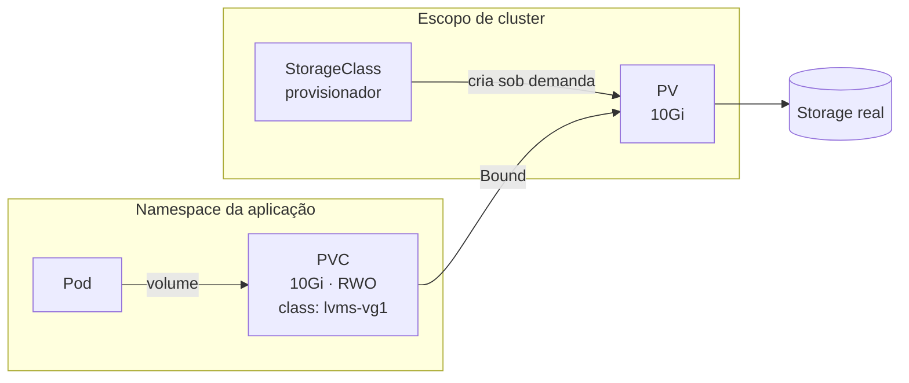

# F7 — Persistência de dados

| Campo | Valor |
|-------|-------|
| Curso | DO180 — OpenShift 4.22 |
| Módulo | Fundamentos essenciais (autoral) |
| Objetivo | Entender o ciclo de vida dos dados em containers e o papel de volumes, PV, PVC e StorageClass, em nível introdutório |
| Pré-requisitos | [F1 — Containers e imagens](01-containers-e-imagens.md), [F4 — Pods e workloads](04-pods-e-workloads.md); noções de storage (LUN, NFS, block × file) |
| Prepara para | Capítulo 5 |

## Parte A — Entendendo o conceito

### O problema

Lembre-se da lição F1: a camada gravável de um container **é descartada** com ele.
Como Pods são recriados o tempo todo (rollouts, falhas, reagendamentos), qualquer
dado gravado "dentro" do container é perdido. Bancos de dados, uploads e filas
precisam de armazenamento que **sobreviva ao Pod**.

### Volumes

Um **volume** é um diretório montado no container, declarado no `spec` do Pod. O
tipo do volume define de onde vêm os dados e quanto tempo eles duram:

| Tipo | Origem | Duração |
|------|--------|---------|
| `emptyDir` | Diretório temporário no nó | Vive enquanto o Pod existir |
| `configMap` / `secret` | Objetos da API | Configuração, não dados da aplicação (Capítulo 5.1) |
| `persistentVolumeClaim` | Armazenamento persistente | Independe do Pod |

### PV, PVC e StorageClass: separação de responsabilidades

O Kubernetes separa **quem fornece** o storage de **quem consome**:

| Objeto | Escopo | Quem cria | O que representa |
|--------|--------|-----------|------------------|
| **PersistentVolume (PV)** | Cluster | Administrador ou provisionador dinâmico | Um pedaço real de storage (disco, export NFS, LUN, volume em nuvem) |
| **PersistentVolumeClaim (PVC)** | Namespace | Usuário/aplicação | Um **pedido**: "preciso de 10 GiB, com tal modo de acesso, de tal classe" |
| **StorageClass** | Cluster | Administrador | Um "catálogo" de tipos de storage e o provisionador que cria PVs sob demanda |

Com **provisionamento dinâmico** (o comum no OpenShift), criar um PVC faz o
provisionador da StorageClass criar o PV automaticamente. O PVC fica `Bound` ao PV.

### Modos de acesso

| Modo | Abreviação | Significado |
|------|------------|-------------|
| `ReadWriteOnce` | RWO | Leitura e escrita por **um nó** por vez |
| `ReadOnlyMany` | ROX | Somente leitura por vários nós |
| `ReadWriteMany` | RWX | Leitura e escrita por vários nós (ex.: NFS, CephFS) |
| `ReadWriteOncePod` | RWOP | Leitura e escrita por **um único Pod** |

O modo pedido no PVC precisa ser suportado pelo storage por trás da classe.

### Reclaim policy

Define o que acontece com o PV quando o PVC é apagado: `Delete` (o storage é
removido, comum no dinâmico) ou `Retain` (o PV e os dados ficam para o
administrador tratar). ⚠️ Com `Delete`, apagar o PVC **apaga os dados**.

## Parte B — Modelo mental



Analogia técnica: o **PVC** é um chamado de requisição de storage; a
**StorageClass** é o catálogo de serviços que define qual equipe/automação atende;
o **PV** é o volume efetivamente entregue.

## Parte C — Funcionamento na prática

PVC mínimo (original):

```yaml
apiVersion: v1
kind: PersistentVolumeClaim
metadata:
  name: dados-web
spec:
  accessModes:
    - ReadWriteOnce
  resources:
    requests:
      storage: 1Gi
  # storageClassName omitido = usa a StorageClass marcada como padrão
```

Uso no Pod (trecho do `spec` do template):

```yaml
      containers:
        - name: web
          image: registry.access.redhat.com/ubi9/httpd-24:latest
          volumeMounts:
            - name: dados
              mountPath: /var/www/html
      volumes:
        - name: dados
          persistentVolumeClaim:
            claimName: dados-web
```

| Comando | Finalidade | Interpretação |
|---------|-----------|---------------|
| `oc get storageclass` | Classes disponíveis | A marcada `(default)` é usada quando o PVC não informa classe |
| `oc get pvc` | Pedidos no projeto | `Bound` = atendido; `Pending` = aguardando (classe inexistente, sem provisionador ou aguardando o primeiro Pod) |
| `oc get pv` | Volumes do cluster | Requer permissão de administrador |
| `oc describe pvc <nome>` | Eventos do provisionamento | Mostra por que um PVC está `Pending` |

> Algumas classes usam `volumeBindingMode: WaitForFirstConsumer`: o PVC fica
> `Pending` **até um Pod usá-lo**. Isso é normal e não é erro.

## Parte D — Relações importantes

| A | B | Diferença essencial |
|---|---|--------------------|
| PV | PVC | PV é o recurso de storage (cluster); PVC é o pedido (namespace) |
| PVC | StorageClass | PVC pede; StorageClass define como e por quem o pedido é atendido |
| `emptyDir` | PVC | `emptyDir` morre com o Pod; PVC sobrevive |
| RWO | RWX | RWO: um nó por vez; RWX: vários nós simultâneos |
| Deployment com PVC | StatefulSet | Deployment compartilha um PVC entre réplicas; StatefulSet cria um PVC por réplica (Capítulo 5.7) |

## Parte E — Preparação para o laboratório

- Saber ler `oc get pvc` e explicar `Bound` × `Pending`.
- Saber localizar as StorageClasses no console (Storage › StorageClasses). O laboratório do Capítulo 1 pede essa leitura.

## Parte F — Fixação

1. Uma aplicação grava uploads em `/uploads` sem volume. Após um rollout, os arquivos somem. Por quê?
2. Um PVC sem `storageClassName` foi criado. Qual classe será usada?
3. Um Deployment com 3 réplicas em nós diferentes monta o mesmo PVC RWO. O que pode acontecer?
4. O que acontece com os dados ao apagar um PVC cujo PV tem reclaim policy `Delete`?

<details>
<summary>Respostas comentadas</summary>

1. Os arquivos estavam na camada gravável do container, descartada quando o Pod antigo foi substituído.
2. A StorageClass marcada como **padrão** no cluster, se houver. Sem classe padrão, o PVC pode ficar `Pending`.
3. RWO permite montagem por **um nó**. Réplicas em outros nós não conseguem montar e ficam presas em `ContainerCreating`. É preciso RWX ou outro desenho (ex.: StatefulSet).
4. O PV e o storage subjacente são removidos: os dados se perdem.

</details>

## Parte G — Essencial para memorizar

- Dado dentro do container é efêmero; dado persistente exige PVC.
- PV (cluster, storage real) ← Bound → PVC (namespace, pedido); StorageClass provisiona dinamicamente.
- Modos: RWO, ROX, RWX, RWOP.
- ⚠️ Reclaim `Delete` + apagar PVC = apagar dados.

---
[← Redes e serviços](06-redes-e-servicos.md) | [Índice do módulo](README.md) | [Próximo: Ferramentas de administração →](08-ferramentas-de-administracao.md)
