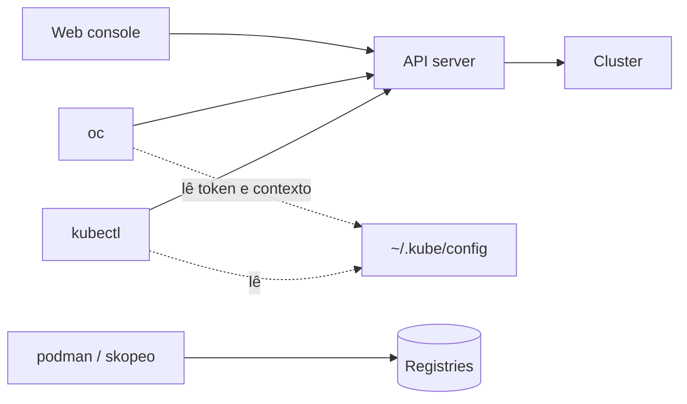

# F8 — Ferramentas de administração

| Campo | Valor |
|-------|-------|
| Curso | DO180 — OpenShift 4.22 |
| Módulo | Fundamentos essenciais (autoral) |
| Objetivo | Saber quando usar a web console, `oc`, `kubectl`, `podman` e `skopeo`, e como a autenticação e o contexto funcionam |
| Pré-requisitos | Lições F1 a F7 |
| Prepara para | Seções 1.5 e 2.1 |

## Parte A — Entendendo o conceito

Todas as ferramentas de cluster falam com o **mesmo API server**. A diferença está
na forma de interagir, não no que é possível: tudo o que a console faz também pode
ser feito pela CLI.

| Ferramenta | O que é | Melhor uso |
|------------|---------|-----------|
| **Web console** | Interface gráfica do OpenShift, extensível por Operators | Visão geral, descoberta, observabilidade (métricas, alertas, eventos), topologia |
| **`oc`** | CLI do OpenShift; inclui todos os comandos do `kubectl` e acrescenta outros | Administração diária, automação, exame EX280 |
| **`kubectl`** | CLI padrão do Kubernetes | Compatibilidade com documentação e ferramentas genéricas |
| **`podman`** | Cria e roda containers localmente | Testar imagens fora do cluster |
| **`skopeo`** | Inspeciona e copia imagens entre registries | Ver metadados e digests sem baixar |

### Autenticação e contexto

O `oc login` autentica no API server e grava as credenciais (um **token**) no
arquivo **kubeconfig** (`~/.kube/config`). Esse arquivo guarda **contextos**:
combinações de *cluster + usuário + namespace*. O `oc` sempre trabalha no contexto
atual.

⚠️ O kubeconfig contém credenciais. Ele **nunca** deve ir para o Git (este
repositório o bloqueia no `.gitignore`).

### Permissões moldam o que você vê

O mesmo comando mostra coisas diferentes para usuários diferentes. Um
desenvolvedor vê os próprios projetos; um administrador de cluster vê nós, Cluster
Operators e todos os namespaces. Na console, menus inteiros podem não aparecer
para usuários comuns.

## Parte B — Modelo mental

Repare que `podman` e `skopeo` **não** falam com o cluster, e sim com registries
e com o runtime local.

## Parte C — Funcionamento na prática

| Comando | Finalidade | Resultado esperado / interpretação |
|---------|-----------|------------------------------------|
| `oc login -u <usuario> <URL_API>:6443` | Autenticar | `Login successful` e o projeto atual |
| `oc whoami` | Quem sou eu | Nome do usuário |
| `oc whoami --show-server` | Em qual API estou | URL do API server |
| `oc whoami --show-console` | URL da web console | Endereço da console |
| `oc config get-contexts` | Contextos disponíveis | `*` marca o atual |
| `oc project <nome>` | Mudar de projeto | `Now using project ...` |
| `oc version` | Versões do cliente e do servidor | Versão do OpenShift e do Kubernetes |
| `oc help` / `oc <cmd> --help` | Ajuda embutida | Exemplos de uso |

**Erros comuns:**

| Mensagem | Significado |
|----------|-------------|
| `error: You must be logged in to the server (Unauthorized)` | Token expirado ou ausente: `oc login` |
| `Error from server (Forbidden)` | Autenticado, mas sem permissão para aquela ação |
| `x509: certificate signed by unknown authority` | CA do cluster não confiável; em ambientes de teste há `--insecure-skip-tls-verify`, mas avalie o risco |
| `Error from server (NotFound)` | Objeto não existe **no projeto atual**; confira `oc project` |

## Parte D — Relações importantes

| A | B | Diferença essencial |
|---|---|--------------------|
| `oc` | `kubectl` | `oc` é um superconjunto: comandos `kubectl` funcionam com `oc` (`oc get`, `oc apply`) e há extras (`oc login`, `oc new-project`, `oc new-app`, `oc expose`, `oc adm`) |
| Web console | CLI | Mesma API; a console é ótima para descobrir, a CLI para repetir e automatizar |
| `podman` | `oc` | `podman` lida com containers locais; `oc` lida com objetos no cluster |
| Autenticação | Autorização | Autenticação = quem você é (`Unauthorized`); autorização = o que pode fazer (`Forbidden`) |

## Parte E — Preparação para o laboratório

- Fazer login, descobrir a URL da console e conferir usuário e projeto atual.
- Interpretar `Unauthorized` × `Forbidden` × `NotFound` sem hesitar.

## Parte F — Fixação

1. Você recebeu só a URL da API. Como descobrir a URL da console?
2. `oc get pods` retorna "No resources found", mas o colega vê Pods. Cite duas causas.
3. Por que o kubeconfig não deve ser versionado?
4. Um comando `kubectl` da documentação Kubernetes funciona com `oc`?

Respostas comentadas

1. Após `oc login`, rode `oc whoami --show-console`.
2. Você está em outro projeto (confira `oc project`) ou seu usuário não tem acesso ao projeto do colega.
3. Ele contém tokens de acesso ao cluster; quem obtiver o arquivo age como você até o token expirar.
4. Em geral **sim**: o `oc` incorpora os comandos do `kubectl`.

## Parte G — Essencial para memorizar

- Console, `oc` e `kubectl` usam a mesma API; `oc` ⊃ `kubectl`.
- `oc login`, `oc whoami [--show-console|--show-server]`, `oc project`.
- `Unauthorized` = autenticação; `Forbidden` = autorização; `NotFound` = projeto/nome errado.
- ⚠️ kubeconfig = credencial. Nunca no Git.

---
[← Persistência de dados](07-persistencia-de-dados.md) | [Índice do módulo](README.md) | [Próximo: Capítulo 1 →](../capitulos/01-introducao-kubernetes-openshift/README.md)
