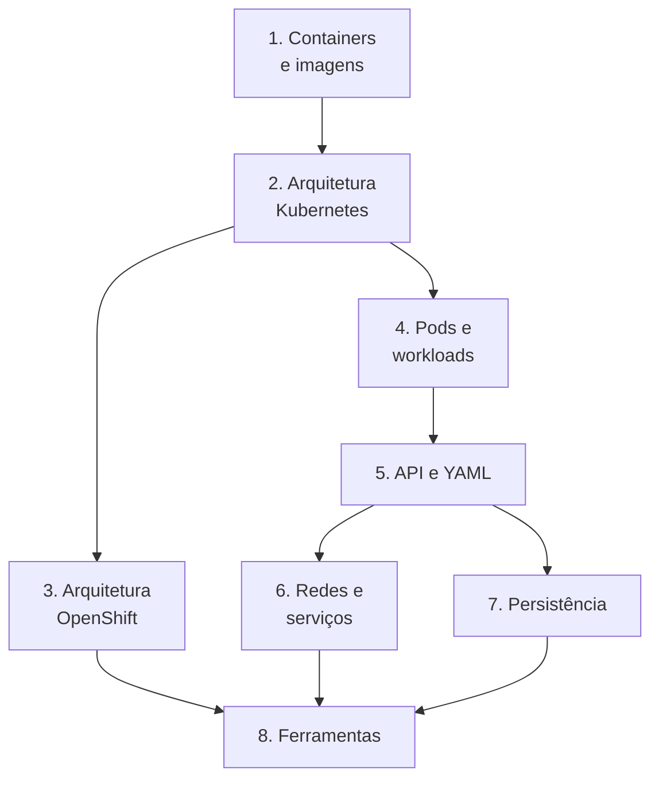

# 01 — Fundamentos essenciais

Módulo introdutório **autoral**, sem correspondência direta com uma seção oficial.
Ele monta o vocabulário e os modelos mentais que o DO180 usa desde o Capítulo 1,
sem antecipar procedimentos que o curso ensina depois.

## Para quem é

Você conhece Linux, redes, virtualização e automação, mas ainda está construindo
a visão de como Kubernetes e OpenShift funcionam por dentro.

## Lições

| # | Lição | Pergunta central | Ligação com o curso |
|---|-------|------------------|---------------------|
| 1 | [Containers e imagens](01-containers-e-imagens.md) | O que é, de fato, um container? | Cap. 1 e 3 |
| 2 | [Arquitetura Kubernetes](02-arquitetura-kubernetes.md) | Quem decide, quem executa e onde fica o estado? | Cap. 1 e 2 |
| 3 | [Arquitetura OpenShift](03-arquitetura-openshift.md) | O que o OpenShift adiciona ao Kubernetes? | Cap. 1 e 2 |
| 4 | [Pods e workloads](04-pods-e-workloads.md) | Por que não se cria Pod "solto" em produção? | Cap. 3, 4 e 6 |
| 5 | [Kubernetes API e YAML](05-kubernetes-api-e-yaml.md) | Como ler e escrever um manifesto? | Cap. 2 em diante |
| 6 | [Redes e serviços](06-redes-e-servicos.md) | Como a requisição chega ao Pod? | Cap. 4 |
| 7 | [Persistência de dados](07-persistencia-de-dados.md) | Onde ficam os dados quando o Pod morre? | Cap. 5 |
| 8 | [Ferramentas de administração](08-ferramentas-de-administracao.md) | Console, `oc`, `kubectl` e `podman`: quando usar cada um? | Todos |

## Mapa do módulo

## Ao terminar este módulo você deve conseguir

- [ ] Explicar a diferença entre imagem, container e Pod.
- [ ] Desenhar de memória o control plane e um worker node com seus componentes.
- [ ] Explicar estado desejado versus estado observado e o papel dos controllers.
- [ ] Ler um manifesto YAML e identificar `apiVersion`, `kind`, `metadata` e `spec`.
- [ ] Descrever o caminho de uma requisição externa: Route → Service → Pod.
- [ ] Diferenciar PV, PVC e StorageClass.
- [ ] Dizer o que é específico do OpenShift e o que é Kubernetes puro.

---
[← Preparação para os laboratórios](../00-comecar-aqui/preparacao-para-os-laboratorios.md) | [Início](../README.md) | [Próximo: Containers e imagens →](01-containers-e-imagens.md)
