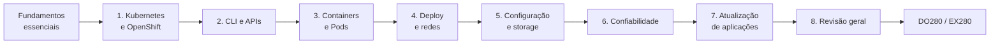

# OpenShift DO180 4.22 — Guia de Estudos

> Guia pessoal e autoral para estudar o curso **Red Hat OpenShift Administration I:
> Operating a Production Cluster (DO180)**, versão **4.22** (OpenShift Container
> Platform 4.22 · Kubernetes 1.35), com foco na preparação para o DO280 e o EX280.

Este repositório **não substitui nem reproduz** a apostila oficial. Ele explica os
conceitos com palavras próprias, organiza os comandos com contexto e faz a ponte
para os laboratórios, que continuam sendo executados no ambiente da Red Hat.

---

## Início rápido

1. Leia [Comece aqui](00-comecar-aqui/README.md): sobre o curso, ambiente oficial e comando `lab`.
2. Estude os [Fundamentos essenciais](01-fundamentos-essenciais/README.md) **antes** do Capítulo 1.
3. Para cada capítulo: lições → `PRATICA-OFICIAL.md` → laboratório oficial → `REVISAO.md` → `RESUMO.md`.
4. Registre cada laboratório no [diário](progresso/diario-de-laboratorios.md).
5. Marque o avanço no [checklist geral](progresso/checklist-geral.md). O estado do repositório está em [estado-do-projeto.md](progresso/estado-do-projeto.md).

## Progressão do aprendizado

## Conteúdo

| Módulo | Tema | Status |
|--------|------|--------|
| [00 — Comece aqui](00-comecar-aqui/README.md) | Sobre o curso, ambiente oficial, comando `lab` | ✅ |
| [01 — Fundamentos essenciais](01-fundamentos-essenciais/README.md) | Containers, Kubernetes, OpenShift, API, redes, storage, ferramentas | ✅ |
| [Capítulo 1](capitulos/01-introducao-kubernetes-openshift/README.md) | Introduction to Kubernetes and OpenShift | ✅ |
| [Capítulo 2](capitulos/02-cli-e-apis/README.md) | Kubernetes and OpenShift Command-line Interfaces and APIs | ⏳ |
| [Capítulo 3](capitulos/03-containers-e-pods/README.md) | Run Applications as Containers and Pods | ⏳ |
| [Capítulo 4](capitulos/04-deploy-e-redes/README.md) | Deploy Managed and Networked Applications on Kubernetes | ⏳ |
| [Capítulo 5](capitulos/05-configuracao-e-storage/README.md) | Manage Storage for Application Configuration and Data | ⏳ |
| [Capítulo 6](capitulos/06-confiabilidade/README.md) | Configure Applications for Reliability | ⏳ |
| [Capítulo 7](capitulos/07-atualizacao-aplicacoes/README.md) | Manage Application Updates | ⏳ |
| [Capítulo 8](capitulos/08-revisao-geral/README.md) | Comprehensive Review | ⏳ |

Legenda: ✅ concluído · 🟡 parcial · ⏳ aguardando o PDF do capítulo (metodologia: um capítulo por vez).

## Consulta rápida

| Arquivo | Para que serve |
|---------|----------------|
| [comandos-oc.md](consulta-rapida/comandos-oc.md) | Comandos `oc` agrupados por tarefa |
| [kubectl-versus-oc.md](consulta-rapida/kubectl-versus-oc.md) | O que é igual e o que só existe no `oc` |
| [objetos-kubernetes.md](consulta-rapida/objetos-kubernetes.md) | Cada objeto em uma linha: função, escopo, quem cria |
| [exemplos-yaml.md](consulta-rapida/exemplos-yaml.md) | Manifestos mínimos e comentados |
| [troubleshooting.md](consulta-rapida/troubleshooting.md) | Sintoma → causa provável → como verificar |
| [glossario.md](consulta-rapida/glossario.md) | Termos em ordem alfabética |

## Checklist de conclusão por capítulo

- [ ] Fundamentos essenciais
- [ ] Capítulo 1 — lições, prática oficial, revisão
- [ ] Capítulo 2
- [ ] Capítulo 3
- [ ] Capítulo 4
- [ ] Capítulo 5
- [ ] Capítulo 6
- [ ] Capítulo 7
- [ ] Capítulo 8 — revisão integrada

> Marque aqui quando **você** concluir o estudo. O checklist detalhado está em
> [progresso/checklist-geral.md](progresso/checklist-geral.md).

## DO180 → DO280 → EX280

| Etapa | Foco | Papel |
|-------|------|-------|
| **DO180** | Operar aplicações em um cluster existente: inspecionar, implantar, expor, configurar, tornar confiável, atualizar | Base operacional |
| **DO280** | Administrar o cluster: autenticação, RBAC, segurança, rede avançada, Operators, atualizações do cluster | Administração da plataforma |
| **EX280** | Exame prático baseado em desempenho | Certificação Red Hat Certified OpenShift Administrator |

A Red Hat recomenda DO180 + DO280 como trilha de preparação para o EX280. A relação
entre o que é estudado aqui e os objetivos públicos do exame está em
[progresso/objetivos-de-aprendizagem.md](progresso/objetivos-de-aprendizagem.md).

## Referências públicas

- Documentação OpenShift 4.22: <https://docs.redhat.com/en/documentation/openshift_container_platform/4.22>
- Curso DO180: <https://www.redhat.com/en/services/training/red-hat-openshift-administration-i-operating-a-production-cluster>
- Exame EX280: <https://www.redhat.com/en/services/training/red-hat-certified-openshift-administrator-exam>

## Aviso

Repositório **público** de estudo pessoal. Ele não contém o PDF do curso, extrações
de texto, soluções de laboratório nem credenciais. Red Hat, OpenShift e nomes relacionados são marcas da
Red Hat, Inc. O conteúdo oficial do curso pertence à Red Hat e não está incluído aqui.
