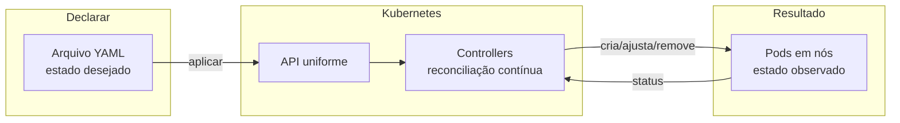

# 1.1 — Containers e Kubernetes

| Campo | Valor |
|-------|-------|
| Curso | DO180 — OpenShift 4.22 |
| Capítulo / seção | Capítulo 1 · Seção 1.1 |
| Título original | Containers and Kubernetes |
| Título em português | Containers e Kubernetes |
| Objetivo | Descrever as principais características dos containers e do Kubernetes |
| Pré-requisitos | [F1](../../01-fundamentos-essenciais/01-containers-e-imagens.md), [F2](../../01-fundamentos-essenciais/02-arquitetura-kubernetes.md), [F4](../../01-fundamentos-essenciais/04-pods-e-workloads.md) |
| Referência | PDF p. 16–19 · atividade 1.2 (Matching) p. 20–21 |

## Parte A — Entendendo o conceito

A seção abre o curso com uma ideia em três camadas:

1. **Containers** empacotam a aplicação e suas dependências e rodam em qualquer
   host com um runtime compatível.
2. **Kubernetes** transforma vários hosts em um cluster que executa esses
   containers com redundância. Mas ele **não pretende ser uma solução completa**:
   oferece pontos de extensão.
3. **OpenShift** usa esses pontos de extensão para entregar uma plataforma completa
   (tema da seção 1.3).

### Containers, em uma frase técnica

Um container é um **processo isolado**, criado a partir de uma **imagem** que traz
todas as dependências de execução. O isolamento usa **namespaces** (o que o
processo enxerga) e **cgroups** (quanto CPU e memória consome). A **OCI** padroniza
imagens e runtimes, e é por isso que uma imagem criada com Podman roda no CRI-O do
cluster. Detalhes em [F1](../../01-fundamentos-essenciais/01-containers-e-imagens.md).

### Por que só containers não bastam

Com Podman você roda containers em **um** host. Se esse host cair, a aplicação cai.
Distribuir réplicas, reiniciar o que falha e balancear tráfego exige trabalho
adicional. É esse trabalho que o Kubernetes automatiza.

### O modelo declarativo

O administrador **descreve** as cargas de trabalho (quantas réplicas, quanta
memória, qual imagem) e o Kubernetes **garante** que o que está rodando
corresponda à descrição. A unidade de execução é o **Pod**: um ou mais containers
que rodam juntos no mesmo nó.

### As capacidades que o Kubernetes oferece

| Capacidade | Problema que resolve | Onde aprofundar |
|------------|---------------------|-----------------|
| **Service discovery e load balancing** | Pods espalhados por nós precisam se encontrar por **nome**, não por IP, e dividir carga entre réplicas | Cap. 4 |
| **Horizontal scaling** | Ajustar o **número** de Pods conforme a carga; em algumas configurações, até o número de nós | Cap. 4 e 6 |
| **Vertical scaling** | Ajustar **CPU e memória** de Pods em execução. Novidade: a partir do Kubernetes 1.35 / OpenShift 4.22, o *in-place pod resize* faz isso **sem reiniciar** o Pod | Cap. 6 |
| **Self-healing** | Reiniciar ou reagendar aplicações que falham internamente ou cujo nó ficou indisponível, quando há health checks declarados | Cap. 6 |
| **Automated rollout** | Trocar a versão gradualmente e voltar (*rollback*) se algo der errado | Cap. 7 |
| **Secrets and configuration management** | Mudar configuração e credenciais sem reconstruir a imagem | Cap. 5 |
| **Operators** | Gerenciar aplicações complexas (ex.: um banco com replicação e backup) de forma declarativa | Cap. 1.3 e DO280 |

⚠️ **Alerta do curso:** o Kubernetes **não criptografa** Secrets. O conteúdo é
apenas codificado em base64. 📘 *Fonte externa:* o OpenShift permite habilitar a
criptografia do etcd, tema de administração do cluster (DO280).

### Arquitetura em resumo

| Conceito | Ponto-chave |
|----------|-------------|
| Nós | Físicos ou virtuais |
| **Control plane nodes** | Coordenação global: agendamento e manutenção do estado da configuração |
| **Compute nodes** | Executam as cargas dos usuários |
| Separação de papéis | Um servidor pode acumular as duas funções, mas separá-las melhora estabilidade, segurança e gerenciabilidade |
| Escala | De clusters de um único nó até cerca de 5.000 nós |
| **Hosted control planes** | O control plane roda como Pods isolados em **outro** cluster (*hosting cluster*); útil em nuvens soberanas com fronteiras multitenant estritas |

Os componentes internos (API server, etcd, scheduler, controllers, kubelet) estão
em [F2](../../01-fundamentos-essenciais/02-arquitetura-kubernetes.md).

### API, recursos e gerenciamento declarativo

- Workloads são definidos como **recursos**, e todos os tipos de recurso seguem a
  **mesma API uniforme**. Por isso `kubectl`/`oc` gerenciam qualquer tipo, até
  recursos customizados.
- Recursos podem ser **exportados e importados como texto** (YAML/JSON). Descrever o
  resultado em vez de executar uma sequência de passos é o
  **gerenciamento declarativo de recursos**, e os arquivos podem ir para controle de
  versão.
- **Controllers** observam o cluster continuamente e agem para alcançar o estado
  pretendido. Consequência prática: **mudanças levam algum tempo** para surtir
  efeito, mas mudanças complexas são aplicadas automaticamente (ex.: mover um Pod
  para um nó com memória suficiente e só então redirecionar o tráfego).
- **Namespaces** organizam recursos e são a base do controle de acesso: permissões
  podem ser dadas por namespace.

## Parte B — Modelo mental

O ponto central é que **o laço nunca para**. Se a realidade muda (um nó cai), o
controller age sem ninguém pedir.

## Parte C — Funcionamento na prática

A seção 1.1 é conceitual e não tem exercício de terminal. Para enxergar os
conceitos em um cluster (seu, ou no ambiente oficial após o `lab start` de uma
atividade):

| Comando | O que demonstra | Observação |
|---------|-----------------|------------|
| `oc get nodes` | Nós e seus papéis (`control-plane,master`, `worker`) | Requer permissão de leitura de cluster |
| `oc api-resources \| head -20` | A API uniforme: dezenas de tipos com o mesmo formato | Qualquer usuário autenticado |
| `oc get namespaces` (admin) ou `oc get projects` | Organização por namespaces | Usuário comum vê só os seus projetos |
| `oc get deployment <nome> -o yaml` | Estado desejado (`spec`) e observado (`status`) no mesmo objeto | Projeto com aplicação implantada |

📘 *Fonte externa (documentação Kubernetes 1.35):* o *in-place pod resize* usa o
subrecurso `resize` do Pod, por exemplo
`oc patch pod <pod> --subresource resize --patch '<json com novos requests/limits>'`.
O tema de recursos de CPU e memória é tratado no Capítulo 6; não é preciso
praticá-lo agora.

## Parte D — Relações importantes

| A | B | Diferença essencial |
|---|---|--------------------|
| Container | Pod | Pod é a unidade que o Kubernetes agenda; agrupa 1+ containers no mesmo nó |
| Horizontal scaling | Vertical scaling | Horizontal muda **quantos** Pods; vertical muda **quanto recurso** cada Pod recebe |
| Self-healing | Automated rollout | Self-healing restaura o estado atual; rollout leva a um novo estado (nova versão) |
| Kubernetes | OpenShift | Kubernetes fornece blocos de construção; OpenShift entrega a solução completa |
| Control plane dedicado | Hosted control plane | Nós próprios × Pods em um cluster de hospedagem |
| Imperativo | Declarativo | Sequência de passos × descrição do resultado, reconciliada por controllers |

## Parte E — Preparação para o laboratório

Atividade associada: **1.2 Matching — Containers and Kubernetes** (PDF p. 20–21),
uma associação entre capacidades e descrições.

Você deve conseguir, sem consulta:

- Definir cada capacidade da tabela da Parte A em uma frase.
- Diferenciar escala horizontal de vertical.
- Explicar o que é gerenciamento declarativo e qual componente o torna possível.

Ver [PRATICA-OFICIAL.md](PRATICA-OFICIAL.md#12-matching-containers-and-kubernetes).

## Parte F — Fixação

1. O que significa dizer que o Kubernetes "não pretende ser uma solução completa"? Que consequência isso tem para o OpenShift?
2. Uma aplicação está lenta por falta de memória. Cite as duas formas de escalar e diga qual delas o OpenShift 4.22 passou a fazer sem reiniciar o Pod.
3. Por que, após aplicar uma mudança, o administrador deve **verificar** o resultado em vez de assumir que já valeu?
4. Que benefício operacional o gerenciamento declarativo traz que comandos imperativos não trazem?
5. Em qual cenário faz sentido um hosted control plane?

Respostas comentadas

1. O Kubernetes fornece mecanismos e pontos de extensão e deixa escolhas em aberto (registry, build, monitoramento, sistema operacional). O OpenShift preenche essas lacunas com componentes integrados, construídos sobre a própria extensibilidade do Kubernetes.
2. **Horizontal** (mais réplicas) e **vertical** (mais CPU/memória por Pod). O *in-place pod resize* (Kubernetes 1.35 / OpenShift 4.22) permite a vertical sem reiniciar o Pod. Para falta de memória por Pod, a vertical ataca a causa; a horizontal ajuda se a carga puder ser dividida.
3. A mudança é registrada como estado desejado e os controllers precisam de tempo para reconciliar. A verificação confirma que o estado observado convergiu.
4. Os arquivos descrevem o resultado, podem ser versionados (histórico de mudanças, revisão) e reaplicados com o mesmo efeito.
5. Quando se quer isolar o control plane dos clusters de usuários, rodando-o como Pods em um cluster de hospedagem, como em nuvens soberanas com fronteiras multitenant rígidas.

## Parte G — Essencial para memorizar

- Container = processo isolado (namespaces + cgroups) criado de imagem OCI.
- Kubernetes: declarativo, baseado em Pods, reconciliado por controllers.
- Sete capacidades: discovery/LB, escala horizontal, escala vertical (*in-place resize* no 1.35/4.22), self-healing, rollout automatizado, secrets/config, Operators.
- ⚠️ Secrets **não** são criptografados pelo Kubernetes.
- Control plane coordena; compute executa; hosted control plane = control plane como Pods em outro cluster.
- Namespaces = organização + base de permissões.

---
[← Capítulo 1 (índice)](README.md) | [Índice do capítulo](README.md) | [Próximo: 1.3 Componentes e edições →](1.3-componentes-e-edicoes-do-openshift.md)
