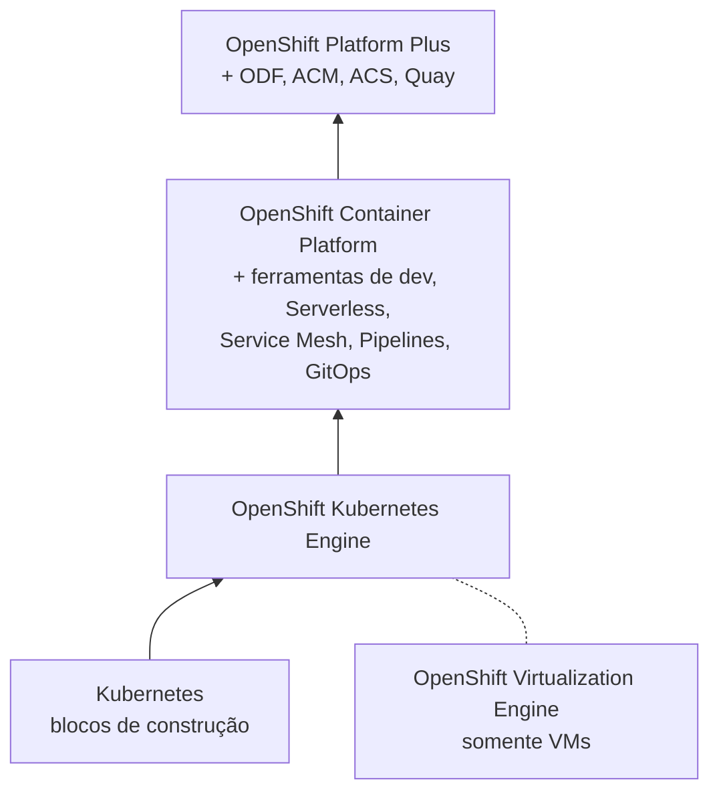
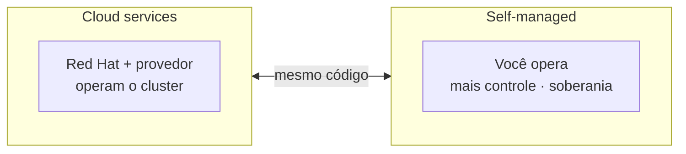

# 1.3 — Componentes e edições do Red Hat OpenShift

| Campo | Valor |
|-------|-------|
| Curso | DO180 — OpenShift 4.22 |
| Capítulo / seção | Capítulo 1 · Seção 1.3 |
| Título original | Red Hat OpenShift Components and Editions |
| Título em português | Componentes e edições do Red Hat OpenShift |
| Objetivo | Relacionar OpenShift, Kubernetes e outros projetos open source; conhecer as edições e o ciclo de suporte |
| Pré-requisitos | [1.1](1.1-containers-e-kubernetes.md), [F3](../../01-fundamentos-essenciais/03-arquitetura-openshift.md) |
| Referência | PDF p. 22–25 · atividade 1.4 (Matching) p. 26–28 |

## Parte A — Entendendo o conceito

### O que o OpenShift acrescenta

Para alguns recursos, o Kubernetes entrega apenas os **blocos de construção**,
porque ambientes diferentes exigem soluções diferentes. O OpenShift aproveita a
extensibilidade do Kubernetes e entrega soluções prontas em três frentes:

| Frente | Lacuna no Kubernetes puro | O que o OpenShift entrega |
|--------|---------------------------|---------------------------|
| **Fluxo integrado de desenvolvimento** | Onde construir e guardar imagens? | Registry interno, pipelines de CI/CD e **S2I** (*Source-to-Image*), que gera imagens a partir do código-fonte |
| **Observabilidade** | Como prevenir e diagnosticar problemas? | Serviços de monitoramento e logging para aplicações e para o cluster |
| **Gerenciamento de servidores** | Quem instala, configura e atualiza o SO dos nós? | Procedimentos de instalação e atualização para muitos cenários e **RHEL CoreOS** gerenciado pelo modelo de configuração do Kubernetes |

Somam-se a isso ferramentas unificadas, a **web console** e reforços de segurança.

### RHEL CoreOS

Sistema operacional **imutável**, otimizado para containers, que usa **o mesmo
kernel e os mesmos pacotes** do Red Hat Enterprise Linux. Sua configuração é
gerenciada pelo cluster de forma declarativa (MachineConfig, visto na seção 1.7).

### Por que isso importa para o administrador

Como o OpenShift é construído sobre a extensibilidade do Kubernetes, o
conhecimento de Kubernetes **continua valendo**, e a maioria dos produtos feitos
para Kubernetes funciona no OpenShift. Uma versão do OpenShift reúne diversos
projetos open source (Kubernetes, CRI-O, Prometheus, entre outros) testados em
conjunto.

### Opções para explorar (não produção)

| Opção | O que é |
|-------|---------|
| **Red Hat OpenShift Local** | Cluster em um computador local, para testes e exploração |
| **Developer Sandbox** | Acesso gratuito por 30 dias a um cluster compartilhado |

### Edições para produção

Todas as edições usam **o mesmo código**, e a maior parte do curso vale para todas.

**Cloud services (gerenciadas)** — provedores como Amazon, Microsoft, IBM e Google
oferecem OpenShift sob demanda. Mais responsabilidades ficam com a Red Hat e o
provedor: a instalação cria e gerencia os recursos de nuvem, e os times de SRE da
Red Hat atualizam o cluster e corrigem problemas de atualização (o cliente ainda
participa do agendamento das atualizações). Cada edição gerenciada documenta a
divisão de responsabilidades. 📘 *Fonte externa:* exemplos são Red Hat OpenShift
Service on AWS (ROSA), Azure Red Hat OpenShift (ARO), Red Hat OpenShift on IBM
Cloud e OpenShift Dedicated.

**Red Hat Lightspeed advisor** — serviço do **Red Hat Hybrid Cloud Console** que
analisa dados enviados pelo **Insights Operator** e recomenda correções para
problemas do cluster.

**Self-managed (autogerenciadas)** — você instala com os instaladores oficiais em
infraestrutura física ou virtual, on-premise ou em nuvem pública. Mais controle e
flexibilidade, mais responsabilidade. São a base arquitetural da **soberania
digital**: controle sobre localização dos dados, independência tecnológica,
padrões e políticas operacionais e integridade/segurança dos sistemas.

As edições autogerenciadas formam uma escada, cada degrau acrescentando recursos:

| Edição | Foco | Destaques |
|--------|------|-----------|
| **OpenShift Virtualization Engine** | **Somente** máquinas virtuais | Console de administração de virtualização, OpenShift GitOps, monitoramento de workloads de usuário, logging da plataforma |
| **OpenShift Kubernetes Engine** | Kubernetes empresarial | Kubernetes com hardening de segurança, RHEL CoreOS, OpenShift Virtualization, console administrativa |
| **OpenShift Container Platform** | Plataforma completa de aplicações | Tudo do Kubernetes Engine + console de desenvolvedor, gestão de logs, gestão de custos, Serverless (Knative), Service Mesh (Istio), Pipelines (Tekton), GitOps (Argo CD) |
| **OpenShift Platform Plus** | Plataforma completa + gestão multicluster | Tudo do Container Platform + OpenShift Data Foundation, Advanced Cluster Management, Advanced Cluster Security, **Quay** (registry privado) |

### Ciclo de vida e suporte

- Versões **minor** regulares (4.20, 4.21, 4.22...).
- Versões **minor pares** (4.18, 4.20, **4.22**) são **EUS** (*Extended Update
  Support*), com janela de suporte maior.
- A partir do 4.14, o EUS das versões pares soma **24 meses** de ciclo total em
  todas as arquiteturas suportadas; um add-on opcional de **12 meses** estende para
  **36 meses**.

Consequência prática: o 4.22, versão deste curso, é uma versão EUS, adequada para
ambientes que querem atualizar com menos frequência.

## Parte B — Modelo mental





## Parte C — Funcionamento na prática

Comandos de leitura para relacionar a teoria com um cluster real. Requerem
permissão de leitura em nível de cluster.

### `oc get clusterversion`

- **Finalidade:** ver a versão instalada do OpenShift e se há atualização em curso.
- **Saída:** colunas `VERSION`, `AVAILABLE`, `PROGRESSING`, `SINCE`, `STATUS`.
- **Interpretação:** `AVAILABLE True` e `PROGRESSING False` = cluster estável na versão mostrada.

### Canal de atualização

```bash
oc get clusterversion version -o jsonpath='{.spec.channel}{"\n"}'
```

- **Finalidade:** ver em qual canal o cluster recebe atualizações (ex.: `stable-4.22`, `eus-4.22`).
- **Relação com o conteúdo:** canais `eus-*` existem para versões pares (EUS).

### Sistema operacional dos nós

```bash
oc get nodes -o wide
```

- A coluna `OS-IMAGE` mostra **Red Hat Enterprise Linux CoreOS** e a coluna `CONTAINER-RUNTIME`, o **cri-o**.

### Insights Operator (base do Lightspeed advisor)

```bash
oc get clusteroperator insights
```

- Mostra se o operador que coleta dados para recomendações está `Available`.
  Em ambientes desconectados ele pode estar desabilitado. Isso não é falha do cluster.

## Parte D — Relações importantes

| A | B | Diferença essencial |
|---|---|--------------------|
| Kubernetes | OpenShift Container Platform | Plataforma de containers sem build e recursos de desenvolvimento × plataforma completa de aplicações |
| Kubernetes Engine | Container Platform | Container Platform acrescenta ferramentas de desenvolvimento, observabilidade e serviços (Serverless, Mesh, Pipelines, GitOps) |
| Container Platform | Platform Plus | Platform Plus acrescenta ODF, ACM, ACS e Quay |
| OpenShift Local / Sandbox | Edições de produção | Exploração e testes × cargas produtivas |
| Cloud services | Self-managed | Responsabilidade compartilhada com Red Hat/provedor × controle e responsabilidade do cliente |
| RHEL | RHEL CoreOS | Mesmo kernel e pacotes; CoreOS é imutável e gerenciado pelo cluster |
| Versão par (EUS) | Versão ímpar | Janela de suporte maior × padrão |

## Parte E — Preparação para o laboratório

Atividade associada: **1.4 Matching — Red Hat OpenShift Components and Editions**
(PDF p. 26–28).

Você deve conseguir associar, sem consulta: Kubernetes, Container Platform,
Platform Plus, OpenShift Local, cloud services, self-managed, RHEL CoreOS,
Lightspeed advisor, EUS e soberania digital às suas descrições.

Ver [PRATICA-OFICIAL.md](PRATICA-OFICIAL.md#14-matching-red-hat-openshift-components-and-editions).

## Parte F — Fixação

1. Uma empresa de governo exige que todo o controle de infraestrutura e segurança permaneça interno. Qual modelo de edição atende melhor e por quê?
2. Qual edição você indicaria para uma equipe que só quer migrar VMs, sem aplicações em containers?
3. Por que o 4.22 é interessante para quem quer atualizar o cluster com menos frequência?
4. Qual componente fornece os dados que o Lightspeed advisor analisa?
5. Cite dois itens que diferenciam o Platform Plus do Container Platform.

<details>
<summary>Respostas comentadas</summary>

1. **Self-managed**: dá controle total sobre infraestrutura e fronteiras de segurança, que é a base da soberania digital. Em cloud services parte da operação é delegada à Red Hat e ao provedor.
2. **OpenShift Virtualization Engine**, focado exclusivamente em VMs.
3. É versão **par**, portanto **EUS**: 24 meses de ciclo, extensíveis a 36 com add-on.
4. O **Insights Operator**, que envia dados ao Hybrid Cloud Console.
5. Quaisquer dois entre OpenShift Data Foundation, Advanced Cluster Management, Advanced Cluster Security e Quay.

</details>

## Parte G — Essencial para memorizar

- OpenShift = Kubernetes + fluxo de desenvolvimento (registry, CI/CD, S2I) + observabilidade + gestão de servidores (RHEL CoreOS) + console.
- Explorar: OpenShift Local, Developer Sandbox (30 dias). Não são para produção.
- Cloud services (Red Hat/provedor operam) × self-managed (você opera; soberania digital).
- Escada self-managed: Virtualization Engine (só VMs) · Kubernetes Engine · Container Platform · Platform Plus.
- Lightspeed advisor ← dados do Insights Operator, via Hybrid Cloud Console.
- EUS = minors pares; 24 meses (desde 4.14), +12 opcionais = 36.

---
[← 1.1 Containers e Kubernetes](1.1-containers-e-kubernetes.md) | [Índice do capítulo](README.md) | [Próximo: 1.5 Web console →](1.5-navegar-na-web-console.md)
