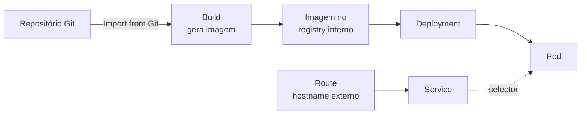

# 1.5 — Navegar na web console do OpenShift

| Campo | Valor |
|-------|-------|
| Curso | DO180 — OpenShift 4.22 |
| Capítulo / seção | Capítulo 1 · Seção 1.5 |
| Título original | Navigate the OpenShift Web Console |
| Título em português | Navegar na web console do OpenShift |
| Objetivo | Usar a web console para identificar aplicações em execução e serviços do cluster |
| Pré-requisitos | [1.3](1.3-componentes-e-edicoes-do-openshift.md), [F8](../../01-fundamentos-essenciais/08-ferramentas-de-administracao.md) |
| Referência | PDF p. 29–33 · Guided Exercise 1.6 p. 34–48 |

## Parte A — Entendendo o conceito

### O que é a web console

É a interface gráfica do OpenShift para tarefas administrativas e de
desenvolvimento. Ela **consome as mesmas APIs** (Kubernetes e extensões do
OpenShift) que a CLI usa. Por isso **tudo o que aparece na console também pode ser
feito com `oc`**. Operators podem **estender** a console com novos menus, páginas e
formulários.

### Diferença para o dashboard do Kubernetes

| | Kubernetes Dashboard | OpenShift web console |
|--|----------------------|----------------------|
| Instalado por padrão | Não | Sim |
| Autenticação | Apenas por token | Integrada ao OAuth do cluster (provedores de identidade) |
| Acesso | Via proxy, limitado ao terminal que criou o proxy | URL publicada, acessível por navegador |
| Extensível por Operators | Não | Sim |

A console do OpenShift **não deriva** do dashboard do Kubernetes. É outro produto.

### Como chegar à console

O administrador normalmente informa a URL. Se você só tem o **endpoint da API**:

1. `oc login -u <USUARIO> <API_ENDPOINT>:<PORTA>`. A saída já mostra uma linha
   *Console URL* que redireciona para a console.
2. `oc whoami --show-console` imprime o endereço configurado pelo console operator
   (padrão `https://console-openshift-console.apps.<domínio>`).

Na tela de login, escolha o **provedor de identidade** configurado no cluster.

### Layout a partir do 4.19: perspectiva unificada

| Antes (até 4.18) | A partir do 4.19 (vale para 4.22) |
|------------------|-----------------------------------|
| Perspectivas separadas *Administrator* e *Developer* | **Core platform perspective** única, reunindo administração, implantação de aplicações e monitoramento |
| OperatorHub e Developer Catalog separados | **Software Catalog** unificado (Operators, Helm charts e outros softwares) |

Notas sobre a perspectiva unificada:

- Usuários que não são administradores podem precisar pedir permissões para
  acessar certas funções.
- Com o operador **OpenShift Virtualization** instalado, surge a perspectiva
  **Virtualization**.
- O administrador do cluster pode **reativar a perspectiva Developer**:
  *Administration › Cluster Settings › Configuration › Console* (recurso
  `operator.openshift.io`) › *Customize* › habilitar *Developer perspective*. A
  mudança leva alguns minutos.

### Mapa da navegação lateral (o que usar no DO180)

| Menu › Página | Para que serve |
|---------------|----------------|
| **Home › Overview** | Visão geral: status, utilização, detalhes (versão, API, ID), inventário e atividade |
| **Home › Projects** | Projetos visíveis para o usuário; criar e apagar projetos |
| **Home › Events** | Eventos do cluster (seção 1.7) |
| **Home › API Explorer** | Catálogo de tipos de recurso (seção 1.7) |
| **Ecosystem › Software Catalog** | Catálogo de software para estender o cluster |
| **Ecosystem › Installed Operators** | Operators já instalados |
| **Workloads › Topology** | Visão gráfica das aplicações do projeto |
| **Workloads › Pods / Deployments** | Listas e detalhes de workloads |
| **Networking › Services / Routes** | Acesso interno e externo às aplicações |
| **Storage › StorageClasses / PVCs** | Armazenamento |
| **Compute › Nodes** | Nós do cluster (administrador) |
| **Observe › Metrics / Alerting** | Monitoramento (seção 1.7) |

No primeiro login aparece um **tour** opcional (*Skip Tour* para dispensar). No canto
superior direito, o menu **+ (quick create)** implanta aplicações rapidamente, por
exemplo **a partir de imagem de container** ou **importando de um repositório Git**.

### Vocabulário mínimo para navegar

| Termo | Definição operacional |
|-------|----------------------|
| **Pod** | Menor unidade gerenciada; um ou mais containers |
| **Deployment** | Unidade operacional que gerencia uma aplicação em execução |
| **Project** | Namespace com anotações extras que delimitam o escopo multitenant |
| **Route** | Configuração de rede que expõe aplicações e serviços para fora do cluster |
| **Operator** | Aplicação Kubernetes empacotada que estende as funções do cluster |

## Parte B — Modelo mental

O que acontece quando se usa *Import from Git* no menu +. O Guided Exercise 1.6
mostra o resultado, e é útil saber de onde vem cada objeto:



Em uma única ação, a console cria vários objetos. Esses mesmos objetos serão
criados individualmente pela CLI no Capítulo 4.

## Parte C — Funcionamento na prática

### Equivalências console ↔ CLI

| Na console | Na CLI | Observação |
|------------|--------|-----------|
| Descobrir a URL da console | `oc whoami --show-console` | Após `oc login` |
| Home › Projects | `oc get projects` | Usuário comum vê só os seus |
| Create Project | `oc new-project <nome> --display-name="..." --description="..."` | Já muda para o novo projeto |
| Workloads › Pods | `oc get pods` (`-A` para todos os namespaces) | `-A` requer permissão de cluster |
| Workloads › Deployments | `oc get deployments` | |
| Networking › Services | `oc get services` | |
| Networking › Routes | `oc get routes` | Coluna `HOST/PORT` = URL externa |
| Ecosystem › Installed Operators | `oc get csv -A` | ClusterServiceVersion = Operator instalado via OLM |
| Delete Project | `oc delete project <nome>` | Apaga **tudo** o que está no projeto |

### Descobrindo a console pela CLI

```bash
oc login -u <USUARIO> https://api.<DOMINIO>:6443
oc whoami --show-console
```

- **Contexto:** qualquer usuário autenticado.
- **Resultado esperado:** uma URL `https://console-openshift-console.apps.<DOMINIO>`.
- **Erros comuns:** `Unauthorized` (credencial incorreta), erro de certificado (CA do cluster não confiável na estação).

⚠️ **Boa prática de administrador:** logado como administrador, **navegue sem
alterar ou remover** componentes do cluster. O Guided Exercise faz esse alerta
explicitamente.

## Parte D — Relações importantes

| A | B | Diferença essencial |
|---|---|--------------------|
| Web console | Kubernetes Dashboard | Produtos diferentes; a console é completa, autenticada por OAuth e extensível |
| Core platform perspective | Developer perspective | Unificada (padrão a partir do 4.19) × separada, reativável pelo administrador |
| Software Catalog | Installed Operators | O que **pode** ser instalado × o que **já está** instalado |
| Topology | Workloads › Deployments | Visão gráfica do projeto × lista detalhada |
| Usuário desenvolvedor | Usuário administrador | Vê os próprios projetos × vê todo o cluster (nós, Operators, todos os Pods) |

## Parte E — Preparação para o laboratório

Atividade associada: **1.6 Guided Exercise — Navigate the OpenShift Web Console**
(`intro-navigate`, PDF p. 34–48).

Competências exigidas:

- Descobrir a URL da console pela CLI e fazer login escolhendo o provedor de identidade.
- Criar e apagar um projeto pela console.
- Implantar uma aplicação de exemplo pelo menu **+** e localizar os objetos criados (Pod, Deployment, Service, Route).
- Comparar o que um desenvolvedor e um administrador enxergam.

Ver [PRATICA-OFICIAL.md](PRATICA-OFICIAL.md#16-guided-exercise-navigate-the-openshift-web-console).

## Parte F — Fixação

1. Você tem apenas `https://api.cluster.exemplo:6443`. Descreva como chegar à console.
2. Um colega procura a perspectiva *Developer* no 4.22 e não encontra. Está quebrado?
3. Onde verificar se o Operator MetalLB já está instalado, na console e na CLI?
4. Após *Import from Git*, quais objetos você espera encontrar no projeto?
5. Por que um desenvolvedor não vê o menu **Compute › Nodes**?

<details>
<summary>Respostas comentadas</summary>

1. `oc login -u <usuario> https://api.cluster.exemplo:6443` e depois `oc whoami --show-console`; abrir a URL e escolher o provedor de identidade.
2. **Não.** Desde o 4.19 a console usa a perspectiva unificada (*Core platform*). O administrador pode reativar a Developer nas configurações do Console operator.
3. Console: **Ecosystem › Installed Operators** (com *All Projects*). CLI: `oc get csv -A | grep -i metallb`.
4. Um build e sua imagem, um Deployment com seu Pod, um Service e uma Route.
5. Nós são recursos de escopo de cluster; o usuário comum não tem permissão para listá-los, e a console esconde o que o usuário não pode acessar.

</details>

## Parte G — Essencial para memorizar

- A console usa as mesmas APIs que o `oc`: o que se faz em uma se faz na outra.
- `oc whoami --show-console` descobre a URL.
- 4.19+: perspectiva **Core platform** unificada; **Software Catalog** = OperatorHub + Developer Catalog.
- Menu **+** (quick create): imagem de container, Import from Git.
- Pod · Deployment · Project · Route · Operator: vocabulário mínimo.
- ⚠️ Como admin, observe, não altere componentes da plataforma.

---
[← 1.3 Componentes e edições](1.3-componentes-e-edicoes-do-openshift.md) | [Índice do capítulo](README.md) | [Próximo: 1.7 Monitorar um cluster →](1.7-monitorar-um-cluster-openshift.md)
