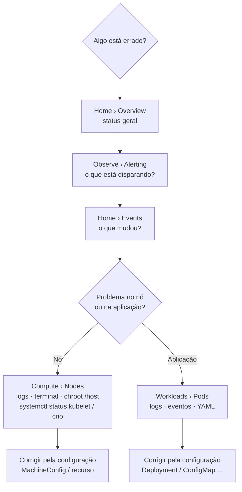
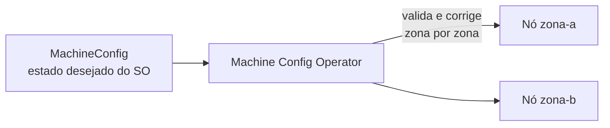

# 1.7 — Monitorar um cluster OpenShift

| Campo | Valor |
|-------|-------|
| Curso | DO180 — OpenShift 4.22 |
| Capítulo / seção | Capítulo 1 · Seção 1.7 |
| Título original | Monitor an OpenShift Cluster |
| Título em português | Monitorar um cluster OpenShift |
| Objetivo | Usar os painéis de eventos, compute e observabilidade da console para avaliar o estado geral do cluster |
| Pré-requisitos | [1.5](1.5-navegar-na-web-console.md), [F2](../../01-fundamentos-essenciais/02-arquitetura-kubernetes.md) |
| Referência | PDF p. 49–55 · Guided Exercise 1.8 p. 56–71 |

## Parte A — Entendendo o conceito

Monitorar um cluster é responder a quatro perguntas, cada uma com uma fonte:

| Pergunta | Fonte | Na console |
|----------|-------|------------|
| Os **nós** estão saudáveis? | Status, logs e serviços do nó | Compute › Nodes |
| As **aplicações** estão saudáveis? | Logs e detalhes do Pod | Workloads › Pods |
| Há **degradação** ou tendência ruim? | Métricas e alertas | Observe › Metrics / Alerting |
| **O que mudou** recentemente? | Eventos | Home › Events |

### Node, Machine e MachineConfig

| Conceito | O que é |
|----------|---------|
| **Node** | Termo Kubernetes: qualquer sistema do cluster (bare metal, virtual ou nuvem) onde Pods rodam. Executa os serviços que falam com o control plane |
| **Machine** | Termo OpenShift: o **recurso** que descreve um nó. Especialmente útil em nuvem pública, onde o cluster provisiona a infraestrutura |
| **MachineConfig** | Recurso que define o estado inicial e as mudanças em arquivos, serviços, atualizações do SO e versões de serviços críticos, como **kubelet** e **cri-o** |
| **Machine Config Operator (MCO)** | Operador de nível de cluster que garante a configuração correta de cada máquina, executa tarefas como atualizações do sistema e **valida e corrige continuamente** as máquinas conforme os MachineConfigs |

Quando um MachineConfig muda, o MCO **orquestra** a aplicação nos nós afetados.
Essa orquestração é priorizada **por zona, em ordem alfabética**, usando o label
de nó `topology.kubernetes.io/zone`.

### Investigando nós

Em **Compute › Nodes**, o detalhe de um nó oferece abas de visão geral, métricas,
eventos, YAML, **logs** e **terminal**.

- O **terminal** abre um *debug pod*: um container rodando **no nó**. Para usar os
  binários do próprio host, execute `chroot /host`.
- Alterar o nó diretamente pelo terminal **não é recomendado** (lembre-se de que o
  MCO gerencia a configuração), mas conectar-se para **diagnóstico** é prática comum.
- Em clusters com **hosted control planes**, os nós de control plane **não aparecem**:
  a página mostra apenas compute nodes.

### Investigando Pods

Em **Workloads › Pods**, filtre por projeto e abra um Pod para ver métricas,
variáveis de ambiente, **Logs**, eventos, **Terminal** e YAML.

⚠️ O terminal do Pod serve para **diagnosticar**. A correção certa é **alterar a
configuração** (Deployment, ConfigMap etc.) e deixar o Pod ser recriado. Mudanças
feitas dentro de um Pod se perdem quando ele é substituído.

### Métricas e alertas

- Serviços expõem métricas em um endpoint HTTP **`/metrics`**, normalmente
  instrumentado com bibliotecas cliente do **Prometheus**.
- **Monitores** avaliam continuamente uma métrica contra uma condição e geram
  **alertas** quando o critério de sucesso deixa de ser atendido.
- **ServiceMonitor** define como monitorar um Service; **PodMonitor** faz o mesmo
  para Pods.
- **Observe › Metrics**: consultas e gráficos (linguagem PromQL).
- **Observe › Alerting**: alertas disparados (filtráveis por severidade) e regras de alerta.
- **Cluster Observability Operator (COO)**: componente **opcional** que adiciona
  pilhas de monitoramento altamente customizáveis, correlação de sinais e grupos
  de detecção de incidentes, com visão mais detalhada por namespace.

### Eventos versus logs

| | Eventos | Logs |
|--|---------|------|
| Nível | Alto: mudanças significativas | Baixo: detalhe linha a linha |
| Uso | Entender rapidamente o que aconteceu com cluster, nó, projeto ou Pod | Remediar um problema específico |
| Na console | Home › Events (filtros por recurso, tipo, texto) | Abas *Logs* de Pods e nós |

📘 *Fonte externa:* eventos são objetos de vida curta. Por padrão o cluster os
mantém por poucas horas, então não servem como histórico de longo prazo.

### API Explorer

**Home › API Explorer** lista todos os tipos de recurso disponíveis no cluster,
com descrição, schema e metadados. Ajuda muito quem está começando, e é o
equivalente gráfico de `oc api-resources` e `oc explain`.

## Parte B — Modelo mental





## Parte C — Funcionamento na prática

O DO180 trabalha esta seção pela console. Os equivalentes de CLI abaixo preparam
o Capítulo 2 (seção 2.5). Todos exigem perfil de **administrador do cluster**,
exceto logs e eventos dos seus próprios projetos.

| Objetivo | Comando | Interpretação |
|----------|---------|---------------|
| Listar nós e status | `oc get nodes` | `Ready` esperado em todos |
| Consumo atual dos nós | `oc adm top nodes` | CPU/memória em uso (dados do monitoramento) |
| Abrir shell de diagnóstico no nó | `oc debug node/<nome>` e depois `chroot /host` | Mesmo mecanismo da aba *Terminal* |
| Estado do kubelet e do CRI-O | `systemctl status kubelet` / `systemctl status crio` (dentro do `chroot /host`) | Esperado `active (running)` |
| Logs de serviços do nó sem shell | `oc adm node-logs <nome> -u kubelet` | Útil quando o debug pod não sobe |
| Machines do cluster | `oc get machines -n openshift-machine-api` | Pode estar vazio em instalações sem integração com a infraestrutura (ex.: bare metal sem provedor) |
| MachineConfigs e pools | `oc get machineconfig` / `oc get machineconfigpool` | Pool com `UPDATED False` e `UPDATING True` = MCO aplicando mudança |
| Logs de um Pod | `oc logs <pod> [-c <container>] [-n <ns>]` | Igual à aba *Logs* |
| Eventos ordenados | `oc get events --sort-by=.lastTimestamp [-n <ns>]` | Igual a Home › Events |
| Alertas disparados | Console › Observe › Alerting | A CLI não tem um comando simples equivalente |

Exemplo de sessão de diagnóstico de nó:

```bash
oc debug node/<NOME_DO_NO>
# dentro do debug pod:
chroot /host
systemctl is-active kubelet crio
exit   # sai do chroot
exit   # encerra o debug pod (ele é removido)
```

- **Contexto:** administrador do cluster.
- **Resultado esperado:** `active` para os dois serviços.
- **Erros comuns:** `Forbidden` (sem permissão); esquecer o `chroot /host` e não encontrar os binários ou a configuração do host.

## Parte D — Relações importantes

| A | B | Diferença essencial |
|---|---|--------------------|
| Node | Machine | Node é a visão Kubernetes do sistema; Machine é o recurso OpenShift que descreve e provisiona o nó |
| MachineConfig | MCO | MachineConfig declara; MCO aplica e mantém |
| Eventos | Logs | Visão de alto nível × detalhe para remediação |
| Métrica | Alerta | Valor coletado × condição sobre a métrica que sinaliza degradação |
| ServiceMonitor | PodMonitor | Coleta a partir de um Service × diretamente de Pods |
| Terminal do nó | Terminal do Pod | Debug pod no host (`chroot /host`) × shell dentro do container da aplicação |
| Monitoramento padrão | Cluster Observability Operator | Incluído × opcional, com pilhas customizáveis e correlação de sinais |

## Parte E — Preparação para o laboratório

Atividade associada: **1.8 Guided Exercise — Monitor an OpenShift Cluster**
(`intro-monitor`, PDF p. 56–71).

Competências exigidas:

- Ler as seções da página **Overview** (status, utilização, detalhes, inventário, atividade).
- Abrir o terminal de um nó, usar `chroot /host` e verificar `kubelet` e `crio`.
- Navegar nas abas de **Alerting** (alertas e regras) e entender *Description* e *Expression* de uma regra.
- Executar uma consulta em **Metrics**.
- Filtrar **Events** por recurso, tipo e texto.

> No ambiente de treinamento o cluster tem **um único nó** (`master01`), que acumula
> control plane e cargas de trabalho (PDF p. 61).

Ver [PRATICA-OFICIAL.md](PRATICA-OFICIAL.md#18-guided-exercise-monitor-an-openshift-cluster).

## Parte F — Fixação

1. Pelo terminal de um nó, `systemctl status kubelet` retorna "command not found" ou mostra dados do container. O que faltou?
2. Você corrigiu um arquivo de configuração **dentro** de um Pod pelo terminal e a aplicação voltou a funcionar. Por que isso não é a solução definitiva?
3. Qual a diferença de propósito entre Home › Events e a aba Logs de um Pod?
4. Em um cluster com hosted control planes, onde verificar o kubelet?
5. O que faz o MCO quando alguém altera manualmente um arquivo gerenciado por MachineConfig em um nó?

<details>
<summary>Respostas comentadas</summary>

1. O `chroot /host`. O debug pod é um container; os binários e serviços do host ficam montados em `/host`.
2. O Pod é efêmero: ao ser recriado, volta à imagem e à configuração declarada. A correção deve ir para o objeto que gera o Pod (Deployment, ConfigMap etc.).
3. Eventos dão a visão resumida do que aconteceu (agendamento, pull de imagem, falhas); logs trazem o detalhe produzido pela aplicação para remediação.
4. Em um **compute node**, porque o control plane roda em outro cluster e seus nós não aparecem.
5. Detecta a divergência em relação ao estado desejado e trata a máquina como fora de conformidade. O caminho correto é alterar o MachineConfig. 📘 *Fonte externa:* a documentação descreve que o MCO marca o nó como degradado quando encontra arquivos gerenciados alterados.

</details>

## Parte G — Essencial para memorizar

- Quatro fontes: **Nodes**, **Pods**, **Metrics/Alerting**, **Events**.
- Node (Kubernetes) × Machine (recurso OpenShift); MachineConfig + **MCO** mantêm o SO e kubelet/cri-o, zona por zona (`topology.kubernetes.io/zone`).
- Terminal do nó = debug pod → `chroot /host` → `systemctl status kubelet|crio`.
- Diagnostique no terminal; **corrija na configuração**.
- `/metrics` + Prometheus; ServiceMonitor/PodMonitor; alertas por severidade.
- COO é opcional. API Explorer = catálogo de tipos.

---
[← 1.5 Web console](1.5-navegar-na-web-console.md) | [Índice do capítulo](README.md) | [Próximo: Prática oficial →](PRATICA-OFICIAL.md)
