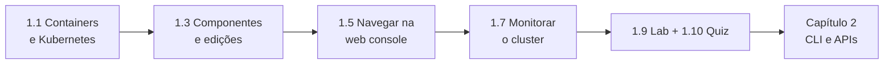

# Capítulo 1 — Introduction to Kubernetes and OpenShift

**Título em português:** Introdução ao Kubernetes e ao OpenShift
**Status:** ✅ concluído e validado
**Referência:** PDF p. 15–82

## Objetivo do capítulo

Identificar os principais serviços de um cluster Kubernetes e os serviços de
plataforma do OpenShift, e **monitorá-los pela web console**.

Em termos práticos: ao final você sabe **o que compõe um cluster** e **como
observar sua condição** pela console, antes de passar à CLI no Capítulo 2.

## Por que este capítulo importa

Ele estabelece o vocabulário de todo o curso (container, Pod, controller,
Operator, Project, Route) e o hábito de **observar antes de agir**. O Capítulo 2
repete muitas dessas observações pela linha de comando.

## Seções e atividades (ordem oficial)

| Seção | Tipo | Título original | Material | PDF |
|-------|------|-----------------|----------|-----|
| 1.1 | Conceito | Containers and Kubernetes | [lição](1.1-containers-e-kubernetes.md) | p. 16–19 |
| 1.2 | Matching | Containers and Kubernetes | [prática](PRATICA-OFICIAL.md#12-matching-containers-and-kubernetes) | p. 20–21 |
| 1.3 | Conceito | Red Hat OpenShift Components and Editions | [lição](1.3-componentes-e-edicoes-do-openshift.md) | p. 22–25 |
| 1.4 | Matching | Red Hat OpenShift Components and Editions | [prática](PRATICA-OFICIAL.md#14-matching-red-hat-openshift-components-and-editions) | p. 26–28 |
| 1.5 | Conceito | Navigate the OpenShift Web Console | [lição](1.5-navegar-na-web-console.md) | p. 29–33 |
| 1.6 | Guided Exercise | Navigate the OpenShift Web Console | [prática](PRATICA-OFICIAL.md#16-guided-exercise-navigate-the-openshift-web-console) | p. 34–48 |
| 1.7 | Conceito | Monitor an OpenShift Cluster | [lição](1.7-monitorar-um-cluster-openshift.md) | p. 49–55 |
| 1.8 | Guided Exercise | Monitor an OpenShift Cluster | [prática](PRATICA-OFICIAL.md#18-guided-exercise-monitor-an-openshift-cluster) | p. 56–71 |
| 1.9 | Lab | Introduction to Kubernetes and OpenShift | [prática](PRATICA-OFICIAL.md#19-lab-introduction-to-kubernetes-and-openshift) | p. 72–79 |
| 1.10 | Quiz | Introduction to Kubernetes and OpenShift | [prática](PRATICA-OFICIAL.md#110-quiz-introduction-to-kubernetes-and-openshift) | p. 80–81 |
| 1.11 | Summary | Summary | [RESUMO.md](RESUMO.md) | p. 82 |

## Arquivos do capítulo

- [PRATICA-OFICIAL.md](PRATICA-OFICIAL.md): ponte com as atividades oficiais.
- [REVISAO.md](REVISAO.md): questões autorais integradas do capítulo.
- [RESUMO.md](RESUMO.md): síntese para revisão rápida.

## Pré-requisitos recomendados

[F1](../../01-fundamentos-essenciais/01-containers-e-imagens.md) ·
[F2](../../01-fundamentos-essenciais/02-arquitetura-kubernetes.md) ·
[F3](../../01-fundamentos-essenciais/03-arquitetura-openshift.md) ·
[F4](../../01-fundamentos-essenciais/04-pods-e-workloads.md) ·
[F8](../../01-fundamentos-essenciais/08-ferramentas-de-administracao.md)

## Checklist

- [ ] 1.1 lida e Parte F respondida
- [ ] 1.2 Matching feito
- [ ] 1.3 lida e Parte F respondida
- [ ] 1.4 Matching feito
- [ ] 1.5 lida e Parte F respondida
- [ ] 1.6 Guided Exercise `intro-navigate` concluído (`lab finish` executado)
- [ ] 1.7 lida e Parte F respondida
- [ ] 1.8 Guided Exercise `intro-monitor` concluído (`lab finish` executado)
- [ ] 1.9 Lab `intro-review` + 1.10 Quiz concluídos
- [ ] [REVISAO.md](REVISAO.md) respondida
- [ ] Registro no [diário de laboratórios](../../progresso/diario-de-laboratorios.md)

---
[← Fundamentos essenciais](../../01-fundamentos-essenciais/README.md) | [Índice geral](../../README.md) | [Próximo: 1.1 Containers e Kubernetes →](1.1-containers-e-kubernetes.md)
