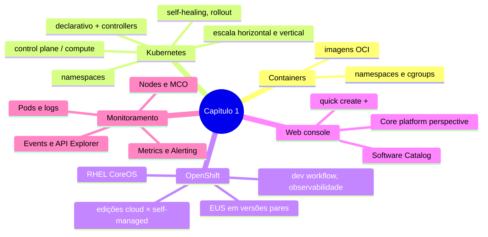

# Resumo — Capítulo 1

Síntese autoral para revisão rápida. Correspondência oficial: seção 1.11 (PDF p. 82).

## Em uma frase por seção

| Seção | Ideia central |
|-------|---------------|
| 1.1 | Containers empacotam aplicações; o Kubernetes as executa em cluster de forma declarativa, em Pods, reconciliadas por controllers |
| 1.3 | O OpenShift completa o Kubernetes (fluxo de dev, observabilidade, RHEL CoreOS, console) e vem em edições gerenciadas e autogerenciadas; versões pares são EUS |
| 1.5 | A web console usa as mesmas APIs da CLI; no 4.19+ a perspectiva é unificada e o Software Catalog reúne Operators e outros softwares |
| 1.7 | Monitora-se por nós (logs/terminal), Pods (logs), métricas/alertas (Prometheus) e eventos; o MCO mantém o SO dos nós via MachineConfig |

## Mapa do capítulo

## Comandos que apareceram (ou equivalem ao que se fez na console)

| Comando | Para quê |
|---------|----------|
| `oc login -u <usuario> <api>:6443` | Autenticar no cluster |
| `oc whoami --show-console` | Descobrir a URL da console |
| `oc get clusterversion` | Versão e estado de atualização |
| `oc get nodes [-o wide]` | Nós, status, SO e runtime |
| `oc debug node/<nó>` + `chroot /host` | Shell de diagnóstico no nó |
| `systemctl status kubelet` / `crio` | Serviços essenciais do nó |
| `oc get events --sort-by=.lastTimestamp` | Eventos recentes |
| `oc api-resources` / `oc explain` | Tipos e campos da API |

## Alertas operacionais

- ⚠️ Kubernetes **não criptografa** Secrets.
- ⚠️ Mudanças levam tempo: **verifique** depois de aplicar.
- ⚠️ Terminal do Pod/nó serve para **diagnóstico**; corrija na configuração.
- ⚠️ Como administrador em ambiente compartilhado ou de laboratório, **observe sem alterar** componentes da plataforma.
- ⚠️ Sempre `lab finish` ao terminar uma atividade.

## Ligação com o próximo capítulo

O Capítulo 2 leva as mesmas observações para a **CLI** (`oc`/`kubectl`):
inspeção de recursos, contextos e projetos, e a saúde do cluster via Cluster
Operators.

---
[← Revisão](REVISAO.md) | [Índice do capítulo](README.md) | [Próximo capítulo →](../02-cli-e-apis/README.md)
