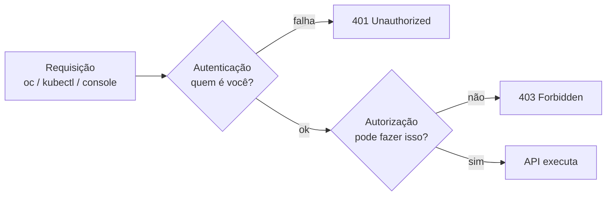
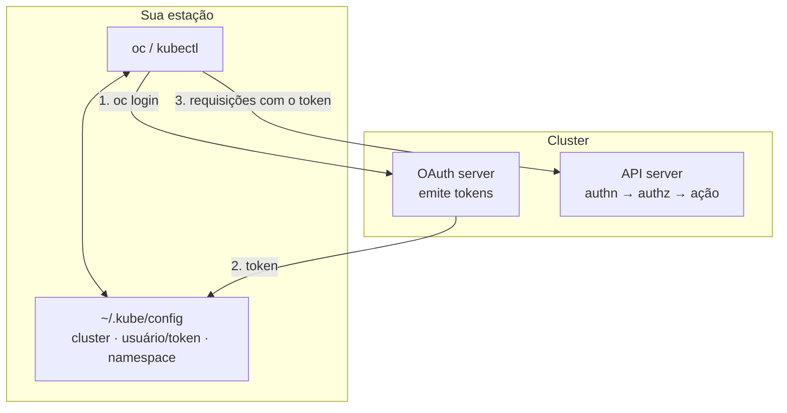

# 2.1 — As interfaces de linha de comando do Kubernetes e do OpenShift

| Campo | Valor |
|-------|-------|
| Curso | DO180 — OpenShift 4.22 |
| Capítulo / seção | Capítulo 2 · Seção 2.1 |
| Título original | The Kubernetes and OpenShift Command-line Interfaces |
| Título em português | As interfaces de linha de comando do Kubernetes e do OpenShift |
| Objetivo | Acessar um cluster OpenShift com as CLIs `kubectl` e `oc` |
| Pré-requisitos | [F5](../../01-fundamentos-essenciais/05-kubernetes-api-e-yaml.md), [F8](../../01-fundamentos-essenciais/08-ferramentas-de-administracao.md), [1.5](../01-introducao-kubernetes-openshift/1.5-navegar-na-web-console.md) |
| Referência | PDF p. 84–94 · Guided Exercise 2.2 p. 95–102 |

## Parte A — Entendendo o conceito

### Por que a linha de comando

No Capítulo 1 tudo foi feito pela web console. A console é ótima para descobrir e
visualizar, mas a administração diária, a automação e o exame EX280 dependem da
**CLI**. O curso cita situações em que a CLI é o caminho natural:

- trabalhar diretamente com o código-fonte de um projeto;
- automatizar operações com scripts;
- operar com pouca banda de rede;
- operar quando a console está indisponível;
- lidar com recursos específicos do OpenShift, como Routes e Projects.

### Duas CLIs, uma API

| CLI | Origem | Relação com a API |
|-----|--------|-------------------|
| **`kubectl`** | Projeto Kubernetes | "Casca fina" sobre a API do Kubernetes |
| **`oc`** | OpenShift | **Superconjunto** do `kubectl`: tudo o que o `kubectl` faz, mais comandos para recursos do OpenShift (Projects, Routes, ImageStreams, builds, login) |

Comandos comuns, como `version`, `--help` e `explain`, funcionam igual nas duas.
O curso usa `oc` para aproveitar os recursos do OpenShift.

> Serviços gerenciados podem ter CLIs **complementares** (não substitutas):
> `rosa` no Red Hat OpenShift Service on AWS e `ocm` no OpenShift Dedicated.

### Instalação e compatibilidade de versões

| Forma | Observação |
|-------|-----------|
| **Baixar o `oc` pela web console** (*Help (?) › Command Line Tools*) | Garante compatibilidade com o cluster. Há builds para x86_64 (Windows, Mac, Linux), ARM64 (Linux, Mac), IBM Z e IBM Power |
| `kubectl` junto com o `oc` | O pacote do `oc` já inclui o `kubectl`; é o método recomendado para usuários de OpenShift |
| `kubectl` avulso | Download oficial do Kubernetes (com validação de checksum) ou repositório RPM em distribuições baseadas em RHEL |

⚠️ **Regra de versão do `kubectl`:** use um cliente com no máximo **uma versão
minor de diferença** do cluster. Um cliente 1.34 fala com control planes 1.33,
1.34 e 1.35. O OpenShift 4.22 usa Kubernetes 1.35.

### Autenticação e autorização

Toda requisição à API passa por duas etapas:



Quem pode fazer requisições:

| Tipo de usuário | O que é | Exemplo |
|-----------------|---------|---------|
| **Regular user** | Usuário interativo, representado por um objeto `User` | Desenvolvedor, administrador |
| **System user** | Usado pela infraestrutura para falar com a API com segurança; alguns são criados automaticamente | Administrador do cluster com acesso total; usuário **anônimo** para requisições sem autenticação |
| **Service account** | Objeto `ServiceAccount` que permite a **aplicações** acessarem a API sem usar credenciais de pessoas | Criadas automaticamente em cada projeto; administradores do projeto podem criar outras |

As permissões são dadas por **roles** atribuídas a usuários ou grupos. O detalhe de
RBAC é tema do DO280.

### Métodos de login

O control plane do OpenShift tem um **servidor OAuth embutido** que emite **tokens
de acesso**.

| Método | Comando | Quando usar |
|--------|---------|-------------|
| Usuário e senha | `oc login -u <usuario> <api-url>` (a senha é pedida interativamente) | Simples; o curso usa por praticidade. **Não recomendado em produção**, sobretudo com a senha na linha de comando (`-p`) |
| **Token** | `oc login --token=<token> --server=<api-url>` | **Recomendado** para produção, automação e pipelines CI/CD: não exige guardar senha em script |
| Web | `oc login --web <api-url>` | Abre o navegador na página de autenticação (útil com SSO); o token volta automaticamente para a CLI |

Para obter um token manualmente:

- Console: menu do usuário › **Copy login command** (também em *Help › Command Line Tools*), ou
- URL `https://oauth-openshift.apps.<domínio>/oauth/token/request` › login › **Display token**.

> O resumo oficial do capítulo destaca que o **token é o único método confiável
> em qualquer cluster**, porque um SSO corporativo pode substituir o formulário de
> login com usuário e senha.

### Projetos e escopo dos comandos

`oc new-project <nome>` cria um projeto (namespace com anotações de multitenancy)
e o torna o projeto atual. **Todo comando atua no projeto atual**, salvo quando se
informa `-n <namespace>` (ou `--namespace`).

## Parte B — Modelo mental



Analogia operacional: o token funciona como um **ticket Kerberos** de duração
limitada. Você se autentica uma vez e reapresenta o ticket a cada requisição.
Quem copiar o ticket (o kubeconfig) age como você até ele expirar.

## Parte C — Funcionamento na prática

### Instalar o `kubectl` avulso (Linux)

Normalmente desnecessário no OpenShift, porque o `kubectl` vem com o `oc`. O
procedimento oficial do Kubernetes é baixar o binário, **validar o checksum** e
instalar:

```bash
VER=$(curl -Ls https://dl.k8s.io/release/stable.txt)
curl -LO "https://dl.k8s.io/release/${VER}/bin/linux/amd64/kubectl"
curl -LO "https://dl.k8s.io/release/${VER}/bin/linux/amd64/kubectl.sha256"
echo "$(cat kubectl.sha256)  kubectl" | sha256sum --check    # esperado: kubectl: OK
sudo install -o root -g root -m 0755 kubectl /usr/local/bin/kubectl
kubectl version --client
```

- Se o checksum falhar, `sha256sum` mostra `kubectl: FAILED` e retorna código diferente de zero: **não instale**.
- Sem root, instale em `~/.local/bin`.
- ⚠️ `stable.txt` aponta para a versão mais nova do Kubernetes. Para um cluster 4.22
  (Kubernetes 1.35), prefira fixar uma versão `v1.34`–`v1.36`, ou simplesmente usar o `kubectl` que vem com o `oc`.

### Descobrir comandos

| Comando | O que mostra |
|---------|--------------|
| `oc help` / `oc --help` | Lista de subcomandos, por categoria |
| `oc <comando> --help` | Propósito, exemplos, subcomandos e opções (ex.: `oc create --help`) |
| `oc explain <recurso>[.campo]` | Documentação de campos (seção 2.3) |
| `oc version` | Versões do cliente, do servidor (OpenShift) e do Kubernetes |
| `oc version --client` | Só o cliente (funciona sem login) |

### Login

```bash
# 1) Token copiado da console (recomendado)
oc login --token=sha256~<TOKEN> --server=https://api.<DOMINIO>:6443

# 2) Navegador
oc login --web https://api.<DOMINIO>:6443

# 3) Usuário e senha (senha solicitada interativamente)
oc login -u <USUARIO> https://api.<DOMINIO>:6443
```

- **Resultado esperado:** `Logged into "https://api...:6443" as "<usuario>"` e a lista ou indicação do projeto atual.
- **Verificar:** `oc whoami` (usuário), `oc whoami --show-server` (API).
- **Erros comuns:** `Login failed (401 Unauthorized)`: token expirado ou senha errada. Erro x509: CA do cluster não confiável na estação.

⚠️ Tokens são credenciais. Não os cole em tickets, chats ou repositórios.
📘 *Fonte externa:* `oc whoami -t` imprime o token da sessão atual; trate a saída como senha.

### Comandos essenciais de gerenciamento

Salvo indicação, valem igualmente para `oc` e `kubectl`.

| Comando | Finalidade | Permissão | Como interpretar |
|---------|-----------|-----------|------------------|
| `oc new-project <nome>` | Criar projeto e mudar para ele | Self-provisioner | `Now using project "<nome>"` |
| `oc cluster-info` | Endereço do control plane e serviços | Autenticado | `Kubernetes control plane is running at ...` |
| `oc cluster-info dump` | Despejo detalhado para depuração | Administrador | Saída muito longa; redirecione para arquivo |
| `oc api-versions` | Versões de API suportadas, no formato `grupo/versão` | Autenticado | Ex.: `apps/v1`, `route.openshift.io/v1` |
| `oc get clusteroperator` | Estado dos Cluster Operators | Administrador | Colunas `AVAILABLE`, `PROGRESSING`, `DEGRADED` (seção 2.5) |
| `oc get <tipo>` | Resumo dos recursos do tipo no projeto | Conforme RBAC | Mostra só as colunas principais |
| `oc get <tipo> <nome> -o yaml` / `-o json` | Definição completa | Conforme RBAC | Útil para backup ou para editar e recriar |
| `oc get all` | Resumo dos tipos principais do projeto (Pods, Services, Deployments, ReplicaSets, ImageStreams...) | Conforme RBAC | ⚠️ "all" **não** inclui tudo: ConfigMaps, Secrets e PVCs, por exemplo, ficam de fora |
| `oc describe <tipo> <nome>` | Detalhe legível, incluindo **eventos** | Conforme RBAC | Primeiro passo de diagnóstico |
| `oc explain <tipo>.<campo>` | Documentação de um campo | Autenticado | Seção 2.3 |
| `oc create -f <arquivo>` | Criar recurso a partir de YAML/JSON | Conforme RBAC | `pod/<nome> created`; falha se já existir |
| `oc status [--suggest]` | Visão geral do projeto: Services, Deployments, builds e problemas detectados | Conforme RBAC | `--suggest` dá dicas para os problemas |
| `oc delete <tipo> <nome>` | Apagar recurso | Conforme RBAC | ⚠️ Recurso gerenciado (ex.: Pod de Deployment) é **recriado**; apagar o projeto apaga **tudo** nele |
| `<comando> -n <ns>` | Atuar em outro namespace | Conforme RBAC | Ex.: `oc get pods -n openshift-apiserver` |

### Contextos (complemento)

📘 *Fonte externa:* cada `oc login` grava um **contexto** (cluster + usuário +
namespace) no kubeconfig.

| Comando | Para quê |
|---------|----------|
| `oc config get-contexts` | Listar contextos; `*` marca o atual |
| `oc config current-context` | Contexto em uso |
| `oc config use-context <nome>` | Alternar entre clusters/usuários já autenticados |
| `oc logout` | Encerrar a sessão (invalida o token no servidor) |

## Parte D — Relações importantes

| A | B | Diferença essencial |
|---|---|--------------------|
| `kubectl` | `oc` | `oc` ⊃ `kubectl`; extras: `login`, `new-project`, `new-app`, Routes, ImageStreams, `adm` |
| Usuário e senha | Token | A senha pode ser substituída por SSO; o token funciona em qualquer cluster e serve para automação |
| User | ServiceAccount | Pessoa × aplicação acessando a API |
| Autenticação | Autorização | `Unauthorized` (quem é você) × `Forbidden` (o que pode fazer) |
| `oc get` | `oc describe` | Resumo tabular × detalhe legível com eventos |
| `oc create -f` | `oc apply -f` | `create` falha se o recurso existe; `apply` cria ou atualiza ([F5](../../01-fundamentos-essenciais/05-kubernetes-api-e-yaml.md)) |
| `oc get all` | "tudo" | `all` é só um conjunto de tipos principais |
| `oc cluster-info` | `oc get clusteroperators` | Endereço do control plane × saúde de cada componente |

## Parte E — Preparação para o laboratório

Atividade associada: **2.2 Guided Exercise — The Kubernetes and OpenShift
Command-line Interfaces** (`cli-interfaces`, PDF p. 95–102).

Você deve conseguir:

- Localizar na console onde baixar o `oc` e onde copiar o comando de login com token.
- Fazer login por token e por `--web`, e confirmar com `oc whoami`.
- Comparar `kubectl --help` e `oc --help` e apontar comandos exclusivos do `oc`.
- Usar `oc cluster-info`, `oc api-versions`, `oc get clusteroperator`, `oc get`, `oc describe` e `oc explain`.

Ver [PRATICA-OFICIAL.md](PRATICA-OFICIAL.md#22-guided-exercise-the-kubernetes-and-openshift-command-line-interfaces).

## Parte F — Fixação

1. Um colega instalou `kubectl` 1.32 para administrar um cluster OpenShift 4.22. O que pode acontecer e o que você recomendaria?
2. Um pipeline de CI precisa aplicar manifestos no cluster. Qual método de autenticação usar e por quê?
3. Você roda `oc get pods` e recebe `Forbidden`. Já `oc whoami` funciona. O que está acontecendo?
4. Após `oc delete pod web-7d9f...`, aparece outro Pod com nome parecido. Por quê?
5. Você quer listar os Pods do namespace `openshift-dns` sem trocar de projeto. Qual comando?

<details>
<summary>Respostas comentadas</summary>

1. A diferença de versão passa de uma minor (1.32 × 1.35). Comandos podem falhar ou se comportar de forma inesperada. Use o `kubectl` que vem com o `oc` baixado da console, ou uma versão entre 1.34 e 1.36.
2. **Token** (de preferência de uma service account): não exige senha em script, é o método recomendado para automação e funciona mesmo se o login por formulário for substituído por SSO.
3. A autenticação funcionou (`whoami` responde), mas a **autorização** negou a ação: falta permissão naquele projeto.
4. O Pod pertencia a um controller (ReplicaSet/Deployment), que detectou réplicas faltando e criou outro Pod.
5. `oc get pods -n openshift-dns`.

</details>

## Parte G — Essencial para memorizar

- `oc` = `kubectl` + recursos OpenShift. Baixe o `oc` pela console (*Help › Command Line Tools*).
- `kubectl`: no máximo ±1 minor do cluster (4.22 = Kubernetes 1.35).
- Requisição = autenticação (401) → autorização (403).
- Usuários: regular, system (inclui anônimo), service account.
- Login: senha (só treino), **token** (produção/automação), `--web` (SSO).
- Tudo roda no projeto atual; use `-n` para outro namespace.
- `oc get all` não traz tudo; `oc delete` em recurso gerenciado gera recriação.

---
[← Capítulo 2 (índice)](README.md) | [Índice do capítulo](README.md) | [Próximo: 2.3 Inspecionar recursos →](2.3-inspecionar-recursos-kubernetes.md)
