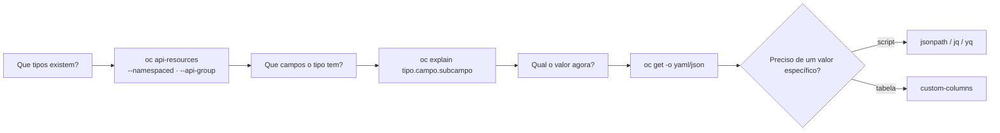

# 2.3 — Inspecionar recursos do Kubernetes

| Campo | Valor |
|-------|-------|
| Curso | DO180 — OpenShift 4.22 |
| Capítulo / seção | Capítulo 2 · Seção 2.3 |
| Título original | Inspect Kubernetes Resources |
| Título em português | Inspecionar recursos do Kubernetes |
| Objetivo | Consultar, formatar e filtrar atributos de recursos Kubernetes |
| Pré-requisitos | [2.1](2.1-interfaces-de-linha-de-comando.md), [F5](../../01-fundamentos-essenciais/05-kubernetes-api-e-yaml.md) |
| Referência | PDF p. 103–112 · Guided Exercise 2.4 p. 113–122 |

## Parte A — Entendendo o conceito

### Tudo é um objeto da API

O Kubernetes representa **o estado desejado de tudo** no cluster como objetos da
API. Toda tarefa administrativa se resume a **criar, ler e alterar** esses
objetos. Para isso, você precisa saber responder a três perguntas:

| Pergunta | Ferramenta |
|----------|-----------|
| Que **tipos** de recurso existem? | `oc api-resources` |
| Que **campos** um tipo aceita? | `oc explain` |
| Qual o **valor atual** de um campo? | `oc get -o yaml/json/jsonpath/custom-columns` |

### Lendo `oc api-resources`

| Coluna | Significado |
|--------|-------------|
| `NAME` | Nome do recurso na API (plural, minúsculo): `deployments` |
| `SHORTNAMES` | Abreviações para digitar menos: `deploy`, `cm`, `svc`, `po`, `sts` |
| `APIVERSION` | `grupo/versão`. Para o grupo **core**, o grupo fica vazio e aparece só `v1` |
| `NAMESPACED` | `true` = existe dentro de um namespace; `false` = escopo de cluster |
| `KIND` | Nome formal do tipo no schema, usado no campo `kind:` do YAML |

Namespace e projeto: há sempre uma relação **um para um** entre um projeto
OpenShift e um namespace.

Filtros úteis:

| Opção | Efeito |
|-------|--------|
| `--namespaced=true` / `--namespaced=false` | Só recursos de namespace / só de cluster |
| `--api-group apps` | Só um grupo de API; `--api-group ''` mostra o grupo core |
| `--sort-by name` ou `--sort-by kind` | Ordena a lista |
| `-o name` | Só os nomes (útil com `wc -l` para contar) |

### Os principais tipos (visão do curso)

| Tipo (`shortname`) | Papel |
|--------------------|-------|
| Pod (`po`) | Containers que compartilham IP e volumes; unidade de trabalho |
| Service (`svc`) | IP/porta únicos de acesso a um conjunto de Pods; por padrão distribui em *round-robin* |
| ReplicaSet (`rs`) | Garante N réplicas de Pod; normalmente criado por um Deployment |
| PersistentVolume (`pv`) | Área de armazenamento para Pods |
| PersistentVolumeClaim (`pvc`) | Pedido de armazenamento que liga um PV a um Pod |
| ConfigMap (`cm`) e Secret | Pares chave-valor usados por outros recursos. Secrets são **codificados (não criptografados)** e têm acesso restrito |
| Deployment (`deploy`) | Modelo dos Pods (imagem, armazenamento, comandos) e estratégia de implantação |
| Build | Processo que transforma uma entrada (ex.: código) em uma saída utilizável (ex.: imagem) — OpenShift |
| BuildConfig (`bc`) | Define um build: fonte, estratégia e destino — OpenShift |
| Route | Hostname DNS reconhecido pelo roteador do OpenShift como ponto de entrada — OpenShift |

### Estrutura de um objeto: `spec` × `status` e *conditions*

- Você escreve o **`spec`** (desejado). Os controllers escrevem o **`status`**
  (atual) durante toda a vida do objeto. Ao criar, **não** se informa `status`.
- O `status` costuma trazer uma lista de **conditions**, cada uma com:

| Campo | Exemplo | Significado |
|-------|---------|-------------|
| `type` | `ContainersReady`, `Ready`, `Available` | Qual aspecto está sendo avaliado |
| `status` | `"True"`, `"False"`, `"Unknown"` | Estado da condição (é **string**) |
| `reason` | `RequirementsNotMet` | Motivo em formato de código (opcional) |
| `message` | `2/3 containers are running` | Explicação legível (opcional) |
| `lastTransitionTime` | carimbo de data/hora | Quando a condição mudou pela última vez |

Ler conditions é a forma mais confiável de saber **por que** um recurso não está
pronto. Esse padrão vale para Pods, nós, Deployments e Cluster Operators (seção 2.5).

### Labels e seletores na CLI

Labels são pares chave-valor em `metadata.labels`. Com `-l` ou `--selector` você
filtra qualquer listagem:

```bash
oc get pods -l app=web
oc get pods --selector 'group=developers,tier!=cache'
oc get pods --show-labels
```

### Formatos de saída

| Opção | Saída | Para quem |
|-------|-------|-----------|
| (padrão) | Tabela com colunas principais | Leitura rápida |
| `-o wide` | Tabela com colunas extras (Pods: `IP`, `NODE`, `NOMINATED NODE`, `READINESS GATES`) | Leitura rápida com contexto |
| `oc describe` | Texto detalhado com recursos relacionados e eventos | Diagnóstico humano. ⚠️ O formato **pode mudar entre versões**: não use em scripts |
| `-o yaml` / `-o json` | Objeto completo | Scripts, backup, análise |
| `-o jsonpath=...` | Campos específicos | Scripts sem ferramentas extras |
| `-o custom-columns=...` | Tabela com as colunas que você escolher | Relatórios legíveis |
| `-o go-template=...` | Formatação com lógica (laços, condicionais) | Saídas avançadas |
| `-o name` | `tipo/nome` | Encadear com outros comandos |

`oc describe TYPE NAME-PREFIX` procura primeiro um nome exato; se não houver,
descreve **todos** os objetos cujo nome começa com o prefixo.

### Qual ferramenta de filtro escolher

| Ferramenta | Quando usar | Observação |
|------------|-------------|------------|
| `yq` | Filtrar YAML mantendo legibilidade | Existem **dois** `yq` diferentes e incompatíveis (Mike Farah e kislyuk) |
| `jq` | Consultas e transformações JSON complexas em scripts | Precisa estar instalado |
| JSONPath | Consultas simples, **sem instalar nada** | Embutido no `oc`/`kubectl` |
| Custom columns | Tabelas legíveis com campos escolhidos | Embutido |
| Go templates | Formatação com lógica condicional | Embutido |

## Parte B — Modelo mental



Pense no `oc explain` como o **manual** e no `oc get -o json` como a **ficha
preenchida**. Os caminhos de campo são os mesmos nos dois: `spec.containers[].image`
no manual corresponde a `.spec.containers[0].image` na ficha.

## Parte C — Funcionamento na prática

### Descobrir tipos

```bash
oc api-resources --namespaced=true --api-group apps --sort-by name
oc api-resources --api-group ''                 # grupo core
oc api-resources --api-group config.openshift.io
oc api-resources --namespaced=false -o name | wc -l
```

- **Resultado:** tabela `NAME SHORTNAMES APIVERSION NAMESPACED KIND`.
- **Uso:** descobrir o *shortname*, o grupo correto para o `apiVersion` do YAML e se o tipo exige `-n`.

### Descobrir campos

```bash
oc explain pod                                  # campos de primeiro nível
oc explain pod.spec.securityContext             # um campo aninhado
oc explain deployment.spec.strategy --recursive # árvore sem descrições
```

- **Interpretação:** cada campo vem com o tipo: `<string>`, `<integer>`, `<boolean>`,
  `<Object>`, `<[]Object>` (lista), `<map[string]string>`. `-required-` marca
  obrigatórios. As informações vêm do servidor em formato OpenAPI, portanto
  refletem **a versão do seu cluster**.
- **Erro comum:** `error: field "X" does not exist`: caminho errado. Volte um nível e confira o nome exato (diferencia maiúsculas).

### Ler um objeto: exemplo original comentado

```yaml
apiVersion: v1                 # grupo core, versão v1
kind: Pod                      # schema Pod
metadata:
  name: catalogo-api           # nome único no namespace
  namespace: loja              # projeto onde vive
  labels:
    app: catalogo-api          # usado por Services e por -l
    tier: backend
spec:                          # estado desejado
  containers:
    - name: api                # nome do container (importa em Pods com vários)
      image: registry.access.redhat.com/ubi9/python-312:latest
      ports:
        - containerPort: 8080
      env:
        - name: LOG_LEVEL
          value: info
status:                        # escrito pelo cluster
  phase: Running
  podIP: 10.128.2.17
  conditions:
    - type: Ready
      status: "True"
```

### Extrair valores

Exemplos sobre os Pods do projeto atual:

```bash
# yq (Mike Farah) e jq: primeiro item da lista
oc get pods -o yaml | yq '.items[0].status.podIP'
oc get pods -o json | jq '.items[0].status.podIP'
oc get pods -o json | jq -r '.items[].status.podIP'      # todos; -r tira as aspas

# JSONPath embutido
oc get pod <POD> -o jsonpath='{.status.podIP}{"\n"}'
oc get pods -o jsonpath='{range .items[*]}{.metadata.name}{"\t"}{.status.podIP}{"\n"}{end}'

# Custom columns
oc get pods -o custom-columns=POD:.metadata.name,FASE:.status.phase,IP:.status.podIP,NO:.spec.nodeName

# Go template
oc get pods -o go-template='{{range .items}}{{.metadata.name}}{{"\n"}}{{end}}'
```

| Elemento | Significado |
|----------|-------------|
| `.items` | Em listagens (`oc get pods`), os objetos vêm dentro de uma lista `items` |
| `[0]` | Primeiro elemento |
| `[*]` (JSONPath) / `[]` (jq) | Todos os elementos |
| `{range ...}{end}` | Laço do JSONPath |
| `{"\n"}` | Texto literal (quebra de linha) |

⚠️ **Erros comuns:**
- Esquecer `.items` ao filtrar uma **lista**, ou usá-lo ao filtrar um **único** objeto (`oc get pod <nome>`).
- JSONPath sem aspas simples no shell: o `{}` e o `$` são interpretados pelo Bash.
- Usar a sintaxe de um `yq` no outro.

## Parte D — Relações importantes

| A | B | Diferença essencial |
|---|---|--------------------|
| `oc api-resources` | `oc api-versions` | Tipos disponíveis (com escopo e kind) × apenas os pares `grupo/versão` |
| `oc explain` | `oc get -o yaml` | Documentação do schema × valores reais de um objeto |
| `NAME` | `KIND` | `deployments` (recurso na URL/CLI) × `Deployment` (campo `kind:`) |
| `spec` | `status` | Desejado (você) × atual (controllers) |
| `oc describe` | `-o yaml/json` | Para humanos, formato instável × para scripts, formato estável |
| JSONPath | `jq` | Embutido e simples × externo e poderoso |
| Label | Selector | O rótulo × o filtro que o usa |

## Parte E — Preparação para o laboratório

Atividade associada: **2.4 Guided Exercise — Inspect Kubernetes Resources**
(`cli-resources`, PDF p. 113–122).

Você deve conseguir:

- Listar tipos de recurso e filtrá-los por escopo e por grupo de API (core, `apps`, `config.openshift.io`).
- Usar `oc explain` para navegar até um campo aninhado.
- Mostrar recursos em YAML e JSON e extrair campos com `jq`, JSONPath e custom columns.
- Identificar condições no `status`.

Ver [PRATICA-OFICIAL.md](PRATICA-OFICIAL.md#24-guided-exercise-inspect-kubernetes-resources).

## Parte F — Fixação

1. Você precisa escrever o `apiVersion` correto de um StatefulSet sem consultar a internet. Como descobre?
2. Qual a diferença entre `oc api-resources --api-group ''` e `oc api-resources --api-group apps`?
3. Um script de monitoramento usa `oc describe pod | grep IP` e quebrou após uma atualização do cluster. Por quê, e como reescrevê-lo?
4. Escreva um comando que mostre, em tabela, o nome de cada Pod e a imagem do primeiro container.
5. Um Pod está `Running`, mas o Service não envia tráfego para ele. Que campo do `status` você inspecionaria?

<details>
<summary>Respostas comentadas</summary>

1. `oc api-resources | grep -i statefulset` (coluna `APIVERSION` = `apps/v1`) ou `oc explain statefulset` (linha `GROUP`/`VERSION`).
2. A primeira lista os tipos do grupo **core** (`v1`: Pod, Service, ConfigMap...); a segunda, os do grupo `apps` (Deployment, ReplicaSet, StatefulSet, DaemonSet, ControllerRevision).
3. O formato do `describe` é para humanos e pode mudar entre versões. Use saída estável: `oc get pod <nome> -o jsonpath='{.status.podIP}'`.
4. `oc get pods -o custom-columns=POD:.metadata.name,IMAGEM:.spec.containers[0].image`.
5. As **conditions**, especialmente `type: Ready`. Pod `Running` com `Ready` em `"False"` não entra nos endpoints do Service ([F6](../../01-fundamentos-essenciais/06-redes-e-servicos.md)).

</details>

## Parte G — Essencial para memorizar

- `oc api-resources` (tipos, shortnames, grupo, escopo) · `oc explain tipo.campo` (schema) · `oc get -o` (valores).
- Grupo core = `v1`; `--api-group ''` lista o core.
- `spec` desejado; `status` atual, com **conditions** (`type`, `status`, `reason`, `message`, `lastTransitionTime`).
- Filtros: `-l`/`--selector`, `--show-labels`.
- Saídas: `-o wide|yaml|json|jsonpath|custom-columns|go-template|name`.
- ⚠️ Não use `oc describe` em scripts. Listas → `.items`.

---
[← 2.1 Interfaces de linha de comando](2.1-interfaces-de-linha-de-comando.md) | [Índice do capítulo](README.md) | [Próximo: 2.5 Saúde do cluster →](2.5-avaliar-a-saude-do-cluster.md)
