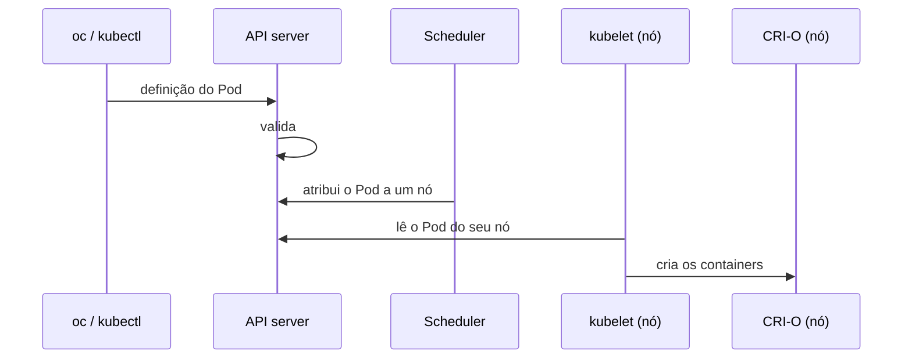
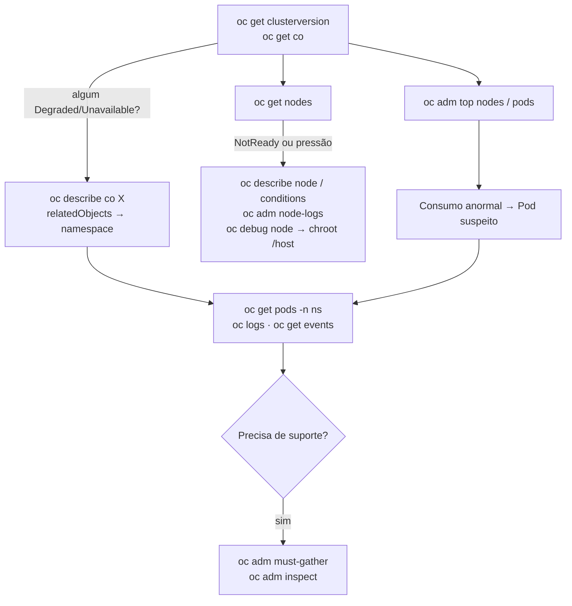

# 2.5 — Avaliar a saúde de um cluster OpenShift

| Campo | Valor |
|-------|-------|
| Curso | DO180 — OpenShift 4.22 |
| Capítulo / seção | Capítulo 2 · Seção 2.5 |
| Título original | Assess the Health of an OpenShift Cluster |
| Título em português | Avaliar a saúde de um cluster OpenShift |
| Objetivo | Consultar a saúde dos serviços e componentes essenciais do cluster |
| Pré-requisitos | [2.3](2.3-inspecionar-recursos-kubernetes.md), [1.7](../01-introducao-kubernetes-openshift/1.7-monitorar-um-cluster-openshift.md), [F3](../../01-fundamentos-essenciais/03-arquitetura-openshift.md) |
| Referência | PDF p. 123–136 · Guided Exercise 2.6 p. 137–144 |

## Parte A — Entendendo o conceito

Na seção 1.7 você avaliou o cluster pela console. Aqui a mesma investigação é
feita **pela CLI**, de cima para baixo: Operators → métricas → eventos e alertas →
nós → Pods → coleta para o suporte.

### 1. Operators: quem mantém a plataforma

Operators automatizam tarefas que, sem eles, exigiriam intervenção humana. São o
método preferido para empacotar, implantar e gerenciar serviços no control plane.
Como o **CRI-O** e o **kubelet** rodam em cada nó, quase todo o resto (inclusive
rede e serviços de credenciais) pode ser gerenciado por Operators.

Há dois sistemas de gerenciamento:

| Sistema | Gerencia | Recurso | Comando (admin) |
|---------|----------|---------|-----------------|
| **Cluster Version Operator (CVO)** | **Cluster operators**: funções da plataforma, instaladas por padrão | `clusteroperators` (`co`) | `oc get clusteroperators` |
| **Operator Lifecycle Manager (OLM)** | Operators **adicionais** (add-ons), opcionais | `operators` | `oc get operators` |

Para cada Cluster Operator, as colunas `AVAILABLE`, `PROGRESSING` e `DEGRADED`
resumem as conditions. O estado saudável típico é `True / False / False`.

Os Pods de um operador ficam em namespaces listados em **`relatedObjects`** no
`status` do ClusterOperator (por exemplo, `openshift-dns-operator`).

### 2. Métricas de uso

- **CLI:** `oc adm top` mostra consumo **atual** de CPU e memória de nós e Pods
  (dados da pilha de monitoramento).
- **Console** (exige perfil de administrador ou as roles `view` ou `cluster-monitoring-view`):
  - **Home › Overview**: capacidade e uso do cluster (CPU, memória, storage, rede),
    séries temporais e **top consumers**, ordenáveis por projeto, Pod ou nó. É
    ótimo para achar, por exemplo, um Pod com vazamento de memória.
  - **Home › Projects › *projeto***: utilização do projeto; se houver quota,
    mostra também requests e limits.
  - **Detalhe do Pod**: gráficos de CPU, memória e sistema de arquivos; picos aparecem aqui.
  - **Observe › Metrics**: consultas **PromQL** diretamente na console (PromQL não é aprofundada no curso).
- Todas as métricas vêm do **Prometheus**.

### 3. Eventos e alertas

- **Eventos** são objetos que o Kubernetes gera a cada mudança relevante de estado
  (container iniciado, Pod destruído, falha de pull...). São "logs de alto nível".
- A pilha de monitoramento (baseada em Prometheus) vive em `openshift-monitoring`
  e monitora os componentes centrais por padrão; o monitoramento de **projetos de
  usuário** é opcional.
  - O **Prometheus Operator** cria e gerencia as instâncias de Prometheus e Alertmanager.
  - `prometheus-k8s-0`: Pod do Prometheus, que avalia as regras e gera alertas.
  - `alertmanager-main-0`: Pod do Alertmanager, que recebe os alertas e os envia a
    sistemas externos por meio de **receivers**.

### 4. Nós

| Indicador | Significado quando ocorre |
|-----------|---------------------------|
| `STATUS Ready` | Nó saudável, aceitando Pods |
| `STATUS NotReady` | Alguma condição falhou; o nó não aceita novos Pods |
| `SchedulingDisabled` (no STATUS) | Nó marcado como não agendável (*cordon*) |
| Condition `MemoryPressure=True` | Pouca memória |
| Condition `DiskPressure=True` | Pouco disco; Pods podem ser **despejados** (*evicted*) para liberar espaço |
| Condition `PIDPressure=True` | Processos demais no nó |
| Condition `NetworkUnavailable=True` | Rede do nó mal configurada |
| Condition `Ready=False` | Nó não saudável; geralmente runtime, kubelet ou rede com problema |

Observe a lógica invertida: nas condições de **pressão**, o saudável é `False`; em
`Ready`, o saudável é `True`.

**Capacity × Allocatable:** `capacity` é o total físico do nó; `allocatable` é o
que sobra para Pods depois das reservas do sistema e do kubelet. O scheduler
decide com base no **allocatable**.

Em **hosted control planes** (ex.: ROSA com HCP, Azure Red Hat OpenShift), os nós
de control plane rodam em um cluster de gerenciamento separado e `oc get nodes`
mostra só os compute nodes.

### 5. Serviços do nó: kubelet e CRI-O

O caminho de um Pod criado pela CLI resume por que esses dois serviços importam:



Todo nó precisa de `kubelet` e `crio` **ativos**. Eles são serviços systemd do
host, verificados por um *debug pod* no nó.

### 6. Pods: logs e depuração

- O OpenShift redireciona **stdout/stderr** dos containers para o armazenamento
  efêmero do container. Por isso `oc logs` funciona **mesmo após o container
  parar**, desde que o **Pod ainda exista**.
- `oc debug` cria uma **cópia** de um Pod (ou de um controller que cria Pods) para
  investigar, com diferenças importantes:

| Na cópia de debug | Por quê |
|-------------------|---------|
| Labels removidos | Para não receber tráfego de Services nem ser contada por controllers |
| Comando trocado por `/bin/sh` (ou `cmd.exe` no Windows) | Para você ter um shell mesmo se a aplicação falha ao iniciar |
| Readiness e liveness probes desativadas | Para o Pod não ser reiniciado durante a investigação |

  Útil quando `oc rsh`/`oc exec` não funcionam porque o Pod está falhando ou não tem shell.

### 7. Coleta para o suporte

| Ferramenta | O que coleta | Uso típico |
|------------|--------------|-----------|
| `oc adm must-gather` | Definições de recursos e logs de serviço mais úteis para depuração, de todo o cluster | Anexar ao chamado da Red Hat, junto com o **ID do cluster** |
| `oc adm inspect` | Mesmo tipo de dado, só dos recursos indicados | Investigar um componente específico |

O `must-gather` cria um Pod em um namespace temporário, coleta os dados e os
baixa para a sua máquina (padrão: `./must-gather.local.<sufixo>`).

## Parte B — Modelo mental

Roteiro de verificação de saúde, do geral para o específico:



## Parte C — Funcionamento na prática

Todos os comandos desta seção exigem **perfil de administrador do cluster**, exceto
os de logs, eventos e debug dentro dos seus próprios projetos.

### Operators

```bash
oc get clusteroperators                       # visão geral
oc describe clusteroperators openshift-apiserver
oc get clusteroperator dns -o yaml            # formato estável para análise
oc get clusteroperator authentication -o jsonpath='{.status.conditions}' | jq
oc get operators                              # add-ons gerenciados pelo OLM
```

- **Interpretação:** procure linhas com `AVAILABLE False` ou `DEGRADED True`; leia `message` e `reason` nas conditions.
- `relatedObjects` aponta os namespaces e recursos que o operador gerencia.

### Pods de componentes da plataforma

```bash
oc get pods -n openshift-dns-operator
oc get pod -n openshift-dns-operator <POD> -o json | jq .status.conditions
oc get pods -n openshift-etcd --show-labels
```

- Pods `installer-*` em `Completed` são normais: são tarefas que terminaram.

### Consumo de recursos

```bash
oc adm top nodes                               # CPU/memória por nó
oc adm top pods -A --sum                       # todos os Pods + total geral
oc adm top pods -n openshift-etcd              # um namespace
oc adm top pods etcd-master01 -n openshift-etcd --containers   # por container
```

- **Erro comum:** `metrics not available yet` logo após a criação do Pod ou com a pilha de monitoramento degradada.

### Eventos

```bash
oc get events                                         # projeto atual
oc get events -n openshift-kube-controller-manager
oc get events -A --sort-by .metadata.creationTimestamp
oc describe pod <POD>                                 # eventos de um Pod, no final
```

- `TYPE Warning` merece atenção; `Normal` é informativo.
- Ordenar por `.metadata.creationTimestamp` (usado no curso) ou `.lastTimestamp` (usado na [lição 1.7](../01-introducao-kubernetes-openshift/1.7-monitorar-um-cluster-openshift.md)) produz resultados parecidos.

### Alertas pela API (avançado)

```bash
oc get all -n openshift-monitoring
oc -n openshift-monitoring exec -c prometheus prometheus-k8s-0 -- \
  curl -s 'http://localhost:9090/api/v1/alerts' | jq
oc -n openshift-monitoring exec -c alertmanager alertmanager-main-0 -- \
  curl -s 'http://localhost:9093/api/v2/alerts' | jq
```

- `oc exec` roda o `curl` **dentro** do container. Por isso `localhost` é o próprio Prometheus/Alertmanager.
- O `-c` escolhe o container certo em Pods com vários containers.
- Na prática, a console (*Observe › Alerting*) é o caminho mais simples.

### Nós

```bash
oc cluster-info                                  # control plane responde?
oc get nodes                                     # STATUS e ROLES
oc describe node master01                        # condições, capacidade, alocado, eventos
oc get node master01 -o json | jq '.status.conditions'
oc get node master01 -o jsonpath='{.status.allocatable.pods}{"\n"}'
oc get node master01 -o jsonpath='{"Capacity CPU: "}{.status.capacity.cpu}{"\nAllocatable CPU: "}{.status.allocatable.cpu}{"\n"}'
oc get node master01 -o jsonpath='{.status.addresses[?(@.type=="InternalIP")].address}{"\n"}'
```

- O último comando usa um **filtro** JSONPath `[?(@.campo=="valor")]` para escolher um item da lista. Útil para pegar o IP interno.
- No laboratório o nó único tem os papéis `control-plane,master,worker`.

### Logs do nó e serviços

```bash
oc adm node-logs master01 -u kubelet --tail 5     # unidade systemd
oc adm node-logs master01 -u crio --tail 1
oc adm node-logs --role master -u kubelet         # todos os nós com o papel
oc adm node-logs master01 --path=cron             # arquivo em /var/log
```

| Opção | Efeito |
|-------|--------|
| `<nó>` | Um nó específico |
| `--role master` | Nós com o papel |
| `-u <unit>` | Unidade systemd (`kubelet`, `crio`) |
| `--path=<arquivo>` | Arquivo de log do host |
| `--tail N` | Últimas N entradas |

⚠️ Logs de nó podem conter dados sensíveis; por isso são restritos a administradores.

Verificação direta dos serviços:

```bash
oc debug node/master01
# no debug pod:
chroot /host
for s in kubelet crio; do echo "--- $s"; systemctl is-active $s; done
systemctl status kubelet --no-pager
exit; exit
```

- O `oc debug node` cria um namespace temporário (`openshift-debug-...`), roda o Pod no nó e o apaga ao sair.
- O próprio comando avisa: **tudo o que for digitado na sessão fica registrado nos logs do container**, inclusive credenciais.

### Logs e debug de Pods

```bash
oc logs <POD>                         # Pod com um container
oc logs <POD> -c <CONTAINER>          # Pod com vários containers
oc debug deployment/<NOME>            # cópia do Pod do Deployment com shell
oc debug job/<NOME> --as-user=1000000 # testa execução como não root
oc debug pod/<POD> --as-root          # testa como root
oc debug --image=<IMAGEM>             # shell em uma imagem específica
oc debug                              # shell com a imagem de ferramentas do OpenShift
```

- `--as-user` ajuda a reproduzir o problema clássico de imagens que **exigem root**,
  bloqueadas pelas políticas de segurança do OpenShift (tema dos capítulos 3 e DO280).

### Coleta para o suporte

```bash
oc adm must-gather --dest-dir ~/must-gather
tar cvaf must-gather-$(date +%F-%H%M)-<CLUSTER_ID>.tar.gz ~/must-gather
oc adm inspect clusteroperator/kube-apiserver --dest-dir ~/inspect --since 5m
```

📘 *Fonte externa:* o ID do cluster é obtido com
`oc get clusterversion -o jsonpath='{.items[0].spec.clusterID}{"\n"}'`.

- `--since` aceita durações relativas (`5s`, `2m`, `3h`) e limita os logs coletados.

## Parte D — Relações importantes

| A | B | Diferença essencial |
|---|---|--------------------|
| CVO / cluster operators | OLM / operators | Plataforma, instalada por padrão × add-ons opcionais |
| `oc get co` | `oc get operators` | Recursos `clusteroperators` × `operators` |
| `oc describe` | `-o yaml/json` | Leitura humana × formato estável (scripts) |
| `capacity` | `allocatable` | Total do nó × disponível para Pods |
| Condition de pressão | Condition `Ready` | Saudável = `False` × saudável = `True` |
| `oc adm node-logs` | `oc debug node` | Logs sem shell × shell completo no host |
| `oc logs` | `oc debug` | Ver saída do container × abrir uma **cópia** do Pod para investigar |
| `oc exec` / `oc rsh` | `oc debug` | Entra no **mesmo** Pod (precisa estar rodando e ter shell) × cria uma cópia modificada |
| Prometheus | Alertmanager | Coleta métricas e avalia regras × recebe alertas e notifica |
| `must-gather` | `inspect` | Cluster inteiro × recursos específicos |
| `oc adm top` | Observe › Metrics | Instantâneo de CPU/memória × séries temporais e PromQL |

## Parte E — Preparação para o laboratório

Atividade associada: **2.6 Guided Exercise — Assess the Health of an OpenShift
Cluster** (`cli-health`, PDF p. 137–144).

Você deve conseguir:

- Listar cluster operators e operators do OLM e ver detalhes de um deles.
- Ver status, consumo e eventos de Pods da plataforma.
- Extrair conditions, capacidade e allocatable de um nó com `jq` e JSONPath.
- Ver logs do kubelet e do CRI-O e confirmar que estão ativos.
- Ver eventos e alertas.
- Gerar dados de depuração com `must-gather` e `inspect`.

Ver [PRATICA-OFICIAL.md](PRATICA-OFICIAL.md#26-guided-exercise-assess-the-health-of-an-openshift-cluster).

## Parte F — Fixação

1. `oc get co` mostra `authentication` com `AVAILABLE True`, `PROGRESSING False`, `DEGRADED True`. Qual o próximo comando e o que procurar?
2. Por que `oc logs` às vezes funciona para um container que já parou, mas não para um Pod apagado?
3. O nó mostra `DiskPressure True`. Que consequência isso pode ter para os Pods?
4. Um Pod entra em `CrashLoopBackOff` logo ao iniciar e a imagem não tem shell. Como investigar seu ambiente?
5. Escreva um comando que mostre só a quantidade de Pods alocáveis do nó `worker-1`.
6. Você vai abrir um chamado na Red Hat sobre lentidão na API. O que coletar?

<details>
<summary>Respostas comentadas</summary>

1. `oc describe co authentication` ou `oc get co authentication -o jsonpath='{.status.conditions}' | jq`. Leia `reason` e `message` da condition `Degraded` e siga `relatedObjects` até os Pods (`oc get pods -n openshift-authentication`).
2. Os logs ficam no armazenamento efêmero do container enquanto o **Pod existe**. Apagado o Pod, os logs locais se perdem.
3. O kubelet pode **despejar** (*evict*) Pods para liberar disco, e novos Pods tendem a não ser agendados ali.
4. `oc debug deployment/<nome>` (ou `oc debug pod/<nome>`): cria uma cópia com `/bin/sh` e sem probes. Se a imagem não tem shell, use `oc debug ... --image=<imagem-com-ferramentas>` ou inspecione logs e eventos (`oc logs --previous`, `oc describe`).
5. `oc get node worker-1 -o jsonpath='{.status.allocatable.pods}{"\n"}'`.
6. `oc adm must-gather` (de todo o cluster), compactado e nomeado com o **ID do cluster**; opcionalmente `oc adm inspect clusteroperator/kube-apiserver --since <tempo>`.

</details>

## Parte G — Essencial para memorizar

- CVO → `oc get clusteroperators` (plataforma) · OLM → `oc get operators` (add-ons).
- Saudável: `AVAILABLE True / PROGRESSING False / DEGRADED False`.
- `oc adm top nodes|pods [-A --sum] [--containers]`.
- `oc get events [-A] --sort-by .metadata.creationTimestamp`.
- Nó: `Ready` deve ser `True`; pressões devem ser `False`; scheduler usa **allocatable**.
- `oc adm node-logs <nó> -u kubelet|crio --tail N` · `oc debug node/<nó>` → `chroot /host`.
- `oc debug` = cópia do Pod, sem labels, com `/bin/sh`, sem probes; `--as-user`/`--as-root`.
- Suporte: `oc adm must-gather --dest-dir` + ID do cluster; `oc adm inspect ... --since`.

---
[← 2.3 Inspecionar recursos](2.3-inspecionar-recursos-kubernetes.md) | [Índice do capítulo](README.md) | [Próximo: Prática oficial →](PRATICA-OFICIAL.md)
