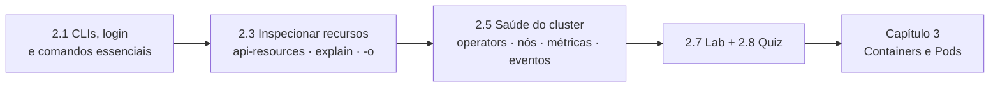

# Capítulo 2 — Kubernetes and OpenShift Command-line Interfaces and APIs

**Título em português:** Interfaces de linha de comando e APIs do Kubernetes e do OpenShift
**Status:** ✅ concluído e validado
**Referência:** PDF p. 83–156

## Objetivo do capítulo

Acessar um cluster OpenShift pela **linha de comando** e consultar seus recursos da
API do Kubernetes para **avaliar a saúde** do cluster.

## Por que este capítulo importa

O Capítulo 1 observou o cluster pela console. Aqui as mesmas perguntas (o que
existe, em que estado está, o que deu errado) passam a ser respondidas pela CLI,
de forma repetível e automatizável. Daqui em diante o curso usa principalmente o
`oc`, e a velocidade nesses comandos é decisiva no EX280.

## Seções e atividades (ordem oficial)

| Seção | Tipo | Título original | Material | PDF |
|-------|------|-----------------|----------|-----|
| 2.1 | Conceito | The Kubernetes and OpenShift Command-line Interfaces | [lição](2.1-interfaces-de-linha-de-comando.md) | p. 84–94 |
| 2.2 | Guided Exercise | The Kubernetes and OpenShift Command-line Interfaces | [prática](PRATICA-OFICIAL.md#22-guided-exercise-the-kubernetes-and-openshift-command-line-interfaces) | p. 95–102 |
| 2.3 | Conceito | Inspect Kubernetes Resources | [lição](2.3-inspecionar-recursos-kubernetes.md) | p. 103–112 |
| 2.4 | Guided Exercise | Inspect Kubernetes Resources | [prática](PRATICA-OFICIAL.md#24-guided-exercise-inspect-kubernetes-resources) | p. 113–122 |
| 2.5 | Conceito | Assess the Health of an OpenShift Cluster | [lição](2.5-avaliar-a-saude-do-cluster.md) | p. 123–136 |
| 2.6 | Guided Exercise | Assess the Health of an OpenShift Cluster | [prática](PRATICA-OFICIAL.md#26-guided-exercise-assess-the-health-of-an-openshift-cluster) | p. 137–144 |
| 2.7 | Lab | Kubernetes and OpenShift Command-line Interfaces and APIs | [prática](PRATICA-OFICIAL.md#27-lab-kubernetes-and-openshift-command-line-interfaces-and-apis) | p. 145–152 |
| 2.8 | Quiz | Kubernetes and OpenShift Command-line Interfaces and APIs | [prática](PRATICA-OFICIAL.md#28-quiz-kubernetes-and-openshift-command-line-interfaces-and-apis) | p. 153–155 |
| 2.9 | Summary | Summary | [RESUMO.md](RESUMO.md) | p. 156 |

## Arquivos do capítulo

- [PRATICA-OFICIAL.md](PRATICA-OFICIAL.md): ponte com as atividades oficiais.
- [REVISAO.md](REVISAO.md): questões autorais integradas.
- [RESUMO.md](RESUMO.md): síntese e tabela de comandos.

## Pré-requisitos recomendados

[Capítulo 1](../01-introducao-kubernetes-openshift/README.md) ·
[F5 — API e YAML](../../01-fundamentos-essenciais/05-kubernetes-api-e-yaml.md) ·
[F8 — Ferramentas](../../01-fundamentos-essenciais/08-ferramentas-de-administracao.md)

## Checklist

- [ ] 2.1 lida e Parte F respondida
- [ ] 2.2 Guided Exercise `cli-interfaces` concluído
- [ ] 2.3 lida e Parte F respondida
- [ ] 2.4 Guided Exercise `cli-resources` concluído
- [ ] 2.5 lida e Parte F respondida
- [ ] 2.6 Guided Exercise `cli-health` concluído
- [ ] 2.7 Lab `cli-review` com `lab grade` aprovado
- [ ] 2.8 Quiz respondido
- [ ] [REVISAO.md](REVISAO.md) respondida
- [ ] Registro no [diário de laboratórios](../../progresso/diario-de-laboratorios.md)

---
[← Capítulo 1](../01-introducao-kubernetes-openshift/README.md) | [Índice geral](../../README.md) | [Próximo: 2.1 Interfaces de linha de comando →](2.1-interfaces-de-linha-de-comando.md)
