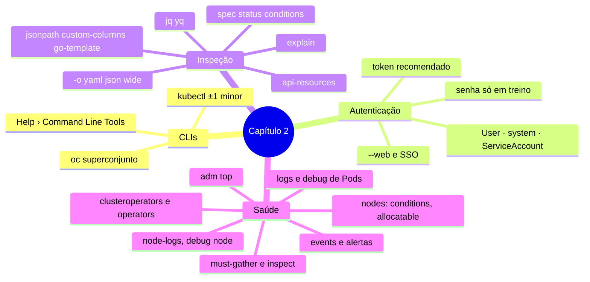

# Resumo — Capítulo 2

Síntese autoral para revisão rápida. Correspondência oficial: seção 2.9 (PDF p. 156).

## Em uma frase por seção

| Seção | Ideia central |
|-------|---------------|
| 2.1 | `oc` é um superconjunto do `kubectl`; autentique-se de preferência por **token**; todo comando atua no projeto atual, salvo com `-n` |
| 2.3 | Toda administração é ler e alterar objetos da API: `api-resources` (tipos), `explain` (campos), `get -o` (valores), com filtros JSONPath/`jq`/custom columns |
| 2.5 | A saúde do cluster se lê em camadas: operators (CVO/OLM), métricas (`oc adm top`), eventos/alertas, nós (conditions, logs, kubelet/crio), Pods (logs, `oc debug`) e coleta (`must-gather`, `inspect`) |

## Mapa do capítulo

## Tabela de comandos do capítulo

| Tarefa | Comando |
|--------|---------|
| Login por token | `oc login --token=<t> --server=<api>` |
| Login pelo navegador | `oc login --web <api>` |
| Versões cliente/servidor | `oc version` · `kubectl version --client` |
| Endereço do control plane | `oc cluster-info` |
| Versões de API | `oc api-versions` |
| Tipos de recurso | `oc api-resources [--namespaced=true\|false] [--api-group X] [--sort-by name]` |
| Campos | `oc explain <tipo>.<campo> [--recursive]` |
| Visão do projeto | `oc get all` · `oc status --suggest` |
| Saída estruturada | `-o yaml\|json\|wide\|name` |
| Extrair campo | `-o jsonpath='{...}'` · `\| jq` · `\| yq` |
| Tabela personalizada | `-o custom-columns=COL:.campo,...` |
| Filtrar por label | `-l chave=valor` · `--show-labels` |
| Saúde da plataforma | `oc get clusteroperators` · `oc describe co <x>` |
| Operators do OLM | `oc get operators` |
| Consumo | `oc adm top nodes` · `oc adm top pods -A --sum` · `--containers` |
| Eventos | `oc get events [-A] --sort-by .metadata.creationTimestamp` |
| Nós | `oc get nodes` · `oc describe node` · `jq '.status.conditions'` |
| Logs do nó | `oc adm node-logs <nó> -u kubelet\|crio --tail N` |
| Shell no nó | `oc debug node/<nó>` → `chroot /host` |
| Logs de Pod | `oc logs <pod> [-c <container>]` |
| Cópia de depuração | `oc debug deployment/<x> [--as-user=UID\|--as-root\|--image=...]` |
| Suporte | `oc adm must-gather --dest-dir <dir>` · `oc adm inspect <recurso> --since <t>` |

## Alertas operacionais

- ⚠️ Senha na linha de comando (`-p`) só em treinamento.
- ⚠️ `oc describe` não serve para scripts: o formato muda entre versões.
- ⚠️ `oc get all` não inclui todos os tipos.
- ⚠️ Logs de nó e sessões de `oc debug` podem registrar dados sensíveis.
- ⚠️ `oc delete` em recurso gerenciado gera recriação; apagar projeto apaga tudo.

## Ligação com o próximo capítulo

O Capítulo 3 usa estas ferramentas de inspeção para **criar e diagnosticar**
containers e Pods: `oc run`, `oc logs`, `oc exec`, `oc debug` e inspeção de imagens.

---
[← Revisão](REVISAO.md) | [Índice do capítulo](README.md) | [Próximo capítulo →](../03-containers-e-pods/README.md)
