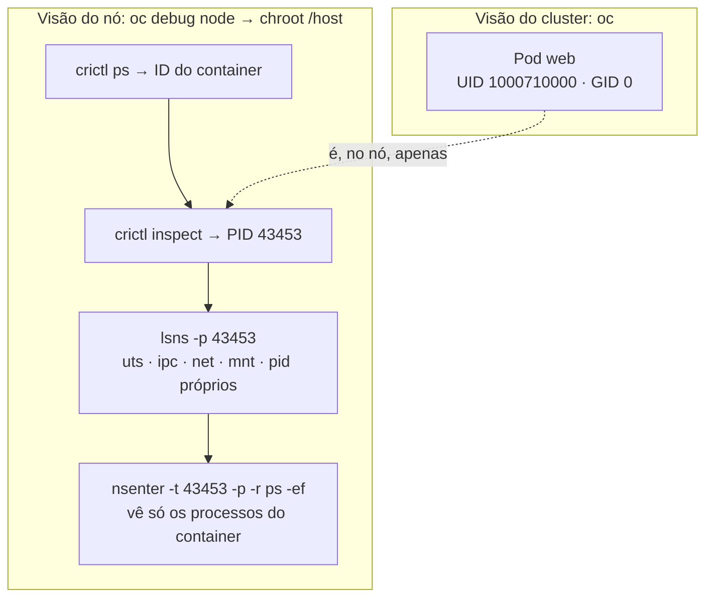

# 3.1 — Criar containers Linux e Pods Kubernetes

| Campo | Valor |
|-------|-------|
| Curso | DO180 — OpenShift 4.22 |
| Capítulo / seção | Capítulo 3 · Seção 3.1 |
| Título original | Create Linux Containers and Kubernetes Pods |
| Título em português | Criar containers Linux e Pods Kubernetes |
| Objetivo | Executar containers dentro de Pods e identificar os processos e namespaces do SO do host usados pelos containers |
| Pré-requisitos | [F1](../../01-fundamentos-essenciais/01-containers-e-imagens.md), [F4](../../01-fundamentos-essenciais/04-pods-e-workloads.md), [2.5](../02-cli-e-apis/2.5-avaliar-a-saude-do-cluster.md) |
| Referência | PDF p. 158–168 · Guided Exercise 3.2 p. 169–176 |

## Parte A — Entendendo o conceito

O objetivo do capítulo é rodar e diagnosticar aplicações como **Pods não
gerenciados**, isto é, Pods criados diretamente, sem Deployment. Isso serve para
**depuração interativa e tarefas temporárias**. Para aplicações de produção, o
recomendado é usar manifestos YAML declarativos com recursos de workload como
Deployment (Capítulo 4).

### `oc run`: o caminho mais curto até um Pod

`oc run` cria **um Pod** a partir de uma imagem. Com opções, ele controla o
comando executado, a interação com o terminal, a política de reinício, a remoção
automática e as variáveis de ambiente.

| Opção | Efeito |
|-------|--------|
| `--image <imagem>` | Imagem do container (obrigatória) |
| `--command -- <cmd> <args>` | **Substitui** o comando padrão da imagem |
| `-- <args>` (sem `--command`) | Passa **argumentos** para o comando padrão da imagem |
| `-it` | `-i` mantém stdin aberto; `-t` aloca um TTY: sessão interativa |
| `--restart Always\|OnFailure\|Never` | Política de reinício (padrão `Always`) |
| `--rm` | Apaga o Pod quando o processo termina (usar com `-it`) |
| `--env CHAVE=valor` | Define variável de ambiente |
| `-n <projeto>` | Cria em outro projeto (padrão: projeto atual) |

### Política de reinício (`restartPolicy`)

| Política | Comportamento quando o container termina | Uso típico |
|----------|------------------------------------------|-----------|
| `Always` (padrão) | Reinicia sempre, com sucesso ou erro | Serviços de longa duração |
| `OnFailure` | Reinicia só se terminar com erro (código ≠ 0) | Tarefas que devem ser repetidas até dar certo |
| `Never` | Não reinicia: o Pod termina como `Completed` ou `Error` | Comandos pontuais (`date`, testes) |

⚠️ Um comando curto (como `date`) com `restartPolicy: Always` termina, é
reiniciado, termina de novo... e o Pod acaba em **`CrashLoopBackOff`**, mesmo sem
erro algum. Para comandos pontuais, use `--restart Never`.

### UIDs e GIDs atribuídos por projeto

Ao criar um projeto, o OpenShift grava **anotações** que reservam faixas de IDs:

| Anotação | Exemplo | Significado |
|----------|---------|-------------|
| `openshift.io/sa.scc.uid-range` | `1000710000/10000` | Faixa de UIDs no formato **base/tamanho**: 10.000 IDs a partir de 1000710000 |
| `openshift.io/sa.scc.supplemental-groups` | `1000710000/10000` | Faixa de GIDs suplementares |
| `openshift.io/sa.scc.mcs` | `s0:c27,c4` | Rótulo SELinux MCS do projeto |

Com as políticas padrão:

| Quem cria o Pod | O que acontece com a instrução `USER` da imagem |
|-----------------|------------------------------------------------|
| **Usuário comum** | **Ignorada.** O processo recebe um UID **aleatório da faixa do projeto**; o GID primário é sempre **0** (grupo root) |
| **Administrador do cluster** | **Respeitada.** Se a imagem diz `USER 0`, o processo roda como **root** |

Por que isso é seguro: o processo pertence ao grupo root, mas o seu UID alto e
não root o torna **não privilegiado**. Arquivos que o container precisa gravar
devem pertencer ao grupo root com permissão de escrita para o grupo. Como cada
projeto tem sua própria faixa, containers de projetos diferentes **nunca
compartilham UID**.

⚠️ Container rodando como root tem, potencialmente, acesso irrestrito ao host se
escapar do isolamento. A Red Hat recomenda containers *rootless*, com o mínimo de
privilégio.

### Segurança de Pods: PSA e SCC

| Mecanismo | Origem | Papel |
|-----------|--------|-------|
| **Pod Security Admission (PSA)** | Kubernetes | Aplica perfis `privileged`, `baseline` ou `restricted` **por namespace**; avisa quando um Pod não define *security context* |
| **Security Context Constraints (SCC)** | OpenShift | Fornece padrões seguros e concede aos Pods as permissões exigidas pelo perfil PSA aplicado |

Os avisos de segurança do PSA nos exercícios do curso podem ser ignorados. SCC é
aprofundado no DO280.

### Executar comandos, ver logs e anexar

| Comando | Para quê |
|---------|----------|
| `oc exec <pod> [-c <container>] -- <cmd>` | Rodar um comando em um container **já em execução** |
| `oc exec -it <pod> -- bash -il` | Shell interativo; `exit` encerra |
| `oc logs <pod>` | stdout/stderr do container |
| `oc attach <pod> -it [-c <container>]` | Conectar-se ao processo **principal** já em execução (não abre um novo processo) |

Sem `-c`, os comandos usam o container indicado pela anotação
`kubectl.kubernetes.io/default-container` ou, na falta dela, o **primeiro** container.

Opções de `oc logs`:

| Opção | Efeito |
|-------|--------|
| `-l` / `--selector` | Logs de Pods filtrados por label |
| `--tail=N` | Últimas N linhas (padrão: tudo, sem seletor) |
| `-c` | Container específico |
| `-f` / `--follow` | Acompanhar em tempo real |
| `-p` / `--previous` | Logs da **instância anterior** do container: essencial para investigar quem reiniciou ou falhou ao iniciar |

### Apagar Pods

| Forma | Exemplo |
|-------|---------|
| Tipo e nome | `oc delete pod web` |
| Label | `oc delete pod -l app=web` |
| Arquivo | `oc delete -f pod.yaml` |
| stdin | `cat pod.yaml \| oc delete -f -` |
| Todos do tipo | `oc delete pods --all` |
| Projeto inteiro | `oc delete project <nome>` |

**Encerramento gracioso:** o Kubernetes primeiro pede aos processos para terminar
(SIGTERM) e só depois força (SIGKILL).

| Opção | Efeito | Risco |
|-------|--------|-------|
| `--grace-period=N` | Espera N segundos antes de forçar | — |
| `--now` | Equivale a período de 1 segundo | Aplicação pode não fechar arquivos e conexões |
| `--force` | Não espera confirmação de que os processos terminaram | ⚠️ Processos podem continuar rodando até o nó perceber: **inconsistência ou perda de dados**. Use só se tiver certeza |

### CRI-O e `crictl`: o container visto do nó

Os nós do OpenShift usam o **CRI-O**, um runtime feito especificamente para
Kubernetes. Ele implementa a interface **CRI** e por isso se integra aos plugins de
rede e de storage. No nó, a ferramenta de linha de comando é o **`crictl`**:

| Comando | Para quê |
|---------|----------|
| `crictl pods` | Pods do nó |
| `crictl images` | Imagens no nó |
| `crictl ps [--name <nome>]` | Containers em execução |
| `crictl inspect <id>` | Detalhes do container, incluindo o **PID** no host |
| `crictl logs <id>` | Logs do container |
| `crictl exec <id> <cmd>` | Comando no container |

Com o PID em mãos, ferramentas comuns do Linux mostram o isolamento:

| Comando | Para quê |
|---------|----------|
| `lsns -p <PID>` | Namespaces do processo (`uts`, `ipc`, `net`, `mnt`, `pid`...) |
| `nsenter -t <PID> -p -r <cmd>` | Rodar um comando **dentro** do namespace PID do container (`-r` usa a raiz do processo) |
| `nsenter -t <PID> -a <cmd>` | Entrar em **todos** os namespaces do container |

## Parte B — Modelo mental



O mesmo container tem duas faces: para o `oc` é um **Pod** com status e logs; para o
kernel do nó é um **processo com PID**, isolado por namespaces. Ao comparar dois
Pods, você verá namespaces diferentes. Dois containers do **mesmo** Pod
compartilham, por exemplo, o namespace de rede.

## Parte C — Funcionamento na prática

### Criar Pods com `oc run`

```bash
# Serviço de longa duração
oc run web --image registry.access.redhat.com/ubi10/httpd-24

# Comando pontual, sem reinício, Pod apagado ao final
oc run tmp -it --rm --restart Never \
  --image registry.access.redhat.com/ubi10/ubi --command -- date

# Shell interativo para investigar
oc run toolbox -it --image registry.access.redhat.com/ubi10/ubi --command -- /bin/bash

# Variáveis de ambiente (aspas simples evitam que o shell interprete $)
oc run db --image registry.redhat.io/rhel10/mysql-84 \
  --env MYSQL_ROOT_PASSWORD='Troque-me$123'
```

- **Recurso criado:** um objeto `Pod` no projeto atual (`pod/<nome> created`).
- **Verificar:** `oc get pod <nome>`, `oc logs <nome>`, `oc describe pod <nome>`.
- ⚠️ **Armadilha de shell:** sem aspas simples, `$$` vira o PID do seu shell e `$123` some. A senha gravada não é a que você digitou.
- ⚠️ `registry.redhat.io` exige credenciais. O cluster normalmente já as tem; para inspecionar a imagem fora do cluster é preciso login (seção 3.3).

Equivalente declarativo (original) do primeiro comando:

```yaml
apiVersion: v1
kind: Pod
metadata:
  name: web
  labels:
    run: web                     # label que o oc run também adiciona
spec:
  restartPolicy: Always
  containers:
    - name: web
      image: registry.access.redhat.com/ubi10/httpd-24
```

### Descobrir faixas de UID/GID do projeto e o UID real

```bash
oc describe project <PROJETO> | grep scc
oc get project <PROJETO> -o jsonpath='{.metadata.annotations.openshift\.io/sa\.scc\.uid-range}{"\n"}'
oc exec web -- id          # ex.: uid=1000710000 gid=0(root) groups=0(root),1000710000
```

- No JSONPath, pontos dentro do nome da anotação precisam de `\.`.
- O UID mostrado por `id` deve estar dentro da faixa do projeto.

### Executar, ver logs e anexar

```bash
oc exec web -- cat /etc/os-release
oc exec -it web -- bash -il
oc logs web --tail=20
oc logs -f web
oc logs web -p            # instância anterior (após reinício)
oc attach toolbox -it     # reconecta ao bash principal do Pod "toolbox"
```

### Apagar

```bash
oc delete pod web
oc delete pod -l run=web
oc delete pod web --grace-period=10
```

### Inspecionar o container a partir do nó (administrador)

```bash
oc get pod web -o jsonpath='{.spec.nodeName}{"\n"}'   # em qual nó está
oc debug node/<NO>
chroot /host
crictl ps --name web
crictl inspect -o json <ID_CONTAINER> | jq .info.pid
crictl inspect --output go-template --template '{{.info.pid}}' <ID_CONTAINER>
lsns -p <PID>
nsenter -t <PID> -p -r ps -ef
exit; exit
```

- Se o projeto atual tiver os labels de segurança que permitem a SCC `privileged`,
  o debug pod é criado **nele**; senão, em um namespace temporário `openshift-debug-*`.
- `crictl ps` mostra o **ID curto**; `-o json` mostra o ID completo.
- ⚠️ Usuários comuns não podem criar debug pods de nó.

## Parte D — Relações importantes

| A | B | Diferença essencial |
|---|---|--------------------|
| `oc run` | Deployment (YAML) | Pod avulso para depuração × workload gerenciado para produção |
| `--command -- cmd` | `-- args` | Substitui o comando × passa argumentos ao comando padrão |
| `oc exec` | `oc attach` | Novo processo no container × conecta ao processo principal existente |
| `oc exec` | `oc debug` | Mesmo Pod em execução × cópia modificada do Pod (seção 2.5) |
| `Always` | `Never` | Reinicia sempre × não reinicia (Pod termina) |
| `--grace-period` / `--now` | `--force` | Encerramento abreviado × sem esperar confirmação (risco de dados) |
| Usuário comum | Administrador | `USER` da imagem ignorado (UID da faixa) × `USER` respeitado |
| PSA | SCC | Perfis por namespace (Kubernetes) × permissões e padrões seguros (OpenShift) |
| Podman | CRI-O / `crictl` | Ferramenta de uso geral × runtime do Kubernetes e sua CLI de nó |

## Parte E — Preparação para o laboratório

Atividade associada: **3.2 Guided Exercise — Create Linux Containers and
Kubernetes Pods** (`pods-containers`, PDF p. 169–176).

Você deve conseguir:

- Ler as faixas de UID/GID de um projeto.
- Criar Pods com `oc run` (inclusive um comando pontual) e ver seus logs.
- Inspecionar o SO e os processos de dentro do container.
- Localizar o container no nó com `crictl`, achar o PID e listar seus namespaces.
- Comparar namespaces entre Pods e explicar a função de cada container em um Pod com vários containers.

Ver [PRATICA-OFICIAL.md](PRATICA-OFICIAL.md#32-guided-exercise-create-linux-containers-and-kubernetes-pods).

## Parte F — Fixação

1. `oc run relogio --image registry.access.redhat.com/ubi10/ubi --command -- date` deixa o Pod em `CrashLoopBackOff`. Por quê, e como corrigir?
2. Um projeto tem `uid-range=1000820000/10000`. Um usuário comum cria um Pod de uma imagem com `USER 1001`. Qual UID o processo terá?
3. A mesma imagem, criada por um administrador, roda como root. Por que a diferença e por que isso é um risco?
4. Um Pod reiniciou cinco vezes. Que opção de `oc logs` mostra o erro da última tentativa?
5. Qual a diferença entre `oc delete pod x --now` e `oc delete pod x --force`?

<details>
<summary>Respostas comentadas</summary>

1. A política padrão é `Always`: o `date` termina e é reiniciado sem parar, até o backoff. Use `--restart Never` (e, se quiser, `-it --rm` para ver a saída e apagar o Pod).
2. Um UID **aleatório da faixa** (entre 1000820000 e 1000829999), com GID primário 0. O `USER 1001` é ignorado para usuários comuns.
3. Para administradores, o `USER` da imagem é respeitado. Root no container, se escapar do isolamento, pode comprometer o host.
4. `oc logs <pod> -p` (ou `--previous`).
5. `--now` encurta o período de encerramento para 1 segundo, mas ainda espera a confirmação; `--force` remove o objeto sem esperar, e os processos podem continuar no nó.

</details>

## Parte G — Essencial para memorizar

- `oc run <nome> --image  [--command -- cmd] [-it] [--rm] [--restart Never] [--env K=V]`.
- `restartPolicy`: `Always` (padrão) · `OnFailure` · `Never`.
- Usuário comum: UID aleatório da faixa do projeto, GID 0; `USER` da imagem ignorado.
- `oc exec [-c] -- cmd` · `oc logs [-f] [-p] [--tail] [-c]` · `oc attach -it`.
- `oc delete pod ... [--grace-period N|--now|--force]`; ⚠️ `--force` arrisca dados.
- No nó: `crictl ps` → `crictl inspect` (PID) → `lsns -p` / `nsenter -t PID`.

---
[← Capítulo 3 (índice)](README.md) | [Índice do capítulo](README.md) | [Próximo: 3.3 Imagens de container →](3.3-encontrar-e-inspecionar-imagens.md)
