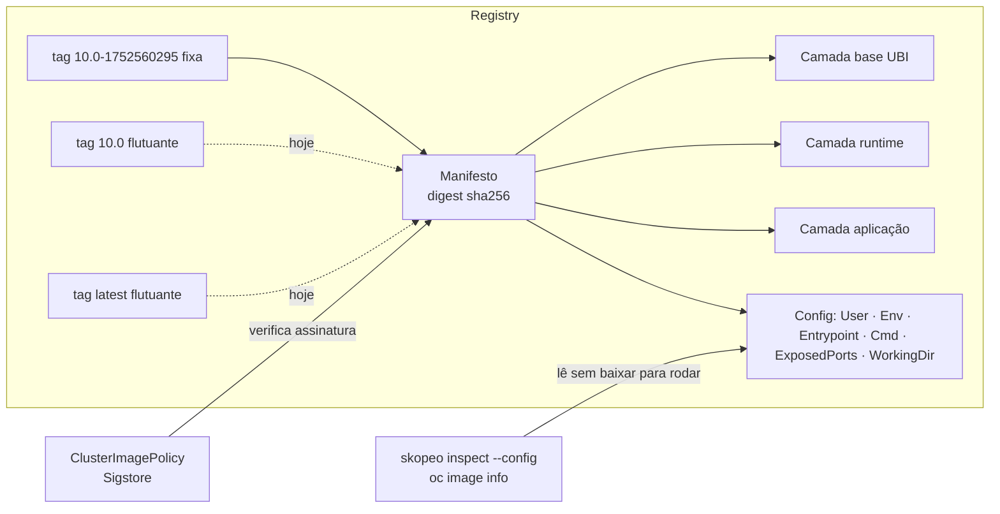

# 3.3 — Encontrar e inspecionar imagens de container

| Campo | Valor |
|-------|-------|
| Curso | DO180 — OpenShift 4.22 |
| Capítulo / seção | Capítulo 3 · Seção 3.3 |
| Título original | Find and Inspect Container Images |
| Título em português | Encontrar e inspecionar imagens de container |
| Objetivo | Encontrar aplicações em registries e obter os parâmetros de execução de imagens suportadas e de comunidade |
| Pré-requisitos | [3.1](3.1-criar-containers-e-pods.md), [F1](../../01-fundamentos-essenciais/01-containers-e-imagens.md) |
| Referência | PDF p. 177–189 · Guided Exercise 3.4 p. 190–200 |

## Parte A — Entendendo o conceito

### Imagem × instância

A **imagem** guarda dados **imutáveis**: a aplicação e suas bibliotecas. Uma
**instância de container** é um processo em execução, isolado por namespaces do
kernel, criado a partir da imagem. Imagens existem sem containers; containers não
existem sem imagem. Uma imagem gera quantas instâncias forem necessárias, em
vários hosts.

### Onde as imagens vivem: registries

| Registry | Características | Quando usar |
|----------|-----------------|-------------|
| **Red Hat Ecosystem Catalog** (`catalog.redhat.com`, imagens em `registry.redhat.io` e `registry.access.redhat.com`) | Busca centralizada com detalhes técnicos, pacotes instalados e varredura de segurança por tag. Imagens validadas pela Red Hat: fontes confiáveis, dependências originais, sem vulnerabilidades críticas conhecidas, execução como **não root**, compatíveis com RHEL e **suportadas** | Base de aplicações corporativas |
| **Quay.io** | Registry público patrocinado pela Red Hat para **suas** imagens: namespaces próprios, controle de acesso fino, build no servidor, varredura automática de vulnerabilidades. Há versão on-premise (Red Hat Quay) | Publicar e consumir imagens próprias ou de projetos |
| **Registries privados** | Controle de colocação, distribuição e uso. Motivos: privacidade e segredos da empresa, restrições legais, imagens em desenvolvimento | Peça central de **soberania digital**: operação *air-gapped* e governança da cadeia de suprimentos |
| **Públicos de terceiros** (Docker Hub, Amazon ECR) | Imagens "oficiais" da comunidade, **sem suporte** do fornecedor do software nem da Red Hat | Testes, com cautela |

⚠️ **Riscos de imagens públicas:** código malicioso, vulnerabilidades, execução
como **root** e licenças incorretas. Revise e teste antes de usar, e confirme que
você tem direito de usar o software.

> Login: `registry.redhat.io` exige conta (Customer Portal ou Red Hat Developer);
> `registry.access.redhat.com` oferece as imagens públicas (UBI) sem login. O
> cluster OpenShift normalmente já tem credenciais configuradas e se autentica
> sozinho ao baixar imagens para Pods. Já o `skopeo` e o `oc image` exigem **login
> prévio** no registry.

### Como uma imagem é identificada

```text
registry.access.redhat.com/ubi10/httpd-24:10.0-1752560295
└──────── registry ───────┘└─ nome ─────┘└── tag fixa ──┘
registry.access.redhat.com/ubi10/httpd-24@sha256:2d2b3f...
                                         └─ ID / hash (digest) ─┘
```

| Identificador | O que é | Muda? |
|---------------|---------|-------|
| **Registry** | Servidor de conteúdo; contém repositórios | — |
| **Nome** | Repositório dentro do registry (`ubi10/httpd-24`) | — |
| **ID / hash (SHA)** | Identificador único do conteúdo; localiza, baixa e verifica a imagem | **Nunca**: sempre o mesmo conteúdo |
| **Tag fixa** | Aponta para um build específico (`10.0-1752560295`) | Por convenção, não |
| **Tag flutuante** | Apelido para outra tag (`10.0` = último build da 10.0; `latest` = release mais recente) | **Sim**, a cada novo build |

Sem tag, o runtime usa **`latest`**. Esse tema volta no Capítulo 7.

### Do que uma imagem é feita

- **Camadas:** cada instrução de build gera uma camada com as diferenças em relação
  à anterior; empilhadas, formam a imagem somente leitura.
- **Metadados:** instruções e documentação.

| Instrução | Efeito em execução | Observação |
|-----------|--------------------|------------|
| `ENV` | Define variáveis de ambiente | O container aceita outras variáveis além das listadas |
| `ARG` | Variável de **build** | Costuma alimentar `ENV` |
| `USER` | Usuário ativo | ⚠️ O OpenShift **ignora** para usuários comuns (seção 3.1) |
| `ENTRYPOINT` | Executável iniciado com o container | Imagens base geralmente usam um shell |
| `CMD` | Comando/argumentos padrão passados ao `ENTRYPOINT` | `oc run --command` substitui; `oc run -- args` complementa |
| `WORKDIR` | Diretório de trabalho | — |
| `EXPOSE` | Porta em que a aplicação escuta | **Só documentação**: não publica porta alguma |
| `VOLUME` | Caminhos para dados fora do container | — |
| `LABEL` | Pares chave-valor para organização | — |

O engine **não é obrigado** a respeitar metadados como `USER` e `EXPOSE`.

### Imagens base e UBI

A **imagem base** define gerenciador de pacotes, init, layout de arquivos e
dependências pré-instaladas, e influencia tamanho, suporte e arquitetura.

As **Universal Base Images (UBI)** da Red Hat são imagens OCI com parte do RHEL.
Podem ser distribuídas **sem custo nem subscrição** para qualquer plataforma e
registry. O **suporte completo** só vale quando rodam em plataforma Red Hat (RHEL,
OpenShift).

| Variante | Conteúdo | Gerenciador de pacotes |
|----------|----------|------------------------|
| **standard** | UBI principal: `dnf`, systemd, utilitários (`tar`, `gzip`) | `dnf` |
| **init** | Facilita rodar vários serviços em um container via systemd | `dnf` |
| **minimal** | Menor | `microdnf` |
| **micro** | A menor; só o mínimo | Nenhum |

Há também imagens de **runtime de linguagem** (Python, Node.js, PHP...).

### Ferramentas de inspeção

| Ferramenta | Destaques |
|------------|-----------|
| **Skopeo** (`skopeo`) | Inspeciona, copia, sincroniza e apaga imagens **remotas**, sem baixar para rodar, **sem root e sem daemon**. Exige o **transporte** explícito: `docker://` (registry) ou `dir:` (diretório local) |
| **`oc image`** | Embutido no `oc`; usa o transporte de registry por padrão |

Credenciais do `skopeo login` ficam em `${XDG_RUNTIME_DIR}/containers/auth.json`,
apenas **codificadas em base64**, não criptografadas. ⚠️ Trate esse arquivo como
senha.

### Rodar como root: por que evitar

- Se um atacante explora a aplicação e escapa do container (bug no kernel ou no
  runtime), o root do container pode corresponder ao **root do host**.
- Algumas aplicações são difíceis de rodar sem root. HTTPd e Nginx tradicionais
  iniciam como root e depois trocam de usuário; a Red Hat oferece versões que **não
  exigem root**.
- Containers não privilegiados **não podem** usar portas privilegiadas (< 1024, como
  80 e 443) nem `ping` (sockets *raw*). Use portas altas (8080, 8443) e
  encaminhamento de portas.

### Verificação de assinaturas com Sigstore

- O OpenShift usa **Sigstore** para verificar integridade e autenticidade das imagens
  **antes** de elas rodarem nos nós.
- O recurso **`ClusterImagePolicy`** define políticas para o cluster todo: quais
  registries/repositórios verificar e a **raiz de confiança** (uma chave pública, ou
  uma CA Fulcio com log de transparência Rekor).
- Ao criar ou alterar uma `ClusterImagePolicy`, o **MCO** atualiza
  `/etc/containers/policy.json` em todos os nós, e o runtime verifica a assinatura no pull.
- Existe uma política padrão chamada **`openshift`** para as imagens dos componentes
  da plataforma. ⚠️ **Não remova nem altere essa política.**
- **Novidade do 4.22:** a verificação cobre **cada camada** da imagem, não só o
  manifesto. Uma camada intermediária comprometida é detectada antes de rodar.

## Parte B — Modelo mental



Analogia técnica: a tag é como um **registro DNS CNAME** (pode passar a apontar
para outro destino), e o digest é como o **hash de um arquivo ISO** (identifica
exatamente o conteúdo).

## Parte C — Funcionamento na prática

### Skopeo

```bash
skopeo login registry.redhat.io                              # pede usuário e senha
skopeo list-tags docker://registry.access.redhat.com/ubi10/httpd-24
skopeo inspect docker://registry.access.redhat.com/ubi10/httpd-24:latest
skopeo inspect --config docker://registry.access.redhat.com/ubi10/httpd-24:latest \
  | jq '.config | {User, ExposedPorts, Entrypoint, Cmd, WorkingDir}'
skopeo copy docker://<origem>/<repo>:<tag> docker://<destino>/<repo>:<tag>
skopeo sync --src docker --dest docker <origem>/<repo> <destino>/<repo>
skopeo delete docker://<registry>/<repo>:<tag>               # exige permissão no repositório
```

| Subcomando | Para quê | Leitura da saída |
|------------|----------|------------------|
| `list-tags` | Tags disponíveis | Lista `Tags` |
| `inspect` | Nome, **Digest**, `RepoTags`, arquitetura, labels, `Env` | `Digest` é o identificador imutável |
| `inspect --config` | Configuração de execução e histórico | `User`, `ExposedPorts`, `Env`, `Entrypoint`, `Cmd`, `WorkingDir` |
| `copy` | Copiar uma imagem entre locais | — |
| `sync` | Copiar todas as imagens de uma origem | — |
| `delete` | Apagar imagem do registry | Requer permissão |

**Erros comuns:**
- `unable to retrieve auth token: invalid username/password: unauthorized`: faltou `skopeo login`.
- `Invalid image name`: faltou o transporte (`docker://`).
- `manifest unknown`: tag inexistente; use `list-tags`.

### `oc image`

```bash
oc image info registry.access.redhat.com/ubi10/httpd-24:latest --filter-by-os amd64
oc image extract <imagem> --path /etc/httpd/conf/httpd.conf:/tmp/httpd-conf --confirm
oc image mirror <origem>/<repo>:<tag> <destino>/<repo>:<tag>
oc image append --from <imagem-base> --to <destino> <camada.tar.gz>
```

| Subcomando | Para quê |
|------------|----------|
| `info` | Digest, camadas, `Env`, portas, comando. Em imagens multiarquitetura exige `--filter-by-os` |
| `extract` | Extrair arquivos da imagem para o disco **sem rodar** a imagem |
| `mirror` | Espelhar imagens entre registries, ou de registry para disco |
| `append` | Adicionar camadas a uma imagem e enviá-la a um registry |

### Interpretar o resultado para prever o comportamento no OpenShift

| Dado inspecionado | Pergunta | Consequência |
|-------------------|----------|--------------|
| `User: 0` ou ausente | A imagem espera root? | Com usuário comum, roda com UID da faixa; se precisar de root, **falha** (permissão negada em arquivos/diretórios ou portas) |
| `User: 1001` | Feita para não root? | Com usuário comum, ainda recebe UID da faixa; funciona se os arquivos tiverem permissão para o grupo 0 |
| `ExposedPorts: 80/tcp` | Porta privilegiada? | Sem root, não consegue escutar na 80 |
| `Env` | Que variáveis a aplicação espera? | Informe as obrigatórias com `--env` |
| `Entrypoint`/`Cmd` | O que roda ao iniciar? | Base para `--command` ou argumentos |

## Parte D — Relações importantes

| A | B | Diferença essencial |
|---|---|--------------------|
| Imagem | Instância de container | Dados imutáveis × processo isolado em execução |
| Tag fixa | Tag flutuante | Um build específico × apelido que muda a cada build |
| Tag | Digest | Rótulo × identificador imutável do conteúdo |
| `ENTRYPOINT` | `CMD` | Executável × comando/argumentos padrão passados a ele |
| `EXPOSE` | Service/Route | Documentação da porta × exposição real (Capítulo 4) |
| `skopeo` | `oc image` | Transporte explícito, copia/sincroniza/apaga × embutido no `oc`, com `extract` e `mirror` |
| `skopeo` | `podman` | Inspeciona e copia sem executar × executa containers |
| `registry.redhat.io` | `registry.access.redhat.com` | Exige login × público |
| UBI standard | UBI micro | Com `dnf` e utilitários × mínimo, sem gerenciador de pacotes |
| Catálogo Red Hat | Docker Hub "oficial" | Validado e suportado × comunidade, sem suporte |

## Parte E — Preparação para o laboratório

Atividade associada: **3.4 Guided Exercise — Find and Inspect Container Images**
(`pods-images`, PDF p. 190–200).

Você deve conseguir:

- Localizar imagens e listar tags no registry da sala de aula com `skopeo`.
- Inspecionar configuração (usuário, variáveis, comando) com `skopeo` e `oc image info`.
- Criar Pods definindo variáveis de ambiente e substituindo o comando de entrada.
- Diagnosticar por que uma imagem de comunidade que exige root falha com usuário comum.

Ver [PRATICA-OFICIAL.md](PRATICA-OFICIAL.md#34-guided-exercise-find-and-inspect-container-images).

## Parte F — Fixação

1. Por que um Pod de uma imagem do Docker Hub que roda Nginx na porta 80 como root pode falhar no OpenShift, mesmo funcionando no seu Podman?
2. Qual a diferença prática entre usar `:10.0` e `:10.0-1752560295`?
3. Como descobrir o comando de inicialização e o usuário de uma imagem sem baixá-la para rodar?
4. Um colega quer usar `ubi10/ubi-micro` e instalar pacotes durante o build com `dnf`. Funciona?
5. Por que alterar a `ClusterImagePolicy` chamada `openshift` é proibido?

<details>
<summary>Respostas comentadas</summary>

1. Como usuário comum, o OpenShift ignora o `USER` e roda com UID não root da faixa do projeto. A imagem não consegue gravar em diretórios de root nem escutar na porta 80 (privilegiada). No Podman, rodava como root.
2. `:10.0` é **flutuante**: amanhã pode apontar para outro build. `:10.0-1752560295` é **fixa**: sempre o mesmo build (para garantia absoluta, use o digest).
3. `skopeo inspect --config docker://<imagem>` (campos `Entrypoint`, `Cmd`, `User`) ou `oc image info <imagem>`.
4. Não: a variante **micro** não tem gerenciador de pacotes. Use standard ou minimal (`microdnf`).
5. Ela garante a verificação de assinatura das imagens dos componentes da plataforma; removê-la ou alterá-la quebra essa garantia de cadeia de suprimentos.

</details>

## Parte G — Essencial para memorizar

- Registries: Catálogo Red Hat (validado, suportado) · Quay.io · privados (soberania) · públicos (risco).
- Identificação: registry / nome : tag (fixa ou flutuante) @ digest (imutável). Sem tag = `latest`.
- Instruções: `ENV`, `ARG`, `USER`, `ENTRYPOINT`, `CMD`, `WORKDIR`; metadados `EXPOSE`, `VOLUME`, `LABEL`.
- UBI: standard · init · minimal (`microdnf`) · micro (sem gerenciador).
- `skopeo login | list-tags | inspect [--config] | copy | sync | delete` com `docker://`.
- `oc image info [--filter-by-os] | extract | mirror | append`.
- Sem root: nada de portas < 1024 nem `ping`.
- Sigstore + `ClusterImagePolicy`; no 4.22, verificação por camada; não mexa na política `openshift`.

---
[← 3.1 Containers e Pods](3.1-criar-containers-e-pods.md) | [Índice do capítulo](README.md) | [Próximo: 3.5 Diagnóstico →](3.5-diagnosticar-containers-e-pods.md)
