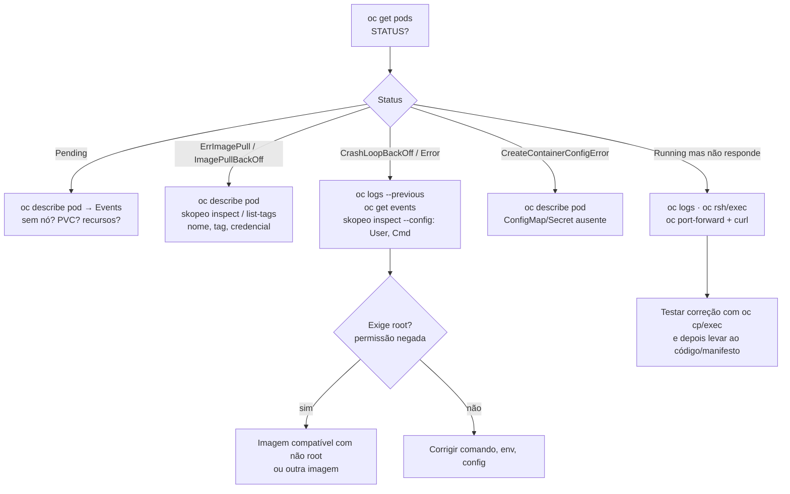

# 3.5 — Diagnosticar containers e Pods

| Campo | Valor |
|-------|-------|
| Curso | DO180 — OpenShift 4.22 |
| Capítulo / seção | Capítulo 3 · Seção 3.5 |
| Título original | Troubleshoot Containers and Pods |
| Título em português | Diagnosticar containers e Pods |
| Objetivo | Diagnosticar um Pod iniciando processos extras nos containers, alterando seus sistemas de arquivos efêmeros e abrindo túneis de rede temporários |
| Pré-requisitos | [3.1](3.1-criar-containers-e-pods.md), [3.3](3.3-encontrar-e-inspecionar-imagens.md), [2.5](../02-cli-e-apis/2.5-avaliar-a-saude-do-cluster.md) |
| Referência | PDF p. 201–207 · Guided Exercise 3.6 p. 208–213 |

## Parte A — Entendendo o conceito

### O princípio: imutável e efêmero

Containers são feitos para serem **imutáveis e efêmeros**. É possível alterar um
container em execução, mas isso é reservado ao **diagnóstico**:

1. Investigue e teste a correção no container em execução.
2. Registre a correção no **controle de versão** (código, Containerfile, manifesto).
3. Gere uma nova imagem e **reimplante**.

Correções manuais em containers vivos não ficam registradas, somem quando o Pod é
recriado e comprometem confiabilidade e resiliência.

### Caixa de ferramentas da CLI

| Comando | O que faz | Altera o quê |
|---------|-----------|--------------|
| `oc describe` | Detalhes do recurso e **eventos** | Nada (leitura) |
| `oc logs` | stdout/stderr do container | Nada |
| `oc get events` | Relatos de acontecimentos no cluster | Nada |
| `oc edit` | Abre o recurso no editor e aplica ao salvar | Objeto na API |
| `oc patch` | Altera campos específicos sem editor | Objeto na API |
| `oc exec` | Executa um comando no container | Processos/arquivos do container |
| `oc rsh` | Shell remoto no container | Idem |
| `oc cp` | Copia arquivos de/para o container | Sistema de arquivos **efêmero** do container |
| `oc rsync` | Sincroniza diretórios de/para o container | Idem |
| `oc port-forward` | Túnel temporário da sua máquina até uma porta do Pod | Nada no Pod (só uma conexão) |

### Editar recursos: `oc edit` e `oc patch`

- `oc edit` usa o editor definido em `KUBE_EDITOR` ou `EDITOR` (ou o padrão do
  sistema). Ao salvar, o objeto é enviado à API; se houver erro, o arquivo reabre
  com a falha indicada; um arquivo vazio cancela.
- `oc patch` muda campos pontuais. Com `--type=json`, usa operações JSON Patch
  (`replace`, `add`, `remove`) e caminhos como `/spec/containers/0/image`.

📘 *Fonte externa (Kubernetes):* a maior parte do `spec` de um **Pod** é
**imutável** depois da criação. Dá para alterar, por exemplo, a **imagem** dos
containers, mas não portas, variáveis ou volumes. Por isso, no Pod, `oc edit`/`oc
patch` servem quase só para trocar a imagem; para o resto, recrie o Pod ou, melhor,
use um Deployment (Capítulo 4).

### Copiar arquivos: `oc cp` e `oc rsync`

| | `oc cp` | `oc rsync` |
|--|---------|-----------|
| Unidade | Arquivos ou diretórios | Diretórios (sincroniza só o que mudou) |
| Requisito | Binário **`tar`** no container | **`rsync`** local e no container; senão, usa `tar` |
| Formato do caminho no Pod | `<pod>:<caminho>` | `<pod>:<caminho>` |
| Container | `-c <container>` (padrão: o primeiro) | `-c <container>` |

Sem `tar` (e sem `rsync`) na imagem, a cópia **falha**. Imagens mínimas costumam
não ter essas ferramentas.

### Túnel de rede: `oc port-forward`

- Liga uma porta **local** a uma porta do **Pod**: `oc port-forward <recurso> <porta-local>:<porta-pod>`.
- Funciona pela API: a requisição cria um **fluxo multiplexado** (HTTP/2) até o
  **kubelet**, que entrega os dados à porta do Pod.
- Ideal para testar uma aplicação que não está exposta (sem Service ou Route).
- É **temporário**: dura enquanto o comando estiver rodando (Ctrl+C encerra).
- 📘 *Fonte externa:* por padrão escuta só em `127.0.0.1` e `::1` da sua máquina.

### Shell e comandos: `oc rsh` e `oc exec`

- `oc rsh <pod> [-c <container>]`: abre um shell (o `sh` da imagem) para inspeção
  forense. Também disponível na console: **Pod details › Terminal**, com seletor de container.
- `oc exec <pod>|<tipo>/<nome> [-c <container>] -- <cmd>`: roda um comando.
  - Com `-it`, envia stdin e recebe stdout/stderr interativamente; a **formatação**
    da saída muda (ex.: `ls` em colunas).

### Logs e eventos

- `oc logs` sem `-c` em um Pod com vários containers mostra
  `Defaulted container "X" out of: X, Y`: confirme se é o container que você queria.
- `oc get events` mostra a sequência `Scheduled` → `Pulling` → `Pulled` → `Created` →
  `Started` e, quando algo falha, `Failed`, `BackOff` etc.

### Ferramentas dentro do container

Dentro do container só existem as ferramentas **que a imagem traz**. Acrescentar
ferramentas de diagnóstico à imagem tem custos: imagem maior, mais pacotes para
atualizar e licenciar, mais superfície para ataques. A alternativa é um **container
de ferramentas** (*toolbox*) implantado no cluster quando necessário. Por exemplo,
um Pod com cliente MySQL para testar a conexão com outro Pod de banco.

## Parte B — Modelo mental

Roteiro de diagnóstico de um Pod que não funciona:



## Parte C — Funcionamento na prática

### Investigar

```bash
oc get pods
oc describe pod <POD>                 # seção Events no final
oc get events --sort-by .metadata.creationTimestamp
oc logs <POD> [-c <CONTAINER>] [--previous]
```

### Estados de falha mais comuns

| STATUS | Causa provável | Onde olhar |
|--------|----------------|-----------|
| `ErrImagePull` → `ImagePullBackOff` | Nome/tag errado, registry inacessível, falta de credencial | `oc describe pod` (Events); `skopeo list-tags` |
| `CrashLoopBackOff` | Processo termina repetidamente: erro da aplicação, comando curto com `restartPolicy: Always`, variável obrigatória faltando, **permissão negada por rodar sem root** | `oc logs --previous`; `skopeo inspect --config` |
| `Error` / `Completed` | Container terminou (com erro / com sucesso) e não será reiniciado | `oc logs` |
| `CreateContainerConfigError` | Referência a ConfigMap/Secret inexistente | `oc describe pod` |
| `Pending` | Sem nó adequado ou volume pendente | `oc describe pod` |
| `Running`, mas a aplicação não responde | Porta errada, configuração, dependência | `oc exec`, `oc port-forward` + `curl` |

### Editar e corrigir

```bash
export KUBE_EDITOR=vim
oc edit pod <POD>                                   # trocar spec.containers[0].image
oc patch pod <POD> --type=json \
  -p '[{"op":"replace","path":"/spec/containers/0/image","value":"<NOVA_IMAGEM>"}]'
oc get pod <POD> -w                                 # acompanhar a mudança (Ctrl+C sai)
```

- **Recurso modificado:** o objeto Pod. O kubelet reinicia o container com a nova imagem.
- **Erro comum:** `Forbidden: pod updates may not change fields other than ...`: você tentou mudar um campo imutável do Pod.

### Copiar arquivos

```bash
oc cp <POD>:/var/www/html/index.html /tmp/index.bak        # do Pod para a máquina
oc cp /tmp/teste.html <POD>:/var/www/html/                 # da máquina para o Pod
oc cp ./init.sql <POD>:/tmp/init.sql -c <CONTAINER>
oc rsync <POD>:/var/www/ /tmp/web_files                    # sincronizar diretório
oc exec <POD> -- ls -l /var/www/html                       # verificar
```

- **Erro comum:** `exec: "tar": executable file not found`: a imagem não tem `tar`.
- ⚠️ O arquivo copiado vive no sistema de arquivos **efêmero** do container: some quando o Pod for recriado.
- ⚠️ Permissões: o UID aleatório só consegue gravar onde o grupo 0 tem escrita.

### Túnel até o Pod

```bash
oc port-forward pod/<POD> 8080:8080        # terminal 1 (mantém aberto)
curl -s http://127.0.0.1:8080/              # terminal 2
oc port-forward pod/<POD> 3306:3306         # ex.: banco, para usar um cliente local
```

- **Saída esperada:** `Forwarding from 127.0.0.1:8080 -> 8080` e `Handling connection for 8080` a cada acesso.
- **Erros comuns:** `address already in use` (porta local ocupada; escolha outra, ex. `18080:8080`); `connection refused` (nada escuta na porta do Pod).

### Shell e comandos

```bash
oc rsh <POD>
oc rsh -c <CONTAINER> <POD>
oc exec <POD> -- id                        # UID/GID efetivos
oc exec <POD> -- ls -ld /run/httpd         # dono, grupo e permissões
oc exec -it <POD> -- /bin/bash
```

Para verificar se um diretório serve a um UID aleatório, procure **grupo root (0)
com permissão de escrita** (ex.: `drwxrwxr-x ... root root`).

## Parte D — Relações importantes

| A | B | Diferença essencial |
|---|---|--------------------|
| Corrigir no container | Corrigir na origem | Teste rápido, efêmero × correção definitiva (código, imagem, manifesto) |
| `oc edit` | `oc patch` | Editor interativo × alteração pontual, scriptável |
| `oc cp` | `oc rsync` | Cópia simples (precisa de `tar`) × sincronização incremental (precisa de `rsync` ou `tar`) |
| `oc port-forward` | Service/Route | Túnel temporário para uma pessoa × acesso permanente para clientes |
| `oc rsh` | `oc exec` | Shell interativo × comando único (ou shell com `-it`) |
| `oc exec` | `oc debug` | Mesmo Pod em execução × cópia do Pod com shell, sem probes |
| `oc logs` | `oc logs --previous` | Instância atual × instância que falhou antes do reinício |
| `ImagePullBackOff` | `CrashLoopBackOff` | Não conseguiu **baixar** a imagem × conseguiu iniciar, mas o processo **termina** |

## Parte E — Preparação para o laboratório

Atividade associada: **3.6 Guided Exercise — Troubleshoot Containers and Pods**
(`pods-troubleshooting`, PDF p. 208–213).

Você deve conseguir:

- Investigar um Pod que não inicia com `oc get`, `oc describe`, `oc get events` e `oc logs`.
- Usar `skopeo` para checar tags e manifestos disponíveis no registry.
- Corrigir a referência de imagem do Pod.
- Copiar arquivos para dentro de um Pod e executar comandos nele.
- Conectar-se ao Pod por `oc port-forward`.

Ver [PRATICA-OFICIAL.md](PRATICA-OFICIAL.md#36-guided-exercise-troubleshoot-containers-and-pods).

## Parte F — Fixação

1. Um Pod está em `ImagePullBackOff`. Qual a sequência de verificação até a correção?
2. Você tentou `oc cp` para um Pod e recebeu erro sobre `tar`. O que significa e que alternativas existem?
3. Qual a vantagem do `oc port-forward` sobre criar uma Route para testar um banco de dados?
4. Você corrigiu um arquivo de configuração com `oc cp` e a aplicação voltou. O trabalho terminou?
5. `oc edit pod` recusa sua alteração de uma variável de ambiente. Por quê, e qual o caminho?

<details>
<summary>Respostas comentadas</summary>

1. `oc describe pod` (Events: mensagem do pull) → conferir nome e tag com `skopeo list-tags`/`skopeo inspect` (e credenciais, se o registry exigir) → corrigir a imagem com `oc edit`/`oc patch` → `oc get pod -w`.
2. A imagem não tem `tar`, necessário ao `oc cp`. Alternativas: `oc rsync` (se houver `rsync`), redirecionar conteúdo com `oc exec -i <pod> -- sh -c 'cat > /caminho' < arquivo` (se houver shell), ou incluir a correção na imagem/manifesto.
3. Não expõe o banco para fora do cluster; o túnel é pessoal, temporário e passa pela API autenticada.
4. **Não.** A mudança vive no sistema de arquivos efêmero e será perdida na recriação do Pod. Leve a correção ao controle de versão e reimplante.
5. Os campos do `spec` de um Pod são quase todos imutáveis (a imagem é exceção). Recrie o Pod com a nova definição, ou use um Deployment, que recria os Pods automaticamente.

</details>

## Parte G — Essencial para memorizar

- Containers são **imutáveis e efêmeros**: altere ao vivo só para diagnosticar; corrija na origem.
- Ler: `oc describe`, `oc logs [--previous]`, `oc get events`.
- Alterar: `oc edit` (`KUBE_EDITOR`), `oc patch --type=json`.
- Arquivos: `oc cp` (precisa de `tar`), `oc rsync` (`rsync` ou `tar`); formato `pod:caminho`, `-c` para o container.
- Rede: `oc port-forward pod/x local:remota` (temporário, via kubelet).
- Acesso: `oc rsh`, `oc exec [-it] -- cmd`, console › Terminal.
- `ImagePullBackOff` = imagem; `CrashLoopBackOff` = processo; `CreateContainerConfigError` = configuração referenciada.

---
[← 3.3 Imagens de container](3.3-encontrar-e-inspecionar-imagens.md) | [Índice do capítulo](README.md) | [Próximo: Prática oficial →](PRATICA-OFICIAL.md)
