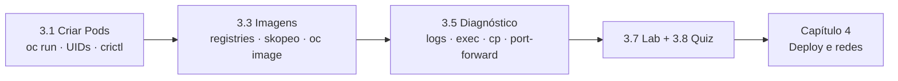

# Capítulo 3 — Run Applications as Containers and Pods

**Título em português:** Executar aplicações como containers e Pods
**Status:** ✅ concluído e validado
**Referência:** PDF p. 157–226

## Objetivo do capítulo

Executar e diagnosticar aplicações em containers como **Pods Kubernetes não
gerenciados**.

## Por que este capítulo importa

Até aqui você **observou** o cluster. Agora começa a **rodar** coisas nele, mas
ainda no nível mais baixo: o Pod avulso. Entender o ciclo **imagem → container →
Pod**, como o OpenShift atribui usuários aos containers e como investigar um Pod
que falha é a base para os Deployments, Services e Routes do Capítulo 4.

## Seções e atividades (ordem oficial)

| Seção | Tipo | Título original | Material | PDF |
|-------|------|-----------------|----------|-----|
| 3.1 | Conceito | Create Linux Containers and Kubernetes Pods | [lição](3.1-criar-containers-e-pods.md) | p. 158–168 |
| 3.2 | Guided Exercise | Create Linux Containers and Kubernetes Pods | [prática](PRATICA-OFICIAL.md#32-guided-exercise-create-linux-containers-and-kubernetes-pods) | p. 169–176 |
| 3.3 | Conceito | Find and Inspect Container Images | [lição](3.3-encontrar-e-inspecionar-imagens.md) | p. 177–189 |
| 3.4 | Guided Exercise | Find and Inspect Container Images | [prática](PRATICA-OFICIAL.md#34-guided-exercise-find-and-inspect-container-images) | p. 190–200 |
| 3.5 | Conceito | Troubleshoot Containers and Pods | [lição](3.5-diagnosticar-containers-e-pods.md) | p. 201–207 |
| 3.6 | Guided Exercise | Troubleshoot Containers and Pods | [prática](PRATICA-OFICIAL.md#36-guided-exercise-troubleshoot-containers-and-pods) | p. 208–213 |
| 3.7 | Lab | Run Applications as Containers and Pods | [prática](PRATICA-OFICIAL.md#37-lab-run-applications-as-containers-and-pods) | p. 214–221 |
| 3.8 | Quiz | Run Applications as Containers and Pods | [prática](PRATICA-OFICIAL.md#38-quiz-run-applications-as-containers-and-pods) | p. 222–225 |
| 3.9 | Summary | Summary | [RESUMO.md](RESUMO.md) | p. 226 |

## Arquivos do capítulo

- [PRATICA-OFICIAL.md](PRATICA-OFICIAL.md): ponte com as atividades oficiais.
- [REVISAO.md](REVISAO.md): questões autorais integradas.
- [RESUMO.md](RESUMO.md): síntese e tabela de comandos.

## Pré-requisitos recomendados

[F1 — Containers e imagens](../../01-fundamentos-essenciais/01-containers-e-imagens.md) ·
[F4 — Pods e workloads](../../01-fundamentos-essenciais/04-pods-e-workloads.md) ·
[Capítulo 2](../02-cli-e-apis/README.md)

## Checklist

- [ ] 3.1 lida e Parte F respondida
- [ ] 3.2 Guided Exercise `pods-containers` concluído
- [ ] 3.3 lida e Parte F respondida
- [ ] 3.4 Guided Exercise `pods-images` concluído
- [ ] 3.5 lida e Parte F respondida
- [ ] 3.6 Guided Exercise `pods-troubleshooting` concluído
- [ ] 3.7 Lab `pods-review` com `lab grade` aprovado
- [ ] 3.8 Quiz respondido
- [ ] [REVISAO.md](REVISAO.md) respondida
- [ ] Registro no [diário de laboratórios](../../progresso/diario-de-laboratorios.md)

---
[← Capítulo 2](../02-cli-e-apis/README.md) | [Índice geral](../../README.md) | [Próximo: 3.1 Criar containers e Pods →](3.1-criar-containers-e-pods.md)
