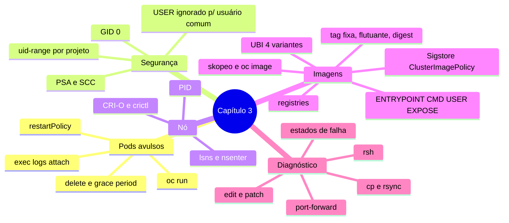

# Resumo — Capítulo 3

Síntese autoral para revisão rápida. Correspondência oficial: seção 3.9 (PDF p. 226).

## Em uma frase por seção

| Seção | Ideia central |
|-------|---------------|
| 3.1 | `oc run` cria Pods avulsos para depuração; o OpenShift executa containers com UID aleatório da faixa do projeto e GID 0; no nó, o container é um processo com namespaces próprios, visível com `crictl`, `lsns` e `nsenter` |
| 3.3 | Imagens vêm de registries (Red Hat, Quay, privados, públicos), são identificadas por nome, tag e digest, e se inspecionam sem rodar com `skopeo` e `oc image`; prefira imagens não root e verificadas (Sigstore) |
| 3.5 | Containers são imutáveis e efêmeros: diagnostique com `describe`, `logs`, `events`, `exec`, `rsh`, `cp`, `rsync` e `port-forward`, e leve a correção para a origem |

## Mapa do capítulo

## Tabela de comandos do capítulo

| Tarefa | Comando |
|--------|---------|
| Criar Pod | `oc run <n> --image  [--env K=V] [--command -- cmd]` |
| Comando pontual | `oc run <n> -it --rm --restart Never --image  --command -- cmd` |
| Faixas do projeto | `oc describe project 
` |
| Comando no container | `oc exec <pod> [-c c] -- cmd` · `oc exec -it <pod> -- bash` |
| Shell | `oc rsh [-c c] <pod>` |
| Logs | `oc logs <pod> [-c c] [-f] [-p] [--tail N] [-l sel]` |
| Anexar | `oc attach <pod> -it` |
| Apagar | `oc delete pod <n> [--grace-period N\|--now\|--force]` · `-l` · `--all` |
| Container no nó | `crictl ps --name x` · `crictl inspect <id>` · `lsns -p PID` · `nsenter -t PID -a cmd` |
| Login no registry | `skopeo login <registry>` |
| Tags | `skopeo list-tags docker://<repo>` |
| Configuração da imagem | `skopeo inspect [--config] docker://` · `oc image info  [--filter-by-os amd64]` |
| Copiar imagens | `skopeo copy` · `skopeo sync` · `oc image mirror` |
| Arquivos da imagem | `oc image extract  --path <orig>:<dest>` |
| Editar | `oc edit pod <n>` · `oc patch pod <n> --type=json -p '[...]'` |
| Copiar arquivos | `oc cp <orig> <pod>:<dest>` · `oc rsync <pod>:<dir> <local>` |
| Túnel | `oc port-forward pod/<n> <local>:<remota>` |

## Alertas operacionais

- ⚠️ Comando curto + `restartPolicy: Always` = `CrashLoopBackOff`.
- ⚠️ Use aspas simples em valores com `$` passados por `--env`.
- ⚠️ `--force` no delete pode causar inconsistência ou perda de dados.
- ⚠️ Imagens públicas: risco de código malicioso, root e licença. Inspecione antes.
- ⚠️ `auth.json` só codifica as credenciais em base64.
- ⚠️ Não altere a `ClusterImagePolicy` `openshift`.
- ⚠️ Mudanças em container vivo são efêmeras: corrija na origem.

## Ligação com o próximo capítulo

Pods avulsos não se recuperam sozinhos nem recebem tráfego estável. O Capítulo 4
apresenta **Deployments**, **Jobs**, **Services** e **Routes**, que gerenciam e
expõem esses Pods.

---
[← Revisão](REVISAO.md) | [Índice do capítulo](README.md) | [Próximo capítulo →](../04-deploy-e-redes/README.md)
