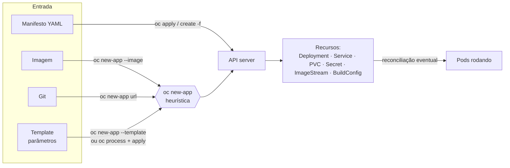

# 4.1 — Implantar aplicações a partir de uma imagem e de um template

| Campo | Valor |
|-------|-------|
| Curso | DO180 — OpenShift 4.22 |
| Capítulo / seção | Capítulo 4 · Seção 4.1 |
| Título original | Deploy Applications from an Image and from a Template |
| Título em português | Implantar aplicações a partir de uma imagem e de um template |
| Objetivo | Identificar os principais recursos e configurações que o Kubernetes usa para gerenciar aplicações de longa duração e ver como o OpenShift simplifica os fluxos comuns de implantação |
| Pré-requisitos | [F4](../../01-fundamentos-essenciais/04-pods-e-workloads.md), [F5](../../01-fundamentos-essenciais/05-kubernetes-api-e-yaml.md), [Capítulo 3](../03-containers-e-pods/README.md) |
| Referência | PDF p. 228–239 · Guided Exercise 4.2 p. 240–244 |

## Parte A — Entendendo o conceito

### "Aplicação" é um conjunto de recursos

"Aplicação" pode significar um sistema inteiro ou um único serviço dele. Por isso,
em Kubernetes, é mais preciso falar dos **recursos**: o Kubernetes gerencia uma
aplicação como um **conjunto frouxo de recursos** (Deployment, Service, PVC,
Secret...).

Dois fatos importantes:

- Criar um recurso **não cria o componente na hora**: é um pedido que o cluster
  cumpre **eventualmente** (reconciliação).
- **Apagar** também é um pedido de remoção eventual. Dá para apagar em lote por
  label (`oc delete deployment -l app=x`) ou apagando o projeto inteiro.

Tipos de recurso vêm do Kubernetes, do OpenShift e de **CRDs** (*Custom Resource
Definitions*), que permitem adicionar tipos novos.

### Os recursos que compõem uma aplicação típica

| Recurso | Papel | Destaques do manifesto |
|---------|-------|------------------------|
| **Pod** | Menor unidade de computação; 1+ containers que compartilham rede e storage | `spec.containers` (imagem, env, portas, `volumeMounts`), `volumes`, `restartPolicy`; `status.conditions` |
| **Deployment** | Estado desejado de um componente como **modelo de Pod**; gerencia ReplicaSets | `replicas`, `selector`, `template` |
| **Project** | Namespace com anotações; principal forma de controlar o acesso de usuários comuns; usa RBAC; isola recursos (outros projetos não os acessam por padrão) | `finalizers: [kubernetes]`: o projeto só some depois que tudo dentro dele for removido |
| **Service** | Comunicação interna Pod a Pod por nome e porta | `selector`, `port` (escuta do Service), `targetPort` (porta do Pod) |
| **PersistentVolumeClaim** | Pedido de storage sem conhecer a infraestrutura | `accessModes`, `resources.requests.storage`, `storageClassName`. Um PV ligado a um PVC **não** se liga a outro: na prática, fica restrito ao namespace do PVC |
| **Secret** | Dados sensíveis: senhas, credenciais, chaves SSH, tokens, certificados TLS | `type` (ex.: `Opaque`); `data` (valores em **base64**) ou `stringData` (texto puro, codificado pelo cluster) |
| **Template** (OpenShift) | Manifesto YAML **parametrizado** que gera vários recursos | Parâmetros com valores padrão, obrigatórios ou **gerados** |

> Um **finalizer** é uma chave especial de metadados que faz o Kubernetes esperar
> uma condição antes de remover de fato o recurso.

### Imperativo × declarativo

| Estilo | Você diz... | Exemplos | Bom para |
|--------|-------------|----------|----------|
| **Imperativo** | **O que fazer** | `oc create deployment`, `oc run`, `oc set env`, `oc new-app --image` | Testes rápidos; gerar um manifesto inicial |
| **Declarativo** | **Que estado quer** | `oc create -f arquivo.yaml`, `oc apply -f`, `oc new-app --file`, `oc new-app --template` | Versionamento e mudanças incrementais |

Atenção: `oc create` pode ser imperativo (`oc create deployment ...`) **ou**
declarativo (`oc create -f manifesto.yaml`). O que conta é se você dá uma ordem ou
descreve um estado.

O fluxo recomendado: testar com comandos imperativos e depois **gerar o
manifesto** com `--dry-run=client -o yaml` para versioná-lo.

### `oc new-app`: heurística do OpenShift

`oc new-app` analisa o que você passou e **decide quais recursos criar**:

| Entrada | Exemplo | Recursos típicos |
|---------|---------|------------------|
| Imagem | `oc new-app --image ` | ImageStream, Deployment e, se a imagem declara portas, Service |
| Repositório Git | `oc new-app <url-git>#<ref> --name <n>` | BuildConfig, ImageStream, Deployment, Service |
| Template | `oc new-app --template <t> --param K=V` | O que o template definir (ex.: Secret, Service, PVC, Deployment) |
| Arquivo | `oc new-app --file <arquivo>` | O que o arquivo definir |

Com template, a saída mostra os **parâmetros usados**, inclusive os gerados (ex.:
senhas). ⚠️ Essa saída pode conter credenciais: não a cole em lugares públicos.

### Templates

- Templates **predefinidos** ficam no projeto `openshift`.
- `oc process` substitui os parâmetros e gera a **lista de recursos**, que pode ser
  enviada ao `oc apply`.
- `oc new-app --template` processa e cria em um passo.

### Pelo console

**Home › Projects › *projeto* › Workloads › Add**: implantar a partir de YAML,
repositório Git, Helm chart, imagem de container ou do Software Catalog.

### Ler o que foi criado

- `oc get all` cobre só um **subconjunto** de tipos. Para saber quais:
  `oc api-resources --categories=all`.
- `oc describe` é ótimo para ler (inclusive templates), mas **não** gera saída
  estruturada. Para filtrar, use `oc get -o yaml|json|jsonpath`.

## Parte B — Modelo mental



## Parte C — Funcionamento na prática

### Templates

```bash
oc get templates -n openshift                         # templates disponíveis
oc describe template mysql-persistent -n openshift    # parâmetros e objetos
oc process --parameters mysql-persistent -n openshift # só os parâmetros
oc process -f meu-template.yaml --parameters          # template em arquivo

# Processar e aplicar (declarativo, em dois passos)
oc process -f meu-template.yaml -p DATABASE_SERVICE_NAME=db -p VOLUME_CAPACITY=2Gi \
  | oc apply -f -

# Processar e criar em um passo
oc new-app --template mysql-persistent \
  --param MYSQL_USER=app --param MYSQL_DATABASE=loja --param DATABASE_SERVICE_NAME=db
```

- **Resultado:** `secret "db" created`, `service "db" created`, `persistentvolumeclaim "db" created`, `deployment.apps "db" created`.
- **Verificar:** `oc get deployment,svc,pvc,secret` e `oc describe deployment db`.
- **Erros comuns:** template inexistente no projeto (`-n openshift` faltando); parâmetro obrigatório sem valor.

### Imperativo e geração de manifesto

```bash
oc create deployment web --image registry.access.redhat.com/ubi10/httpd-24 --replicas 2
oc set env deployment/web TEAM=red                    # altera o template do Deployment
oc run exemplo --image registry.access.redhat.com/ubi10/httpd-24 \
  --env GREETING='Ola' --port 8080 --dry-run=client -o yaml > exemplo-pod.yaml
oc create deployment web --image  --dry-run=client -o yaml > web-deploy.yaml
```

- `--dry-run=client` **não** envia nada ao cluster; com `-o yaml` imprime o manifesto.
- `oc set env` em um Deployment gera um **novo rollout** (Pods recriados com a variável).

### `oc new-app` a partir de imagem ou Git

```bash
oc new-app --image registry.access.redhat.com/ubi10/httpd-24 --name site
oc new-app https://git.exemplo.com/equipe/app.git#v1.0 --name app
oc get all -l app=site
oc status
```

### Apagar em lote

```bash
oc delete all -l app=site          # ⚠️ "all" não inclui PVC, Secret, ConfigMap
oc delete pvc,secret -l app=site
```

## Parte D — Relações importantes

| A | B | Diferença essencial |
|---|---|--------------------|
| Pod | Deployment | Unidade de execução × modelo + réplicas + versões |
| Imperativo | Declarativo | Ordem ("faça") × estado desejado ("quero assim") |
| `oc create deployment` | `oc create -f` | Imperativo × declarativo |
| `oc new-app` | `oc create deployment` | Heurística, cria vários recursos × cria só o Deployment |
| `oc process` | `oc new-app --template` | Gera a lista de recursos (você aplica) × processa e cria |
| Template | Helm chart | Parametrização nativa do OpenShift × empacotamento da comunidade, também aceito pela console |
| Secret `data` | Secret `stringData` | Base64 × texto puro (o cluster codifica) |
| `oc describe` | `oc get -o yaml` | Leitura humana × saída estruturada para filtros |

## Parte E — Preparação para o laboratório

Atividade associada: **4.2 Guided Exercise — Deploy Applications from an Image and
from a Template** (`deploy-newapp`, PDF p. 240–244).

Você deve conseguir:

- Implantar um banco a partir de uma **imagem** e a partir de um **template**.
- Listar os recursos criados por cada método e comparar seus atributos e labels.
- Usar `oc get` com seletores de label e reconhecer que nem todo recurso recebe os mesmos labels.

Ver [PRATICA-OFICIAL.md](PRATICA-OFICIAL.md#42-guided-exercise-deploy-applications-from-an-image-and-from-a-template).

## Parte F — Fixação

1. Por que se diz que criar um recurso no Kubernetes é um pedido de criação "eventual"?
2. Qual a diferença entre `oc process` e `oc new-app --template`?
3. `oc create deployment` e `oc create -f deploy.yaml` usam o mesmo verbo. Ambos são imperativos?
4. Como gerar um manifesto de Deployment para versionar sem criar nada no cluster?
5. Você apagou `oc delete all -l app=db`, mas o PVC e o Secret continuam. Por quê?

<details>
<summary>Respostas comentadas</summary>

1. O API server grava o estado desejado e os controllers trabalham para alcançá-lo; o componente surge (ou some) depois, de forma assíncrona.
2. `oc process` só gera a lista de recursos com os parâmetros substituídos (você a envia ao `oc apply`); `oc new-app --template` processa e cria de uma vez.
3. Não. `oc create deployment ...` dá uma ordem (imperativo); `oc create -f` envia um estado descrito em arquivo (declarativo).
4. `oc create deployment <nome> --image  --dry-run=client -o yaml > arquivo.yaml`.
5. `all` é só um subconjunto de tipos (veja `oc api-resources --categories=all`); PVC e Secret não fazem parte dele.

</details>

## Parte G — Essencial para memorizar

- Aplicação = conjunto de recursos; criação e remoção são **eventuais**.
- Pod · Deployment · Project (finalizer) · Service (`port`/`targetPort`) · PVC · Secret (`data` base64 / `stringData`) · Template.
- Imperativo (`create <tipo>`, `run`, `set`) × declarativo (`create -f`, `apply -f`, `new-app --template/--file`).
- `--dry-run=client -o yaml` gera manifestos.
- Templates: `oc get templates -n openshift`, `oc process [--parameters]`, `oc new-app --template --param`.
- `oc new-app` usa heurística: imagem, Git, template ou arquivo.
- `all` ≠ tudo: `oc api-resources --categories=all`.

---
[← Capítulo 4 (índice)](README.md) | [Índice do capítulo](README.md) | [Próximo: 4.3 Workloads →](4.3-workloads-de-longa-e-curta-duracao.md)
