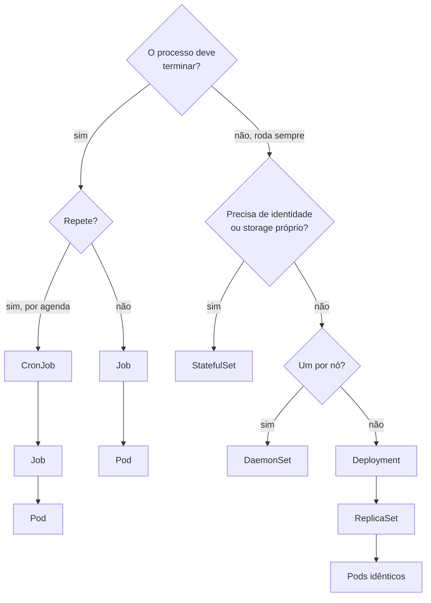

# 4.3 — Gerenciar aplicações de longa e curta duração com a Workloads API

| Campo | Valor |
|-------|-------|
| Curso | DO180 — OpenShift 4.22 |
| Capítulo / seção | Capítulo 4 · Seção 4.3 |
| Título original | Manage Long-lived and Short-lived Applications by Using the Kubernetes Workload API |
| Título em português | Gerenciar aplicações de longa e curta duração com a Workloads API do Kubernetes |
| Objetivo | Implantar aplicações como Pods gerenciados por recursos de workload |
| Pré-requisitos | [4.1](4.1-implantar-a-partir-de-imagem-e-template.md), [F4](../../01-fundamentos-essenciais/04-pods-e-workloads.md) |
| Referência | PDF p. 245–250 · Guided Exercise 4.4 p. 251–255 |

## Parte A — Entendendo o conceito

### Por que não Pods avulsos

Um Pod criado com `oc run` não é gerenciado por nenhum controller: se o nó
falhar, ele **não é reagendado**; se o processo sair com erro, a recuperação
depende só da política de reinício do próprio Pod. A **Workloads API** reúne
recursos que criam e mantêm Pods de acordo com **por quanto tempo** e **com que
frequência** eles precisam rodar.

### O mapa da Workloads API

| Recurso | Duração | Garante | Casos de uso |
|---------|---------|---------|--------------|
| **Job** | Curta: roda até concluir | N conclusões com sucesso; refaz em caso de falha até um limite | Inicializar ou migrar banco, cálculo pontual, backup/restauração |
| **CronJob** | Curta, **recorrente** | Cria Jobs conforme um agendamento cron | Backups, relatórios, tarefas em horário de baixa carga |
| **Deployment** | Longa | N réplicas idênticas, recriadas se falharem ou forem apagadas | Aplicações *stateless* |
| **DaemonSet** | Longa | Um Pod em todos (ou alguns) nós; segue a entrada e saída de nós | Agentes de storage, log, monitoramento |
| **StatefulSet** | Longa | Pods **únicos**, com identidade de rede e storage próprios | Bancos e sistemas com estado (aprofundado em 5.7) |

### Jobs

- O Job cria Pods para executar a tarefa. Se o Pod falhar, o Job **tenta de novo**
  até o limite definido (📘 *fonte externa:* `spec.backoffLimit`, padrão 6).
- Depois do número especificado de **conclusões com sucesso** (`spec.completions`,
  padrão 1), o Job **não roda novamente**.
- 📘 *Fonte externa:* o Pod de um Job só aceita `restartPolicy` `Never` ou `OnFailure`.

### CronJobs

- Usa o **formato cron** do Linux: `minuto hora dia-do-mês mês dia-da-semana`.
- Por padrão, o horário segue o fuso do nó de control plane onde roda o controller
  de CronJob. O curso destaca que, no OpenShift 4.22, é possível **definir o fuso
  horário** do agendamento, garantindo o mesmo horário independentemente da
  localização do nó. 📘 *Fonte externa:* o campo é `spec.timeZone`, com nomes IANA
  (ex.: `America/Sao_Paulo`).

| Expressão | Significado |
|-----------|-------------|
| `*/1 * * * *` | A cada minuto |
| `0 2 * * *` | Todo dia às 02:00 |
| `30 22 * * 1-5` | Dias úteis às 22:30 |
| `0 0 1 * *` | Dia 1 de cada mês, à meia-noite |

### Deployments e ReplicaSets

- O Deployment cria um **ReplicaSet**, que mantém o número de réplicas. Você **não**
  gerencia ReplicaSets diretamente.
- Ao contrário dos Pods de um Job, os Pods de um Deployment são **recriados** após
  falha ou remoção.
- ⚠️ **DeploymentConfig** (objeto antigo do OpenShift, com triggers próprios) está
  **obsoleto desde o 4.14**. Workloads novos devem usar **Deployment**.

### Labels e seletores, de novo

- **Labels** são pares chave-valor em texto que indicam um traço comum (ex.:
  `layer=frontend`).
- **Seletores** são consultas sobre labels. ReplicaSets usam seletores para
  identificar seus Pods; Services também (seção 4.5).
- O Deployment adiciona o label **`pod-template-hash`**, que distingue os
  ReplicaSets (versões) de um mesmo Deployment.
- Muitos comandos aceitam `-l` para agir sobre vários recursos: `oc delete pod -l environment=testing`.

## Parte B — Modelo mental



## Parte C — Funcionamento na prática

### Job

```bash
oc create job hora-job --image registry.access.redhat.com/ubi9/ubi -- /bin/bash -c "date"
oc get jobs                                   # COMPLETIONS 1/1 = sucesso
oc get pods -l job-name=hora-job              # Pod com STATUS Completed
oc logs job/hora-job                          # logs do Pod do Job
oc get job hora-job -o yaml                   # inclusive o template do Pod
oc delete job hora-job                        # apaga o Job e seus Pods
```

Manifesto original equivalente, com limites explícitos:

```yaml
apiVersion: batch/v1
kind: Job
metadata:
  name: migra-banco
spec:
  completions: 1          # quantas execuções com sucesso
  backoffLimit: 3         # quantas novas tentativas em caso de falha
  template:
    spec:
      restartPolicy: Never
      containers:
        - name: migra
          image: registry.access.redhat.com/ubi9/ubi
          command: ["/bin/bash", "-c", "echo migrando; sleep 5; echo ok"]
```

### CronJob

```bash
oc create cronjob relatorio --image registry.access.redhat.com/ubi9/ubi \
  --schedule "*/1 * * * *" -- date
oc get cronjobs                               # SCHEDULE, LAST SCHEDULE
oc get jobs -w                                # Jobs criados a cada minuto
oc create job relatorio-manual --from=cronjob/relatorio   # 📘 disparo manual
```

```yaml
apiVersion: batch/v1
kind: CronJob
metadata:
  name: backup-noturno
spec:
  schedule: "0 2 * * *"
  timeZone: "America/Sao_Paulo"
  jobTemplate:
    spec:
      template:
        spec:
          restartPolicy: OnFailure
          containers:
            - name: backup
              image: registry.access.redhat.com/ubi9/ubi
              command: ["/bin/bash", "-c", "echo backup em $(date)"]
```

### Deployment

```bash
oc create deployment my-deployment --image registry.access.redhat.com/ubi10/httpd-24 --replicas 3
oc get deployment,replicaset,pod -l app=my-deployment
oc set env deployment/my-deployment NIVEL=debug    # muda o template → novo ReplicaSet
oc get rs -l app=my-deployment                     # o antigo fica com 0 réplicas
oc delete pod -l app=my-deployment                 # Pods voltam (ReplicaSet recria)
```

- `oc create deployment` adiciona o label `app=<nome>` e o usa no seletor.
- **Verificar:** `READY 3/3` no Deployment; `DESIRED/CURRENT/READY` no ReplicaSet.

### DaemonSet

Só por manifesto (`oc create -f daemonset.yaml`) ou pela console (*Workloads ›
DaemonSets*). Exemplo original:

```yaml
apiVersion: apps/v1
kind: DaemonSet
metadata:
  name: agente-log
spec:
  selector:
    matchLabels:
      app: agente-log
  template:
    metadata:
      labels:
        app: agente-log
    spec:
      containers:
        - name: agente
          image: registry.access.redhat.com/ubi9/ubi
          command: ["/bin/bash", "-c", "while true; do date; sleep 60; done"]
```

Pela console, cada tipo tem sua página em **Workloads** (*Jobs*, *CronJobs*,
*Deployments*, *DaemonSets*, *StatefulSets*), com botão **Create** e editor YAML.

## Parte D — Relações importantes

| A | B | Diferença essencial |
|---|---|--------------------|
| `oc run` (Pod) | Job | Nada recria o Pod se o nó cair × controller refaz até concluir ou atingir o limite |
| Job | CronJob | Uma execução × execuções periódicas, cada uma um Job |
| Job | Deployment | Deve terminar × deve continuar rodando |
| Deployment | ReplicaSet | Gerencia versões (rollout) × mantém a contagem de uma versão |
| Deployment | DeploymentConfig | Padrão Kubernetes × objeto antigo do OpenShift, obsoleto desde 4.14 |
| Deployment | StatefulSet | Réplicas intercambiáveis × réplicas únicas com identidade e storage |
| Deployment | DaemonSet | N réplicas onde o scheduler escolher × uma por nó |
| `completions` | `backoffLimit` | Sucessos exigidos × novas tentativas permitidas |

## Parte E — Preparação para o laboratório

Atividade associada: **4.4 Guided Exercise — Manage Long-lived and Short-lived
Applications by Using the Kubernetes Workload API** (`deploy-workloads`, PDF p. 251–255).

Você deve conseguir:

- Criar Deployments e alterar variáveis de ambiente no template de Pod.
- Criar e executar Jobs, ver seus logs e o estado de término.
- Inspecionar o template de Pod de um Job.

Ver [PRATICA-OFICIAL.md](PRATICA-OFICIAL.md#44-guided-exercise-manage-long-lived-and-short-lived-applications-by-using-the-kubernetes-workload-api).

## Parte F — Fixação

1. Que recurso usar para: (a) API web; (b) migração de esquema antes de uma versão; (c) limpeza de arquivos temporários toda madrugada; (d) coletor de logs em cada nó; (e) cluster de banco com três membros?
2. Escreva a expressão cron para "às 06:15 de segunda a sexta".
3. Um Pod de Job falhou três vezes. O que define se haverá nova tentativa?
4. Você editou diretamente um ReplicaSet de um Deployment para mudar a imagem. O que acontece?
5. Por que não usar DeploymentConfig em uma aplicação nova no 4.22?

<details>
<summary>Respostas comentadas</summary>

1. (a) Deployment; (b) Job; (c) CronJob; (d) DaemonSet; (e) StatefulSet.
2. `15 6 * * 1-5`.
3. O limite de novas tentativas do Job (`spec.backoffLimit`); enquanto não for atingido, o Job cria outro Pod.
4. O Deployment é o dono do estado; a mudança no ReplicaSet não é a forma suportada e tende a ser revertida ou ignorada nas próximas reconciliações. Altere o Deployment.
5. Está obsoleto desde o 4.14; o padrão é o Deployment do Kubernetes, alinhado ao upstream.

</details>

## Parte G — Essencial para memorizar

- Workloads API: **Job**, **CronJob**, **Deployment**, **DaemonSet**, **StatefulSet**.
- Escolha por duração (termina ou não), repetição (agenda) e identidade (estado).
- `oc create job <n> --image  -- <cmd>` · `oc create cronjob <n> --image  --schedule "<cron>" -- <cmd>` · `oc create deployment <n> --image  --replicas N`.
- Deployment → ReplicaSet (`pod-template-hash`) → Pods; não edite ReplicaSets.
- DeploymentConfig: obsoleto desde 4.14.
- Fuso de CronJob configurável (`spec.timeZone`).

---
[← 4.1 Imagem e template](4.1-implantar-a-partir-de-imagem-e-template.md) | [Índice do capítulo](README.md) | [Próximo: 4.5 Redes de Pods e Services →](4.5-redes-de-pods-e-services.md)
