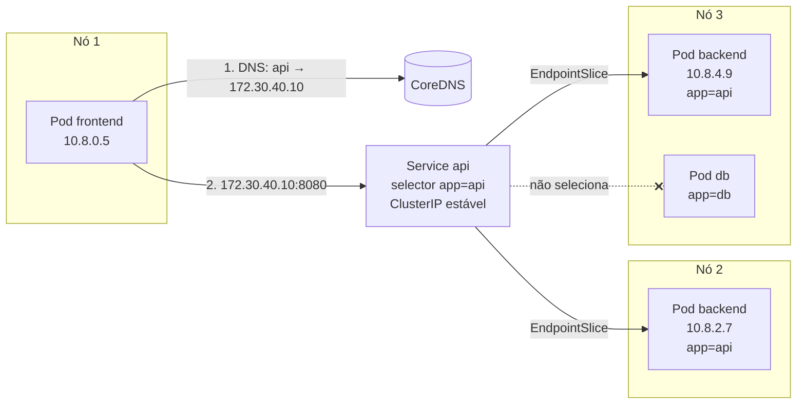

# 4.5 — Redes de Pods e de Services do Kubernetes

| Campo | Valor |
|-------|-------|
| Curso | DO180 — OpenShift 4.22 |
| Capítulo / seção | Capítulo 4 · Seção 4.5 |
| Título original | Kubernetes Pod and Service Networks |
| Título em português | Redes de Pods e de Services do Kubernetes |
| Objetivo | Interligar Pods de aplicações no mesmo cluster usando Services |
| Pré-requisitos | [F6](../../01-fundamentos-essenciais/06-redes-e-servicos.md), [4.3](4.3-workloads-de-longa-e-curta-duracao.md) |
| Referência | PDF p. 256–264 · Guided Exercise 4.6 p. 265–270 |

## Parte A — Entendendo o conceito

### A rede definida por software: OVN-Kubernetes

O OpenShift implementa a rede do cluster (SDN) com o plugin **OVN-Kubernetes**, o
provedor de rede padrão. Ele é um plugin **CNI** (*Container Network Interface*)
completo, baseado no **OVN** (*Open Virtual Network*), uma solução de virtualização
de rede independente de fornecedor.

- Cria uma **rede virtual que abrange todos os nós** e permite a comunicação entre
  quaisquer Pods do cluster.
- Essa rede **não** é acessível de fora do cluster nem por processos comuns dos nós.
- O modelo é compatível com práticas tradicionais: em alocação de portas, IPs e
  nomes, um Pod se comporta como uma **máquina virtual**. Aplicações legadas que
  conversam por TCP/UDP não precisam mudar.

### Os quatro tipos de comunicação

| Comunicação | Como funciona |
|-------------|---------------|
| **Container ↔ container** (mesmo Pod) | Compartilham IP e MAC: falam por `localhost`. Portas ligadas a `localhost` só são vistas dentro do Pod |
| **Pod ↔ Pod** | Cada Pod tem IP único de uma faixa CIDR comum, "plana": comunicação **sem NAT**, mesmo entre nós e **entre namespaces** (por padrão) |
| **Pod → Service** | IP estável da **rede de Services**; um agente gerenciado pelo OVN-Kubernetes encaminha o tráfego aos Pods do seletor |
| **Externo → Service** | Routes, Ingress e Gateway API: seção 4.7 |

### O problema e a solução

Pods são **efêmeros**: rollouts, falhas e escala trocam seus IPs. Um frontend que
aponta para o IP do Pod de backend quebra quando o backend é recriado. A solução é
o **Service**:

- recebe um **IP estável** que não muda nem é reutilizado enquanto o Service existir;
- funciona como um **balanceador de carga virtual** para os Pods ligados a ele;
- atualiza os **endpoints** automaticamente quando Pods entram, saem ou mudam de nó;
- os Pods de destino podem estar em **qualquer nó**.

Para um Pod entrar em um Service, os labels do Pod precisam conter **todos** os
campos do seletor do Service. Cada Pod selecionado é um **endpoint**.

### `oc expose deployment`: criar o Service

| Opção | Efeito | Se omitida |
|-------|--------|-----------|
| `--selector` | Seletor de labels | Usa o seletor do ReplicaSet/controller |
| `--port` | Porta em que o Service escuta (só dentro do cluster) | Copia da configuração do Deployment |
| `--target-port` | Nome ou número da porta do container | Copia da configuração do Deployment |
| `--protocol` | Protocolo | `TCP` |
| `--name` | Nome do Service | Nome do Deployment |

### DNS do cluster

O **DNS operator** (API `operator.openshift.io`) implanta o **CoreDNS**, cria um
Service para ele e configura o kubelet para que os Pods usem esse IP como servidor
de nomes. Cada Service recebe um nome:

```text
SVC-NAME.PROJECT-NAME.svc.CLUSTER-DOMAIN     ex.: db.loja.svc.cluster.local
```

O `/etc/resolv.conf` de um Pod no projeto `loja` fica parecido com:

```text
nameserver 172.30.0.10
search loja.svc.cluster.local svc.cluster.local cluster.local
options ndots:5
```

| Diretiva | Efeito prático |
|----------|----------------|
| `nameserver` | IP do Service do DNS interno |
| `search loja.svc.cluster.local` | Permite usar só `SVC-NAME` para Services do **mesmo** projeto |
| `search svc.cluster.local` | Permite usar `SVC-NAME.PROJECT-NAME` para **outros** projetos |
| `ndots:5` | Nomes com menos de 5 pontos são tentados primeiro com os sufixos de `search` |

Um Service **sem** ClusterIP (*headless*) recebe um registro DNS que resolve
diretamente para os IPs dos Pods. Isso é usado pelos StatefulSets (5.7).

### Cluster Network Operator (CNO)

O **CNO** é o cluster operator que carrega e configura os plugins CNI. A
configuração de rede do cluster fica em `network.config/cluster`:

| Campo | Significado | No laboratório |
|-------|-------------|----------------|
| Cluster Network CIDR | Faixa de IPs de **todos os Pods** | `10.8.0.0/14` |
| Host Prefix | Tamanho da sub-rede entregue a cada nó | `23` (≈ 510 IPs de Pod por nó) |
| Service Network | Faixa de IPs de **todos os Services** | `172.30.0.0/16` |
| Network Type | Plugin | `OVNKubernetes` |

Em edições gerenciadas (ex.: ROSA), o CNO é gerenciado pelo provedor e não fica
acessível ao administrador do cluster.

## Parte B — Modelo mental



Se o Pod `10.8.2.7` morrer, outro nasce com IP novo. O EndpointSlice é atualizado,
e o frontend continua chamando `api:8080` sem perceber.

## Parte C — Funcionamento na prática

### Criar e inspecionar um Service

```bash
oc create deployment db-pod --image registry.redhat.io/rhel10/mysql-84
oc set env deployment/db-pod MYSQL_USER=app MYSQL_PASSWORD='Troque-me' MYSQL_DATABASE=loja
oc expose deployment/db-pod --port 3306 --target-port 3306
oc get service db-pod -o wide                       # coluna SELECTOR
oc get endpointslices -l kubernetes.io/service-name=db-pod
oc get pods -l app=db-pod -o wide                   # IPs devem coincidir com os endpoints
oc describe deployment db-pod | grep -i selector
oc get deployment db-pod -o jsonpath='{.spec.selector.matchLabels}{"\n"}'
```

Manifesto original equivalente do Service:

```yaml
apiVersion: v1
kind: Service
metadata:
  name: db-pod
spec:
  type: ClusterIP
  selector:
    app: db-pod
  ports:
    - name: mysql
      protocol: TCP
      port: 3306
      targetPort: 3306
```

### Testar conectividade de dentro do cluster

```bash
# Cliente temporário no mesmo projeto, usando o nome do Service
oc run cliente -it --rm --restart Never \
  --image registry.redhat.io/rhel10/mysql-84 --command -- \
  mysql -h db-pod -u app -p loja

# Resolução de nomes a partir de um Pod existente (se a imagem tiver getent)
oc exec <POD> -- getent hosts db-pod
oc exec <POD> -- getent hosts db-pod.<OUTRO_PROJETO>
oc exec <POD> -- cat /etc/resolv.conf

# Diagnóstico Pod a Pod (ignora o Service), útil para isolar o problema
oc get pod <POD_DESTINO> -o jsonpath='{.status.podIP}{"\n"}'
```

| Resultado | Interpretação |
|-----------|---------------|
| Conecta pelo IP do Pod, mas **não** pelo Service | Seletor errado, porta/targetPort errados ou Pod não pronto (fora dos endpoints) |
| Nome não resolve | Nome/projeto errado; confira o formato `svc.projeto` |
| Não conecta nem pelo IP do Pod | A aplicação não escuta na porta, ou escuta só em `localhost` dentro do Pod |

### Ver a configuração de rede do cluster (administrador)

```bash
oc get -n openshift-network-operator deployment/network-operator
oc describe network.config/cluster
oc get network.config/cluster -o jsonpath='{.spec.clusterNetwork}{"\n"}{.spec.serviceNetwork}{"\n"}'
oc get co network dns
```

## Parte D — Relações importantes

| A | B | Diferença essencial |
|---|---|--------------------|
| IP do Pod | ClusterIP do Service | Muda a cada recriação × estável durante a vida do Service |
| Rede de Pods | Rede de Services | `clusterNetwork` (ex.: 10.8.0.0/14) × `serviceNetwork` (ex.: 172.30.0.0/16) |
| `port` | `targetPort` | Porta do Service × porta do container |
| Service | EndpointSlice | Define o seletor × lista os IPs dos Pods que casam e estão prontos |
| `localhost` | IP do Pod | Só entre containers do mesmo Pod × acessível por outros Pods |
| `svc` | `svc.projeto` | Mesmo projeto × outro projeto |
| ClusterIP | Headless | IP virtual com balanceamento × DNS devolve os IPs dos Pods |
| CNO | DNS operator | Configura a rede/CNI × configura o CoreDNS |

## Parte E — Preparação para o laboratório

Atividade associada: **4.6 Guided Exercise — Kubernetes Pod and Service Networks**
(`deploy-services`, PDF p. 265–270).

Você deve conseguir:

- Implantar um servidor de banco e criar um Service para ele.
- Conferir o label do Pod, o seletor do Service e os EndpointSlices, e verificar que o IP do endpoint é o IP do Pod.
- Acessar o banco pelo Service e também diretamente Pod a Pod, para diagnóstico.

Ver [PRATICA-OFICIAL.md](PRATICA-OFICIAL.md#46-guided-exercise-kubernetes-pod-and-service-networks).

## Parte F — Fixação

1. Dois containers do mesmo Pod precisam se comunicar. Qual endereço usar?
2. Um Pod do projeto `vendas` precisa acessar o Service `estoque` do projeto `logistica`. Qual nome usar?
3. O Service `api` existe, mas `oc get endpointslices -l kubernetes.io/service-name=api` mostra `<unset>`/nenhum endpoint. Cite duas causas.
4. Por que Pods em nós diferentes se comunicam sem NAT?
5. O que `oc expose deployment/web` faz quando você omite `--port`, `--target-port` e `--name`?

<details>
<summary>Respostas comentadas</summary>

1. `localhost`: containers do mesmo Pod compartilham a pilha de rede.
2. `estoque.logistica` (ou `estoque.logistica.svc.cluster.local`).
3. O seletor do Service não casa com os labels dos Pods; os Pods não estão prontos (`Ready` em `False`); ou não há Pods rodando.
4. Todos os Pods recebem IPs de uma mesma faixa plana, roteada pelo OVN-Kubernetes entre os nós.
5. Cria um Service com o nome do Deployment, usando o seletor do controller e as portas copiadas da configuração do Deployment, com protocolo TCP.

</details>

## Parte G — Essencial para memorizar

- OVN-Kubernetes = CNI padrão; rede virtual plana entre nós; Pods sem NAT, inclusive entre namespaces (por padrão).
- Containers do mesmo Pod: mesmo IP, falam por `localhost`.
- Service = IP estável + balanceamento + endpoints automáticos via **seletor**.
- `oc expose deployment/<d> [--port] [--target-port] [--name] [--selector] [--protocol]`.
- `oc get svc -o wide` (seletor) · `oc get endpointslices -l kubernetes.io/service-name=<svc>`.
- DNS: `svc` · `svc.projeto` · `svc.projeto.svc.cluster.local`; CoreDNS via DNS operator.
- CNO e `network.config/cluster`: CIDR de Pods, host prefix, CIDR de Services.

---
[← 4.3 Workloads](4.3-workloads-de-longa-e-curta-duracao.md) | [Índice do capítulo](README.md) | [Próximo: 4.7 Escalar e expor →](4.7-escalar-e-expor-aplicacoes.md)
