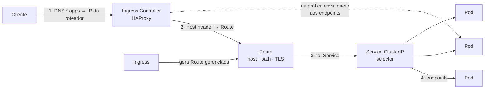

# 4.7 — Escalar e expor aplicações para acesso externo

| Campo | Valor |
|-------|-------|
| Curso | DO180 — OpenShift 4.22 |
| Capítulo / seção | Capítulo 4 · Seção 4.7 |
| Título original | Scale and Expose Applications to External Access |
| Título em português | Escalar e expor aplicações para acesso externo |
| Objetivo | Expor aplicações a clientes fora do cluster com Ingress do Kubernetes e Routes do OpenShift |
| Pré-requisitos | [4.5](4.5-redes-de-pods-e-services.md), [F6](../../01-fundamentos-essenciais/06-redes-e-servicos.md) |
| Referência | PDF p. 271–278 · Guided Exercise 4.8 p. 279–284 |

## Parte A — Entendendo o conceito

### Services: tipos e quando usar

O IP de um Service vem de uma rede interna do OVN-Kubernetes, separada da rede de
Pods. Por padrão o balanceamento é **round-robin**.

| Tipo | O que faz | Alcance | Cuidados |
|------|-----------|---------|----------|
| **ClusterIP** (padrão) | IP interno da rede de Services | Só dentro do cluster | É o que a maioria das aplicações usa |
| **LoadBalancer** | Pede um balanceador ao provedor de nuvem (ou MetalLB em bare metal) com IP externo | Externo | **Custo** de um balanceador por aplicação; exige configurações de segurança extras |
| **NodePort** | Abre a mesma porta (padrão **30000–32767**) no IP de **todos os nós** | Externo, via nós | ⚠️ Exige acesso direto aos nós: firewall e controle de acesso rigorosos |
| **ExternalIP** | Encaminha um IP virtual atribuído a um nó para os Pods (NAT) | Externo, via nó | ⚠️ **Legado** por questões de segurança; prefira LoadBalancer ou NodePort |
| **ExternalName** | O DNS do cluster responde um **CNAME** para um nome externo (`externalName`) | — | Não tem Pods nem IP: é um apelido DNS |

### Route: a forma nativa de expor HTTP(S)

- Uma **Route** associa um **hostname público** a um Service. O **Ingress
  Controller** do OpenShift (baseado em **HAProxy**) recebe o tráfego e o entrega aos Pods.
- Pensada principalmente para HTTP e TLS. Serviços não HTTP, como bancos,
  normalmente ficam **internos**.
- Recursos além do Ingress padrão: **re-encrypt** e **passthrough** de TLS, e
  **divisão de tráfego** para implantações blue-green.
- Outros Ingress Controllers de terceiros podem rodar em paralelo. Em nuvem, é comum
  um Ingress Controller público atrás de um balanceador do provedor.

**Hostname:** com `--hostname`, você escolhe; sem ele, o OpenShift gera
`<route>-<projeto>.<domínio-wildcard>` (ex.: `frontend-api.apps.example.com`).

⚠️ O DNS **wildcard** (`*.apps...`) resolve **qualquer** nome para o IP do
roteador. O roteador trata cada hostname como **virtual host**: nome sem Route
correspondente (ou sem endpoints) recebe **HTTP 503** do roteador.

**Elementos de uma Route:** nome do Service (define os Pods), hostname, caminho
opcional (roteamento por path), porta de destino (`targetPort`, igual à do
Service) e estratégia de criptografia (TLS ou não).

### Ingress do Kubernetes

- Funções semelhantes às da Route: HTTP, HTTPS, SNI e TLS com SNI. O Ingress
  Controller do OpenShift processa Ingress e oferece terminação TLS, redirecionamento
  de caminho e sessões persistentes.
- Ao criar um Ingress, o OpenShift gera automaticamente uma **Route gerenciada**,
  removida quando o Ingress é apagado. Útil para ferramentas do ecossistema que só
  conhecem Ingress.
- **Routes são preferidas** pela integração nativa e pelos recursos avançados.

### Gateway API (alternativa)

Framework alternativo de entrada de tráfego, gerenciado pelo **Cluster Ingress
Operator** e implementado com componentes do **OpenShift Service Mesh**.

| Recurso | Escopo | Quem cria | Função |
|---------|--------|-----------|--------|
| **GatewayClass** | Cluster | Provedor de infraestrutura/administrador | Define o controller (no OpenShift: `controllerName: openshift.io/gateway-controller/v1`) |
| **Gateway** | Namespace | Operação do cluster | Ponto de entrada lógico: portas, protocolos, TLS |
| **HTTPRoute** | Namespace | Desenvolvedores | Regras que mapeiam requisições HTTP (ou HTTPS terminado) do Gateway (`parentRefs`) para Services |

⚠️ A Gateway API **não** suporta redes definidas pelo usuário (UDN).

### Sessões persistentes (*sticky sessions*)

Aplicações com estado de sessão precisam que o mesmo usuário caia sempre no mesmo
Pod. O Ingress Controller usa um **cookie**: escolhe o Pod, devolve o cookie na
resposta, e o cliente o reenvia nas próximas requisições.

- Ingress: anotação `ingress.kubernetes.io/affinity=cookie`.
- Route: anotação `router.openshift.io/cookie_name=<nome>` define o nome do cookie.
- ⚠️ Em Routes **passthrough** não há cookie: o roteador não termina o TLS e não lê o HTTP.

### Escalar e balancear

- `oc scale` altera as réplicas do **Deployment**; o ReplicaSet cria ou remove Pods.
  Não altere o ReplicaSet diretamente.
- O **Service** balanceia internamente. Para tráfego que chega pela Route, o
  **Ingress Controller** usa o seletor do Service para descobrir os endpoints e
  **ele mesmo** distribui entre os Pods, atualizando sua configuração quando os IPs mudam.

## Parte B — Modelo mental



| Pergunta | Use |
|----------|-----|
| Só outros Pods acessam? | Service **ClusterIP** |
| Clientes externos via HTTP(S) com nome? | **Route** (ou Ingress) |
| Protocolo não HTTP para fora (TCP/UDP)? | **LoadBalancer** (ou NodePort, com cautela) |
| Apontar para um serviço fora do cluster por nome? | **ExternalName** |

## Parte C — Funcionamento na prática

### Escalar

```bash
oc scale --replicas=3 deployment/web
oc get deployment web                            # READY 3/3
oc get pods -l app=web -o wide
oc get endpointslices -l kubernetes.io/service-name=web   # 3 endereços
```

### Route

```bash
oc expose service web                                      # hostname gerado
oc expose service web --hostname web.apps.exemplo.com --name web-externo
oc get route web                                           # coluna HOST/PORT
HOST=$(oc get route web -o jsonpath='{.spec.host}')
curl -s http://$HOST/
oc delete route web
```

Manifesto original:

```yaml
apiVersion: route.openshift.io/v1
kind: Route
metadata:
  name: web
  labels:
    app: web
spec:
  host: web.apps.exemplo.com     # omitido = gerado automaticamente
  path: /                        # opcional
  to:
    kind: Service
    name: web
  port:
    targetPort: 8080             # porta (ou nome) do Service
```

Pela console: **Networking › Routes › Create Route** (formulário ou YAML).

### Ingress

```bash
oc create ingress web-ingress --rule="web.apps.exemplo.com/*=web:8080"
oc get ingress
oc get route                     # aparece a Route gerenciada criada pelo Ingress
oc delete ingress web-ingress    # a Route gerenciada também some
```

```yaml
apiVersion: networking.k8s.io/v1
kind: Ingress
metadata:
  name: web-ingress
spec:
  rules:
    - host: web.apps.exemplo.com
      http:
        paths:
          - path: /
            pathType: Prefix
            backend:
              service:
                name: web
                port:
                  number: 8080
```

### Gateway API (exemplo coerente, original)

```yaml
apiVersion: gateway.networking.k8s.io/v1
kind: GatewayClass
metadata:
  name: openshift-default
spec:
  controllerName: openshift.io/gateway-controller/v1
---
apiVersion: gateway.networking.k8s.io/v1
kind: Gateway
metadata:
  name: loja-gateway
  namespace: openshift-ingress
spec:
  gatewayClassName: openshift-default
  listeners:
    - name: http
      protocol: HTTP
      port: 80
      hostname: "*.loja.exemplo.com"
      allowedRoutes:
        namespaces:
          from: All
---
apiVersion: gateway.networking.k8s.io/v1
kind: HTTPRoute
metadata:
  name: vitrine
  namespace: loja
spec:
  parentRefs:
    - name: loja-gateway
      namespace: openshift-ingress
  hostnames:
    - vitrine.loja.exemplo.com
  rules:
    - backendRefs:
        - name: vitrine
          port: 8080
```

### Sessões persistentes

```bash
oc annotate ingress web-ingress ingress.kubernetes.io/affinity=cookie
oc annotate route web router.openshift.io/cookie_name=sessao_web
HOST=$(oc get route web -o jsonpath='{.spec.host}')
curl -s -c /tmp/cookies http://$HOST/        # 1ª requisição: grava o cookie
curl -s -b /tmp/cookies http://$HOST/        # próximas: mesmo Pod
```

Para conferir, use uma aplicação que responda o nome do Pod (ex.: `hostname`) e
compare as respostas com e sem o cookie.

### Tipos de Service por comando

```bash
oc expose deployment/web --type NodePort --port 8080 --name web-np
oc get svc web-np                     # PORT(S) 8080:3xxxx/TCP
oc create service externalname banco-legado --external-name db.corp.exemplo.com
```

## Parte D — Relações importantes

| A | B | Diferença essencial |
|---|---|--------------------|
| Service | Route | Acesso interno (L4, IP estável) × acesso externo HTTP(S) por hostname |
| Route | Ingress | Nativa e mais recursos × padrão Kubernetes, convertido em Route gerenciada |
| Route/Ingress | Gateway API | Modelo atual preferido × alternativa com papéis separados (GatewayClass, Gateway, HTTPRoute) |
| ClusterIP | LoadBalancer | Interno × IP externo dedicado (custo) |
| NodePort | ExternalIP | Porta alta em todos os nós × IP virtual em um nó (legado) |
| ExternalName | Service com seletor | Apelido DNS (CNAME) × balanceador de Pods |
| `oc expose deployment` | `oc expose service` | Cria Service × cria Route |
| Escalar Deployment | Editar ReplicaSet | Correto × sobrescrito pelo Deployment |
| 503 do roteador | 503 da aplicação | Sem Route ou sem endpoints × erro da própria aplicação |

## Parte E — Preparação para o laboratório

Atividade associada: **4.8 Guided Exercise — Scale and Expose Applications to
External Access** (`deploy-routes`, PDF p. 279–284).

Você deve conseguir:

- Implantar duas aplicações web e expô-las, uma por **Ingress** e outra por **Route**.
- Habilitar sessões persistentes e verificá-las com cookies.
- Escalar os Deployments e confirmar o balanceamento pelos endpoints.

Ver [PRATICA-OFICIAL.md](PRATICA-OFICIAL.md#48-guided-exercise-scale-and-expose-applications-to-external-access).

## Parte F — Fixação

1. Você criou uma Route sem `--hostname` para o Service `vitrine` no projeto `loja`, com domínio `apps.cluster.exemplo`. Qual será o hostname?
2. `curl` para um hostname inventado `xyz.apps.cluster.exemplo` retorna 503. Por que não retorna erro de DNS?
3. Uma equipe quer expor um banco PostgreSQL para uma ferramenta externa. Route é a melhor escolha? Por quê?
4. Por que sessões persistentes não funcionam em Routes passthrough?
5. Você apagou um Ingress e a Route correspondente sumiu. Isso é esperado?

<details>
<summary>Respostas comentadas</summary>

1. `vitrine-loja.apps.cluster.exemplo`.
2. O DNS wildcard resolve qualquer nome para o roteador; o roteador não encontra a Route para aquele host e responde 503.
3. Em geral não: Routes são voltadas a HTTP/TLS e bancos costumam ficar internos. Para acesso externo controlado a TCP, use LoadBalancer (ou NodePort com regras de firewall), avaliando a segurança.
4. No passthrough o TLS vai cifrado até o Pod; o roteador não lê nem modifica o HTTP e não consegue inserir ou ler o cookie.
5. Sim. A Route gerada por um Ingress é gerenciada por ele e é removida junto.

</details>

## Parte G — Essencial para memorizar

- Tipos de Service: **ClusterIP** (padrão) · LoadBalancer · NodePort (30000–32767) · ExternalIP (legado) · ExternalName (CNAME).
- `oc expose service <svc> [--hostname] [--name]` → Route; hostname padrão `<route>-<projeto>.<apps>`.
- Wildcard DNS + host inexistente/sem endpoints = **503** do roteador.
- Ingress gera Route gerenciada; Routes são preferidas.
- Gateway API: GatewayClass (cluster) · Gateway · HTTPRoute (`parentRefs`).
- Sticky: `ingress.kubernetes.io/affinity=cookie` · `router.openshift.io/cookie_name`; não em passthrough.
- `oc scale --replicas=N deployment/<d>`; o roteador balanceia direto entre os endpoints.

---
[← 4.5 Redes de Pods e Services](4.5-redes-de-pods-e-services.md) | [Índice do capítulo](README.md) | [Próximo: Prática oficial →](PRATICA-OFICIAL.md)
