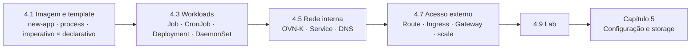

# Capítulo 4 — Deploy Managed and Networked Applications on Kubernetes

**Título em português:** Implantar aplicações gerenciadas e em rede no Kubernetes
**Status:** ✅ concluído e validado
**Referência:** PDF p. 227–292

## Objetivo do capítulo

Implantar aplicações e expô-las ao acesso de rede **de dentro e de fora** de um
cluster Kubernetes.

## Por que este capítulo importa

No Capítulo 3 os Pods eram avulsos. Aqui eles passam a ser **gerenciados** por
recursos de workload (Deployment, Job, CronJob...), **conectados** entre si por
Services e DNS, e **publicados** por Routes, Ingress ou Gateway API. Esse é o
núcleo do trabalho diário com aplicações no OpenShift e um dos eixos centrais do EX280.

## Seções e atividades (ordem oficial)

| Seção | Tipo | Título original | Material | PDF |
|-------|------|-----------------|----------|-----|
| 4.1 | Conceito | Deploy Applications from an Image and from a Template | [lição](4.1-implantar-a-partir-de-imagem-e-template.md) | p. 228–239 |
| 4.2 | Guided Exercise | Deploy Applications from an Image and from a Template | [prática](PRATICA-OFICIAL.md#42-guided-exercise-deploy-applications-from-an-image-and-from-a-template) | p. 240–244 |
| 4.3 | Conceito | Manage Long-lived and Short-lived Applications by Using the Kubernetes Workload API | [lição](4.3-workloads-de-longa-e-curta-duracao.md) | p. 245–250 |
| 4.4 | Guided Exercise | Manage Long-lived and Short-lived Applications by Using the Kubernetes Workload API | [prática](PRATICA-OFICIAL.md#44-guided-exercise-manage-long-lived-and-short-lived-applications-by-using-the-kubernetes-workload-api) | p. 251–255 |
| 4.5 | Conceito | Kubernetes Pod and Service Networks | [lição](4.5-redes-de-pods-e-services.md) | p. 256–264 |
| 4.6 | Guided Exercise | Kubernetes Pod and Service Networks | [prática](PRATICA-OFICIAL.md#46-guided-exercise-kubernetes-pod-and-service-networks) | p. 265–270 |
| 4.7 | Conceito | Scale and Expose Applications to External Access | [lição](4.7-escalar-e-expor-aplicacoes.md) | p. 271–278 |
| 4.8 | Guided Exercise | Scale and Expose Applications to External Access | [prática](PRATICA-OFICIAL.md#48-guided-exercise-scale-and-expose-applications-to-external-access) | p. 279–284 |
| 4.9 | Lab | Deploy Managed and Networked Applications on Kubernetes | [prática](PRATICA-OFICIAL.md#49-lab-deploy-managed-and-networked-applications-on-kubernetes) | p. 285–291 |
| 4.10 | Summary | Summary | [RESUMO.md](RESUMO.md) | p. 292 |

> Este capítulo **não tem quiz** oficial.

## Arquivos do capítulo

- [PRATICA-OFICIAL.md](PRATICA-OFICIAL.md): ponte com as atividades oficiais.
- [REVISAO.md](REVISAO.md): questões autorais integradas.
- [RESUMO.md](RESUMO.md): síntese e tabela de comandos.

## Pré-requisitos recomendados

[F4 — Pods e workloads](../../01-fundamentos-essenciais/04-pods-e-workloads.md) ·
[F6 — Redes e serviços](../../01-fundamentos-essenciais/06-redes-e-servicos.md) ·
[Capítulo 3](../03-containers-e-pods/README.md)

## Checklist

- [ ] 4.1 lida e Parte F respondida
- [ ] 4.2 Guided Exercise `deploy-newapp` concluído
- [ ] 4.3 lida e Parte F respondida
- [ ] 4.4 Guided Exercise `deploy-workloads` concluído
- [ ] 4.5 lida e Parte F respondida
- [ ] 4.6 Guided Exercise `deploy-services` concluído
- [ ] 4.7 lida e Parte F respondida
- [ ] 4.8 Guided Exercise `deploy-routes` concluído
- [ ] 4.9 Lab `deploy-review` com `lab grade` aprovado
- [ ] [REVISAO.md](REVISAO.md) respondida
- [ ] Registro no [diário de laboratórios](../../progresso/diario-de-laboratorios.md)

---
[← Capítulo 3](../03-containers-e-pods/README.md) | [Índice geral](../../README.md) | [Próximo: 4.1 Imagem e template →](4.1-implantar-a-partir-de-imagem-e-template.md)
