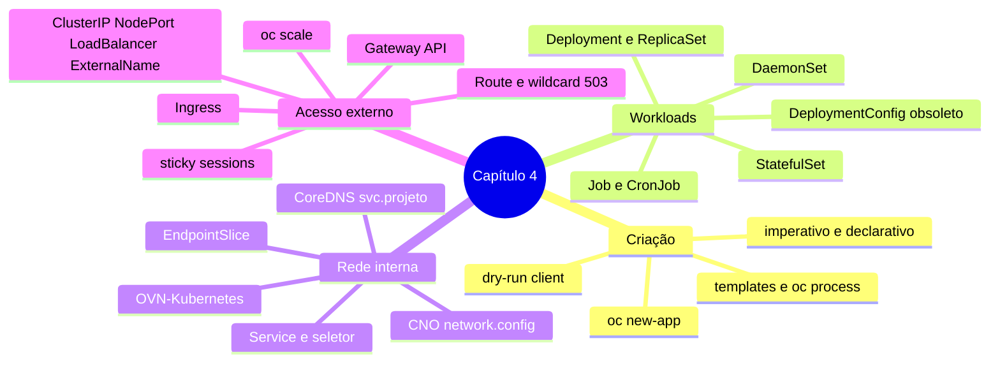

# Resumo — Capítulo 4

Síntese autoral para revisão rápida. Correspondência oficial: seção 4.10 (PDF p. 292).

## Em uma frase por seção

| Seção | Ideia central |
|-------|---------------|
| 4.1 | Aplicações são conjuntos de recursos criados de forma imperativa ou declarativa; `oc new-app` e templates (`oc process`) aceleram a criação |
| 4.3 | A Workloads API escolhe o controller pela duração e repetição: Job, CronJob, Deployment, DaemonSet, StatefulSet; DeploymentConfig é obsoleto |
| 4.5 | OVN-Kubernetes dá uma rede plana aos Pods; Services dão IP e nome estáveis via seletor; o CoreDNS resolve `svc.projeto` |
| 4.7 | Para fora do cluster: Routes (preferidas), Ingress (vira Route) ou Gateway API; tipos de Service; sessões persistentes; `oc scale` |

## Mapa do capítulo

## Tabela de comandos do capítulo

| Tarefa | Comando |
|--------|---------|
| Templates disponíveis | `oc get templates -n openshift` |
| Parâmetros | `oc process --parameters <t> -n openshift` · `oc process -f <arq> --parameters` |
| Processar e aplicar | `oc process -f <arq> -p K=V \| oc apply -f -` |
| App a partir de template | `oc new-app --template <t> --param K=V` |
| App a partir de imagem/Git | `oc new-app --image ` · `oc new-app <url>#<ref> --name <n>` |
| Deployment | `oc create deployment <n> --image  [--replicas N]` |
| Gerar manifesto | `... --dry-run=client -o yaml` |
| Variáveis | `oc set env deployment/<n> K=V` |
| Job | `oc create job <n> --image  -- <cmd>` |
| CronJob | `oc create cronjob <n> --image  --schedule "<cron>" -- <cmd>` |
| Service | `oc expose deployment/<n> [--port P] [--target-port T] [--name N]` |
| Endpoints | `oc get endpointslices -l kubernetes.io/service-name=<svc>` |
| Rede do cluster | `oc describe network.config/cluster` |
| Route | `oc expose service <svc> [--hostname H]` |
| Ingress | `oc create ingress <n> --rule="host/*=svc:porta"` |
| Sticky | `oc annotate route <r> router.openshift.io/cookie_name=<c>` · `oc annotate ingress <i> ingress.kubernetes.io/affinity=cookie` |
| Escalar | `oc scale --replicas=N deployment/<n>` |
| Tipos de `all` | `oc api-resources --categories=all` |

## Alertas operacionais

- ⚠️ `oc delete all` não apaga PVC, Secret nem ConfigMap.
- ⚠️ A saída de `oc new-app --template` pode mostrar senhas geradas.
- ⚠️ Não edite ReplicaSets; escale e altere o Deployment.
- ⚠️ NodePort e ExternalIP exigem acesso direto aos nós; ExternalIP é legado.
- ⚠️ LoadBalancer por aplicação pode gerar custo alto.
- ⚠️ Gateway API não suporta UDN.

## Ligação com o próximo capítulo

As aplicações agora rodam e se comunicam, mas a configuração ainda está "dentro"
dos Deployments e os dados se perdem com os Pods. O Capítulo 5 traz
**ConfigMaps**, **Secrets**, **volumes persistentes**, **StorageClasses** e
**StatefulSets**.

---
[← Revisão](REVISAO.md) | [Índice do capítulo](README.md) | [Próximo capítulo →](../05-configuracao-e-storage/README.md)
