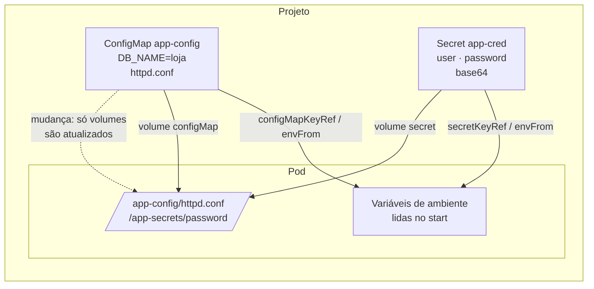

# 5.1 — Externalizar a configuração de aplicações

| Campo | Valor |
|-------|-------|
| Curso | DO180 — OpenShift 4.22 |
| Capítulo / seção | Capítulo 5 · Seção 5.1 |
| Título original | Externalize the Configuration of Applications |
| Título em português | Externalizar a configuração de aplicações |
| Objetivo | Configurar aplicações com Secrets e ConfigMaps para inicializar variáveis de ambiente e fornecer arquivos de configuração de texto e binários |
| Pré-requisitos | [4.1](../04-deploy-e-redes/4.1-implantar-a-partir-de-imagem-e-template.md), [4.3](../04-deploy-e-redes/4.3-workloads-de-longa-e-curta-duracao.md) |
| Referência | PDF p. 294–306 · Guided Exercise 5.2 p. 307–316 |

## Parte A — Entendendo o conceito

### O problema

Uma imagem traz uma configuração padrão, suficiente para testes. Em produção, a
mesma imagem precisa rodar em vários ambientes (dev, homologação, produção), com
nomes de banco, endpoints, certificados e senhas diferentes. Reconstruir a imagem
para cada ambiente quebra a portabilidade e espalha segredos.

A solução é **externalizar** a configuração. As três formas usuais são **variáveis
de ambiente**, **arquivos externos** e **argumentos de linha de comando**. O
Kubernetes oferece dois objetos para guardar esses dados fora da imagem:

| Objeto | Para quê | Proteção |
|--------|----------|----------|
| **ConfigMap** (`cm`) | Configuração **não sensível**: propriedades isoladas ou arquivos inteiros (inclusive JSON) | Nenhuma especial |
| **Secret** | Dados **sensíveis**: senhas, arquivos de configuração sensíveis, chaves SSH, tokens OAuth | Valores em **base64** (codificados, **não** criptografados) e acesso restrito a menos usuários |

Ambos são **namespaced**: só Pods do **mesmo projeto** podem usá-los. Devem existir
**antes** do Pod que os consome (a não ser que a referência seja `optional: true`).

⚠️ **Base64 não é criptografia.** Qualquer pessoa com leitura no Secret decodifica
o valor com `base64 --decode`. Para criptografar **em repouso**, é preciso
habilitar a criptografia do **etcd**, que passa a cifrar Secrets, ConfigMaps,
Routes e tokens OAuth. Esse tema fica fora do escopo do curso.

### ConfigMap: `data` e `binaryData`

- `data`: valores de texto (UTF-8). Uma chave pode guardar um arquivo inteiro (`|` no YAML).
- `binaryData`: conteúdo **binário** codificado em base64 (ex.: um keystore Java, uma imagem PNG).

### Tipos de Secret

Ao usar um tipo específico, o Kubernetes **valida** se os dados seguem o formato
esperado.

| Tipo (`type`) | Uso | Como criar |
|---------------|-----|-----------|
| `Opaque` | Pares chave-valor arbitrários, sem validação | `oc create secret generic` |
| `kubernetes.io/service-account-token` | Token de aplicações que autenticam na API | Gerado pela plataforma |
| `kubernetes.io/basic-auth` | Credenciais básicas: chaves `username` e `password` | YAML |
| `kubernetes.io/ssh-auth` | Autenticação SSH | YAML (ou `generic --from-file`) |
| `kubernetes.io/tls` | Certificado e chave TLS | `oc create secret tls` |
| `kubernetes.io/dockerconfigjson` | Credenciais de registry de imagens (*image pull secret*) | 📘 `oc create secret docker-registry` |

### Três formas de consumir

| Forma | Mecanismo | Atualização quando o objeto muda |
|-------|-----------|----------------------------------|
| **Uma variável por chave** | `env[].valueFrom.configMapKeyRef` / `secretKeyRef` | ❌ Só com **reinício** do Pod |
| **Todas as chaves como variáveis** | `envFrom[].configMapRef` / `secretRef` | ❌ Só com **reinício** |
| **Arquivos em um volume** | `volumes[].configMap` / `secret` + `volumeMounts` | ✅ **Eventualmente** o kubelet atualiza os arquivos, mas a aplicação só percebe se reler o arquivo |

No volume, cada **chave vira um arquivo** com o nome da chave e o **valor
decodificado** como conteúdo.

📘 *Fonte externa:* montagens com `subPath` **não** recebem atualizações automáticas.

## Parte B — Modelo mental



Regra prática: **imagem = código**, **ConfigMap = configuração**, **Secret =
credenciais**. A mesma imagem roda em qualquer ambiente; o que muda são os objetos.

## Parte C — Funcionamento na prática

### Criar Secrets

```bash
oc create secret generic app-cred \
  --from-literal user=app --from-literal password='Troque-me!'
oc create secret generic ssh-keys \
  --from-file id_rsa=$HOME/.ssh/id_lab --from-file id_rsa.pub=$HOME/.ssh/id_lab.pub
oc create secret tls web-tls --cert ./tls.crt --key ./tls.key
oc get secret app-cred -o jsonpath='{.data.password}' | base64 --decode; echo
```

- `--from-literal chave=valor`: valor digitado na linha (⚠️ fica no histórico do shell).
- `--from-file chave=caminho`: valor lido do arquivo; sem `chave=`, o nome do arquivo vira a chave.
- **Console:** *Workloads › Secrets › Create* › **Key/value secret** ou **Image pull secret**.

Manifesto original (valores fictícios):

```yaml
apiVersion: v1
kind: Secret
metadata:
  name: app-cred
type: Opaque
stringData:              # texto puro; o cluster grava em base64 em data
  user: app
  password: Troque-me!
```

### Criar ConfigMaps

```bash
oc create configmap app-config \
  --from-literal DB_NAME=loja --from-literal LOG_LEVEL=info
oc create cm web-files --from-file=index.html --from-file=config-files/httpd.conf
oc create cm certificados --from-file=keystore.jks     # binário → binaryData
oc get cm app-config -o yaml
```

**Console:** *Workloads › ConfigMaps › Create ConfigMap* (formulário ou YAML); o
botão *Browse* carrega arquivos como valores.

### Consumir como variáveis

```yaml
apiVersion: v1
kind: Pod
metadata:
  name: demo-env
spec:
  restartPolicy: Never
  containers:
    - name: app
      image: registry.access.redhat.com/ubi10/ubi
      command: ["/bin/sh", "-c", "env | sort"]
      env:
        - name: MYSQL_DATABASE           # nome da variável no container
          valueFrom:
            configMapKeyRef:
              name: app-config          # ConfigMap
              key: DB_NAME              # chave
        - name: MYSQL_PASSWORD
          valueFrom:
            secretKeyRef:
              name: app-cred
              key: password
        - name: OPCIONAL
          valueFrom:
            configMapKeyRef:
              name: nao-existe
              key: x
              optional: true            # o Pod inicia mesmo sem o objeto
      envFrom:
        - configMapRef:
            name: app-config            # todas as chaves viram variáveis
```

Pela CLI, em um Deployment:

```bash
oc set env deployment/demo --from configmap/app-config
oc set env deployment/demo --from secret/app-cred --prefix MYSQL_
#   chaves user/password viram MYSQL_USER e MYSQL_PASSWORD (prefixo + chave em maiúsculas)
oc set env deployment/demo --list            # conferir
```

### Consumir como arquivos (volumes)

```bash
oc set volume deployment/demo --add --type secret \
  --secret-name app-cred --mount-path /app-secrets
oc set volume deployment/demo --add --type configmap \
  --configmap-name web-files --mount-path /app-config --name config-vol
oc set volume deployment/demo                      # lista volumes e montagens
oc exec deploy/demo -- ls /app-config
oc set volume deployment/demo --remove --name config-vol   # remover volume
```

- **Recurso modificado:** o Deployment (`volumes` e `volumeMounts`), o que gera um novo rollout.
- **Console:** *Workloads › Secrets › secret › Add Secret to workload › Volume*. O curso observa que, pela console, **não** é possível adicionar ConfigMaps como volume a workloads: use a CLI ou o YAML.

### Atualizar e apagar

```bash
oc extract secret/app-cred --to /tmp/app-cred --confirm   # um arquivo por chave
echo -n 'Nova-senha!' > /tmp/app-cred/password
oc set data secret/app-cred --from-file /tmp/app-cred/password
oc set data cm/app-config LOG_LEVEL=debug
oc rollout restart deployment/demo     # 📘 necessário para quem consome por variável
oc delete secret/app-cred
oc delete configmap/app-config
```

- `oc extract`: cada chave vira um arquivo; `--confirm` sobrescreve arquivos e cria o diretório.
- `oc set data`: atualiza chaves a partir de literais ou arquivos.
- ⚠️ `oc extract` grava os segredos **decodificados** em disco: apague depois.

## Parte D — Relações importantes

| A | B | Diferença essencial |
|---|---|--------------------|
| ConfigMap | Secret | Configuração comum × dado sensível (base64, acesso restrito) |
| Codificado | Criptografado | Base64 é reversível por qualquer leitor × exige chave (criptografia do etcd) |
| `data` | `stringData` (Secret) | Base64 × texto puro convertido pelo cluster |
| `data` | `binaryData` (ConfigMap) | Texto × binário em base64 |
| `env.valueFrom` | `envFrom` | Uma chave por variável × todas as chaves |
| Variável | Volume | Lida só no start (reinício para atualizar) × arquivo atualizado eventualmente |
| `oc set env --from` | `oc set volume --add` | Injeta como variáveis × monta como arquivos |
| `oc extract` | `oc set data` | Baixar valores para arquivos × gravar valores no objeto |

## Parte E — Preparação para o laboratório

Atividade associada: **5.2 Guided Exercise — Externalize the Configuration of
Applications** (`storage-configs`, PDF p. 307–316).

Você deve conseguir:

- Criar um Deployment de servidor web e expô-lo.
- Criar um ConfigMap a partir de **arquivos**.
- Montar o ConfigMap como volume no Deployment e verificar o conteúdo servido.
- Confirmar que as réplicas estão disponíveis após a mudança.

Ver [PRATICA-OFICIAL.md](PRATICA-OFICIAL.md#52-guided-exercise-externalize-the-configuration-of-applications).

## Parte F — Fixação

1. Um colega diz que guardar a senha do banco em um Secret a deixa "criptografada". Corrija.
2. Você atualizou um ConfigMap usado como variável de ambiente, mas a aplicação continua com o valor antigo. Por quê, e como resolver?
3. Qual a diferença de resultado entre `oc set env deployment/x --from secret/s` e `oc set volume deployment/x --add --type secret --secret-name s --mount-path /s`?
4. Um Pod de outro projeto pode usar seu ConfigMap?
5. Escreva o comando que transforma as chaves `user` e `password` do Secret `db` nas variáveis `PG_USER` e `PG_PASSWORD` do Deployment `api`.

<details>
<summary>Respostas comentadas</summary>

1. O Secret só **codifica** em base64; qualquer pessoa com leitura decodifica. Criptografia em repouso exige habilitar a criptografia do etcd, e o acesso deve ser limitado por RBAC.
2. Variáveis de ambiente são lidas apenas quando o container inicia. Reinicie os Pods (ex.: `oc rollout restart deployment/<d>`).
3. O primeiro cria variáveis de ambiente (uma por chave); o segundo monta arquivos (um por chave) em `/s`, atualizados eventualmente pelo kubelet.
4. Não. ConfigMaps e Secrets só são referenciados por Pods do mesmo projeto.
5. `oc set env deployment/api --from secret/db --prefix PG_`.

</details>

## Parte G — Essencial para memorizar

- ConfigMap = configuração; Secret = sensível, **base64 ≠ criptografia**.
- Criptografia em repouso: etcd (fora do escopo do curso).
- `oc create secret generic|tls ...` · `oc create cm ... --from-literal|--from-file`.
- Consumo: `valueFrom` (uma chave), `envFrom` (todas), volume (arquivos).
- `oc set env deployment/x --from secret/s [--prefix P_]` · `oc set volume deployment/x --add --type secret|configmap ... --mount-path`.
- `oc extract ... --to dir --confirm` · `oc set data ...`.
- Variável: reiniciar para atualizar; volume: atualização eventual (sem `subPath`).
- Mesmo projeto; criar antes do Pod.

---
[← Capítulo 5 (índice)](README.md) | [Índice do capítulo](README.md) | [Próximo: 5.3 Volumes persistentes →](5.3-provisionar-volumes-persistentes.md)
