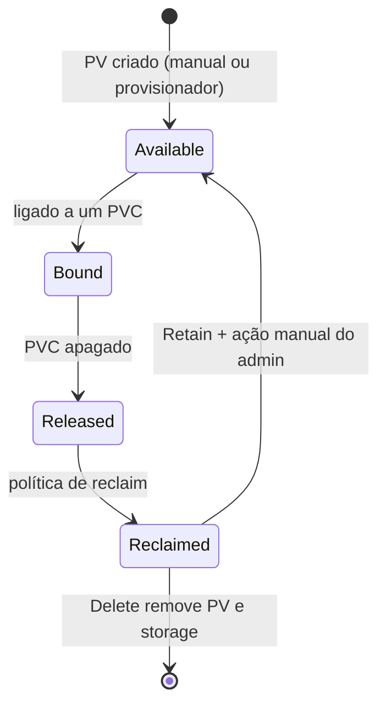
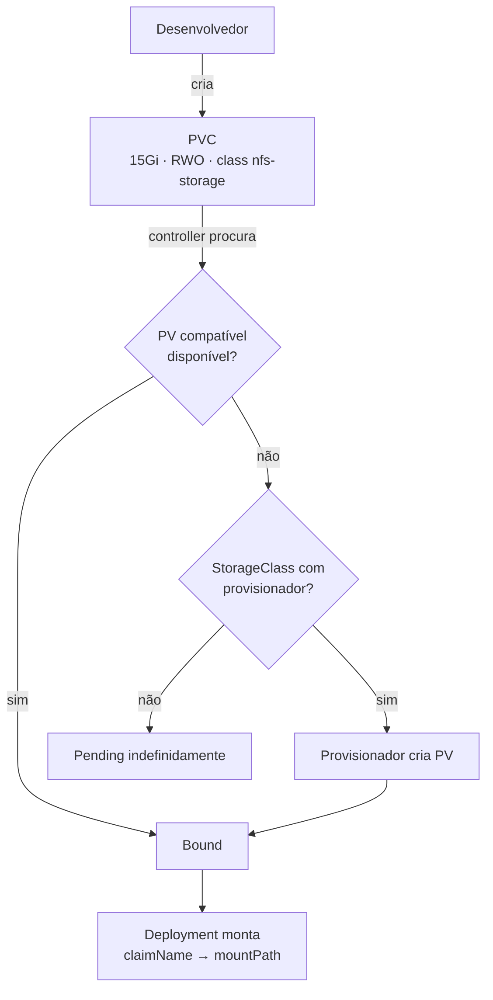

# 5.3 — Provisionar volumes de dados persistentes

| Campo | Valor |
|-------|-------|
| Curso | DO180 — OpenShift 4.22 |
| Capítulo / seção | Capítulo 5 · Seção 5.3 |
| Título original | Provision Persistent Data Volumes |
| Título em português | Provisionar volumes de dados persistentes |
| Objetivo | Fornecer às aplicações volumes persistentes para dados em bloco e em arquivo |
| Pré-requisitos | [F7](../../01-fundamentos-essenciais/07-persistencia-de-dados.md), [5.1](5.1-externalizar-configuracao.md) |
| Referência | PDF p. 317–327 · Guided Exercise 5.4 p. 328–335 |

## Parte A — Entendendo o conceito

### Efêmero × persistente

O armazenamento de um container é **efêmero**: não sobrevive ao Pod e não é
compartilhado entre Pods. Para preservar dados usa-se o **framework de volumes
persistentes** do Kubernetes:

- O **administrador** fornece armazenamento ao cluster (PVs, StorageClasses).
- O **desenvolvedor** pede armazenamento com um **PVC**, sem conhecer a infraestrutura.

| Provisionamento | Como funciona | Quem age |
|-----------------|---------------|----------|
| **Estático** | O administrador cria PVs manualmente; o PVC se liga a um PV existente | Administrador antes; desenvolvedor depois |
| **Dinâmico** | O PVC referencia uma **StorageClass**, cujo **provisionador** cria o PV sob demanda | Desenvolvedor declara; o cluster cria |

### Tipos de volume mais comuns

| Tipo | Uso | Observação |
|------|-----|-----------|
| `configMap` | Externalizar configuração (5.1) | Portável e versionável |
| `emptyDir` | Diretório temporário por Pod (*scratch*) | Nasce vazio, morre com o Pod |
| `hostPath` | Monta arquivo ou diretório do **nó** no Pod | Exige Pod **privilegiado**, dá acesso a outros Pods do nó; **não recomendado em produção** (só dev/teste em nó único) |
| iSCSI | Acesso em bloco via IP a dispositivos de storage | Padrão comum em SAN |
| `local` | Disco ou partição local pela interface de PVC | Depende da disponibilidade do nó |
| NFS | Compartilhamento de arquivos entre vários Pods ao mesmo tempo | A Red Hat recomenda NFS só para **não produção** |

### Modos de acesso

| Modo | Sigla | Significado |
|------|-------|-------------|
| `ReadWriteOnce` | RWO | Leitura/escrita por **um nó**; vários Pods **no mesmo nó** podem usar |
| `ReadWriteOncePod` | RWOP | Leitura/escrita por **um único Pod** no cluster |
| `ReadOnlyMany` | ROX | Somente leitura por vários nós |
| `ReadWriteMany` | RWX | Leitura/escrita por vários nós |

Os modos dependem do tipo de volume. Entre os tipos acima, só o **NFS** oferece
**RWX**. `emptyDir`, `hostPath` e `local` são limitados a acesso de um nó/Pod.

### Modos de volume

| `volumeMode` | Entrega | Quando usar |
|--------------|---------|-------------|
| `Filesystem` (padrão) | Diretório com sistema de arquivos | Maioria das aplicações, compartilhamento de arquivos |
| `Block` | Dispositivo de bloco **cru**, sem sistema de arquivos | Aplicações que escrevem direto no disco ou implementam o próprio storage, para ganhar desempenho |

Bloco cru é suportado por vários plugins (ex.: AWS EBS, Azure Disk, Cinder, GCP,
vSphere e OpenShift Data Foundation, manual e dinamicamente; Fibre Channel, iSCSI e
`local`, só manualmente).

### PVC: um pedido, não uma reserva exata

- Pertence a um **projeto**; não é compartilhado entre projetos.
- O ciclo de vida do PVC está ligado ao **namespace**, não ao Pod. Pods diferentes,
  inclusive de controllers diferentes, podem usar o mesmo PVC, ao mesmo tempo ou em
  sequência (inicializar, migrar, fazer backup).
- A ligação é por **melhor esforço**: um PVC de 10 GiB pode se ligar a um PV de 15
  GiB; um PVC RWO pode se ligar a um PV que também aceita RWX.
- Um PV ligado a um PVC **não** se liga a outro.
- Sem PV compatível e sem provisionador capaz, o PVC fica **`Pending` indefinidamente**
  até que surja um volume adequado.

### StorageClass padrão

Uma StorageClass pode ser marcada como **padrão** (`(default)` em `oc get
storageclass`). Um PVC sem `storageClassName` usa a padrão. Para se ligar a um PV
**sem** classe, use `storageClassName: ""`. Como o administrador pode trocar a
padrão, a Red Hat recomenda **sempre informar a classe**.

### Ciclo de vida de PV e PVC



| Fase | Significado |
|------|-------------|
| **Available** | Disponível para qualquer PVC de qualquer namespace |
| **Bound** | Ligado a um PVC e, portanto, ao namespace dele |
| **In use** | **Storage Object in Use Protection** (ativo por padrão): apagar um PVC usado por um Pod fica **adiado** até nenhum Pod usá-lo; apagar um PV ligado fica adiado até ele deixar de estar ligado |
| **Released** | O PVC foi apagado; o storage pode ser recuperado |
| **Reclaimed** | Aplica-se a política: `Retain` (recuperação manual) ou `Delete` (remove o PV **e** o storage externo) |

### Expandir um PVC

- Exige `allowVolumeExpansion: true` na StorageClass.
- Aumenta-se `spec.resources.requests.storage` do PVC. **Só cresce**, nunca diminui.
- Se a expansão falhar (o storage não atende), o controller tenta de novo
  continuamente. **Desde o 4.19**, o próprio desenvolvedor pode se recuperar pedindo
  um tamanho **menor que o que falhou, porém maior** que `status.capacity`, sem
  intervenção do administrador.

## Parte B — Modelo mental



## Parte C — Funcionamento na prática

### Adicionar um PVC a um Deployment com `oc set volumes`

```bash
oc set volumes deployment/db \
  --add --name db-data \
  --type persistentVolumeClaim \
  --claim-name db-pvc --claim-size 15Gi --claim-mode rwo \
  --claim-class nfs-storage \
  --mount-path /var/lib/mysql
```

| Opção | Significado |
|-------|-------------|
| `--add` | Adiciona volume e montagem |
| `--name` | Nome do volume no Pod (gerado se omitido) |
| `--type` | `emptyDir`, `hostPath`, `secret`, `configMap`, `persistentVolumeClaim` (`pvc`) |
| `--claim-name` | Nome do PVC (**obrigatório** para PVC); se não existir, é criado |
| `--claim-size` | Tamanho em notação SI (`15Gi`, `15G`) |
| `--claim-mode` | `rwo` (padrão), `rwop`, `rwx`, `rox` |
| `--claim-class` | StorageClass |
| `--mount-path` | Caminho no container |

- **Recursos modificados:** cria o **PVC** (se preciso) e altera o **Deployment** (`volumes` e `volumeMounts`), disparando um rollout.
- **Verificar:** `oc get pvc` (`Bound`), `oc set volumes deployment/db`, `oc exec deploy/db -- df -h /var/lib/mysql`.

O mesmo, de forma declarativa (original):

```yaml
apiVersion: v1
kind: PersistentVolumeClaim
metadata:
  name: db-pvc
  labels:
    app: db
spec:
  storageClassName: nfs-storage
  accessModes:
    - ReadWriteOnce
  resources:
    requests:
      storage: 15Gi
```

Trecho correspondente do Deployment:

```yaml
spec:
  template:
    spec:
      containers:
        - name: db
          image: registry.redhat.io/rhel10/mariadb-118
          volumeMounts:
            - name: db-data
              mountPath: /var/lib/mysql
      volumes:
        - name: db-data
          persistentVolumeClaim:
            claimName: db-pvc
```

### Inspecionar

```bash
oc get pvc                                   # STATUS, VOLUME, CAPACITY, ACCESS MODES, STORAGECLASS
oc describe pvc db-pvc                       # eventos de provisionamento
oc get pv                                    # (admin) CLAIM, RECLAIM POLICY, STATUS
oc get pv $(oc get pvc db-pvc -o jsonpath='{.spec.volumeName}') \
  -o jsonpath='{.spec.storageClassName}{"  "}{.metadata.annotations.pv\.kubernetes\.io/provisioned-by}{"\n"}'
oc get storageclass
```

### PV estático (administrador)

```yaml
apiVersion: v1
kind: PersistentVolume
metadata:
  name: pv-nfs-01
spec:
  capacity:
    storage: 10Gi
  accessModes:
    - ReadWriteMany
  persistentVolumeReclaimPolicy: Retain
  nfs:                          # atributos específicos do tipo de storage
    server: nfs.exemplo.com
    path: /exports/app01
```

```bash
oc create -f pv-nfs-01.yaml     # console: Storage › PersistentVolumes
```

### Expandir, remover, apagar

```bash
oc patch pvc/db-pvc --type merge -p '{"spec":{"resources":{"requests":{"storage":"30Gi"}}}}'
oc get pvc db-pvc -w                                    # CAPACITY sobe quando concluir
oc set volumes deployment/db --remove --name db-data   # tira o volume do Deployment
oc delete pvc/db-pvc                                     # ⚠️ com Delete, apaga os dados
```

**Console:** *Storage › PersistentVolumeClaims › Create PersistentVolumeClaim*
(nome, classe, tamanho, modo de acesso, modo de volume).

## Parte D — Relações importantes

| A | B | Diferença essencial |
|---|---|--------------------|
| Estático | Dinâmico | PV criado antes pelo admin × criado pelo provisionador ao surgir o PVC |
| PV | PVC | Recurso de cluster × pedido do namespace |
| RWO | RWOP | Um **nó** (vários Pods nele) × um **Pod** |
| RWO | RWX | Um nó × vários nós |
| `Filesystem` | `Block` | Diretório × dispositivo cru |
| `emptyDir` | PVC | Some com o Pod × sobrevive ao Pod |
| `hostPath` | `local` | Caminho do nó em Pod privilegiado (dev/teste) × disco local via PVC |
| `Retain` | `Delete` | Dados ficam, limpeza manual × PV e storage apagados |
| Released | Available | Liberado, mas com dados antigos × livre para novo PVC |

## Parte E — Preparação para o laboratório

Atividade associada: **5.4 Guided Exercise — Provision Persistent Data Volumes**
(`storage-volumes`, PDF p. 328–335).

Você deve conseguir:

- Implantar um banco com armazenamento persistente a partir de um PVC.
- Identificar o PV que atende a aplicação.
- Identificar o provisionador que criou o PV.

Ver [PRATICA-OFICIAL.md](PRATICA-OFICIAL.md#54-guided-exercise-provision-persistent-data-volumes).

## Parte F — Fixação

1. Um PVC de 100 GiB fica `Pending` em um cluster que só tem PVs estáticos de 50 GiB e nenhuma StorageClass com provisionador. O que acontece e como resolver?
2. Três réplicas de um Deployment em nós diferentes usam o mesmo PVC RWO. Por que duas ficam presas e como corrigir?
3. Você apagou um PVC ainda montado por um Pod. Ele sumiu na hora?
4. Por que informar `storageClassName` mesmo havendo uma classe padrão?
5. Uma expansão de 20 → 200 GiB falhou porque o storage só suporta até 100 GiB. Qual o caminho no 4.22?

<details>
<summary>Respostas comentadas</summary>

1. Fica `Pending` indefinidamente: não há PV de pelo menos 100 GiB e nada pode criar um. Resolve-se com um PV adequado (estático) ou uma StorageClass com provisionador.
2. RWO só permite montagem em **um nó**; Pods em outros nós não conseguem montar. Use RWX (ex.: NFS) se o compartilhamento for desejado, ou um StatefulSet (volume por réplica).
3. Não. A Storage Object in Use Protection adia a remoção até nenhum Pod usar o PVC.
4. O administrador pode mudar a classe padrão; informar a classe garante o tipo de storage esperado.
5. Corrigir o pedido para um valor que o storage atenda (ex.: 100 GiB), maior que a capacidade atual. Desde o 4.19 isso não exige o administrador.

</details>

## Parte G — Essencial para memorizar

- Container = efêmero; PVC = persistente, ligado ao **namespace**.
- Estático (PV manual) × dinâmico (StorageClass + provisionador).
- Acesso: RWO (1 nó) · RWOP (1 Pod) · ROX · RWX (só NFS na lista do curso).
- `volumeMode`: `Filesystem` (padrão) · `Block` (cru).
- `oc set volumes deployment/x --add --type pvc --claim-name --claim-size --claim-mode --claim-class --mount-path`.
- Ciclo: Available → Bound → (In use protection) → Released → Reclaimed (`Retain`/`Delete`).
- Expandir: `allowVolumeExpansion: true` + `oc patch pvc ...`; só cresce; recuperação de falha sem admin desde 4.19.
- ⚠️ `hostPath` e NFS: não para produção (recomendação Red Hat). ⚠️ Sempre informe a StorageClass.

---
[← 5.1 Configuração](5.1-externalizar-configuracao.md) | [Índice do capítulo](README.md) | [Próximo: 5.5 Storage classes →](5.5-selecionar-storage-class.md)
