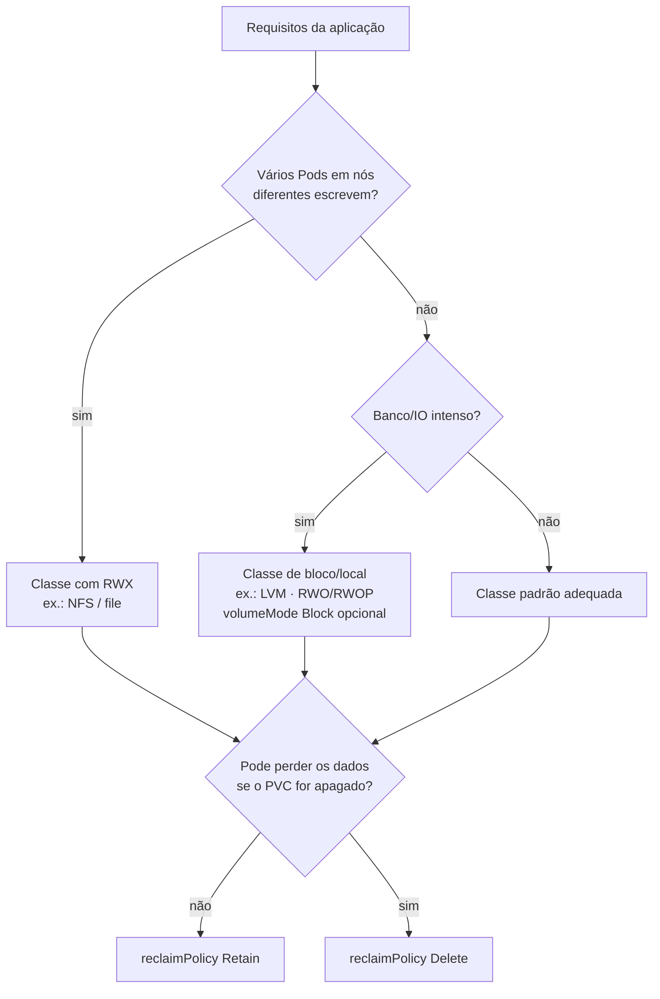

# 5.5 — Selecionar uma storage class para uma aplicação

| Campo | Valor |
|-------|-------|
| Curso | DO180 — OpenShift 4.22 |
| Capítulo / seção | Capítulo 5 · Seção 5.5 |
| Título original | Selecting a Storage Class for an Application |
| Título em português | Selecionar uma storage class para uma aplicação |
| Objetivo | Associar aplicações a storage classes que atendam aos seus requisitos |
| Pré-requisitos | [5.3](5.3-provisionar-volumes-persistentes.md) |
| Referência | PDF p. 336–341 · Guided Exercise 5.6 p. 342–348 |

## Parte A — Entendendo o conceito

### O que é uma StorageClass

Uma **StorageClass** descreve um **tipo de storage** do cluster e provisiona
volumes **sob demanda**. Em outros sistemas de storage o mesmo conceito se chama
**perfil**. Quem define o significado de cada classe é o administrador (ex.: uma
para desenvolvimento, outra para produção). O desenvolvedor escolhe pela
necessidade da aplicação, sem conhecer a infraestrutura.

É um recurso de **escopo de cluster**, criado pelo administrador do cluster ou por
um usuário `storage-admin`, e visível a todos os projetos.

### Critérios de escolha

| Critério | Exemplos |
|----------|----------|
| **Modo de volume** | Classe com suporte a `Block` para bancos que ganham desempenho com bloco cru; `Filesystem` para compartilhar arquivos |
| **Qualidade de serviço** | SSD para dados muito acessados; HDD mais barato para dados frios |
| **Nível de suporte administrativo** | Classe de produção com backup frequente; classe de dev sem backup |
| **Modos de acesso** | RWX só onde o backend oferece (ex.: NFS) |
| **Política de reclaim** | `Retain` para não perder dados por engano; `Delete` para economizar |
| **Soberania** | Residência dos dados (região/geografia) e criptografia exigidas por compliance |

Um PVC que define `storageClassName` só se liga a PVs **daquela** classe. Se não
houver PV que atenda a **todos** os critérios (classe, modo de acesso, tamanho
mínimo), o PVC fica **Pending**.

### Reclaim policy na prática

| Política | O que acontece ao apagar o PVC | Custo/risco |
|----------|-------------------------------|-------------|
| **`Delete`** (padrão de provisionadores CSI; usada se a classe não declarar) | PV, dados e storage físico são removidos automaticamente | Economiza; ⚠️ PVC apagado por engano = dados perdidos |
| **`Retain`** | Só o objeto PVC some; PV, storage e dados permanecem (o PV fica `Released`) | Protege dados; ⚠️ custo de storage até o admin limpar |

Recuperação manual com `Retain` (administrador):

1. Guardar a definição do PV: `oc get pv <pv> -o yaml > pv.yaml`.
2. Apagar o PV: `oc delete pv <pv>`. O ativo externo (EBS, disco Azure, Cinder...) **continua existindo**.
3. Criar um PV novo apontando para o mesmo storage, para reaproveitar os dados; **ou**
4. Apagar os dados e o ativo de storage.

### O que o Kubernetes **não** faz pela aplicação

O Kubernetes não muda a relação da aplicação com o storage: **a aplicação é
responsável pela integridade e consistência dos dados**.

- Nada impede dois bancos de dados de montarem o mesmo volume e se corromperem.
- RWO significa "um **nó**", não "um processo": dois Pods no mesmo nó podem
  escrever no mesmo volume RWO.
- RWX significa "qualquer Pod pode ler e escrever", não "compartilhamento seguro".

Use a mesma cautela que teria com um disco compartilhado entre dois editores de
texto.

### Anatomia de uma StorageClass

| Campo | Obrigatório | Significado |
|-------|-------------|-------------|
| `provisioner` | Sim | Plugin que cria os volumes (ex.: `topolvm.io`, `ebs.csi.aws.com`, `k8s-sigs.io/nfs-subdir-external-provisioner`). Nomes que começam com `kubernetes.io` vêm embutidos |
| `parameters` | Não | Específicos do provisionador: tipo de disco, IOPS, sistema de arquivos, criptografia, replicação |
| `reclaimPolicy` | Não | `Delete` (padrão) ou `Retain` |
| `volumeBindingMode` | Não | `Immediate` (padrão) ou `WaitForFirstConsumer` |
| `allowVolumeExpansion` | Não | `true` permite aumentar PVCs |
| anotação `storageclass.kubernetes.io/is-default-class` | Não | `"true"` marca a classe padrão |

| `volumeBindingMode` | Quando o PV é criado | Consequência |
|---------------------|----------------------|--------------|
| `Immediate` | Ao criar o PVC | Pode criar volume onde o Pod não consegue rodar (storage limitado por topologia), deixando o Pod sem agendamento |
| `WaitForFirstConsumer` | Quando um Pod que usa o PVC é agendado | O PV respeita as restrições de agendamento do Pod; o PVC fica `Pending` até lá (normal) |

Serviços gerenciados trazem classes próprias (ex.: `gp3-csi` no ROSA, para EBS).

## Parte B — Modelo mental



## Parte C — Funcionamento na prática

### Conhecer as classes

```bash
oc get storageclass                      # NAME (default), PROVISIONER, RECLAIMPOLICY, VOLUMEBINDINGMODE, ALLOWVOLUMEEXPANSION
oc describe storageclass lvms-vg1        # parâmetros, descrição, binding mode
oc get sc -o custom-columns=NOME:.metadata.name,PROV:.provisioner,RECLAIM:.reclaimPolicy,BINDING:.volumeBindingMode,EXPANDE:.allowVolumeExpansion
```

Usuários comuns podem **ler** StorageClasses. Se nenhuma serve, peça ao
administrador uma classe nova ou um PV com as características necessárias.

### Usar uma classe específica

```bash
oc set volumes deployment/db --add --name db-data --type pvc \
  --claim-name db-lvm --claim-class lvms-vg1 --claim-mode rwo --claim-size 1Gi \
  --mount-path /var/lib/mysql
oc get pvc db-lvm                         # STORAGECLASS lvms-vg1
```

Ou declarativamente (preferível para versionamento):

```yaml
apiVersion: v1
kind: PersistentVolumeClaim
metadata:
  name: db-lvm
spec:
  storageClassName: lvms-vg1
  accessModes:
    - ReadWriteOncePod
  resources:
    requests:
      storage: 1Gi
```

```bash
oc create -f db-lvm-pvc.yaml
oc set volumes deployment/db --add --name db-data --claim-name db-lvm --mount-path /var/lib/mysql
```

📘 *Fonte externa:* um PVC com `volumeMode: Block` é entregue ao container como
**dispositivo** (`volumeDevices.devicePath`, ex.: `/dev/xvda`), não como diretório
montado; a aplicação precisa saber usar bloco cru.

### Criar uma classe (administrador) — exemplo original

```yaml
apiVersion: storage.k8s.io/v1
kind: StorageClass
metadata:
  name: lvm-retain
  annotations:
    storageclass.kubernetes.io/is-default-class: "false"
    kubernetes.io/description: Volumes locais LVM preservados após apagar o PVC
provisioner: topolvm.io
parameters:
  csi.storage.k8s.io/fstype: xfs
  topolvm.io/device-class: vg1
reclaimPolicy: Retain
volumeBindingMode: WaitForFirstConsumer
allowVolumeExpansion: true
```

```bash
oc create -f lvm-retain-sc.yaml       # console: Storage › StorageClasses › Create StorageClass
```

### Recuperar um PV com `Retain` (administrador)

```bash
oc get pv | grep Released
oc get pv <PV> -o yaml > pv-backup.yaml
oc delete pv <PV>                      # o storage externo e os dados continuam
```

## Parte D — Relações importantes

| A | B | Diferença essencial |
|---|---|--------------------|
| StorageClass | PV | Tipo/perfil e provisionador × volume concreto |
| `Immediate` | `WaitForFirstConsumer` | PV criado com o PVC × PV criado quando o Pod é agendado |
| `Delete` | `Retain` | Limpeza automática × proteção dos dados, limpeza manual |
| Classe padrão | `storageClassName` explícito | Pode mudar sem aviso × escolha estável e intencional |
| `storageClassName` omitido | `storageClassName: ""` | Usa a padrão × exige PV sem classe |
| RWO | "acesso exclusivo" | Um **nó**, não um processo; a aplicação garante a consistência |
| File (NFS) | Block/local (LVM) | Compartilhável × desempenho, não compartilhado |

## Parte E — Preparação para o laboratório

Atividade associada: **5.6 Guided Exercise — Selecting a Storage Class for an
Application** (`storage-classes`, PDF p. 342–348).

Você deve conseguir:

- Listar e interpretar as StorageClasses disponíveis.
- Criar volumes a partir de uma classe **diferente da padrão** (bloco/local em vez de arquivo).
- Implantar um banco com persistência nessa classe e verificar o PVC e o PV.

Ver [PRATICA-OFICIAL.md](PRATICA-OFICIAL.md#56-guided-exercise-selecting-a-storage-class-for-an-application).

## Parte F — Fixação

1. Seu PVC ficou `Pending` sem nenhum Pod usando-o. A classe tem `WaitForFirstConsumer`. É um problema?
2. Por que uma classe `Immediate` pode deixar um Pod sem conseguir ser agendado?
3. Um banco de produção usa uma classe `Delete`. Que risco existe e como mitigá-lo?
4. Dois Pods no mesmo nó gravam no mesmo PVC RWO e corrompem os dados. De quem é a responsabilidade?
5. Qual comando mostra provisionador, política de reclaim e modo de binding de todas as classes em uma tabela?

<details>
<summary>Respostas comentadas</summary>

1. Não. O PV só será criado quando um Pod que usa o PVC for agendado.
2. O PV é criado antes de se saber onde o Pod vai rodar; se o storage só é acessível em certos nós ou zonas, o Pod pode não ter nó compatível.
3. Apagar o PVC por engano apaga o PV e os dados. Mitigar com classe `Retain`, backups e controle de acesso.
4. Da aplicação. O Kubernetes não impede usos inadequados; RWO limita a um nó, não a um processo.
5. `oc get storageclass` (as colunas já aparecem) ou `oc get sc -o custom-columns=...` como na Parte C.

</details>

## Parte G — Essencial para memorizar

- StorageClass = perfil de storage + provisionador; escopo de cluster.
- Critérios: modo de volume, QoS, nível de suporte/backup, modo de acesso, reclaim, soberania.
- `reclaimPolicy`: `Delete` (padrão CSI) × `Retain` (proteção, limpeza manual).
- `volumeBindingMode`: `Immediate` × `WaitForFirstConsumer` (Pending até o Pod é normal).
- `allowVolumeExpansion: true` para crescer PVCs.
- `oc get sc` · `oc describe sc <x>` · `--claim-class` ou `storageClassName`.
- A aplicação responde pela consistência dos dados.

---
[← 5.3 Volumes persistentes](5.3-provisionar-volumes-persistentes.md) | [Índice do capítulo](README.md) | [Próximo: 5.7 StatefulSets →](5.7-storage-nao-compartilhado-com-statefulsets.md)
