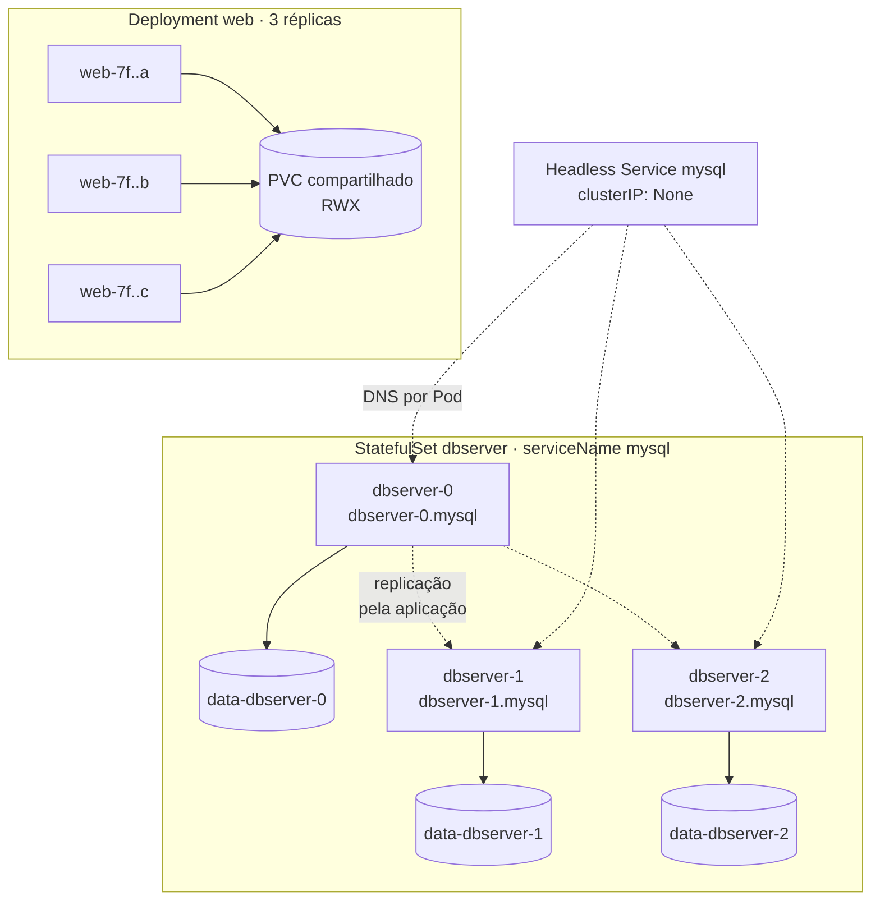

# 5.7 — Gerenciar storage não compartilhado com StatefulSets

| Campo | Valor |
|-------|-------|
| Curso | DO180 — OpenShift 4.22 |
| Capítulo / seção | Capítulo 5 · Seção 5.7 |
| Título original | Manage Non-shared Storage with Stateful Sets |
| Título em português | Gerenciar storage não compartilhado com StatefulSets |
| Objetivo | Implantar aplicações que escalam sem compartilhar storage |
| Pré-requisitos | [5.3](5.3-provisionar-volumes-persistentes.md), [5.5](5.5-selecionar-storage-class.md), [4.5](../04-deploy-e-redes/4.5-redes-de-pods-e-services.md) |
| Referência | PDF p. 349–355 · Guided Exercise 5.8 p. 356–362 |

## Parte A — Entendendo o conceito

### File × block storage

Aplicações clusterizadas (MySQL, Cassandra...) precisam de storage persistente.
Quando não há discos para todos, o storage **compartilhado** distribui a capacidade
de um único dispositivo entre vários serviços. Há dois grandes modelos:

| | **File storage** (NAS) | **Block storage** (SAN, iSCSI) |
|--|------------------------|-------------------------------|
| Entrega | Árvore de diretórios conhecida | Dispositivos de bloco crus, como discos físicos (formatar e montar) |
| Protocolos | **NFS** (monta sistemas de arquivos remotos como locais), **SMB** (compartilhamentos e impressoras) | iSCSI, Fibre Channel |
| Pontos fortes | Simples, barato, confiável; o SO e o sistema de arquivos cuidam de *locking* e *cache* | Desempenho, acesso direto ao dispositivo |
| Bons usos | Conteúdo web, compartilhamento de arquivos, FTP, arquivos de backup | Bancos SQL (acesso de um nó), VMs (acesso de vários nós), alto desempenho, RAID |
| Fraquezas | Grandes volumes de dados ou dados não estruturados | Não compartilha arquivos por si só |

Em nuvens gerenciadas existem equivalentes de file storage (ex.: Amazon EFS no
ROSA, Azure Files no ARO, Google Cloud Filestore no OpenShift Dedicated).

### Deployment com PVC × StatefulSet

Uma aplicação **stateful** age de acordo com estados e transações anteriores.

| | **Deployment** | **StatefulSet** |
|--|----------------|-----------------|
| Pensado para | Stateless (pode ter estado com um PV) | Stateful |
| Storage | **Todas as réplicas usam o mesmo PVC** | **Cada réplica tem seu próprio PVC/PV** |
| Pods | Intercambiáveis, nomes aleatórios, via ReplicaSet | Identidade estável: `<sts>-0`, `<sts>-1`... **sem ReplicaSet** |
| Rede | Service com ClusterIP balanceado | **Headless Service**: um nome DNS por Pod |
| Criação | Paralela | **Ordenada**: um Pod por vez, pelo índice, esperando o anterior ficar pronto |
| Replicação de dados | — | **Responsabilidade da aplicação** (clustering no nível da aplicação) |
| Criação imperativa | `oc create deployment` | ❌ Só por **manifesto** (YAML) ou console |

O StatefulSet garante que uma **identidade de rede** sempre corresponda à mesma
**identidade de storage**: o Pod `db-1` sempre volta a montar `data-db-1`.

### Headless Service

- Service com **`clusterIP: None`**: não tem IP virtual nem balanceamento.
- A consulta DNS devolve os **IPs de todos os Pods** selecionados.
- Associado a um StatefulSet (campo `serviceName`), cada Pod ganha um nome DNS
  **único e previsível**: `<pod>.<service>.<namespace>.svc.cluster.local`
  (ex.: `dbserver-0.mysql`).
- Isso permite **descoberta entre pares** e falar com um Pod específico, como o
  primário de um banco replicado.
- O Service precisa existir **antes** do StatefulSet.

### Volume claim templates

No StatefulSet, `volumeClaimTemplates` descreve o PVC que **cada réplica**
recebe. Os nomes seguem `<template>-<statefulset>-<índice>` (ex.: `data-dbserver-0`).
O curso recomenda **`ReadWriteOncePod`** para produção.

⚠️ Ao **apagar o StatefulSet**, os **PVCs permanecem**. Os dados ficam preservados,
e o storage também continua consumido até ser apagado.

## Parte B — Modelo mental



## Parte C — Funcionamento na prática

### Manifestos (originais)

```yaml
apiVersion: v1
kind: Service
metadata:
  name: mysql
  labels:
    app: database
spec:
  clusterIP: None              # headless
  selector:
    app: database              # igual aos labels dos Pods do StatefulSet
  ports:
    - name: mysql
      port: 3306
---
apiVersion: apps/v1
kind: StatefulSet
metadata:
  name: dbserver
spec:
  serviceName: mysql           # headless Service que governa o StatefulSet
  replicas: 3
  selector:
    matchLabels:
      app: database
  template:
    metadata:
      labels:
        app: database
    spec:
      terminationGracePeriodSeconds: 10
      containers:
        - name: database
          image: registry.redhat.io/rhel10/mysql-84
          env:
            - name: MYSQL_USER
              valueFrom:
                secretKeyRef:
                  name: db-cred
                  key: user
            - name: MYSQL_PASSWORD
              valueFrom:
                secretKeyRef:
                  name: db-cred
                  key: password
            - name: MYSQL_DATABASE
              value: loja
          ports:
            - name: database
              containerPort: 3306
          volumeMounts:
            - name: data
              mountPath: /var/lib/mysql
  volumeClaimTemplates:
    - metadata:
        name: data             # PVCs: data-dbserver-0, -1, -2
      spec:
        accessModes: ["ReadWriteOncePod"]
        storageClassName: lvms-vg1
        resources:
          requests:
            storage: 1Gi
```

### Criar e verificar

```bash
oc create secret generic db-cred --from-literal user=app --from-literal password='Troque-me!'
oc create -f headless-service.yaml
oc get svc mysql                              # CLUSTER-IP None
oc create -f statefulset-dbserver.yaml
oc get statefulset dbserver                   # READY 3/3
oc get pods -l app=database -w                # dbserver-0, depois -1, depois -2
oc get pvc                                    # data-dbserver-0/1/2, Bound, RWOP
oc describe pod dbserver-1 | grep ClaimName   # data-dbserver-1
oc get endpointslices -l kubernetes.io/service-name=mysql
oc rsh dbserver-0 curl -v telnet://dbserver-1.mysql:3306   # DNS por Pod
```

### Escalar e apagar

```bash
oc scale statefulset/dbserver --replicas 4    # cria dbserver-3 (após o -2 estar pronto)
oc scale statefulset/dbserver --replicas 2    # remove do maior índice para o menor
oc delete statefulset dbserver
oc get pvc                                    # PVCs continuam
oc delete pvc -l app=database                 # ⚠️ só se quiser apagar os dados
```

- 📘 *Fonte externa:* o controller aplica aos PVCs gerados os labels do seletor do StatefulSet (`app=database`); confira com `oc get pvc --show-labels` antes de apagar por label.
- **Console:** *Workloads › StatefulSets › Create StatefulSet* (editor YAML).

### Comparar com um Deployment compartilhando um PVC

```bash
oc create deployment web --image registry.access.redhat.com/ubi10/httpd-24 --replicas 1
oc set volumes deployment/web --add --name web-data --type pvc \
  --claim-name web-pvc --claim-class nfs-storage --claim-mode rwx --claim-size 1Gi \
  --mount-path /var/www/html
oc exec deploy/web -- sh -c 'echo ola > /var/www/html/index.html'
oc scale deployment/web --replicas 3
for p in $(oc get pods -l app=web -o name); do oc exec $p -- cat /var/www/html/index.html; done
```

Todas as réplicas mostram o mesmo arquivo: o **mesmo** PVC é compartilhado.

## Parte D — Relações importantes

| A | B | Diferença essencial |
|---|---|--------------------|
| Deployment + PVC | StatefulSet | Um PVC para todos × um PVC por réplica |
| ReplicaSet | StatefulSet | Pods intercambiáveis × Pods com índice e identidade estáveis |
| Service ClusterIP | Headless (`clusterIP: None`) | IP virtual balanceado × DNS com o IP de cada Pod |
| `svc.ns` | `pod.svc.ns` | Qualquer réplica × réplica específica |
| `volumes` | `volumeClaimTemplates` | Volume fixo no template × PVC gerado por réplica |
| File storage | Block storage | Compartilhamento simples × desempenho, acesso de um nó |
| Apagar StatefulSet | Apagar PVCs | Remove os Pods, mantém os dados × remove os dados |
| Replicação de dados | StatefulSet | Feita pela aplicação × só garante identidade e storage |

## Parte E — Preparação para o laboratório

Atividade associada: **5.8 Guided Exercise — Manage Non-shared Storage with
Stateful Sets** (`storage-statefulsets`, PDF p. 356–362).

Você deve conseguir:

- Implantar um servidor web com storage persistente, gravar dados, escalar e observar que as réplicas **compartilham** o volume.
- Criar um banco com **headless Service** e **StatefulSet** a partir de manifestos.
- Verificar que **cada** instância do StatefulSet tem seu próprio PVC.

Ver [PRATICA-OFICIAL.md](PRATICA-OFICIAL.md#58-guided-exercise-manage-non-shared-storage-with-stateful-sets).

## Parte F — Fixação

1. Por que um banco com três réplicas independentes não deve usar um Deployment com um único PVC?
2. Qual o nome DNS do Pod `kafka-2` governado pelo Service headless `kafka-hs` no projeto `stream`?
3. Você aplicou o StatefulSet antes do headless Service. O que deve ser feito?
4. Após `oc delete statefulset dbserver`, o espaço em disco não foi liberado. Por quê?
5. O StatefulSet garante que as réplicas tenham os mesmos dados?

<details>
<summary>Respostas comentadas</summary>

1. As réplicas gravariam nos mesmos arquivos, o que corrompe os dados (bancos exigem acesso exclusivo). Cada réplica precisa do próprio volume: StatefulSet.
2. `kafka-2.kafka-hs.stream.svc.cluster.local` (ou `kafka-2.kafka-hs` dentro do projeto).
3. O Service deve existir antes do StatefulSet. Crie o Service (com seletor igual aos labels dos Pods) e confira se os Pods ganharam os nomes DNS; se necessário, recrie o StatefulSet.
4. Os PVCs (e PVs) gerados pelos `volumeClaimTemplates` permanecem após apagar o StatefulSet. Apague-os explicitamente se não quiser os dados.
5. Não. Ele garante identidade e storage dedicados; a replicação é configurada na aplicação.

</details>

## Parte G — Essencial para memorizar

- File (NAS: NFS/SMB) = compartilhar · Block (SAN/iSCSI) = desempenho.
- Deployment: um PVC para todos; StatefulSet: um PVC por réplica (`<template>-<sts>-<n>`).
- StatefulSet exige **headless Service** (`clusterIP: None`) criado **antes**; DNS `<pod>.<svc>`.
- Pods ordenados (`-0`, `-1`...), criados um a um, sem ReplicaSet; só por manifesto.
- RWOP recomendado para produção.
- Apagar o StatefulSet **não** apaga os PVCs.
- Replicação de dados = aplicação.

---
[← 5.5 Storage classes](5.5-selecionar-storage-class.md) | [Índice do capítulo](README.md) | [Próximo: Prática oficial →](PRATICA-OFICIAL.md)
