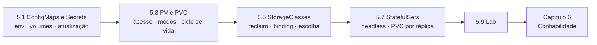

# Capítulo 5 — Manage Storage for Application Configuration and Data

**Título em português:** Gerenciar armazenamento para configuração e dados de aplicações
**Status:** ✅ concluído e validado
**Referência:** PDF p. 293–376

## Objetivo do capítulo

Externalizar a configuração das aplicações em recursos do Kubernetes e
provisionar volumes de armazenamento para arquivos de dados persistentes.

## Por que este capítulo importa

No Capítulo 4 as aplicações rodavam e se comunicavam, mas a configuração ficava
"dentro" dos Deployments e os dados morriam com os Pods. Aqui você separa
**código** (imagem), **configuração** (ConfigMap), **credenciais** (Secret) e
**dados** (PVC), e aprende a escolher o storage certo e a escalar sem compartilhar
volumes (StatefulSet).

## Seções e atividades (ordem oficial)

| Seção | Tipo | Título original | Material | PDF |
|-------|------|-----------------|----------|-----|
| 5.1 | Conceito | Externalize the Configuration of Applications | [lição](5.1-externalizar-configuracao.md) | p. 294–306 |
| 5.2 | Guided Exercise | Externalize the Configuration of Applications | [prática](PRATICA-OFICIAL.md#52-guided-exercise-externalize-the-configuration-of-applications) | p. 307–316 |
| 5.3 | Conceito | Provision Persistent Data Volumes | [lição](5.3-provisionar-volumes-persistentes.md) | p. 317–327 |
| 5.4 | Guided Exercise | Provision Persistent Data Volumes | [prática](PRATICA-OFICIAL.md#54-guided-exercise-provision-persistent-data-volumes) | p. 328–335 |
| 5.5 | Conceito | Selecting a Storage Class for an Application | [lição](5.5-selecionar-storage-class.md) | p. 336–341 |
| 5.6 | Guided Exercise | Selecting a Storage Class for an Application | [prática](PRATICA-OFICIAL.md#56-guided-exercise-selecting-a-storage-class-for-an-application) | p. 342–348 |
| 5.7 | Conceito | Manage Non-shared Storage with Stateful Sets | [lição](5.7-storage-nao-compartilhado-com-statefulsets.md) | p. 349–355 |
| 5.8 | Guided Exercise | Manage Non-shared Storage with Stateful Sets | [prática](PRATICA-OFICIAL.md#58-guided-exercise-manage-non-shared-storage-with-stateful-sets) | p. 356–362 |
| 5.9 | Lab | Manage Storage for Application Configuration and Data | [prática](PRATICA-OFICIAL.md#59-lab-manage-storage-for-application-configuration-and-data) | p. 363–375 |
| 5.10 | Summary | Summary | [RESUMO.md](RESUMO.md) | p. 376 |

> Este capítulo **não tem quiz** oficial.

## Arquivos do capítulo

- [PRATICA-OFICIAL.md](PRATICA-OFICIAL.md): ponte com as atividades oficiais.
- [REVISAO.md](REVISAO.md): questões autorais integradas.
- [RESUMO.md](RESUMO.md): síntese e tabela de comandos.

## Pré-requisitos recomendados

[F7 — Persistência de dados](../../01-fundamentos-essenciais/07-persistencia-de-dados.md) ·
[Capítulo 4](../04-deploy-e-redes/README.md)

## Checklist

- [ ] 5.1 lida e Parte F respondida
- [ ] 5.2 Guided Exercise `storage-configs` concluído
- [ ] 5.3 lida e Parte F respondida
- [ ] 5.4 Guided Exercise `storage-volumes` concluído
- [ ] 5.5 lida e Parte F respondida
- [ ] 5.6 Guided Exercise `storage-classes` concluído
- [ ] 5.7 lida e Parte F respondida
- [ ] 5.8 Guided Exercise `storage-statefulsets` concluído
- [ ] 5.9 Lab `storage-review` com `lab grade` aprovado
- [ ] [REVISAO.md](REVISAO.md) respondida
- [ ] Registro no [diário de laboratórios](../../progresso/diario-de-laboratorios.md)

---
[← Capítulo 4](../04-deploy-e-redes/README.md) | [Índice geral](../../README.md) | [Próximo: 5.1 Configuração →](5.1-externalizar-configuracao.md)
