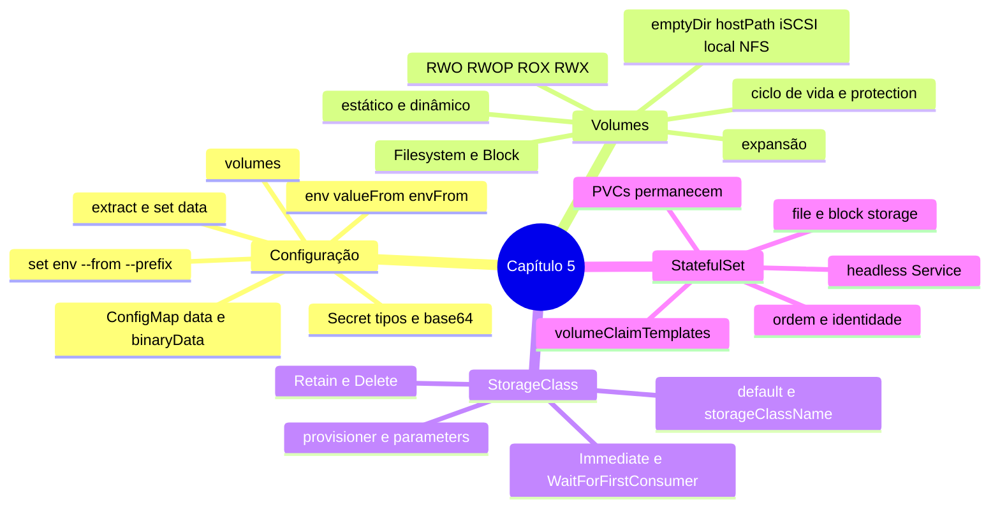

# Resumo — Capítulo 5

Síntese autoral para revisão rápida. Correspondência oficial: seção 5.10 (PDF p. 376).

## Em uma frase por seção

| Seção | Ideia central |
|-------|---------------|
| 5.1 | ConfigMaps (configuração) e Secrets (sensível, base64 ≠ criptografia) entram nos Pods como variáveis (reiniciar para atualizar) ou arquivos (atualização eventual) |
| 5.3 | PVCs pedem storage com tamanho, modo de acesso e classe; PVs vêm do admin (estático) ou de provisionadores (dinâmico); ciclo Available → Bound → Released → Reclaimed |
| 5.5 | A StorageClass define provisionador, parâmetros, reclaim, binding e expansão; escolha pelos requisitos da aplicação e sempre declare a classe |
| 5.7 | StatefulSets dão a cada réplica identidade estável (nome, DNS via headless Service) e um PVC próprio, que sobrevive ao StatefulSet |

## Mapa do capítulo

## Tabela de comandos do capítulo

| Tarefa | Comando |
|--------|---------|
| Secret genérico | `oc create secret generic <s> --from-literal k=v \| --from-file k=arq` |
| Secret TLS | `oc create secret tls <s> --cert <crt> --key <key>` |
| ConfigMap | `oc create cm <c> --from-literal k=v \| --from-file arq` |
| Variáveis a partir de objeto | `oc set env deployment/<d> --from secret/<s> [--prefix P_]` |
| Montar Secret/ConfigMap | `oc set volume deployment/<d> --add --type secret\|configmap --secret-name\|--configmap-name <n> --mount-path 
` |
| Listar / remover volumes | `oc set volume deployment/<d>` · `--remove --name <vol>` |
| Baixar e atualizar dados | `oc extract secret/<s> --to <dir> --confirm` · `oc set data secret/<s> --from-file <arq>` |
| Reiniciar Pods | `oc rollout restart deployment/<d>` |
| PVC em Deployment | `oc set volumes deployment/<d> --add --type pvc --claim-name <c> --claim-size <t> --claim-mode rwo\|rwop\|rwx\|rox --claim-class <sc> --mount-path 
` |
| PVCs, PVs, classes | `oc get pvc` · `oc get pv` · `oc get storageclass` · `oc describe sc <x>` |
| Expandir PVC | `oc patch pvc/<c> --type merge -p '{"spec":{"resources":{"requests":{"storage":"<t>"}}}}'` |
| StatefulSet | `oc create -f <manifesto>` · `oc get statefulset` · `oc scale statefulset/<s> --replicas N` |

## Alertas operacionais

- ⚠️ Base64 não é criptografia; `oc extract` grava segredos decodificados em disco.
- ⚠️ Variáveis de ambiente não se atualizam sozinhas.
- ⚠️ `hostPath` e NFS: não recomendados em produção pela Red Hat.
- ⚠️ `Delete` + apagar PVC = apagar dados.
- ⚠️ Sempre declare a StorageClass; a padrão pode mudar.
- ⚠️ RWO/RWX não tornam o compartilhamento seguro: a aplicação responde pela consistência.
- ⚠️ Apagar StatefulSet não apaga PVCs.

## Ligação com o próximo capítulo

Com configuração e dados resolvidos, falta tornar as aplicações **confiáveis**: o
Capítulo 6 trata de alta disponibilidade, **probes**, **requests e limits** de CPU e
memória e **autoscaling**.

---
[← Revisão](REVISAO.md) | [Índice do capítulo](README.md) | [Próximo capítulo →](../06-confiabilidade/README.md)
