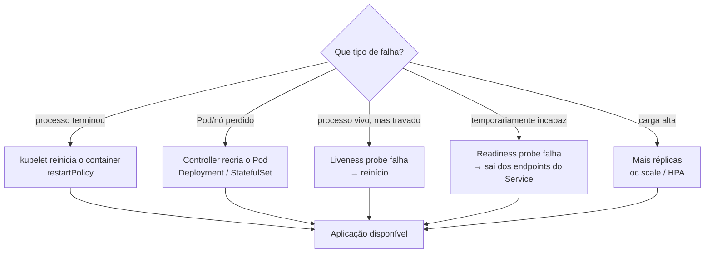

# 6.1 — Alta disponibilidade de aplicações com Kubernetes

| Campo | Valor |
|-------|-------|
| Curso | DO180 — OpenShift 4.22 |
| Capítulo / seção | Capítulo 6 · Seção 6.1 |
| Título original | Application High Availability with Kubernetes |
| Título em português | Alta disponibilidade de aplicações com Kubernetes |
| Objetivo | Descrever como o Kubernetes mantém aplicações funcionando depois de falhas |
| Pré-requisitos | [4.3](../04-deploy-e-redes/4.3-workloads-de-longa-e-curta-duracao.md), [4.5](../04-deploy-e-redes/4.5-redes-de-pods-e-services.md), [3.1](../03-containers-e-pods/3.1-criar-containers-e-pods.md) |
| Referência | PDF p. 378–379 · Guided Exercise 6.2 p. 380–385 |

## Parte A — Entendendo o conceito

### O que é alta disponibilidade (HA)

HA torna a aplicação mais **robusta** contra falhas em tempo de execução e reduz a
chance de ela ficar **totalmente** indisponível. Uma aplicação precisa ser
protegida de três fontes de problema:

| Fonte | Exemplo |
|-------|---------|
| Ela mesma | Bugs, travamentos, deadlocks |
| O ambiente | Problemas de rede, nó que cai |
| Outras aplicações | Uma vizinha que esgota CPU ou memória do cluster |

As práticas de HA também protegem o **cluster** das aplicações, por exemplo de uma
aplicação com vazamento de memória.

⚠️ HA no cluster **mitiga** o pior cenário, mas **não substitui** corrigir a
aplicação.

### A aplicação precisa colaborar

Para aproveitar os recursos de HA do Kubernetes, a aplicação deve:

| Comportamento | Por quê |
|---------------|---------|
| **Tolerar reinícios** | O cluster reinicia e recria Pods como forma de recuperação |
| **Responder a health probes** (startup, readiness, liveness) | É assim que o cluster sabe se ela está viva e pronta (6.3) |
| **Suportar várias instâncias simultâneas** | Permite réplicas e escala horizontal (6.9) |
| **Ter uso de recursos bem definido e comportado** | Permite requests e limits corretos (6.5, 6.7) |
| **Rodar com privilégios restritos** | Compatível com as políticas de segurança (Cap. 3) |

O **endpoint de saúde** (comum em aplicações HTTP) é responsabilidade de quem
desenvolve: é a aplicação que decide o que significa estar saudável. Por exemplo,
responder "saudável" só se o banco estiver acessível, quando fizer sentido para
ela.

### Os três mecanismos do Kubernetes

| Mecanismo | Resolve | Exige |
|-----------|---------|-------|
| **Reinício de containers** (`restartPolicy`) | Processo que **morre** | Nada além da política |
| **Health probes** | Processo que **não morre, mas não funciona** (travado, sem dependências) | Probes configuradas |
| **Escala horizontal** | Variação de **carga** | Réplicas/HPA e aplicação que aceita várias instâncias |

Ponto-chave: se a aplicação falha **sem derrubar o processo**, o Pod continua
`Running` e o cluster **só percebe com probes**.

### `restartPolicy` no contexto de HA

| Valor | O kubelet reinicia o container que terminou... |
|-------|-----------------------------------------------|
| `Always` (padrão) | Sempre |
| `OnFailure` | Só com código de saída ≠ 0 |
| `Never` | Nunca |

Para aplicações, use **controllers** (Deployment, StatefulSet): eles mantêm o
número de réplicas e **recriam Pods** perdidos, o mecanismo central de HA. Esses
controllers **exigem** `restartPolicy: Always` no template de Pod.

## Parte B — Modelo mental



Sem probes, os ramos "travado" e "temporariamente incapaz" ficam invisíveis para o
cluster: o tráfego continua chegando a um Pod que não responde.

## Parte C — Funcionamento na prática

### Observar reinícios e recriações

```bash
oc get pods -w                                  # coluna RESTARTS e STATUS em tempo real
oc get pod <POD> -o jsonpath='{.spec.restartPolicy}{"\n"}'
oc describe pod <POD>                           # Last State, Exit Code, Reason, eventos BackOff
oc logs <POD> --previous                        # o que a instância anterior registrou
oc delete pod <POD>                             # com Deployment, outro Pod surge
oc get deployment <D>                           # READY volta a N/N
```

| Observação | Interpretação |
|------------|---------------|
| `RESTARTS` subindo, `STATUS` alternando com `CrashLoopBackOff` | O processo termina repetidamente; o kubelet espera cada vez mais entre tentativas (*backoff*) |
| Pod avulso apagado não volta | Sem controller |
| Pod de Deployment apagado volta com outro nome | O ReplicaSet recriou |
| `Running` com `READY 0/1` | Readiness falhando: fora dos endpoints (6.3) |
| `Running` e `READY 1/1`, mas a aplicação não responde | Sem probes adequadas, o cluster não percebe |

### Simular falhas com segurança

Em clusters de teste, aplicações com endpoints utilitários (para derrubar o
processo ou alternar o estado de saúde) ajudam a observar cada mecanismo. O
exercício oficial usa uma imagem assim.

```bash
oc exec <POD> -- kill 1        # 📘 se a imagem tiver "kill": encerra o processo principal
oc get pods -w                 # observar o reinício
```

### Escalar para tolerar falhas

```bash
oc scale deployment/<D> --replicas 3
oc get pods -o wide             # réplicas espalhadas por nós (quando há mais de um)
```

Com várias réplicas, perder um Pod não derruba o serviço: o Service continua
enviando tráfego às réplicas prontas.

## Parte D — Relações importantes

| A | B | Diferença essencial |
|---|---|--------------------|
| `restartPolicy` | Controller | Reinicia o **container** no mesmo Pod × recria o **Pod** (inclusive em outro nó) |
| Processo morto | Processo travado | Detectado sem configuração × exige liveness probe |
| Liveness | Readiness | Reinicia × tira do balanceamento |
| HA do cluster | Correção da aplicação | Mitigação × solução da causa |
| Uma réplica | Várias réplicas | Ponto único de falha × tolerância a falhas |
| `Always` | `OnFailure`/`Never` | Obrigatório em Deployments × típico de Jobs/Pods avulsos |

## Parte E — Preparação para o laboratório

Atividade associada: **6.2 Guided Exercise — Application High Availability with
Kubernetes** (`reliability-ha`, PDF p. 380–385).

Você deve conseguir:

- Explicar o efeito de cada `restartPolicy` em um Pod que falha.
- Observar o comportamento de uma aplicação de inicialização lenta **sem** probes.
- Escalar com Deployment e observar o que acontece com o tráfego quando uma réplica "quebra".

Ver [PRATICA-OFICIAL.md](PRATICA-OFICIAL.md#62-guided-exercise-application-high-availability-with-kubernetes).

## Parte F — Fixação

1. Cite três comportamentos que uma aplicação deve ter para aproveitar a HA do Kubernetes.
2. Uma aplicação trava (deadlock), mas o processo continua vivo. O Kubernetes reinicia sozinho? O que é necessário?
3. Por que um Deployment exige `restartPolicy: Always`?
4. Qual a diferença entre o kubelet reiniciar um container e o controller recriar um Pod?
5. Uma aplicação com vazamento de memória ameaça o nó. Que mecanismos de HA ajudam (adiante no capítulo)?

<details>
<summary>Respostas comentadas</summary>

1. Quaisquer três: tolerar reinícios; responder a probes; suportar várias instâncias; ter uso de recursos previsível; rodar com privilégios restritos.
2. Não: para o kubelet, o processo está vivo. É preciso uma **liveness probe** que detecte o travamento e provoque o reinício.
3. O objetivo do Deployment é manter réplicas **rodando continuamente**; containers que terminam devem ser sempre reiniciados.
4. O reinício acontece no mesmo Pod e nó (o contador `RESTARTS` sobe). A recriação gera um Pod novo, com outro nome e IP, possivelmente em outro nó, quando o Pod é perdido ou apagado.
5. **Memory limit** (o container é morto e reiniciado ao atingir o limite, 6.7), **requests** corretos para o agendamento (6.5) e probes para detectar degradação.

</details>

## Parte G — Essencial para memorizar

- HA protege contra a própria aplicação, o ambiente e os vizinhos; e protege o cluster da aplicação.
- Aplicação colaborativa: reinícios, probes, várias instâncias, recursos previsíveis, privilégios restritos.
- Três mecanismos: **restart** (processo morto), **probes** (vivo mas doente), **escala** (carga).
- `restartPolicy`: `Always` (padrão, exigido por Deployment/StatefulSet), `OnFailure`, `Never`.
- Processo vivo e travado só é detectado com probes.

---
[← Capítulo 6 (índice)](README.md) | [Índice do capítulo](README.md) | [Próximo: 6.3 Health probes →](6.3-health-probes.md)
