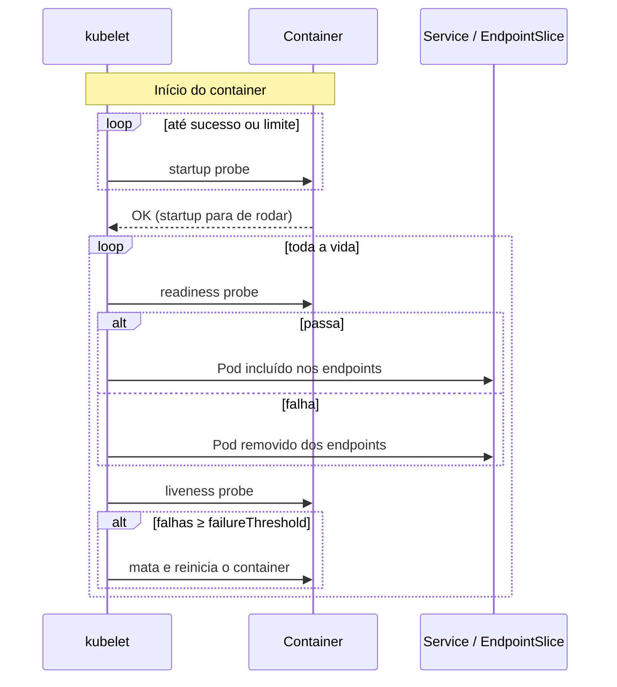

# 6.3 — Health probes de aplicações

| Campo | Valor |
|-------|-------|
| Curso | DO180 — OpenShift 4.22 |
| Capítulo / seção | Capítulo 6 · Seção 6.3 |
| Título original | Application Health Probes |
| Título em português | Health probes de aplicações |
| Objetivo | Descrever como o Kubernetes usa health probes durante implantação, escala e failover |
| Pré-requisitos | [6.1](6.1-alta-disponibilidade-de-aplicacoes.md), [4.5](../04-deploy-e-redes/4.5-redes-de-pods-e-services.md) |
| Referência | PDF p. 386–390 · Guided Exercise 6.4 p. 391–396 |

## Parte A — Entendendo o conceito

### Para que servem as probes

Uma probe é um **teste repetido** que o kubelet faz no container para saber o
estado da aplicação. Com elas o cluster consegue:

- **mitigar travamentos**, reiniciando o que falha;
- fazer **failover e balanceamento**, enviando requisições só a Pods saudáveis;
- **monitorar** quando e se os Pods falham;
- **escalar** com segurança, sabendo quando uma réplica nova está pronta.

Os endpoints de saúde são escritos por quem desenvolve a aplicação. Eles devem ser
**rápidos**, porque são chamados com frequência: nada de consultas pesadas ou muitas
chamadas de rede.

### Os três tipos de probe

| Probe | Pergunta | Quando roda | Se falhar |
|-------|----------|-------------|-----------|
| **Startup** | "Já terminou de iniciar?" | Só no início; **para** de rodar após o primeiro sucesso. Enquanto não passa, as outras probes não rodam | Esgotado o limite, o container é reiniciado conforme a `restartPolicy` |
| **Readiness** | "Pode receber tráfego agora?" | Durante **toda** a vida do container | O IP do Pod **sai dos endpoints** do Service; nada é reiniciado. Volta quando a probe passa de novo |
| **Liveness** | "Ainda está saudável?" | Durante toda a vida, **após** a startup | Atingido o limite de falhas, o container é **reiniciado** conforme a `restartPolicy` |

📘 *Fonte externa:* na liveness e na startup, quem age é o **kubelet**, que mata e
reinicia o **container** (o Pod e seu IP permanecem; o `RESTARTS` sobe).

Quando usar cada uma:

- **Startup:** aplicações com **inicialização longa**. Assim a liveness pode ser curta
  e responsiva, sem matar a aplicação enquanto ela ainda sobe.
- **Readiness:** problemas **temporários**: aquecimento de cache, conexões iniciais,
  tarefas em lote que deixam a aplicação ocupada. Evita erros para clientes durante
  rollouts e escalas.
- **Liveness:** estados dos quais a aplicação **não se recupera sozinha** (deadlock, vazamento).

### Os três tipos de teste

| Teste | Sucesso quando | Campo no YAML |
|-------|----------------|---------------|
| **HTTP GET** | Resposta HTTP entre **200 e 399** | `httpGet: {path, port}` |
| **Comando no container** | Comando termina com código **0** | `exec: {command: [...]}` |
| **Socket TCP** | A conexão na porta é estabelecida | `tcpSocket: {port}` |

### Tempos e limites

| Campo | Significado | Padrão 📘 |
|-------|-------------|-----------|
| `initialDelaySeconds` | Espera antes da primeira execução | 0 |
| `periodSeconds` | Intervalo entre execuções | 10 |
| `timeoutSeconds` | Tempo máximo de resposta de cada teste | 1 |
| `failureThreshold` | Falhas **consecutivas** para considerar a probe falha | 3 |
| `successThreshold` | Sucessos consecutivos para voltar a "ok" (1 para liveness/startup) | 1 |

Com `failureThreshold: 3` e `periodSeconds: 5`, um problema persiste por pelo menos
~10 segundos antes da mitigação. Probes muito frequentes **desperdiçam recursos**;
muito espaçadas **demoram a reagir**. Equilibre.

📘 *Fonte externa:* o tempo máximo de inicialização tolerado por uma startup probe é
aproximadamente `failureThreshold × periodSeconds`.

## Parte B — Modelo mental



## Parte C — Funcionamento na prática

### No YAML (exemplo original)

```yaml
apiVersion: apps/v1
kind: Deployment
metadata:
  name: web
spec:
  replicas: 3
  selector:
    matchLabels:
      app: web
  template:
    metadata:
      labels:
        app: web
    spec:
      containers:
        - name: web
          image: registry.access.redhat.com/ubi10/httpd-24
          ports:
            - containerPort: 8080
          startupProbe:
            httpGet:
              path: /
              port: 8080
            periodSeconds: 5
            failureThreshold: 24      # até ~120 s para iniciar
          readinessProbe:
            httpGet:
              path: /
              port: 8080
            periodSeconds: 5
            failureThreshold: 2
          livenessProbe:
            tcpSocket:
              port: 8080
            periodSeconds: 10
            failureThreshold: 3
```

Para aplicar em um Deployment existente: edite e reaplique o YAML, ou use `oc edit`.

### Pela CLI: `oc set probe` (exclusivo do `oc`)

```bash
# Readiness por HTTP
oc set probe deployment/front-end --readiness \
  --failure-threshold 6 --period-seconds 10 --get-url http://:8080/healthz

# Liveness por HTTP com atraso inicial e timeout
oc set probe deployment/front-end --liveness \
  --get-url http://:8080/health --initial-delay-seconds 5 --timeout-seconds 2

# Startup por TCP
oc set probe deployment/front-end --startup --open-tcp 8080 \
  --period-seconds 5 --failure-threshold 30

# Liveness por comando
oc set probe deployment/db --liveness -- /bin/sh -c 'mysqladmin ping -h 127.0.0.1'

# Remover uma probe
oc set probe deployment/front-end --liveness --remove
```

| Opção | Significado |
|-------|-------------|
| `--readiness` / `--liveness` / `--startup` | Tipo de probe |
| `--get-url http://:PORTA/caminho` | Teste HTTP (host vazio = o próprio Pod) |
| `--open-tcp PORTA` | Teste TCP |
| `-- comando args` | Teste por comando |
| `--initial-delay-seconds`, `--period-seconds`, `--timeout-seconds`, `--failure-threshold`, `--success-threshold` | Tempos e limites |
| `--remove` | Remove a probe |

- **Recurso modificado:** o template do Deployment, o que gera um novo rollout.
- **Verificar:** `oc describe deployment front-end` (linhas `Liveness:`, `Readiness:`, `Startup:`), ou `oc get deployment front-end -o yaml`.

### Pela console

*Workloads › Deployments › deployment › Actions › Add Health Checks*. Depois,
**Edit probe** para cada probe (tipo, cabeçalhos HTTP, caminho, porta...).

### Diagnosticar probes

```bash
oc describe pod <POD>         # eventos "Unhealthy": Readiness probe failed / Liveness probe failed
oc get pods -w                # READY 0/1 (readiness) ou RESTARTS subindo (liveness/startup)
oc get endpointslices -l kubernetes.io/service-name=<SVC>   # Pod some/volta dos endpoints
oc exec <POD> -- curl -s -o /dev/null -w '%{http_code}\n' localhost:8080/health
```

| Sintoma | Causa provável |
|---------|----------------|
| Pod `Running` com `READY 0/1` para sempre | Readiness com caminho/porta errados, ou a aplicação depende de algo indisponível |
| Reinícios em loop logo após iniciar | Liveness sem startup em aplicação lenta, ou `failureThreshold` × `periodSeconds` curto demais |
| Erros para clientes durante escala/rollout | Falta readiness: o Pod recebe tráfego antes de estar pronto |
| Probe com timeout | Endpoint pesado demais ou `timeoutSeconds` pequeno |

## Parte D — Relações importantes

| A | B | Diferença essencial |
|---|---|--------------------|
| Startup | Liveness | Só no início, depois para × durante toda a vida |
| Readiness | Liveness | Tira do balanceamento × reinicia |
| HTTP GET | TCP socket | Valida a resposta da aplicação (200–399) × só que a porta aceita conexão |
| Exec | HTTP GET | Comando no container (código 0) × requisição HTTP |
| `periodSeconds` | `failureThreshold` | Frequência × tolerância |
| Readiness falha | Pod `NotReady` | Sai dos endpoints, mas continua rodando |
| Probe | Monitoramento (Prometheus) | Ação automática local × observação e alerta |

## Parte E — Preparação para o laboratório

Atividade associada: **6.4 Guided Exercise — Application Health Probes**
(`reliability-probes`, PDF p. 391–396).

Você deve conseguir:

- Avaliar problemas de uma aplicação **sem** probes, sob escala e falhas.
- Configurar probes de **startup**, **liveness** e **readiness**.
- Verificar que clientes deixam de receber erros quando uma réplica fica indisponível.

Ver [PRATICA-OFICIAL.md](PRATICA-OFICIAL.md#64-guided-exercise-application-health-probes).

## Parte F — Fixação

1. Uma aplicação leva 90 s para iniciar. Com só uma liveness (`periodSeconds: 10`, `failureThreshold: 3`), o que acontece? Como corrigir?
2. Durante um rollout, alguns usuários recebem erro 503. Que probe falta?
3. A aplicação perde a conexão com o banco por alguns segundos. Readiness ou liveness deve detectar isso? Por quê?
4. Escreva o comando que adiciona uma readiness HTTP em `/ready` na porta 3000 ao Deployment `api`.
5. Qual a diferença de efeito entre uma readiness e uma liveness que falham para sempre?

<details>
<summary>Respostas comentadas</summary>

1. A liveness falha antes da aplicação subir (~30 s) e o container é reiniciado em loop. Adicione uma **startup probe** com folga (ex.: `periodSeconds: 10`, `failureThreshold: 12`), ou aumente o atraso inicial da liveness.
2. **Readiness**: sem ela, Pods novos recebem tráfego antes de estarem prontos.
3. Em geral, **readiness**: o problema é temporário; tirar o Pod do balanceamento basta. Reiniciar (liveness) não traria o banco de volta e poderia piorar a situação.
4. `oc set probe deployment/api --readiness --get-url http://:3000/ready`
5. Readiness: o Pod continua rodando, mas nunca recebe tráfego (`READY 0/1`). Liveness: o container é reiniciado repetidamente (`RESTARTS` sobe, pode chegar a `CrashLoopBackOff`).

</details>

## Parte G — Essencial para memorizar

- Startup (só no início) · Readiness (tráfego) · Liveness (reinício).
- Testes: HTTP GET (200–399) · exec (código 0) · TCP (conexão).
- `periodSeconds`, `failureThreshold`, `timeoutSeconds`, `initialDelaySeconds`, `successThreshold`.
- `oc set probe deployment/x --readiness|--liveness|--startup --get-url http://:P/caminho | --open-tcp P | -- cmd`.
- Console: *Actions › Add Health Checks*.
- Endpoints de saúde: rápidos e leves.

---
[← 6.1 Alta disponibilidade](6.1-alta-disponibilidade-de-aplicacoes.md) | [Índice do capítulo](README.md) | [Próximo: 6.5 Requests →](6.5-reservar-capacidade-de-computacao.md)
