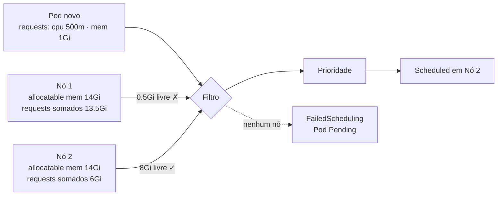

# 6.5 — Reservar capacidade de computação para aplicações

| Campo | Valor |
|-------|-------|
| Curso | DO180 — OpenShift 4.22 |
| Capítulo / seção | Capítulo 6 · Seção 6.5 |
| Título original | Reserving Compute Capacity for Applications |
| Título em português | Reservar capacidade de computação para aplicações |
| Objetivo | Configurar requests de recursos para que o Kubernetes tome decisões de agendamento |
| Pré-requisitos | [6.1](6.1-alta-disponibilidade-de-aplicacoes.md), [2.5](../02-cli-e-apis/2.5-avaliar-a-saude-do-cluster.md) (capacity × allocatable) |
| Referência | PDF p. 397–400 · Guided Exercise 6.6 p. 401–404 |

## Parte A — Entendendo o conceito

### Como o scheduler escolhe um nó

O scheduler do OpenShift decide em que nó cada Pod novo vai rodar, evitando disputa
por recursos. São três etapas:

| Etapa | O que acontece | Resultado |
|-------|----------------|-----------|
| **1. Filtrar** | Descarta nós que não atendem: **node selector** (labels do nó) e predicados, como ter **recursos livres suficientes para os requests** | Lista de nós elegíveis. Se ficar vazia: evento **`FailedScheduling`** e Pod em `Pending` até surgir um nó adequado |
| **2. Priorizar** | Dá uma pontuação ponderada a cada nó elegível | Nós mais adequados com nota maior |
| **3. Selecionar** | Escolhe a maior nota (empate: round-robin) | Evento **`Scheduled`** |

Personalizar o scheduler está fora do escopo do curso.

### Requests: a reserva mínima

Um **request** declara o **mínimo** de CPU e memória que **cada container** precisa.
O scheduler só coloca o Pod em um nó cujo **allocatable** ainda comporte a soma dos
requests.

| Recurso | Unidade | Exemplos |
|---------|---------|----------|
| **CPU** | Unidades de CPU; **millicores** (1 núcleo = `1000m`) | `100m` = `0.1` CPU; `1` = `1000m` |
| **Memória** | Bytes, com sufixos binários ou decimais | `512Mi`, `1Gi` (binário: 1024³) · `1G` (decimal: 1000³) |

Sem requests, o container mostra `resources: {}`.

⚠️ Os sufixos diferenciam maiúsculas: `Mi`/`Gi` são válidos; `mi`/`gi` **não**. E
`m` em memória significa **mili**byte, um erro clássico (`512m` de memória ≈ 0,5
byte!).

### Allocatable e reservas do sistema

```text
Allocatable = Capacidade do nó − system-reserved − limiares de despejo (hard eviction)
```

- O OpenShift **calcula automaticamente** reservas de CPU e memória para os
  componentes do nó (kubelet, kube-proxy) e do sistema (sshd, NetworkManager).
- Nós pequenos reservam percentual maior; nós grandes, menor. Ex.: em um nó de 16
  GiB, cerca de 1,5 GiB fica reservado.
- O curso apresenta a fórmula em faixas para memória: 1 GiB fixo para os primeiros
  8 GiB, 6% dos 120 GiB seguintes (até 128 GiB) e 2% acima de 128 GiB.
- A reserva de CPU é aplicada por **cgroups**: em disputa, os daemons do sistema
  recebem sua parte e os Pods o restante; sem disputa, o sistema pode usar CPU
  ociosa além da reserva.
- Quando a **soma dos requests** dos Pods de um nó atinge o allocatable, o
  scheduler **não coloca mais Pods** ali, **mesmo que o uso real seja baixo**.

### Request não é limite

O request serve para **agendar** e, em disputa de CPU, para dividir o processador
proporcionalmente. Ele **não impede** o container de usar mais. Quem restringe é o
**limit** (6.7).

## Parte B — Modelo mental



Analogia técnica: o request é como uma **reserva de capacidade** em um hipervisor
(*reservation*). O agendamento conta o reservado, não o consumido.

## Parte C — Funcionamento na prática

### Definir requests

```bash
oc set resources deployment/hello-world-nginx --requests cpu=100m,memory=1Gi
oc set resources deployment/hello-world-nginx --containers=web --requests memory=256Mi
oc get deployment hello-world-nginx -o jsonpath='{.spec.template.spec.containers[*].resources}{"\n"}'
```

- Funciona em qualquer recurso com template de Pod (Deployment, Job, StatefulSet...). Gera **novo rollout**.
- Com `oc edit`, cuidado com a indentação: erros impedem salvar.

Trecho de manifesto (original):

```yaml
spec:
  template:
    spec:
      containers:
        - name: web
          image: registry.access.redhat.com/ubi10/httpd-24
          resources:
            requests:
              cpu: 100m
              memory: 256Mi
```

### Ver capacidade, reservas e uso (administrador)

```bash
oc describe node master01        # Capacity, Allocatable, tabela por Pod e "Allocated resources"
oc adm top nodes                 # uso real dos nós
oc adm top node master01
oc adm top pods -n <PROJETO>     # uso real por Pod
```

Na seção **Allocated resources** de `oc describe node`:

| Coluna | Significado |
|--------|-------------|
| `Requests` (e %) | Soma dos requests dos Pods no nó, em relação ao allocatable: é o que limita novos agendamentos |
| `Limits` (e %) | Soma dos limits; pode passar de 100% (*overcommit*) |

### Diagnosticar falta de capacidade

```bash
oc get pods                                   # novas réplicas em Pending
oc describe pod <POD>                         # Events: FailedScheduling ... Insufficient memory
oc get events --field-selector reason=FailedScheduling
```

| Mensagem | Significado | Ação |
|----------|-------------|------|
| `0/1 nodes are available: 1 Insufficient memory` | Nenhum nó comporta o request de memória | Reduzir o request (se superestimado), reduzir réplicas ou adicionar capacidade |
| `Insufficient cpu` | Idem para CPU | Idem |
| `node(s) didn't match Pod's node affinity/selector` | Node selector sem nós correspondentes | Corrigir labels/seletor |

## Parte D — Relações importantes

| A | B | Diferença essencial |
|---|---|--------------------|
| Request | Limit | Mínimo para agendar × máximo permitido (6.7) |
| Request | Uso real | Reservado no agendamento × consumido agora (`oc adm top`) |
| Capacity | Allocatable | Total do nó × total menos reservas do sistema e de despejo |
| `FailedScheduling` | `Scheduled` | Nenhum nó elegível × nó escolhido |
| `100m` (CPU) | `100Mi` (memória) | 0,1 núcleo × 100 mebibytes |
| `Gi` | `G` | 1024³ × 1000³ bytes |
| `oc describe node` | `oc adm top node` | Requests/limits alocados × consumo atual |

## Parte E — Preparação para o laboratório

Atividade associada: **6.6 Guided Exercise — Reserving Compute Capacity for
Applications** (`reliability-requests`, PDF p. 401–404).

Você deve conseguir:

- Ver como requests de memória "ocupam" a memória alocável do nó.
- Prever, a partir do allocatable e dos requests, quantas réplicas cabem no nó.
- Ajustar requests e observar réplicas passando de `Pending` a `Running` (e vice-versa).

Ver [PRATICA-OFICIAL.md](PRATICA-OFICIAL.md#66-guided-exercise-reserving-compute-capacity-for-applications).

## Parte F — Fixação

1. Um nó tem 12 GiB alocáveis, e os Pods existentes somam 9 GiB de requests. Quantas réplicas de um Pod com request de 1 GiB ainda cabem?
2. O nó está com 20% de uso real de memória, mas um Pod novo fica `Pending` com `Insufficient memory`. Como isso é possível?
3. Qual o erro em `oc set resources deployment/x --requests memory=512m`?
4. Por que nós pequenos têm percentual maior de reserva do sistema?
5. Request de CPU impede o container de usar mais CPU?

<details>
<summary>Respostas comentadas</summary>

1. **Três** (12 − 9 = 3 GiB livres em requests), desconsiderando outros fatores.
2. O agendamento considera a **soma dos requests** em relação ao allocatable, não o uso real. Se os requests já ocupam quase tudo, não cabe mais nada.
3. `m` em memória significa milibyte; o correto é `512Mi`.
4. Os componentes do sistema precisam de uma quantidade base de recursos que, em nós pequenos, representa uma fração maior do total.
5. Não. Sem limit, o container usa a CPU livre do nó; o request só garante sua parte proporcional em caso de disputa.

</details>

## Parte G — Essencial para memorizar

- Scheduler: **filtrar** (selector, recursos) → **priorizar** → **selecionar**; sem nó: `FailedScheduling`.
- Request = mínimo reservado; o agendamento soma requests contra o **allocatable**.
- CPU em millicores (`1000m` = 1 núcleo); memória em `Mi`/`Gi` (maiúsculas!).
- Allocatable = capacidade − system-reserved − limiares de despejo; reservas automáticas.
- `oc set resources deployment/x --requests cpu=...,memory=...`.
- `oc describe node` (alocado) × `oc adm top` (uso real).

---
[← 6.3 Health probes](6.3-health-probes.md) | [Índice do capítulo](README.md) | [Próximo: 6.7 Limits →](6.7-limitar-capacidade-de-computacao.md)
