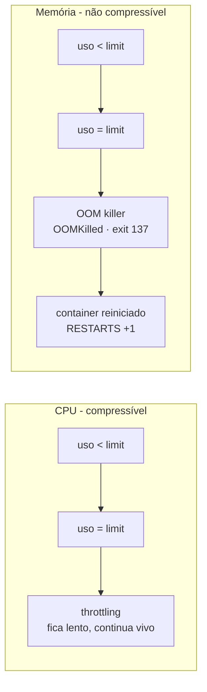

# 6.7 — Limitar a capacidade de computação das aplicações

| Campo | Valor |
|-------|-------|
| Curso | DO180 — OpenShift 4.22 |
| Capítulo / seção | Capítulo 6 · Seção 6.7 |
| Título original | Limit Compute Capacity for Applications |
| Título em português | Limitar a capacidade de computação das aplicações |
| Objetivo | Configurar limits de recursos para que o Kubernetes proteja as outras aplicações |
| Pré-requisitos | [6.5](6.5-reservar-capacidade-de-computacao.md), [F1](../../01-fundamentos-essenciais/01-containers-e-imagens.md) (cgroups) |
| Referência | PDF p. 405–411 · Guided Exercise 6.8 p. 412–414 |

## Parte A — Entendendo o conceito

### Por que limits

Requests ajudam a **escolher o nó**, mas **não restringem** o consumo: um container
com request de 1 GiB pode usar 5 GiB. A Red Hat recomenda definir os requests no
**pico de uso** da aplicação. Valores menores criam **overcommit**: se todos os
Pods de um nó passarem do request ao mesmo tempo, o nó fica sem memória ou CPU.

**Limits** definem o **máximo** que um container pode usar e protegem os vizinhos.

### Memória: recurso **não compressível**

- Memória não pode ser "tomada de volta" de um processo em execução.
- Ao atingir o limit, o kernel aciona o **OOM killer**, que escolhe e **mata um
  processo** do container.
- O OpenShift percebe a falha (processo principal ausente ou probes falhando) e
  **reinicia o container** conforme a `restartPolicy` (padrão `Always`).
- O status do container registra `lastState.terminated.reason: OOMKilled` e
  `exitCode: 137` (128 + 9, SIGKILL).

Quando usar: aplicações com padrão de memória que precisa ser contido, como
**vazamento de memória**. O limit impede que ela consuma o nó inteiro e faz o
OpenShift reiniciá-la periodicamente, liberando a memória.

### CPU: recurso **compressível**

- Ao atingir o limit, o container sofre **throttling**: fica mais lento, mas **não é
  morto**, mesmo que o nó tenha CPU sobrando.
- **Sem** limit, o container usa toda a CPU disponível. Em disputa, o kernel divide
  a CPU entre os containers **na proporção dos requests**.

Quando usar: quando você quer **comportamento consistente** entre nós e entre
clusters (dev × produção). Sem limit, a aplicação é rápida em um nó ocioso e lenta em
um nó disputado.

⚠️ Requests e limits não enxergam diferenças de **hardware**: 1 núcleo em uma CPU
mais lenta continua sendo 1 núcleo. Ajuste os valores para cada ambiente se o
hardware diferir.

### cgroups v2

- O OpenShift implementa limits com **cgroups v2**. **Desde o 4.19**, cgroups v1 foi
  **removido**: v2 é a única implementação suportada.
- Runtimes antigos podem não entender cgroups v2, ler errado os limites e consumir
  memória demais, gerando `OOMKilled`. Versões mínimas com suporte completo:
  **OpenJDK 8u372+**, **Node.js 22+**, **.NET 5+**. Atualizar a imagem base é a
  solução mais segura.

### Redimensionamento no local (*in-place pod resize*) — GA no 4.22

- Desde o OpenShift 4.22, é possível alterar requests e limits de CPU e memória de
  um container **sem recriar nem reiniciar o Pod**. Antes, mudar limits exigia
  recriar os Pods.
- A **`resizePolicy`** do container define, por recurso, `NotRequired` (aplica sem
  reiniciar) ou `RestartContainer` (reinicia o container ao mudar).
- Pela CLI: `oc edit` ou `oc patch` com **`--subresource resize`**.

## Parte B — Modelo mental



| | Request | Limit |
|--|---------|-------|
| Para que serve | Agendar e garantir parte em disputa | Teto de consumo |
| CPU acima do valor | Permitido, se houver CPU livre | Throttling |
| Memória acima do valor | Permitido, se houver memória livre | OOMKilled |
| Pode somar > 100% do nó? | Não (agendamento barra) | Sim (overcommit) |

📘 *Fonte externa — classes de QoS do Pod:* **Guaranteed** (requests = limits para
CPU e memória em todos os containers), **Burstable** (algum request ou limit
definido) e **BestEffort** (nada definido). Sob pressão de memória no nó, Pods
BestEffort e Burstable que excedem seus requests são os primeiros despejados.

## Parte C — Funcionamento na prática

### Definir limits (e requests)

```bash
oc set resources deployment/hello --limits memory=1Gi
oc set resources deployment/hello --limits cpu=200m
oc set resources deployment/hello --requests cpu=100m,memory=500Mi --limits cpu=200m,memory=1Gi
oc describe deployment hello | grep -A4 -E 'Limits|Requests'
```

Trecho de manifesto (original):

```yaml
      containers:
        - name: hello
          image: registry.access.redhat.com/ubi9/nginx-124
          resources:
            requests:
              cpu: 100m
              memory: 500Mi
            limits:
              cpu: 200m
              memory: 1Gi
          resizePolicy:                    # 📘 comportamento no in-place resize
            - resourceName: cpu
              restartPolicy: NotRequired
            - resourceName: memory
              restartPolicy: RestartContainer
```

**Console:** selecione o Deployment › **Actions › Edit resource limits**.

### Identificar OOMKilled

```bash
oc get pods                                  # RESTARTS > 0
oc describe pod <POD> | grep -A5 'Last State'   # Reason: OOMKilled, Exit Code: 137
oc get pod <POD> -o jsonpath='{.status.containerStatuses[0].lastState.terminated.reason}{"\n"}'
oc adm top pods                              # uso real se aproximando do limit
```

### Redimensionar no local (4.22)

```bash
oc patch pod <POD> --subresource resize --type merge -p \
  '{"spec":{"containers":[{"name":"hello","resources":{"limits":{"cpu":"400m"},"requests":{"cpu":"200m"}}}]}}'
oc get pod <POD> -o jsonpath='{.status.containerStatuses[0].resources}{"\n"}'   # 📘 valores aplicados
oc get pod <POD>                              # mesmo Pod; RESTARTS não sobe para CPU com NotRequired
```

⚠️ O resize altera o **Pod**, não o Deployment. Uma nova réplica ou rollout volta aos
valores do template. Para tornar a mudança permanente, altere também o Deployment.

### Ver requests, limits e uso (administrador)

```bash
oc describe node master01       # por Pod: CPU/Memory Requests e Limits (0 = não definido); totais
oc adm top nodes
oc adm top pods -n <PROJETO>
```

**Console:** Deployment › aba **Metrics** (memória, CPU, sistema de arquivos, rede).

## Parte D — Relações importantes

| A | B | Diferença essencial |
|---|---|--------------------|
| Limit de CPU | Limit de memória | Throttling (lento) × OOMKilled (morto e reiniciado) |
| Request | Limit | Agendamento × teto |
| Overcommit | Requests no pico | Mais densidade, risco de falta × previsibilidade |
| cgroups v1 | cgroups v2 | Removido desde 4.19 × única opção |
| Resize no local | Mudar o Deployment | Pod atual, sem recriar × todos os Pods futuros (rollout) |
| `NotRequired` | `RestartContainer` | Aplica ao vivo × reinicia o container |
| `OOMKilled` | `CrashLoopBackOff` | Motivo do término × estado após reinícios repetidos |
| `oc describe node` | `oc adm top` | Reservado/limitado × consumido |

## Parte E — Preparação para o laboratório

Atividade associada: **6.8 Guided Exercise — Limit Compute Capacity for
Applications** (`reliability-limits`, PDF p. 412–414).

Você deve conseguir:

- Monitorar o uso de memória de uma aplicação.
- Definir um limit de memória e observar o efeito quando ela o ultrapassa.
- Reconhecer `OOMKilled` e o reinício automático.

Ver [PRATICA-OFICIAL.md](PRATICA-OFICIAL.md#68-guided-exercise-limit-compute-capacity-for-applications).

## Parte F — Fixação

1. Um container com limit de CPU de `500m` usa 100% disso. O nó tem CPU ociosa. O container acelera?
2. Um Pod reinicia a cada poucas horas, e `lastState` mostra `OOMKilled`. Cite duas hipóteses.
3. Uma imagem Java antiga sofre `OOMKilled` no 4.22, mas não sofria em um cluster antigo. Por quê?
4. Você aumentou a memória de um Pod com `--subresource resize`. Depois de um rollout, o valor voltou ao antigo. Por quê?
5. Por que a soma dos limits de um nó pode passar de 100%, mas a dos requests não?

<details>
<summary>Respostas comentadas</summary>

1. Não. Com o limit atingido, há throttling mesmo com CPU livre.
2. Vazamento de memória na aplicação (o limit está fazendo seu papel), ou limit pequeno demais para o uso normal. Compare com `oc adm top pods` e o histórico de métricas.
3. Runtimes antigos não entendem cgroups v2 (única opção desde o 4.19) e calculam errado a memória disponível. Atualize para uma versão com suporte (ex.: OpenJDK 8u372+).
4. O resize mudou só aquele Pod; o rollout cria Pods a partir do template do Deployment. Altere o Deployment (`oc set resources`).
5. O scheduler só agenda se a soma dos **requests** couber no allocatable. Limits não são considerados no agendamento: é o **overcommit**.

</details>

## Parte G — Essencial para memorizar

- Request ≠ limit; requests no pico evitam overcommit arriscado.
- Memória acima do limit → **OOMKilled** (exit 137) → reinício. CPU acima do limit → **throttling**.
- Memory limit para vazamentos; CPU limit para comportamento consistente.
- cgroups v2 apenas (desde 4.19); runtimes mínimos: OpenJDK 8u372+, Node.js 22+, .NET 5+.
- `oc set resources deployment/x --limits cpu=...,memory=...` · Console: *Edit resource limits*.
- 4.22: **in-place pod resize** GA (`--subresource resize`, `resizePolicy`).

---
[← 6.5 Requests](6.5-reservar-capacidade-de-computacao.md) | [Índice do capítulo](README.md) | [Próximo: 6.9 Autoscaling →](6.9-autoscaling-de-aplicacoes.md)
