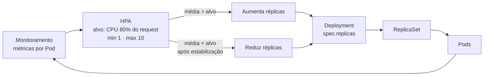

# 6.9 — Autoscaling de aplicações

| Campo | Valor |
|-------|-------|
| Curso | DO180 — OpenShift 4.22 |
| Capítulo / seção | Capítulo 6 · Seção 6.9 |
| Título original | Application Autoscaling |
| Título em português | Autoscaling de aplicações |
| Objetivo | Configurar um Horizontal Pod Autoscaler para uma aplicação |
| Pré-requisitos | [6.5](6.5-reservar-capacidade-de-computacao.md), [6.7](6.7-limitar-capacidade-de-computacao.md), [4.7](../04-deploy-e-redes/4.7-escalar-e-expor-aplicacoes.md) (`oc scale`) |
| Referência | PDF p. 415–419 · Guided Exercise 6.10 p. 420–425 |

## Parte A — Entendendo o conceito

### Por que autoscaling

A carga de produção varia muito. Escalar manualmente é ineficiente e sujeito a
erro. O **Horizontal Pod Autoscaler (HPA)** ajusta automaticamente o número de
réplicas de um Deployment, ReplicaSet, StatefulSet ou ReplicationController com base
em métricas como uso de CPU.

| Benefício | Como |
|-----------|------|
| Disponibilidade e desempenho | Adiciona Pods em picos, mantendo os objetivos de nível de serviço |
| Custo | Remove Pods em baixa e libera recursos para outros workloads |
| Eficiência operacional | Dispensa intervenção manual e reduz erro humano |

### Como o HPA decide

O HPA é um **laço de controle** dentro do **kube-controller-manager** e usa as
métricas coletadas pela pilha de monitoramento (pré-instalada). A cada ciclo
(📘 *fonte externa:* a cada 15 segundos por padrão):

1. Lê a métrica-alvo do recurso HPA.
2. Coleta o valor atual da métrica de **cada Pod** alvo (*metrics server*).
3. Calcula o **percentual de uso de cada Pod em relação ao seu request**.
4. Calcula a **média** entre os Pods.
5. Compara a média com o alvo (razão).
6. Usa a razão para **aumentar ou diminuir** as réplicas, dentro de `min` e `max`.

📘 *Fonte externa:* `réplicas desejadas = ⌈réplicas atuais × (média atual ÷ alvo)⌉`.
Exemplo: 2 réplicas a 160% com alvo de 80% → ⌈2 × 2⌉ = 4. Para reduzir, o HPA
espera uma janela de estabilização (padrão de 5 minutos), evitando oscilação.

### Pré-requisito: requests

O uso é calculado **em relação ao request**. Sem request para a métrica usada, o
HPA **não consegue calcular** e mostra `<unknown>`.

⚠️ Deployments criados com `oc create deployment` **não** têm requests. Adicione com
`oc set resources`, no YAML, ou com um **LimitRange** no projeto, que define
requests padrão para os Pods.

### Mínimo e máximo

- **Mínimo**: réplicas de reserva para absorver picos súbitos.
- **Máximo**: protege o cluster; réplicas demais podem consumir a capacidade e
  afetar outras aplicações.

### CPU × memória

- Escala por **memória** é possível (`name: memory`), mas **não serve para todas as
  aplicações**. Aplicações JVM, por exemplo, reservam muita memória no início e não
  a devolvem. Se o uso de memória não acompanha a carga, o HPA por memória não é
  eficaz.

### Vertical Pod Autoscaler (VPA)

O **VPA** complementa o HPA escalando **verticalmente**: ajusta requests e limits de
CPU e memória de cada Pod em vez de mudar o número de réplicas. **Desde o 4.21**, o
modo de atualização **`InPlaceOrRecreate`** usa o *in-place pod resize* (6.7):
ajusta sem reiniciar quando o nó comporta; caso contrário, recria o Pod em um nó com
recursos suficientes. 📘 *Fonte externa:* no OpenShift o VPA é instalado por um
Operator.

## Parte B — Modelo mental



| Autoscaler | Muda | Bom para |
|------------|------|----------|
| HPA | **Quantidade** de Pods | Aplicações stateless que escalam horizontalmente |
| VPA | **Tamanho** de cada Pod | Aplicações que não escalam bem horizontalmente ou com requests mal dimensionados |

## Parte C — Funcionamento na prática

### Criar o HPA pela CLI

```bash
oc set resources deployment/hello --requests cpu=100m,memory=128Mi   # pré-requisito
oc autoscale deployment/hello --min 1 --max 10 --cpu 80%
```

- **Recurso criado:** `horizontalpodautoscaler.autoscaling/hello` (mesmo nome do alvo).
- Mantém entre 1 e 10 réplicas para que a CPU média fique **em ou abaixo de 80% do request**.
- 📘 *Fonte externa:* em versões anteriores do `oc`/`kubectl`, a opção equivalente era `--cpu-percent=80`.

### Criar por YAML (infraestrutura como código)

```yaml
apiVersion: autoscaling/v2
kind: HorizontalPodAutoscaler
metadata:
  name: hello
spec:
  scaleTargetRef:                # quem o HPA escala
    apiVersion: apps/v1
    kind: Deployment
    name: hello
  minReplicas: 1
  maxReplicas: 10
  metrics:
    - type: Resource
      resource:
        name: cpu                # ou memory
        target:
          type: Utilization      # percentual do request
          averageUtilization: 80
```

```bash
oc apply -f hello-hpa.yaml
oc explain hpa.spec.metrics.resource.target     # tipos: Utilization, AverageValue, Value
```

Variante por memória: troque `name: cpu` por `name: memory` (avaliando se a
aplicação libera memória quando a carga cai).

### Pela console

*Workloads › Deployments › deployment › Actions › Add HorizontalPodAutoscaler*
(formulário ou YAML).

### Acompanhar e diagnosticar

```bash
oc get hpa                       # TARGETS cpu: 35%/80%, MINPODS, MAXPODS, REPLICAS
watch oc get hpa hello           # acompanhar um teste de carga
oc describe hpa hello            # métricas atuais e eventos SuccessfulRescale (New size: N)
oc get deployment hello -w
```

| Sintoma | Causa provável |
|---------|----------------|
| `TARGETS <unknown>/80%` nos primeiros minutos | Normal: pode levar até ~5 minutos para aparecer |
| `<unknown>` persistente | Falta de **request** para a métrica no Deployment |
| Não passa de N réplicas | `maxReplicas` atingido, ou Pods novos em `Pending` por falta de capacidade (6.5) |
| Não reduz logo após a carga cair | Janela de estabilização de redução |
| `oc scale` manual "desfeito" | O HPA controla as réplicas e reaplica o valor calculado |

## Parte D — Relações importantes

| A | B | Diferença essencial |
|---|---|--------------------|
| `oc scale` | HPA | Réplicas fixas, manual × réplicas automáticas entre min e max |
| HPA | VPA | Mais/menos Pods × Pods maiores/menores |
| `Utilization` | `AverageValue` | Percentual do request × valor absoluto médio (ex.: `500Mi`) |
| CPU | Memória como métrica | Acompanha bem a carga × nem sempre (JVM) |
| Request | HPA | Base do cálculo × sem request não funciona |
| `minReplicas` | `maxReplicas` | Folga para picos × proteção do cluster |
| `oc autoscale` | YAML `autoscaling/v2` | Rápido, só CPU × completo e versionável |

## Parte E — Preparação para o laboratório

Atividade associada: **6.10 Guided Exercise — Application Autoscaling**
(`reliability-autoscaling`, PDF p. 420–425).

Você deve conseguir:

- Implantar uma aplicação e escalá-la manualmente.
- Configurar requests de recursos.
- Criar um HPA e observar a escala durante um teste de carga.

Ver [PRATICA-OFICIAL.md](PRATICA-OFICIAL.md#610-guided-exercise-application-autoscaling).

## Parte F — Fixação

1. O HPA mostra `<unknown>/80%` há 20 minutos. Qual a causa mais provável e a correção?
2. Três réplicas com uso médio de 120% do request de CPU; alvo 60%; máximo 10. Quantas réplicas o HPA vai pedir?
3. Por que um HPA por memória pode não reduzir réplicas em uma aplicação Java depois do pico?
4. Qual a diferença entre o HPA e o VPA no modo `InPlaceOrRecreate`?
5. Escreva o comando que cria um HPA para o Deployment `api`, entre 2 e 6 réplicas, alvo de 70% de CPU.

<details>
<summary>Respostas comentadas</summary>

1. O Deployment não tem **request** de CPU. Adicione com `oc set resources deployment/<d> --requests cpu=...`.
2. ⌈3 × (120 ÷ 60)⌉ = **6** réplicas (dentro do máximo de 10).
3. A JVM tende a não devolver memória ao sistema; o uso continua alto mesmo sem carga, e o HPA não vê motivo para reduzir.
4. O HPA muda o **número** de réplicas; o VPA muda requests e limits de **cada** Pod, no local quando possível, recriando o Pod quando o nó não comporta.
5. `oc autoscale deployment/api --min 2 --max 6 --cpu 70%`

</details>

## Parte G — Essencial para memorizar

- HPA = laço no controller manager; métricas da pilha de monitoramento; uso relativo ao **request**.
- Sem request → `<unknown>`; até ~5 min de `<unknown>` inicial é normal.
- `oc autoscale deployment/<d> --min N --max M --cpu P%` · YAML `autoscaling/v2` (`scaleTargetRef`, `metrics`, `averageUtilization`).
- `oc get hpa` · `oc describe hpa` (eventos `SuccessfulRescale`).
- Memória como métrica: cuidado com JVM.
- VPA ajusta o tamanho dos Pods; `InPlaceOrRecreate` desde 4.21.

---
[← 6.7 Limits](6.7-limitar-capacidade-de-computacao.md) | [Índice do capítulo](README.md) | [Próximo: Prática oficial →](PRATICA-OFICIAL.md)
