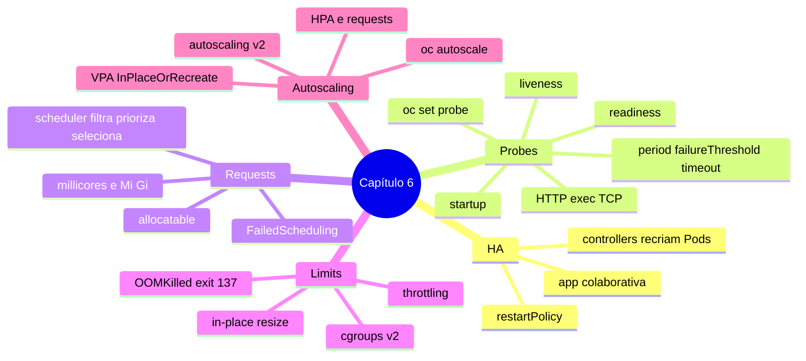

# Resumo — Capítulo 6

Síntese autoral para revisão rápida. Correspondência oficial: seção 6.13 (PDF p. 436).

## Em uma frase por seção

| Seção | Ideia central |
|-------|---------------|
| 6.1 | HA combina reinício de containers, recriação de Pods por controllers, probes e escala; a aplicação precisa colaborar |
| 6.3 | Startup protege inicializações lentas, readiness controla o tráfego e liveness reinicia o que travou; testes HTTP, exec ou TCP |
| 6.5 | Requests são a reserva mínima usada pelo scheduler contra o allocatable do nó; sem nó elegível, `FailedScheduling` |
| 6.7 | Limits são o teto: memória excedida = `OOMKilled`, CPU excedida = throttling; cgroups v2; in-place resize GA no 4.22 |
| 6.9 | O HPA ajusta réplicas pelo uso médio relativo ao request; o VPA ajusta o tamanho dos Pods |

## Mapa do capítulo

## Tabela de comandos do capítulo

| Tarefa | Comando |
|--------|---------|
| Probe HTTP | `oc set probe deployment/<d> --readiness\|--liveness\|--startup --get-url http://:
/<caminho>` |
| Probe TCP / comando | `--open-tcp 
` · `-- <cmd>` |
| Tempos | `--initial-delay-seconds` · `--period-seconds` · `--timeout-seconds` · `--failure-threshold` |
| Remover probe | `oc set probe deployment/<d> --liveness --remove` |
| Requests e limits | `oc set resources deployment/<d> --requests cpu=..,memory=.. --limits cpu=..,memory=..` |
| Capacidade do nó | `oc describe node <n>` (Capacity, Allocatable, Allocated resources) |
| Uso real | `oc adm top nodes` · `oc adm top pods -n 
` |
| Por que não agendou | `oc describe pod 
` (`FailedScheduling`) |
| OOM | `oc describe pod 
` (Last State `OOMKilled`, exit 137) |
| Resize no local | `oc patch pod 
 --subresource resize --type merge -p '{...}'` |
| HPA rápido | `oc autoscale deployment/<d> --min N --max M --cpu P%` |
| HPA declarativo | `oc apply -f hpa.yaml` (`autoscaling/v2`) · `oc explain hpa.spec.metrics.resource.target` |
| Estado do HPA | `oc get hpa` · `oc describe hpa <h>` |

## Alertas operacionais

- ⚠️ HA do cluster não corrige bugs da aplicação.
- ⚠️ Liveness sem startup em aplicação lenta = reinício em loop.
- ⚠️ Endpoints de saúde devem ser leves.
- ⚠️ `Mi`/`Gi` (maiúsculas); `m` em memória é milibyte.
- ⚠️ Requests baixos demais = overcommit; altos demais = Pods `Pending`.
- ⚠️ Resize no local muda só o Pod; atualize o Deployment para persistir.
- ⚠️ HPA sem requests = `<unknown>`; HPA por memória não serve para toda aplicação.

## Ligação com o próximo capítulo

Com aplicações confiáveis, falta **atualizá-las com segurança**: o Capítulo 7 trata
de identidade de imagens e tags, atualização de imagem e configuração em
Deployments, **ImageStreams** e **triggers** de mudança de imagem.

---
[← Revisão](REVISAO.md) | [Índice do capítulo](README.md) | [Próximo capítulo →](../07-atualizacao-aplicacoes/README.md)
