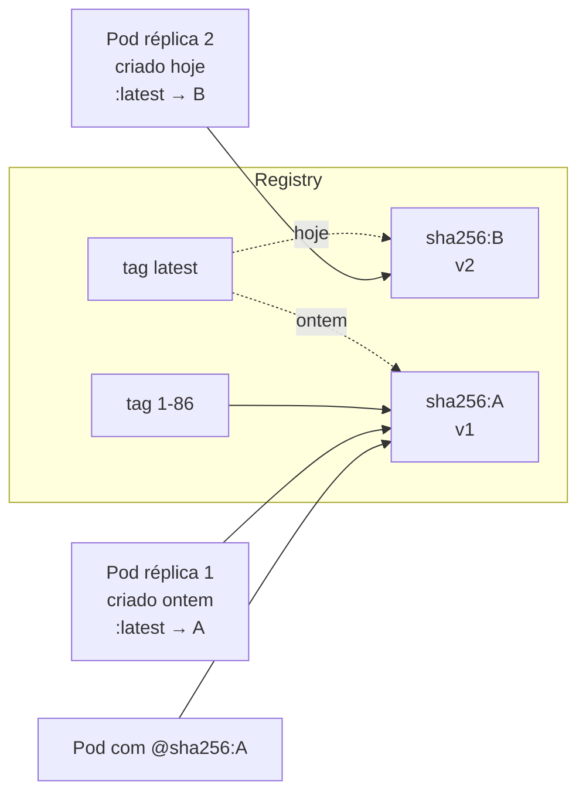

# 7.1 — Identidade e tags de imagens de container

| Campo | Valor |
|-------|-------|
| Curso | DO180 — OpenShift 4.22 |
| Capítulo / seção | Capítulo 7 · Seção 7.1 |
| Título original | Container Image Identity and Tags |
| Título em português | Identidade e tags de imagens de container |
| Objetivo | Relacionar tags de imagens aos seus hashes e identificar as imagens de Pods e containers nos nós |
| Pré-requisitos | [3.3](../03-containers-e-pods/3.3-encontrar-e-inspecionar-imagens.md), [3.1](../03-containers-e-pods/3.1-criar-containers-e-pods.md) (`crictl`) |
| Referência | PDF p. 438–444 · Guided Exercise 7.2 p. 445–452 |

## Parte A — Entendendo o conceito

### Anatomia do nome

```text
registry.redhat.io / rhel9 / nginx-124 : 9.8
└── registry ─────┘ └ namespace ┘└ nome ┘ └ tag ┘
registry.redhat.io/rhel9/nginx-124@sha256:b147...87fc
                                  └── SHA image ID (digest) ──┘
```

- O nome da imagem pode incluir a versão do software (`nginx-124` = Nginx 1.24).
- **Várias tags podem apontar para a mesma imagem** (ex.: `9.8`, `1` e `latest`).
- Sem tag, a maioria das ferramentas usa `latest`.
- Dividir o nome em "registry/namespace/nome" é uma **convenção**, não uma estrutura técnica.

### O problema das tags flutuantes

Tags **flutuantes** (`latest`, `1`) são **reatribuídas** pelo publicador a cada nova
versão, sem aviso. Isso garante "o mais recente", mas tira o controle de quem
consome:

| Cenário | O que acontece com `:latest` |
|---------|------------------------------|
| Pod reagendado em **outro nó** (falha do nó original) | O nó novo baixa o `latest` atual: a aplicação muda de versão **sem você saber** |
| **Escala** para mais réplicas | Pods novos podem receber a versão nova e os antigos ficam com a anterior: **versões misturadas**, comportamento inconsistente |
| **Rollback** | A tag antiga pode apontar para outra imagem: você "volta" para algo que nunca rodou |

A diferença entre tag fixa e flutuante é **convenção**: nada impede alguém de
enviar outra imagem para uma tag "fixa". Para garantia **absoluta**, use o
**SHA image ID**.

| Opção | Controle | Observação |
|-------|----------|-----------|
| Tag flutuante (`latest`, `1`) | ❌ Baixo | Recebe atualizações automaticamente, sem controle |
| Tag "fixa" (`9.8-1784...`) | 🟡 Por convenção | Geralmente estável |
| **Digest** (`@sha256:...`) | ✅ Total | Imutável, calculado pelo registry |
| **ImageStream** (7.5) | ✅ Total + histórico | Recurso do OpenShift; facilita rollback e promoção |

### Descobrir o digest

- `oc image info <imagem>`: mostra o `Digest`. Imagens **multiarquitetura** têm um
  **índice** (*manifest list*) com uma imagem por plataforma; é preciso escolher com
  `--filter-by-os` (ex.: `linux/amd64`).
- `skopeo inspect docker://<imagem>`: mesma informação, em outro formato.
- No nó: `crictl images --digests --no-trunc` (`--digests` mostra o digest e
  `--no-trunc` o mostra inteiro). A coluna **IMAGE ID** é um identificador **local**
  do runtime, **não** o digest.

⚠️ A imagem usa hashes SHA-256 para várias partes (camadas, metadados). Garanta que
está usando o hash do **digest da imagem**, normalmente chamado de *image digest*.

### `imagePullPolicy`

| Política | Comportamento | Padrão quando... |
|----------|---------------|------------------|
| **`IfNotPresent`** | Usa a imagem local se já existir no nó; senão, baixa. Com tag flutuante já presente, **não** busca a versão nova | A imagem usa uma tag (exceto `latest`) ou um digest |
| **`Always`** | Sempre consulta o registry pelo digest atual da tag; baixa só se o digest mudou | A tag é `latest` ou não há tag |
| **`Never`** | Nunca baixa; a imagem já deve estar no nó, senão falha | — (uso: nós pré-carregados, independência do registry) |

### Limpeza de imagens nos nós

- Apagar um Pod **não** apaga a imagem do nó, que é reaproveitada.
- O **garbage collector do kubelet** roda a cada **5 minutos**: se o sistema de
  arquivos de imagens passar de **85%**, remove as imagens não usadas mais antigas
  até ficar **abaixo de 80%**. Os limiares são ajustáveis pelo recurso **`KubeletConfig`**.
- `crictl imagefsinfo` mostra o sistema de arquivos de imagens (ex.:
  `/var/lib/containers/storage/overlay-images`) e o uso.
- `crictl rmi` remove imagens manualmente, mas **pode interferir** no garbage
  collector e no kubelet. Prefira o mecanismo automático.

## Parte B — Modelo mental



Analogia técnica: a tag é um **ponteiro DNS** que o dono pode mudar; o digest é o
**hash do arquivo**. Para saber exatamente o que roda, compare digests.

## Parte C — Funcionamento na prática

### Obter o digest de uma tag

```bash
oc image info registry.redhat.io/rhel9/nginx-124:9.8
#   erro: manifest list ... use --filter-by-os
oc image info --filter-by-os linux/amd64 registry.redhat.io/rhel9/nginx-124:9.8
skopeo inspect docker://registry.redhat.io/rhel9/nginx-124:9.8 | jq -r .Digest
```

### Ver que imagem um Pod realmente usa

```bash
oc get pod <POD> -o jsonpath='{.spec.containers[*].image}{"\n"}'               # o que foi pedido
oc get pod <POD> -o jsonpath='{.status.containerStatuses[*].imageID}{"\n"}'    # o digest em execução
oc get pods -o custom-columns=POD:.metadata.name,IMAGEM:.status.containerStatuses[0].imageID
```

Compare o `imageID` entre réplicas: valores diferentes indicam **versões misturadas**.

### Fixar a versão por digest ou tag fixa

```bash
oc set image deployment/web nginx-124=registry.redhat.io/rhel9/nginx-124@sha256:<DIGEST>
oc set image deployment/web nginx-124=registry.redhat.io/rhel9/nginx-124:9.8-<BUILD>
oc get deployment web -o jsonpath='{.spec.template.spec.containers[0].imagePullPolicy}{"\n"}'
```

- O formato é `<nome-do-container>=<imagem>`. Veja os nomes dos containers com `oc get deployment web -o wide`.
- **Recurso modificado:** template do Deployment → novo ReplicaSet → rollout (7.3).

### No nó (administrador)

```bash
oc debug node/<NO>
chroot /host
crictl images --digests --no-trunc registry.redhat.io/rhel9/nginx-124
crictl imagefsinfo
exit; exit
```

## Parte D — Relações importantes

| A | B | Diferença essencial |
|---|---|--------------------|
| Tag flutuante | Tag fixa | Reatribuída a cada versão × estável por convenção |
| Tag | Digest | Rótulo mutável × hash imutável calculado pelo registry |
| Digest | IMAGE ID do `crictl` | Identidade da imagem no registry × identificador local do runtime |
| Manifest list | Manifesto de imagem | Índice multiarquitetura × imagem de uma plataforma |
| `IfNotPresent` | `Always` | Usa a local se existir × consulta o registry a cada início |
| `Never` | `IfNotPresent` | Nunca baixa × baixa se faltar |
| Garbage collector | `crictl rmi` | Automático e coordenado × manual, pode conflitar |
| `.spec...image` | `.status...imageID` | Pedido × efetivamente em execução |

## Parte E — Preparação para o laboratório

Atividade associada: **7.2 Guided Exercise — Container Image Identity and Tags**
(`updates-ids`, PDF p. 445–452).

Você deve conseguir:

- Inspecionar imagens e obter digests (`oc image info`, `skopeo`).
- Listar as imagens presentes no nó com digests completos.
- Atualizar um Deployment para uma tag nova ou para um digest, e comparar os hashes antigo e novo.

Ver [PRATICA-OFICIAL.md](PRATICA-OFICIAL.md#72-guided-exercise-container-image-identity-and-tags).

## Parte F — Fixação

1. Um Deployment com `:latest` e `IfNotPresent` explícito escala para 5 réplicas em nós diferentes. Por que podem surgir versões diferentes?
2. `oc image info` responde que a imagem é uma *manifest list*. O que fazer?
3. Qual a diferença entre a coluna `IMAGE ID` do `crictl images` e o digest?
4. Qual a política de pull padrão para `registry.access.redhat.com/ubi10/httpd-24` (sem tag)?
5. Por que não é recomendado limpar imagens com `crictl rmi`?

<details>
<summary>Respostas comentadas</summary>

1. Nós que já têm uma imagem `latest` antiga usam a local (`IfNotPresent`); nós sem a imagem baixam o `latest` atual, que pode ser outra versão.
2. Escolher a plataforma com `--filter-by-os` (ex.: `linux/amd64`).
3. O IMAGE ID é um identificador local atribuído pelo runtime; o digest é o hash SHA-256 calculado pelo registry, que identifica a imagem em qualquer lugar.
4. `Always`: sem tag equivale a `latest`.
5. Pode interferir no garbage collector e no kubelet. O recomendado é deixar o garbage collector agir, ajustando seus limiares via `KubeletConfig`.

</details>

## Parte G — Essencial para memorizar

- Tags flutuantes mudam sem aviso: risco em reagendamento, escala e rollback.
- Fixo de verdade = **digest** (`@sha256:...`) ou **ImageStream**.
- `oc image info [--filter-by-os linux/amd64]` · `skopeo inspect` · `crictl images --digests --no-trunc`.
- `imagePullPolicy`: `IfNotPresent` (padrão com tag/digest), `Always` (padrão com `latest`/sem tag), `Never`.
- Garbage collector: a cada 5 min, 85% → 80%; ajustável por `KubeletConfig`.
- `.status.containerStatuses[].imageID` mostra o digest em execução.

---
[← Capítulo 7 (índice)](README.md) | [Índice do capítulo](README.md) | [Próximo: 7.3 Atualizar imagem e configurações →](7.3-atualizar-imagem-e-configuracoes.md)
