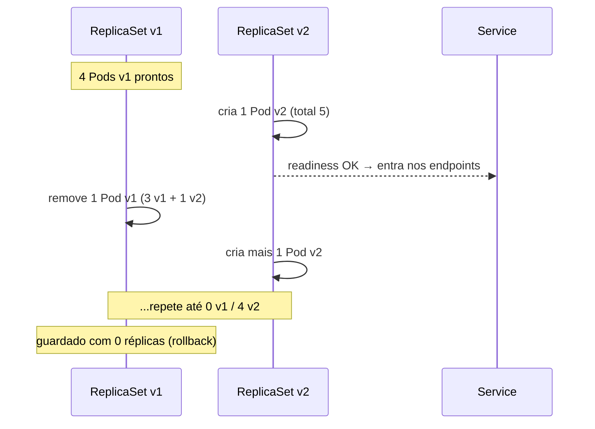
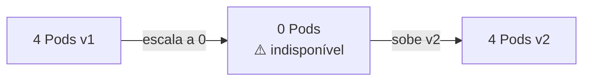

# 7.3 — Atualizar a imagem e as configurações da aplicação

| Campo | Valor |
|-------|-------|
| Curso | DO180 — OpenShift 4.22 |
| Capítulo / seção | Capítulo 7 · Seção 7.3 |
| Título original | Update Application Image and Settings |
| Título em português | Atualizar a imagem e as configurações da aplicação |
| Objetivo | Atualizar aplicações com o mínimo de indisponibilidade usando estratégias de implantação |
| Pré-requisitos | [7.1](7.1-identidade-e-tags-de-imagens.md), [6.3](../06-confiabilidade/6.3-health-probes.md), [4.3](../04-deploy-e-redes/4.3-workloads-de-longa-e-curta-duracao.md) |
| Referência | PDF p. 453–460 · Guided Exercise 7.4 p. 461–466 |

## Parte A — Entendendo o conceito

### Código, configuração e dados

Aplicações modernas desacoplam:

| Parte | Onde vive | Como se atualiza |
|-------|-----------|------------------|
| **Código** | Imagem de container | Nova imagem (geralmente gerada por um pipeline CI/CD) |
| **Configuração** | ConfigMaps e Secrets (Cap. 5) | Novos valores |
| **Dados** | Volumes (Cap. 5) | Pela aplicação |

O processo de levar uma nova versão ao ar é controlado pelo **Deployment**.

### Estratégias de implantação

Mudanças trazem riscos: indisponibilidade, bugs, queda de desempenho. Uma
**estratégia** define como trocar a versão minimizando o impacto. Ela é definida em
`.spec.strategy.type`.

| | **RollingUpdate** (padrão) | **Recreate** |
|--|----------------------------|--------------|
| Como funciona | Substitui instâncias aos poucos; a versão antiga só diminui quando a nova está **pronta** | Para **todas** as instâncias antigas e só então sobe as novas |
| Indisponibilidade | **Nenhuma** (com readiness configurada) | **Sim**, entre parar e subir |
| Versões simultâneas | Sim: v1 e v2 atendem juntas | Nunca |
| Requisito | Versões **compatíveis** entre si | — |
| Quando usar | Entrega contínua, alta disponibilidade | Versões que não podem coexistir; migração/transformação de dados antes do novo código |
| Evitar | Versões incompatíveis | Sistemas que exigem HA (ex.: sistemas médicos) |

Parâmetros da `RollingUpdate` (número de Pods ou percentual):

| Parâmetro | Significado | Padrão 📘 |
|-----------|-------------|-----------|
| `maxSurge` | Quantos Pods **acima** de `replicas` podem existir durante a troca | 25% |
| `maxUnavailable` | Quantos Pods **abaixo** de `replicas` podem estar indisponíveis | 25% |

⚠️ **Sem readiness probe**, o OpenShift manda tráfego para os Pods novos assim que
estão `Running`, antes de a aplicação estar pronta, e as requisições falham. A
readiness (6.3) é o que torna o RollingUpdate realmente sem indisponibilidade.

Outros campos do Deployment relacionados: `revisionHistoryLimit` (quantos ReplicaSets
antigos manter, padrão 10) e `progressDeadlineSeconds` (prazo para o rollout
progredir, padrão 600).

### Rollouts e ReplicaSets

- **Toda** mudança no template de Pod do Deployment dispara um **rollout**.
- O Deployment **não altera** o ReplicaSet existente: cria **outro** ReplicaSet com o
  novo template (sufixo `pod-template-hash`) e faz a troca conforme a estratégia.
- Durante a troca, dois ReplicaSets estão ativos: o antigo diminuindo e o novo
  crescendo.
- Ao final, o ReplicaSet antigo fica com 0 réplicas, guardado para **rollback**.
- ⚠️ Não altere nem apague ReplicaSets diretamente. Apagar o Deployment apaga todos.

### Várias mudanças, um rollout

Cada `oc set image`, `oc set env`, `oc set probe`... gera **um rollout**. Para
agrupar mudanças:

1. `oc rollout pause` (desativa o trigger de configuração);
2. aplique todas as mudanças;
3. `oc rollout resume`, que faz um único rollout.

Alternativa ao criar: `oc create deployment ... --replicas 0`, configurar tudo e
depois `oc scale`.

### Rollback

- `oc rollout undo` volta para a revisão anterior, reutilizando o ReplicaSet guardado
  e revertendo o template do Deployment.
- ⚠️ Se o rollout **falhar** (imagem errada, readiness falhando), o OpenShift **não**
  reverte sozinho. Você executa o `undo`.
- `--to-revision N` volta para uma revisão específica (veja `oc rollout history`).
- A coluna `CHANGE-CAUSE` vem da anotação `kubernetes.io/change-cause`, que você
  pode definir após cada mudança.
- ⚠️ Com **tags flutuantes**, o rollback pode baixar uma imagem diferente da original
  (7.1). Use digests ou **ImageStreams** (7.5).

## Parte B — Modelo mental

RollingUpdate com 4 réplicas, `maxSurge: 1` e `maxUnavailable: 0`:



Recreate:



## Parte C — Funcionamento na prática

### Escolher a estratégia

```yaml
spec:
  replicas: 10
  revisionHistoryLimit: 10
  progressDeadlineSeconds: 600
  strategy:
    type: RollingUpdate
    rollingUpdate:
      maxSurge: 25%
      maxUnavailable: 50%
```

```bash
oc patch deployment/web -p '{"spec":{"strategy":{"type":"Recreate","rollingUpdate":null}}}'
```

> Ao mudar para `Recreate`, o bloco `rollingUpdate` precisa ser removido (`null`).

### Atualizar imagem e configurações

```bash
oc set image deployment/web nginx-120=registry.access.redhat.com/ubi9/nginx-120:1-86
oc set env deployment/web NGINX_LOG_TO_VOLUME=1
oc set probe deployment/web --readiness --get-url http://:8080
oc rollout status deployment/web           # acompanha até "successfully rolled out"
oc get replicaset -l app=web               # novo RS cresce, antigo diminui
```

### Agrupar mudanças em um rollout

```bash
oc rollout pause deployment/web
oc set image deployment/web nginx-120=registry.access.redhat.com/ubi9/nginx-120:1-86
oc set env deployment/web NGINX_LOG_TO_VOLUME=1
oc set probe deployment/web --readiness --get-url http://:8080
oc rollout resume deployment/web
```

### Histórico e rollback

```bash
oc annotate deployment/web kubernetes.io/change-cause="Imagem 1-86 + readiness" --overwrite
oc rollout history deployment/web
oc rollout history deployment/web --revision 2       # template daquela revisão
oc describe replicaset web-<pod-template-hash>
oc rollout undo deployment/web                       # revisão anterior
oc rollout undo deployment/web --to-revision 1
oc rollout status deployment/web
```

### Interpretar `oc get replicaset` durante o rollout

| Coluna | Leitura |
|--------|---------|
| `DESIRED` | Quantos Pods o RS quer agora |
| `CURRENT` | Quantos existem |
| `READY` | Quantos passaram na readiness (recebem tráfego) |

Um RS novo com `DESIRED 4, READY 2` e o antigo com `DESIRED 8` mostram a troca em
andamento, dentro dos limites de `maxSurge` e `maxUnavailable`.

### Rollout travado

```bash
oc rollout status deployment/web     # espera... ou: exceeded its progress deadline
oc get pods                          # Pods novos em ImagePullBackOff / READY 0/1
oc describe deployment web           # Condition Progressing=False, reason ProgressDeadlineExceeded
oc rollout undo deployment/web       # volta para a versão funcional
```

## Parte D — Relações importantes

| A | B | Diferença essencial |
|---|---|--------------------|
| RollingUpdate | Recreate | Sem indisponibilidade, versões coexistem × indisponibilidade, versões nunca coexistem |
| `maxSurge` | `maxUnavailable` | Pods extras permitidos × Pods a menos permitidos |
| Rollout | Rollback | Para a nova revisão × para uma revisão anterior |
| `oc rollout pause` | `oc scale --replicas 0` | Agrupa mudanças sem parar os Pods × para tudo |
| `oc rollout undo` | Reverter tag flutuante | Volta o template × a imagem por trás da tag pode ter mudado |
| `oc rollout restart` | `oc rollout undo` | Recria Pods com o mesmo template × volta para outro template |
| Deployment | ReplicaSet | Gerencia revisões × mantém Pods de uma revisão |

## Parte E — Preparação para o laboratório

Atividade associada: **7.4 Guided Exercise — Update Application Image and Settings**
(`updates-rollout`, PDF p. 461–466).

Você deve conseguir:

- Pausar um Deployment, aplicar várias mudanças e retomá-lo.
- Atualizar a configuração (imagem, variáveis, probes) com o mínimo de interrupção.
- Fazer rollback para uma configuração anterior que funcionava.

Ver [PRATICA-OFICIAL.md](PRATICA-OFICIAL.md#74-guided-exercise-update-application-image-and-settings).

## Parte F — Fixação

1. Um banco de dados com esquema incompatível entre versões precisa ser atualizado. Que estratégia usar e qual o custo?
2. Com 10 réplicas, `maxSurge: 25%` e `maxUnavailable: 50%`, qual o máximo de Pods existentes e o mínimo de Pods disponíveis durante a troca? (Arredonde o surge para cima e o unavailable para baixo.)
3. Você aplicou `oc set image` com um nome de imagem errado. O rollout fica parado. O OpenShift reverte sozinho? O que fazer?
4. Por que um RollingUpdate sem readiness pode gerar erros?
5. Como fazer três mudanças em um Deployment gerando um único rollout?

<details>
<summary>Respostas comentadas</summary>

1. **Recreate**: versões não coexistem. O custo é a indisponibilidade entre parar a versão antiga e subir a nova.
2. Surge: 25% de 10 = 2,5 → **3** extras, máximo **13** Pods. Unavailable: 50% de 10 = **5**, mínimo **5** disponíveis.
3. Não. Execute `oc rollout undo deployment/<d>` e corrija a imagem.
4. Os Pods novos recebem tráfego assim que ficam `Running`, antes de a aplicação estar pronta.
5. `oc rollout pause`, aplicar as três mudanças, `oc rollout resume`.

</details>

## Parte G — Essencial para memorizar

- Código na imagem; configuração em ConfigMap/Secret; dados em volumes.
- `strategy.type`: **RollingUpdate** (padrão; `maxSurge`, `maxUnavailable`) × **Recreate** (indisponibilidade).
- Readiness é essencial para rolling update sem erros.
- Toda mudança no template = novo ReplicaSet = rollout; RS antigos guardados (`revisionHistoryLimit`).
- `oc set image deployment/<d> <container>=<imagem>`.
- `oc rollout pause|resume|status|history [--revision N]|undo [--to-revision N]`.
- Falha não reverte sozinha; `change-cause` documenta revisões; tag flutuante compromete rollback.

---
[← 7.1 Identidade e tags](7.1-identidade-e-tags-de-imagens.md) | [Índice do capítulo](README.md) | [Próximo: 7.5 ImageStreams →](7.5-implantacoes-reproduziveis-com-imagestreams.md)
