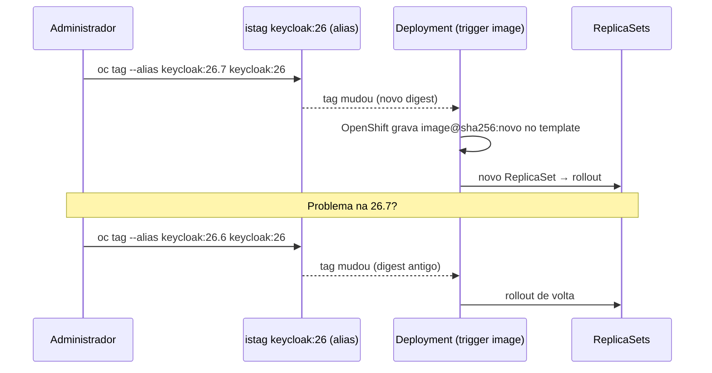

# 7.7 — Atualizações automáticas de imagem com image change triggers

| Campo | Valor |
|-------|-------|
| Curso | DO180 — OpenShift 4.22 |
| Capítulo / seção | Capítulo 7 · Seção 7.7 |
| Título original | Automatic Image Updates with OpenShift Image Change Triggers |
| Título em português | Atualizações automáticas de imagem com image change triggers |
| Objetivo | Garantir a atualização automática dos Pods usando ImageStreams com recursos de workload do Kubernetes |
| Pré-requisitos | [7.5](7.5-implantacoes-reproduziveis-com-imagestreams.md), [7.3](7.3-atualizar-imagem-e-configuracoes.md) |
| Referência | PDF p. 480–484 · Guided Exercise 7.8 p. 485–488 |

## Parte A — Entendendo o conceito

### O que falta depois da ImageStream

Uma ImageStreamTag sempre aponta para uma imagem imutável. Quando você a muda para
uma imagem nova, o Deployment que a usa **não faz rollout sozinho**. Para isso existe
o **image trigger** (*image change trigger*).

Com o trigger:

- **Atualizar** a ImageStreamTag → rollout automático para a imagem nova.
- **Reverter** a ImageStreamTag → rollout automático de volta (**rollback pela tag**).
- Tags com `--scheduled` (7.5) passam a disparar rollouts quando a origem muda.

Além de Deployments, Pods, CronJobs e Jobs também aceitam image triggers.

### Pré-requisitos (os mesmos da 7.5)

1. ImageStream no **mesmo projeto**.
2. **Lookup local** habilitado (`oc set image-lookup`).
3. Deployment referenciando a ImageStreamTag pelo **nome curto**.

### Como funciona por dentro

- O trigger é configurado **por container**. Em Deployments com vários containers,
  cada um pode observar uma tag diferente.
- O OpenShift grava a configuração na anotação **`image.openshift.io/triggers`**
  (JSON) do Deployment:
  - `from`: a ImageStreamTag observada (`kind: ImageStreamTag`, `name: keycloak:26`);
  - `fieldPath`: expressão JSONPath que localiza o campo `image` do container no template.
- Quando a tag muda, o OpenShift **escreve no campo `image`** o nome completo com o
  novo **digest**. Como o template mudou, o Deployment faz um rollout normal (7.3).

### Dois tipos de trigger em `oc set triggers`

| Tipo | Dispara rollout quando... | Controle |
|------|---------------------------|----------|
| `config` | O template do Deployment muda (env, probe, imagem...) | `oc rollout pause` desativa; `oc rollout resume` reativa |
| `image` | A ImageStreamTag observada muda | `--manual` desativa; `--auto` reativa; `--remove-all` remove |

### Aliases: "tags flutuantes" sob controle

`oc tag --alias <is:origem> <is:alias>` faz uma tag **seguir** outra (ex.:
`keycloak:26` → `keycloak:26.6`). É o equivalente controlado de uma tag flutuante:

- Criar `keycloak:26.7` **não** muda `keycloak:26`: nenhum rollout.
- **Mover** o alias (`oc tag --alias keycloak:26.7 keycloak:26`) muda `keycloak:26`:
  todos os Deployments com trigger nessa tag fazem rollout.
- Algo deu errado? **Volte o alias** para `26.6`: rollback automático.

Isso permite um fluxo de **promoção**: testar a versão nova por uma tag específica e
só então mover o alias usado em produção.

## Parte B — Modelo mental



## Parte C — Funcionamento na prática

### Preparar e configurar o trigger

```bash
oc import-image keycloak:26.6 --from quay.io/keycloak/keycloak:26.6 --confirm
oc tag --alias keycloak:26.6 keycloak:26
oc set image-lookup keycloak
oc create deployment mykeycloak --image keycloak:26
oc get deployment mykeycloak -o wide                      # coluna CONTAINERS: nome do container
oc set triggers deployment/mykeycloak --from-image keycloak:26 --containers keycloak
```

### Verificar

```bash
oc set triggers deployment/mykeycloak
#   NAME                     TYPE    VALUE                 AUTO
#   deployments/mykeycloak   config                        true
#   deployments/mykeycloak   image   keycloak:26 (keycloak) true
oc get deployment mykeycloak \
  -o jsonpath='{.metadata.annotations.image\.openshift\.io/triggers}' | jq .
```

### Promover, observar e reverter

```bash
oc create istag keycloak:26.7 --from-image quay.io/keycloak/keycloak:26.7   # nada muda ainda
oc tag --alias keycloak:26.7 keycloak:26                                     # dispara o rollout
oc rollout status deployment/mykeycloak
oc describe is keycloak                       # "26.7 (26)": o alias aponta para 26.7
oc get pods -o custom-columns=POD:.metadata.name,IMG:.status.containerStatuses[0].imageID
oc tag --alias keycloak:26.6 keycloak:26      # rollback pela tag
```

### Ligar, desligar e remover

```bash
oc set triggers deployment/mykeycloak --manual --from-image keycloak:26 --containers keycloak
oc set triggers deployment/mykeycloak --auto   --from-image keycloak:26 --containers keycloak
oc set triggers deployment/mykeycloak --remove-all
```

### Diagnóstico

| Sintoma | Causa provável |
|---------|----------------|
| A tag mudou, mas não houve rollout | Trigger ausente ou `AUTO false`; Deployment pausado (`oc rollout pause`) |
| `oc set triggers` aceito, mas a imagem não resolve | ImageStream em outro projeto ou sem lookup local |
| Rollout disparou para todos os apps ao mover um alias | Esperado: todos com trigger naquela tag são atualizados |
| Rollback com `oc rollout undo` "voltou" de novo | O controller de triggers tende a reaplicar a imagem atual da tag; para voltar de vez, reverta a **tag** |

## Parte D — Relações importantes

| A | B | Diferença essencial |
|---|---|--------------------|
| ImageStreamTag | Image trigger | Aponta para o digest × faz o Deployment seguir a tag |
| Trigger `config` | Trigger `image` | Mudança no template × mudança na tag |
| `oc rollout pause` | `oc set triggers --manual` | Pausa rollouts por configuração × desliga o trigger de imagem |
| `oc rollout undo` | Reverter a tag | Volta o template × volta a imagem de todos que seguem a tag |
| Alias de istag | Tag flutuante de registry | Você move, com histórico × o publicador move, sem aviso |
| `oc tag --alias` | `oc tag ` | Segue outra istag × aponta para uma imagem de registry |

## Parte E — Preparação para o laboratório

Atividade associada: **7.8 Guided Exercise — Automatic Image Updates with OpenShift
Image Change Triggers** (`updates-triggers`, PDF p. 485–488).

Você deve conseguir:

- Adicionar um image trigger a um Deployment.
- Alterar uma ImageStreamTag para uma imagem nova e acompanhar o rollout.
- Fazer rollback para a imagem anterior pela tag.

Ver [PRATICA-OFICIAL.md](PRATICA-OFICIAL.md#78-guided-exercise-automatic-image-updates-with-openshift-image-change-triggers).

## Parte F — Fixação

1. Você atualizou `web:prod` para uma imagem nova, mas o Deployment não mudou. O que falta?
2. Onde o OpenShift guarda a configuração do trigger e o que é o `fieldPath`?
3. Por que criar `app:2.4` não muda nada, mas mover o alias `app:2` sim?
4. Qual a forma correta de fazer rollback de um Deployment com image trigger?
5. Escreva o comando que configura o container `api` do Deployment `loja` para seguir `loja-api:stable`.

<details>
<summary>Respostas comentadas</summary>

1. Um **image trigger** no Deployment (`oc set triggers deployment/<d> --from-image web:prod --containers <c>`), além dos pré-requisitos de ImageStream no mesmo projeto, lookup local e nome curto.
2. Na anotação `image.openshift.io/triggers` do Deployment. O `fieldPath` é o JSONPath do campo `image` do container que o OpenShift atualiza.
3. Os Deployments seguem a tag `app:2`; criar outra tag não a altera. Mover o alias muda o digest de `app:2` e dispara os triggers.
4. Reverter a ImageStreamTag (ex.: mover o alias de volta), que é o método indicado pelo curso. Um `oc rollout undo` com o trigger ativo tende a ser desfeito, porque o trigger mantém o Deployment alinhado à imagem atual da tag.
5. `oc set triggers deployment/loja --from-image loja-api:stable --containers api`

</details>

## Parte G — Essencial para memorizar

- ImageStreamTag muda → sem trigger, nada acontece; com trigger, rollout automático.
- `oc set triggers deployment/<d> --from-image <is:tag> --containers <c>` (`--manual`, `--auto`, `--remove-all`).
- Anotação `image.openshift.io/triggers` com `from` e `fieldPath`.
- Triggers `config` (pause/resume) e `image`.
- `oc tag --alias <is:origem> <is:alias>`: promoção e rollback movendo o alias.
- `oc create istag` × `oc import-image` × `oc tag`.

---
[← 7.5 ImageStreams](7.5-implantacoes-reproduziveis-com-imagestreams.md) | [Índice do capítulo](README.md) | [Próximo: Prática oficial →](PRATICA-OFICIAL.md)
