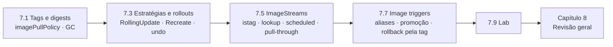

# Capítulo 7 — Manage Application Updates

**Título em português:** Gerenciar atualizações de aplicações
**Status:** ✅ concluído e validado
**Referência:** PDF p. 437–494

## Objetivo do capítulo

Gerenciar atualizações e rollbacks **reproduzíveis** de código e de configuração das
aplicações.

## Por que este capítulo importa

Colocar uma aplicação no ar é só o começo: ela será atualizada muitas vezes. Aqui
você aprende a saber **exatamente qual imagem roda** (digest), a trocar versões
**sem indisponibilidade** (estratégias e rollouts), a **voltar** com segurança
(rollback) e a usar os recursos exclusivos do OpenShift, **ImageStreams** e
**image triggers**, para promover e reverter versões de forma controlada.

## Seções e atividades (ordem oficial)

| Seção | Tipo | Título original | Material | PDF |
|-------|------|-----------------|----------|-----|
| 7.1 | Conceito | Container Image Identity and Tags | [lição](7.1-identidade-e-tags-de-imagens.md) | p. 438–444 |
| 7.2 | Guided Exercise | Container Image Identity and Tags | [prática](PRATICA-OFICIAL.md#72-guided-exercise-container-image-identity-and-tags) | p. 445–452 |
| 7.3 | Conceito | Update Application Image and Settings | [lição](7.3-atualizar-imagem-e-configuracoes.md) | p. 453–460 |
| 7.4 | Guided Exercise | Update Application Image and Settings | [prática](PRATICA-OFICIAL.md#74-guided-exercise-update-application-image-and-settings) | p. 461–466 |
| 7.5 | Conceito | Reproducible Deployments with OpenShift Image Streams | [lição](7.5-implantacoes-reproduziveis-com-imagestreams.md) | p. 467–476 |
| 7.6 | Guided Exercise | Reproducible Deployments with OpenShift Image Streams | [prática](PRATICA-OFICIAL.md#76-guided-exercise-reproducible-deployments-with-openshift-image-streams) | p. 477–479 |
| 7.7 | Conceito | Automatic Image Updates with OpenShift Image Change Triggers | [lição](7.7-triggers-de-mudanca-de-imagem.md) | p. 480–484 |
| 7.8 | Guided Exercise | Automatic Image Updates with OpenShift Image Change Triggers | [prática](PRATICA-OFICIAL.md#78-guided-exercise-automatic-image-updates-with-openshift-image-change-triggers) | p. 485–488 |
| 7.9 | Lab | Manage Application Updates | [prática](PRATICA-OFICIAL.md#79-lab-manage-application-updates) | p. 489–493 |
| 7.10 | Summary | Summary | [RESUMO.md](RESUMO.md) | p. 494 |

> Este capítulo **não tem quiz** oficial.

## Arquivos do capítulo

- [PRATICA-OFICIAL.md](PRATICA-OFICIAL.md): ponte com as atividades oficiais.
- [REVISAO.md](REVISAO.md): questões autorais integradas.
- [RESUMO.md](RESUMO.md): síntese e tabela de comandos.

## Pré-requisitos recomendados

[3.3 — Imagens](../03-containers-e-pods/3.3-encontrar-e-inspecionar-imagens.md) ·
[4.3 — Workloads](../04-deploy-e-redes/4.3-workloads-de-longa-e-curta-duracao.md) ·
[6.3 — Probes](../06-confiabilidade/6.3-health-probes.md)

## Checklist

- [ ] 7.1 lida e Parte F respondida
- [ ] 7.2 Guided Exercise `updates-ids` concluído
- [ ] 7.3 lida e Parte F respondida
- [ ] 7.4 Guided Exercise `updates-rollout` concluído
- [ ] 7.5 lida e Parte F respondida
- [ ] 7.6 Guided Exercise `updates-imagestreams` concluído
- [ ] 7.7 lida e Parte F respondida
- [ ] 7.8 Guided Exercise `updates-triggers` concluído
- [ ] 7.9 Lab `updates-review` com `lab grade` aprovado
- [ ] [REVISAO.md](REVISAO.md) respondida
- [ ] Registro no [diário de laboratórios](../../progresso/diario-de-laboratorios.md)

---
[← Capítulo 6](../06-confiabilidade/README.md) | [Índice geral](../../README.md) | [Próximo: 7.1 Identidade e tags →](7.1-identidade-e-tags-de-imagens.md)
